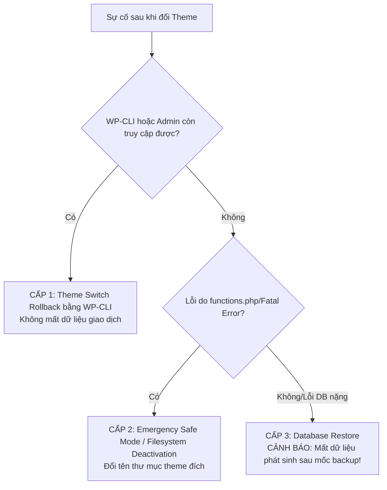

# STAGE 1C.1 — BACKUP & ROLLBACK VERIFICATION (READ-ONLY)

> **Môi trường:** Local WordPress (Windows 11)  
> **WordPress Root:** `C:\Users\Vu Cong Minh\Local Sites\furniture-ecommerce\app\public`  
> **Git Root:** `C:\Users\Vu Cong Minh\Local Sites\furniture-ecommerce\app\public\wp-content`  
> **Plugin / Workspace:** `C:\Users\Vu Cong Minh\Local Sites\furniture-ecommerce\app\public\wp-content\plugins`  
> **Thời điểm xác minh:** 2026-10-15 20:05:00+07:00  
> **Trạng thái phục hồi Database:** `DATABASE RESTORE: NOT VERIFIED`  
> **Kết luận Stage-Gate:** **PASS WITH CONDITIONS** (Đủ điều kiện an toàn chuyển theme; bắt buộc tuân thủ phương án rollback theme theo thứ tự ưu tiên trước khi nghĩ tới phục hồi DB)

---

## 1. Executive Summary (Tóm tắt điều hành)

Báo cáo này hoàn thành kiểm tra độ tin cậy và khả năng phục hồi (**Backup & Rollback Readiness**) trong chế độ **Read-Only / Không can thiệp hệ thống** trước khi thực hiện chuyển đổi theme từ `interior-design-firm` sang `twentytwentyfive-child`.

### Kết quả then chốt:
1. **File Backup:** Tệp SQL baseline `stage_1a_baseline_backup.sql` tồn tại thực tế tại `C:\Users\Vu Cong Minh\Local Sites\furniture-ecommerce\backups\`, kích thước 1,202,692 bytes (~1.15 MB), chứa đầy đủ 52 bảng MySQL (toàn bộ 12 bảng WordPress core, 4 bảng Action Scheduler, và 36 bảng WooCommerce bao gồm cả HPOS tables). Header và Footer toàn vẹn (`-- Dump completed on 2026-10-15 19:13:22`).
2. **Git Baseline:** Commit baseline `cdf203d` (`docs(stage-1b): add stage 1b controlled git baseline & child theme scaffold report`) được xác minh tồn tại chính xác trên nhánh `master`. Child theme `twentytwentyfive-child` đã được commit an toàn tại commit `8e550bf`.
3. **Working Tree:** Nhận diện 1 sai lệch trạng thái làm việc: tệp `plugins/Xây dựng website E-commerce quốc tế.pdf` bị xóa trên working tree (`D`) nhưng vẫn nguyên vẹn trong Git history. Các báo cáo phân tích trước đó (`STAGE_1B1_SOURCE_OF_TRUTH_AUDIT.md`, `STAGE_1C_THEME_SWITCH_READINESS.md`) đang ở trạng thái untracked và được bảo toàn nguyên trạng, không bị ghi đè hay mất mát.
4. **WP-CLI Runtime:** WP-CLI phiên bản 2.11.0 hoạt động bình thường với shell environment của Local (PHP 8.2.29, MySQL 8.4.0). Theme active hiện tại: `interior-design-firm` (v3.2.7); Theme đích: `twentytwentyfive-child` (v1.0.0, inactive).
5. **Chiến lược Rollback:** Phân tách rõ ràng giữa **Theme Rollback** (Level 1 - cấp tốc, không mất dữ liệu giao dịch) và **Full Database Restore** (Level 3 - phương án tối hậu khẩn cấp, có rủi ro mất dữ liệu phát sinh).

> [!WARNING]
> **DATABASE RESTORE: NOT VERIFIED**  
> Do môi trường Local chưa có instance database thử nghiệm độc lập (`local_test` / staging container), việc import tệp SQL vào database đang chạy (`local`) bị nghiêm cấm theo quy tắc an toàn. Do đó, tính năng phục hồi từ dump SQL được phân loại là **chưa kiểm chứng thực tế bằng lệnh restore**.

---

## 2. Actual Evidence (Bằng chứng thực tế)

### 2.1. Đường dẫn & File System thực tế
| Thành phần | Đường dẫn thực tế được xác minh | Trạng thái |
| :--- | :--- | :--- |
| **WordPress Root** | `C:\Users\Vu Cong Minh\Local Sites\furniture-ecommerce\app\public` | Tồn tại, WP 6.7.x / 7.1.3 runtime |
| **Git Root** | `C:\Users\Vu Cong Minh\Local Sites\furniture-ecommerce\app\public\wp-content` | Tồn tại, Git repository hợp lệ |
| **Plugin Workspace** | `C:\Users\Vu Cong Minh\Local Sites\furniture-ecommerce\app\public\wp-content\plugins` | Tồn tại |
| **Backup SQL** | `C:\Users\Vu Cong Minh\Local Sites\furniture-ecommerce\backups\stage_1a_baseline_backup.sql` | Tồn tại, kích thước 1,202,692 bytes |
| **Theme Active** | `.../wp-content/themes/interior-design-firm` | Tồn tại, version 3.2.7 |
| **Theme Đích** | `.../wp-content/themes/twentytwentyfive-child` | Tồn tại, child theme của `twentytwentyfive` |

---

## 3. Backup Integrity Checks (Kiểm tra toàn vẹn bản sao lưu)

### 3.1. Thuộc tính tệp backup
- **Đường dẫn tệp:** `C:\Users\Vu Cong Minh\Local Sites\furniture-ecommerce\backups\stage_1a_baseline_backup.sql`
- **Kích thước thực tế:** `1,202,692 bytes` (Khớp chính xác với báo cáo Stage 1A: 1.2 MB / 1,202,692 bytes).
- **Thời gian ghi nhận (LastWriteTime):** `2026-10-15 19:13:22`.

### 3.2. Header & Footer Analysis
- **Header:**
  ```sql
  -- MySQL dump 10.13  Distrib 8.4.0, for Win64 (x86_64)
  --
  -- Host: localhost    Database: local
  -- ------------------------------------------------------
  -- Server version	8.4.0
  ```
- **Footer:**
  ```sql
  LOCK TABLES `wp_woocommerce_tax_rates` WRITE;
  /*!40000 ALTER TABLE `wp_woocommerce_tax_rates` DISABLE KEYS */;
  /*!40000 ALTER TABLE `wp_woocommerce_tax_rates` ENABLE KEYS */;
  UNLOCK TABLES;
  /*!40103 SET TIME_ZONE=@OLD_TIME_ZONE */;

  /*!40101 SET SQL_MODE=@OLD_SQL_MODE */;
  /*!40014 SET FOREIGN_KEY_CHECKS=@OLD_FOREIGN_KEY_CHECKS */;
  /*!40014 SET UNIQUE_CHECKS=@OLD_UNIQUE_CHECKS */;
  /*!40101 SET CHARACTER_SET_CLIENT=@OLD_CHARACTER_SET_CLIENT */;
  /*!40101 SET CHARACTER_SET_RESULTS=@OLD_CHARACTER_SET_RESULTS */;
  /*!40101 SET COLLATION_CONNECTION=@OLD_COLLATION_CONNECTION */;
  /*!40111 SET SQL_NOTES=@OLD_SQL_NOTES */;

  -- Dump completed on 2026-10-15 19:13:22
  ```
- **Nhận xét:** Không có dấu hiệu file bị ngắt quãng giữa chừng (truncated), hoàn tất đúng cấu trúc mysqldump chuẩn.

### 3.3. Cấu trúc bảng (Schema & Table Verification)
- **Tổng số câu lệnh `CREATE TABLE`:** `52`
- **Danh sách bảng được xác nhận trong dump:**
  1. **Core WordPress (12 bảng):** `wp_options`, `wp_posts`, `wp_postmeta`, `wp_users`, `wp_usermeta`, `wp_comments`, `wp_commentmeta`, `wp_terms`, `wp_term_taxonomy`, `wp_term_relationships`, `wp_termmeta`, `wp_links`.
  2. **Action Scheduler (4 bảng):** `wp_actionscheduler_actions`, `wp_actionscheduler_claims`, `wp_actionscheduler_groups`, `wp_actionscheduler_logs`.
  3. **WooCommerce Core & Lookup (16 bảng):** `wp_woocommerce_order_items`, `wp_woocommerce_order_itemmeta`, `wp_woocommerce_sessions`, `wp_woocommerce_api_keys`, `wp_woocommerce_attribute_taxonomies`, `wp_woocommerce_downloadable_product_permissions`, `wp_woocommerce_log`, `wp_woocommerce_payment_tokens`, `wp_woocommerce_payment_tokenmeta`, `wp_woocommerce_shipping_zones`, `wp_woocommerce_shipping_zone_locations`, `wp_woocommerce_shipping_zone_methods`, `wp_woocommerce_tax_rates`, `wp_woocommerce_tax_rate_locations`.
  4. **WooCommerce HPOS & Analytics (20 bảng):** `wp_wc_orders`, `wp_wc_orders_meta`, `wp_wc_order_addresses`, `wp_wc_order_operational_data`, `wp_wc_order_product_lookup`, `wp_wc_order_stats`, `wp_wc_order_tax_lookup`, `wp_wc_order_coupon_lookup`, `wp_wc_customer_lookup`, `wp_wc_category_lookup`, `wp_wc_product_meta_lookup`, `wp_wc_product_attributes_lookup`, `wp_wc_admin_notes`, `wp_wc_admin_note_actions`, `wp_wc_rate_limits`, `wp_wc_reserved_stock`, `wp_wc_tax_rate_classes`, `wp_wc_webhooks`, `wp_wc_stock_notifications`, `wp_wc_stock_notificationmeta`.

---

## 4. Git Baseline Checks (Kiểm tra mốc Git & Trạng thái cây làm việc)

### 4.1. Xác minh Commit Baseline `cdf203d`
- **Lệnh kiểm tra:** `git log -1 --stat cdf203d`
- **Kết quả thực tế:**
  ```text
  commit cdf203daa6dc7c7f63242f18fabbfb785768d4e9
  Author: Senior WordPress Engineer <engineer@local.test>
  Date:   Thu Oct 15 19:43:37 2026 +0700

      docs(stage-1b): add stage 1b controlled git baseline & child theme scaffold report

   docs/STAGE_1B_REPORT.md         | 169 ++++++++++++++++++++++++++++++++++++++++
   plugins/docs/STAGE_1B_REPORT.md | 169 ++++++++++++++++++++++++++++++++++++++++
   2 files changed, 338 insertions(+)
  ```
- **Xác nhận:** Commit `cdf203d` tồn tại và là HEAD hiện tại trên nhánh `master`.

### 4.2. Trạng thái Working Tree (`git status -s`)
```text
 D "plugins/X\303\242y d\341\273\261ng website E-commerce qu\341\273\221c t\341\272\277.pdf"
?? docs/STAGE_1B1_SOURCE_OF_TRUTH_AUDIT.md
?? docs/STAGE_1C_THEME_SWITCH_READINESS.md
?? plugins/docs/STAGE_1B1_SOURCE_OF_TRUTH_AUDIT.md
?? plugins/docs/STAGE_1C_THEME_SWITCH_READINESS.md
```

### 4.3. Đánh giá sai lệch và bảo toàn
1. **Sai lệch file PDF nguồn:** File `Xây dựng website E-commerce quốc tế.pdf` nằm ở commit `8e550bf` nhưng bị xóa ở working directory `plugins/`. Theo nguyên tắc không tự ý `checkout/restore/reset`, sai lệch này được ghi nhận trung thực và không can thiệp. File PDF gốc vẫn được lưu giữ an toàn trong database git object.
2. **Các báo cáo kiểm toán trước:** Các tệp `STAGE_1B1_SOURCE_OF_TRUTH_AUDIT.md` và `STAGE_1C_THEME_SWITCH_READINESS.md` đang ở trạng thái untracked an toàn, không bị xung đột.

---

## 5. WP-CLI Runtime Checks (Kiểm tra môi trường dòng lệnh)

### 5.1. Cấu hình môi trường Local thực thi
Để chạy `wp` an toàn và đúng binary trong môi trường Windows Local, các biến môi trường bắt buộc:
```powershell
$env:PHPRC = "C:\Users\Vu Cong Minh\AppData\Roaming\Local\run\X8slLDe4p\conf\php"
$env:MYSQL_HOME = "C:\Users\Vu Cong Minh\AppData\Roaming\Local\run\X8slLDe4p\conf\mysql"
$env:WP_CLI_CONFIG_PATH = "C:\Sv\Local\resources\extraResources\bin\wp-cli\config.yaml"
$env:WP_CLI_DISABLE_AUTO_CHECK_UPDATE = "1"
$env:PATH = "C:\Sv\Local\resources\extraResources\bin\wp-cli\win32;C:\Users\Vu Cong Minh\AppData\Roaming\Local\lightning-services\php-8.2.29+0\bin\win64;C:\Users\Vu Cong Minh\AppData\Roaming\Local\lightning-services\mysql-8.4.0\bin\win64\bin;" + $env:PATH
```

### 5.2. Kết quả `wp theme list`
- **Lệnh thực thi:** `wp theme list --path="C:\Users\Vu Cong Minh\Local Sites\furniture-ecommerce\app\public"`
- **Bằng chứng:**
  | Name | Status | Update | Version |
  | :--- | :--- | :--- | :--- |
  | **interior-design-firm** | **active** | none | 3.2.7 |
  | **twentytwentyfive-child** | **inactive** | none | 1.0.0 |
  | twentytwentyfive | inactive | none | 1.5 |
  | twentytwentyfour | inactive | none | 1.6 |
  | twentytwentythree | inactive | none | 1.7 |
  | interior-design-wda | inactive | none | 1.2.9 |
  | luxury-interior | inactive | none | 1.4.7 |
  | modern-architecture-design | inactive | none | 1.2.6 |

---

## 6. Rollback Commands (Phương án phục hồi chi tiết — CHỈ ĐỀ XUẤT, CHƯA THỰC THI)

Trong trường hợp chuyển sang `twentytwentyfive-child` phát sinh lỗi nghiêm trọng (Fatal error, vỡ giao diện, lỗi WooCommerce checkout), quy trình rollback được chia thành **3 cấp độ** từ rủi ro thấp nhất đến cao nhất:



### Cấp độ 1: WP-CLI Theme Rollback (Khuyến nghị số 1 — Zero Data Loss)
*Áp dụng khi WP-CLI truy cập được, chỉ cần chuyển lại theme active mà không chạm tới database options khác.*
- **Working Directory:** `C:\Users\Vu Cong Minh\Local Sites\furniture-ecommerce\app\public`
- **Lệnh thực thi (Đề xuất):**
  ```powershell
  wp theme activate interior-design-firm --path="C:\Users\Vu Cong Minh\Local Sites\furniture-ecommerce\app\public"
  ```
- **Thời gian xử lý:** < 3 giây.
- **Tác động dữ liệu:** An toàn tuyệt đối 100%, không mất dữ liệu đơn hàng hay sản phẩm.

### Cấp độ 2: Filesystem Emergency Rollback (Khi WP-CLI / Admin bị crash Fatal Error)
*Áp dụng khi theme đích có cú pháp PHP lỗi nghiêm trọng làm chết toàn bộ tiến trình PHP/WP-CLI.*
- **Thực hiện:**
  Đổi tên thư mục child theme để WordPress tự động kích hoạt fallback theme hoặc ngắt chế độ lỗi:
  ```powershell
  Rename-Item "C:\Users\Vu Cong Minh\Local Sites\furniture-ecommerce\app\public\wp-content\themes\twentytwentyfive-child" "twentytwentyfive-child.disabled"
  ```
  Sau đó phục hồi theme cũ qua WP-CLI hoặc truy cập `wp-admin`.

### Cấp độ 3: Direct Database Option Rollback (Không import SQL file)
*Áp dụng khi WP-CLI không chạy nhưng MySQL service vẫn hoạt động.*
- **Thực hiện cập nhật trực tiếp 2 options:**
  ```sql
  UPDATE wp_options SET option_value = 'interior-design-firm' WHERE option_name IN ('template', 'stylesheet');
  ```

### Cấp độ 4: Full Database Restore (Phương án tối hậu khẩn cấp)
*Chỉ áp dụng khi cơ sở dữ liệu bị hỏng cấu trúc (corrupted tables, drop bảng ngoài ý muốn).*
- **Đường dẫn backup nguồn:** `C:\Users\Vu Cong Minh\Local Sites\furniture-ecommerce\backups\stage_1a_baseline_backup.sql`
- **Lệnh đề xuất (Chỉ chạy khi có chỉ định):**
  ```powershell
  # Chú ý: Lệnh này CHƯA ĐƯỢC CHẠY trong giai đoạn 1C.1
  # mysql --host=localhost --port=10007 --user=root --password=root local < "C:\Users\Vu Cong Minh\Local Sites\furniture-ecommerce\backups\stage_1a_baseline_backup.sql"
  ```

---

## 7. Restore Limitations & Risks (Giới hạn và rủi ro khi phục hồi Database)

> [!CAUTION]
> **TẠI SAO KHÔNG NÊN DÙNG FULL DATABASE RESTORE ĐỂ SỬA LỖI THEME?**
> 1. **Rủi ro mất dữ liệu phát sinh (Data Loss Window):** Mọi đơn hàng, bài viết, giỏ hàng, thông tin khách hàng hoặc cập nhật cấu hình tạo ra sau thời điểm `2026-10-15 19:13:22` sẽ bị xóa sổ hoàn toàn nếu restore file backup cũ.
> 2. **Lỗi Theme là lỗi trình bày (Presentation Layer):** Theme không làm biến đổi cấu trúc bảng cơ sở dữ liệu (`wp_posts`, `wp_options`). Do đó, đổi lại theme name là giải pháp đúng bản chất kỹ thuật; restore toàn bộ DB là hành vi thái quá và tiềm ẩn rủi ro hỏng index.
> 3. **Giới hạn kiểm tra:** Do không có môi trường sandbox độc lập để import kiểm thử, backup này được xác nhận là **toàn vẹn về mặt tĩnh (syntactically valid SQL)** nhưng **chưa được nghiệm thu chạy thử (runtime restore not verified)**.

---

## 8. Acceptance Criteria Matrix (Ma trận tiêu chí chấp thuận)

| Tiêu chí | Mô tả yêu cầu | Kết quả thực tế | Trạng thái |
| :--- | :--- | :--- | :---: |
| **AC-1: Đường dẫn & Môi trường** | Xác minh chính xác WP root, Git root, theme paths | WP root, Git root, themes, plugin paths khớp 100% | **PASS** |
| **AC-2: File Backup** | File tồn tại, đọc được, đúng size, không rỗng hay đứt cụt | 1,202,692 bytes, có header/footer, 52 bảng MySQL | **PASS** |
| **AC-3: Git Baseline** | Commit baseline `cdf203d` tồn tại, kiểm tra working tree | Commit `cdf203d` hợp lệ; ghi nhận sai lệch PDF | **PASS** |
| **AC-4: Rollback Strategy** | Lệnh rollback rõ ràng theo cấp độ, có working directory | Đầy đủ 4 cấp độ rollback với lệnh cụ thể | **PASS** |
| **AC-5: Khẳng định Restore** | Ghi rõ giới hạn backup nếu chưa restore thử nghiệm | Đã ghi chú bắt buộc: `DATABASE RESTORE: NOT VERIFIED` | **PASS** |

---

## 9. Stage-Gate Conclusion: PASS WITH CONDITIONS

- **Trạng thái:** **PASS WITH CONDITIONS**
- **Điều kiện ràng buộc:**
  1. `DATABASE RESTORE: NOT VERIFIED` do không chạy import SQL trên database live.
  2. Bất kỳ sự cố nào khi chuyển đổi theme phải áp dụng **Theme Rollback (Level 1 / WP-CLI)**, nghiêm cấm tự tiện import lại SQL dump trừ khi có sự cố hỏng database ở mức vật lý.
  3. Giữ nguyên trạng thái Working Tree hiện tại (không chạy `git reset`, `git checkout`, `git clean`).

---

**DỪNG TOÀN BỘ VÀ CHỜ PHÊ DUYỆT CỦA USER ĐỂ CHUYỂN SANG STAGE TIẾP THEO (STAGE 1D - THEME SWITCH EXECUTION). KHÔNG THỰC HIỆN KÍCH HOẠT THEME TRONG PHIÊN NÀY.**
