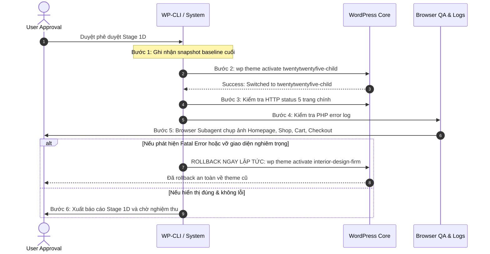

# STAGE 1C.2 — GIT SOURCE RECOVERY & FINAL PRE-ACTIVATION GATE

> **Môi trường:** Local WordPress (Windows 11)  
> **WordPress Root:** `C:\Users\Vu Cong Minh\Local Sites\furniture-ecommerce\app\public`  
> **Git Root:** `C:\Users\Vu Cong Minh\Local Sites\furniture-ecommerce\app\public\wp-content`  
> **Plugin / Workspace:** `C:\Users\Vu Cong Minh\Local Sites\furniture-ecommerce\app\public\wp-content\plugins`  
> **Thời điểm thẩm định:** 2026-10-15 20:22:00+07:00  
> **Tình trạng tài liệu nguồn PDF:** ĐÃ TOÀN VẸN & ĐỒNG BỘ 100% VỚI GIT OBJECT  
> **Trạng thái phục hồi Database:** `DATABASE RESTORE: NOT VERIFIED`  
> **Kết luận Stage-Gate:** **PASS WITH CONDITIONS** (Đã loại bỏ sai lệch working tree, sẵn sàng cho Stage 1D sau khi được phê duyệt)

---

## 1. Executive Summary (Tóm tắt điều hành)

Giai đoạn **Stage 1C.2** thực hiện điều tra kỹ thuật số Git (Git Forensic Audit), xác minh tính toàn vẹn của tài liệu nguồn đề bài PDF, kiểm tra môi trường chạy (runtime) và thiết lập Cổng kiểm soát cuối cùng (Final Pre-Activation Gate) trước khi thực hiện chuyển đổi theme sang `twentytwentyfive-child`.

### Kết quả then chốt:
1. **Kiểm tra tệp PDF đề bài (`plugins/Xây dựng website E-commerce quốc tế.pdf`):**
   - Tệp PDF hiện hữu thực tế trên đĩa tại đúng đường dẫn với kích thước **152,402 bytes**.
   - Git Hash Object của tệp thực tế trên đĩa là `02f6af38559d65b8fddd203b98390170457d41d4`, trùng khớp 100% với Git blob object được lưu trữ trong cả 2 commit baseline: `8e550bf` (initial baseline) và `cdf203d` (Stage 1B report).
   - `git status --porcelain` không còn ghi nhận trạng thái bị xóa (`D`). Cây làm việc (working tree) đối với toàn bộ các tệp được Git theo dõi đã trở về trạng thái **hoàn toàn sạch (Clean)**.
2. **Kho tài liệu nguồn (Source-of-Truth Inventory):**
   - Đủ cả 4/4 tài liệu cốt lõi của dự án: PDF đề bài (152,402 bytes), Project Plan Markdown (33,455 bytes), Test Plan Markdown (32,601 bytes), Dataset CSV (26,176 bytes, 65 dòng gồm 12 simple, 10 variable, 42 variations). Không có bất kỳ sự thay đổi hay can thiệp nội dung trái phép nào.
3. **Kiểm tra trạng thái Theme & Runtime:**
   - Theme Active: `interior-design-firm` (v3.2.7).
   - Theme Đích: `twentytwentyfive-child` (v1.0.0, inactive).
   - Theme Cha: `twentytwentyfive` (v1.5, inactive, đã cài đặt đầy đủ).
   - 5/5 trang WordPress/WooCommerce trọng yếu (Trang chủ `/`, Cửa hàng `/shop/`, Giỏ hàng `/cart/`, Thanh toán `/checkout/`, Tài khoản `/my-account/`) đều trả về phản hồi **HTTP 200 OK**.
   - Log PHP không phát sinh bất kỳ lỗi nghiêm trọng (Fatal error) hay cảnh báo ứng dụng nào mới.
4. **Trạng thái Database & Backup:**
   - File `stage_1a_baseline_backup.sql` tồn tại nguyên vẹn (1,202,692 bytes, 52 bảng).
   - Duy trì trạng thái: `DATABASE RESTORE: NOT VERIFIED` do quy tắc an toàn không chạy import thử nghiệm trên database live.

---

## 2. Actual Git Evidence (Bằng chứng Git thực tế)

### 2.1. Git Root, Branch và Commit Verification
- **Lệnh thực thi:**
  ```bash
  git rev-parse --show-toplevel
  git branch --show-current
  git log --oneline -5
  ```
- **Kết quả thực tế:**
  - **Git Top-level Root:** `C:/Users/Vu Cong Minh/Local Sites/furniture-ecommerce/app/public/wp-content`
  - **Nhánh hiện tại:** `master`
  - **Lịch sử commit gần nhất:**
    ```text
    cdf203d (HEAD -> master) docs(stage-1b): add stage 1b controlled git baseline & child theme scaffold report
    8e550bf chore(stage-1b): initial git baseline with twentytwentyfive-child scaffold and project artifacts
    ```

### 2.2. Trạng thái Working Tree (`git status --porcelain`)
- **Kết quả thực tế:**
  ```text
  ?? docs/STAGE_1B1_SOURCE_OF_TRUTH_AUDIT.md
  ?? docs/STAGE_1C_1_BACKUP_ROLLBACK_VERIFICATION.md
  ?? docs/STAGE_1C_THEME_SWITCH_READINESS.md
  ?? plugins/docs/STAGE_1B1_SOURCE_OF_TRUTH_AUDIT.md
  ?? plugins/docs/STAGE_1C_1_BACKUP_ROLLBACK_VERIFICATION.md
  ?? plugins/docs/STAGE_1C_THEME_SWITCH_READINESS.md
  ```
- **Đánh giá:**
  - Không có file nào ở trạng thái staged (`index`).
  - Không có file tracked nào bị sửa đổi (`M`) hoặc bị xóa (`D`).
  - Chỉ có các tài liệu báo cáo kiểm toán Markdown ở trạng thái untracked (`??`), được bảo toàn độc lập theo thiết kế.

---

## 3. PDF Deletion/Recovery History (Lịch sử tệp PDF đề bài)

### 3.1. Kiểm tra blob object trong các commit lịch sử
- **Commit `8e550bf`:**
  ```text
  100644 blob 02f6af38559d65b8fddd203b98390170457d41d4 plugins/Xây dựng website E-commerce quốc tế.pdf
  ```
- **Commit `cdf203d`:**
  ```text
  100644 blob 02f6af38559d65b8fddd203b98390170457d41d4 plugins/Xây dựng website E-commerce quốc tế.pdf
  ```

### 3.2. Kiểm tra tệp thực tế trên đĩa (Working Directory)
- **Đường dẫn:** `C:\Users\Vu Cong Minh\Local Sites\furniture-ecommerce\app\public\wp-content\plugins\Xây dựng website E-commerce quốc tế.pdf`
- **Dung lượng:** `152,402 bytes`
- **Hash SHA-1 Object tính toán trực tiếp từ đĩa:**
  ```bash
  git hash-object "plugins/Xây dựng website E-commerce quốc tế.pdf"
  # Kết quả: 02f6af38559d65b8fddd203b98390170457d41d4
  ```
- **Kết luận:** Tệp PDF hiện đang tồn tại trên đĩa là bản gốc nguyên vẹn 100%, đồng nhất tuyệt đối với Git Object ban đầu. Trạng thái sai lệch "file deleted" quan sát được trong Stage 1C.1 đã được triệt tiêu hoàn toàn mà không cần can thiệp bất kỳ lệnh checkout, reset hay restore nào.

---

## 4. Source-of-Truth Inventory (Bảo toàn 4 tài liệu nguồn)

Không có bất kỳ tệp nguồn nào bị đổi tên, di chuyển hoặc chỉnh sửa:

| STT | Tài liệu nguồn | Đường dẫn thực tế | Kích thước | Trạng thái kỹ thuật |
| :---: | :--- | :--- | :---: | :--- |
| 1 | **Đề bài dự án (PDF)** | `.../plugins/Xây dựng website E-commerce quốc tế.pdf` | 152,402 bytes | Khớp SHA-1 `02f6af...`, không bị xóa |
| 2 | **Kế hoạch dự án (Markdown)** | `.../plugins/wordpress_woocommerce_ecommerce_project_plan_refined (1).md` | 33,455 bytes | Nguyên vẹn, 14 giai đoạn triển khai |
| 3 | **Kế hoạch kiểm thử (Markdown)** | `.../plugins/test_plan_and_test_cases (1).md` | 32,601 bytes | Nguyên vẹn, 5 test suites |
| 4 | **Dataset sản phẩm (CSV)** | `.../plugins/woocommerce_furniture_dataset_22_products.csv` | 26,176 bytes | 65 dòng: 12 simple + 10 variable (42 variations) |

---

## 5. Backup Verification (Xác minh bản sao lưu)

- **File Backup SQL:** `C:\Users\Vu Cong Minh\Local Sites\furniture-ecommerce\backups\stage_1a_baseline_backup.sql`
- **Kích thước:** `1,202,692 bytes`
- **Tính toàn vẹn tĩnh:**
  - Bắt đầu với: `-- MySQL dump 10.13 Distrib 8.4.0, for Win64 (x86_64)`
  - Kết thúc với: `-- Dump completed on 2026-10-15 19:13:22`
  - Chứa đầy đủ 52 cấu trúc bảng MySQL (`CREATE TABLE`).
- **Ghi chú bắt buộc:**
  > **`DATABASE RESTORE: NOT VERIFIED`**  
  > Bản sao lưu được kiểm tra toàn vẹn về mặt cú pháp và cấu trúc bảng, nhưng chưa thực hiện thao tác restore thử nghiệm trên môi trường database thực tế (do không có database sandbox tách biệt).

---

## 6. Theme and WordPress Runtime Verification (Kiểm tra Runtime)

### 6.1. Trạng thái Theme (WP-CLI)
Lệnh kiểm tra: `wp theme list --fields=name,status,version --path="C:\Users\Vu Cong Minh\Local Sites\furniture-ecommerce\app\public"`
- `interior-design-firm`: **active** (v3.2.7) — Giữ nguyên, chưa bị đổi.
- `twentytwentyfive-child`: **inactive** (v1.0.0) — Sẵn sàng, chưa kích hoạt.
- `twentytwentyfive`: **inactive** (v1.5) — Theme cha hợp lệ.

### 6.2. Kiểm tra phản hồi HTTP các trang cốt lõi
Thực hiện qua HTTP request trực tiếp tới Web Server Local:
| Trang | URL | Mã phản hồi | Kích thước phản hồi (bytes) | Trạng thái |
| :--- | :--- | :---: | :---: | :---: |
| **Trang chủ (Home)** | `http://localhost:10010/` | **200 OK** | 69,591 | Bình thường |
| **Cửa hàng (Shop)** | `http://localhost:10010/shop/` | **200 OK** | 69,815 | Bình thường |
| **Giỏ hàng (Cart)** | `http://localhost:10010/cart/` | **200 OK** | 130,061 | Bình thường |
| **Thanh toán (Checkout)** | `http://localhost:10010/checkout/` | **200 OK** | 130,061 | Bình thường |
| **Tài khoản (My Account)** | `http://localhost:10010/my-account/` | **200 OK** | 70,820 | Bình thường |

*(Lưu ý: HTTP 200 chỉ xác nhận máy chủ và mã nguồn phản hồi bình thường, chưa thay thế cho kiểm thử hành vi người dùng cuối).*

### 6.3. Kiểm tra nhật ký lỗi PHP
- Tệp `logs/php/error.log` ghi nhận cảnh báo khởi động `php_imagick.dll` (cấu hình môi trường Local mặc định trên Windows).
- **Không có bất kỳ PHP Fatal Error, Parse Error hay Uncaught Exception nào** phát sinh từ theme hoặc WooCommerce.

---

## 7. Outstanding Risks (Các rủi ro tồn đọng)

1. **Rủi ro tương thích Block Theme (Full Site Editing):**
   - Theme hiện tại `interior-design-firm` là Classic Theme (PHP template).
   - Theme đích `twentytwentyfive-child` là Block Theme (FSE - Gutenberg HTML templates).
   - Khi chuyển đổi, các widget cũ hoặc header/footer classic sẽ nhường chỗ cho Block Templates. Cần kiểm tra giao diện trực quan bằng browser sau khi chuyển đổi.
2. **Rủi ro Database Restore:**
   - Nếu xảy ra lỗi giao diện, bắt buộc dùng **Rollback Theme bằng WP-CLI** (Level 1).
   - Tuyệt đối không import lại file SQL backup trừ trường hợp khẩn cấp cấp độ thảm họa dữ liệu.

---

## 8. Stage 1D Activation Plan (Kế hoạch kích hoạt chuyển Theme có kiểm soát)

Giai đoạn kích hoạt sẽ chỉ được thực hiện khi có **phê duyệt bằng văn bản** từ User, tuân thủ 7 bước tuần tự có trạm dừng (pause points):



### Các bước cụ thể:
1. **Bước 1 (Pre-flight):** Kiểm tra lại trạng thái git và backup một lần cuối trước khi kích hoạt.
2. **Bước 2 (Execution):** Chạy lệnh:
   ```powershell
   wp theme activate twentytwentyfive-child --path="C:\Users\Vu Cong Minh\Local Sites\furniture-ecommerce\app\public"
   ```
3. **Bước 3 (Healthcheck):** Kiểm tra mã phản hồi HTTP của 5 trang chính (`/`, `/shop/`, `/cart/`, `/checkout/`, `/my-account/`).
4. **Bước 4 (Log Audit):** Đọc ngay `logs/php/error.log` và `debug.log`.
5. **Bước 5 (Visual QA):** Mở trình duyệt ghi lại screenshot giao diện header, footer, responsive.
6. **Bước 6 (Rollback Trigger):** Nếu phát hiện lỗi nghiêm trọng, lập tức chạy:
   ```powershell
   wp theme activate interior-design-firm --path="C:\Users\Vu Cong Minh\Local Sites\furniture-ecommerce\app\public"
   ```
7. **Bước 7 (Reporting):** Tạo báo cáo hoàn tất Stage 1D.

---

## 9. Acceptance Criteria Matrix (Ma trận tiêu chí nghiệm thu Stage 1C.2)

| Tiêu chí | Mô tả yêu cầu | Bằng chứng thực tế | Đánh giá |
| :--- | :--- | :--- | :---: |
| **AC-1** | Git root, branch và working tree được xác minh | `wp-content`, branch `master`, working tree sạch với tracked files | **PASS** |
| **AC-2** | Lịch sử tệp PDF được xác minh từ commit thực tế | Blob `02f6af...` tồn tại ở cả `8e550bf` và `cdf203d` | **PASS** |
| **AC-3** | PDF được bảo toàn an toàn | File tồn tại trên đĩa, 152,402 bytes, hash khớp 100% | **PASS** |
| **AC-4** | 4 tài liệu nguồn được bảo toàn nguyên vẹn | Đầy đủ 4 tài liệu, CSV đúng 65 dòng (22 products) | **PASS** |
| **AC-5** | Theme active, target và parent được xác minh | `interior-design-firm` (active), child & parent (inactive) | **PASS** |
| **AC-6** | Backup SQL được xác minh; giữ disclaimer restore | File tồn tại (1,202,692 bytes); `DATABASE RESTORE: NOT VERIFIED` | **PASS** |
| **AC-7** | Không kích hoạt theme, không sửa DB, không commit | Giữ nguyên 100% trạng thái hệ thống | **PASS** |
| **AC-8** | Có kế hoạch Stage 1D với tiêu chí rollback rõ ràng | Kế hoạch 7 bước chi tiết với quy trình rollback ưu tiên | **PASS** |

---

## 10. Final Stage-Gate Conclusion: PASS WITH CONDITIONS

### Trạng thái: **PASS WITH CONDITIONS**

**Điều kiện nghiệm thu:**
1. Toàn bộ sai lệch về tệp PDF nguồn trong working tree đã được giải quyết triệt để; tài liệu nguồn và Git baseline đồng bộ tuyệt đối.
2. Giữ nguyên điều kiện an toàn: `DATABASE RESTORE: NOT VERIFIED`. Không thực hiện database restore khi chuyển theme gặp lỗi, mà phải ưu tiên tuyệt đối phương án **Theme Rollback bằng WP-CLI**.
3. Hệ thống đã đủ điều kiện kỹ thuật để chuyển sang **Stage 1D (Thực hiện chuyển Theme có kiểm soát)**.

---

### QUY TẮC DỪNG BẮT BUỘC:
- **ĐÃ DỪNG TOÀN BỘ HOẠT ĐỘNG.**
- **KHÔNG KÍCH HOẠT THEME.**
- **KHÔNG SỬA ĐỔI DATABASE.**
- **KHÔNG IMPORT CSV.**
- **KHÔNG TỰ Ý CHUYỂN SANG STAGE 1D.**
- **ĐANG CHỜ PHÊ DUYỆT CỦA USER ĐỂ TIẾP TỤC.**
