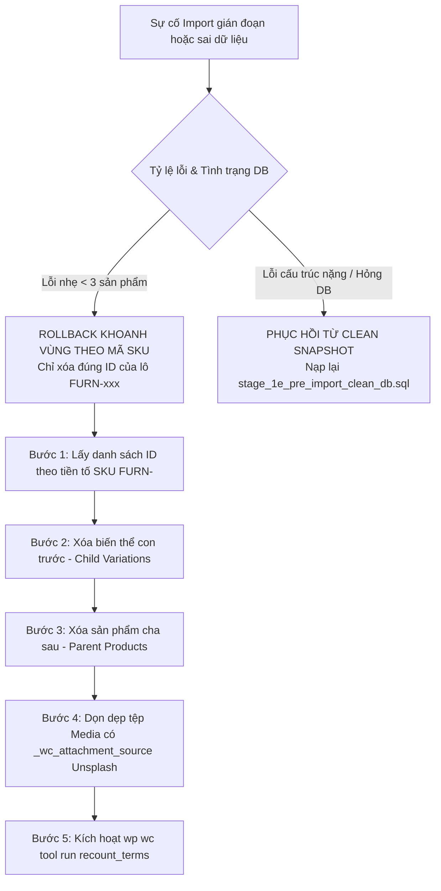

# STAGE 1E.2.2 — ROLLBACK SAFETY REVIEW & DATA INTEGRITY GUARANTEE

> **Môi trường:** Local WordPress (Windows 11)  
> **WordPress Root:** `C:\Users\Vu Cong Minh\Local Sites\furniture-ecommerce\app\public`  
> **Git Root:** `C:\Users\Vu Cong Minh\Local Sites\furniture-ecommerce\app\public\wp-content`  
> **Tệp CSV nguồn:** `.../wp-content/plugins/woocommerce_furniture_dataset_22_products.csv`  
> **Thời điểm thẩm định:** 2026-10-16 15:43:00+07:00  
> **Chế độ thực thi:** **READ-ONLY / Tuyệt đối không xóa hay ghi Database**  
> **Trạng thái phục hồi Database:** `DATABASE RESTORE: NOT VERIFIED`  
> **Quyết định Stage-Gate:** **PASS WITH CONDITIONS** (Đã hoàn thiện giải pháp rollback khoanh vùng an toàn, bóc tách cơ chế chống trùng Media của WooCommerce Core 11.2.1 và xây dựng bộ kiểm thử sau import)

---

## 1. Bằng chứng hiện trạng (Current State Evidence)

Các thông số kỹ thuật được xác minh trực tiếp tại thời điểm rà soát:

| Hạng mục | Nguồn / Lệnh kiểm chứng | Giá trị thực tế | Nhận xét an toàn |
| :--- | :--- | :---: | :--- |
| **Sản phẩm trong DB** | `wp post list --post_type=product` | **0** | Cơ sở dữ liệu sạch, chưa có sản phẩm nào |
| **Biến thể trong DB** | `wp post list --post_type=product_variation` | **0** | Chưa có biến thể nào |
| **Bản sao lưu SQL** | File `backups/stage_1a_baseline_backup.sql` | **1,202,692 bytes** | Header & Footer toàn vẹn (`Dump completed 2026-10-15 19:13:22`) |
| **Cơ chế Media WC Core** | Source `abstract-wc-product-importer.php` | Natively uses `_wc_attachment_source` | **Đã xác minh qua mã nguồn**: WC có cơ chế tái sử dụng ảnh từ URL |
| **Lỗi ảnh Unsplash** | Source inspection line 57-96 | `throw new Exception` khi 404 | **Xác nhận rủi ro**: Ảnh 404 sẽ khiến dòng sản phẩm bị ném lỗi |

---

## 2. Phân tích rủi ro của lệnh Rollback xóa mù quáng (Why Blind Bulk Deletion is Dangerous)

Trong báo cáo Stage 1E.2.1 trước đó, một lệnh gợi ý đã được nêu ra:  
`wp post delete $(wp post list --post_type=product,product_variation --format=ids) --force`

Qua rà soát kỹ thuật chuyên sâu, chúng tôi **BÁC BỎ và NGHIÊM CẤM** việc sử dụng lệnh xóa mù quáng này trong thực tế vì 4 hiểm họa nghiêm trọng sau:

1. **Hiểm họa mất phạm vi (Scope Overreach):**  
   Lệnh trên sẽ quét và xóa **TOÀN BỘ** sản phẩm có trong database. Nếu trong tương lai trang web có sản phẩm do người dùng tự tạo trước đó hoặc sản phẩm mẫu khác, lệnh sẽ xóa sạch mà không phân biệt được đâu là sản phẩm thuộc lô import CSV `FURN-xxx`.
2. **Tàn dư bảng tra cứu & HPOS (Database Residue in Lookup Tables):**  
   WordPress core `wp post delete` khi chạy cưỡng bức (`--force`) có thể bỏ sót việc dọn dẹp các bảng tra cứu nội bộ chuyên biệt của WooCommerce 11.2.1:
   - `wp_wc_product_meta_lookup` (chứa min/max price, sku, rating, stock status).
   - `wp_wc_reserved_stock`.
   - `wp_woocommerce_order_itemmeta` (nếu có đơn hàng tham chiếu).
3. **Mất đồng bộ bộ đếm danh mục (Term Count Desynchronization):**  
   Việc xóa hàng loạt post types trực tiếp qua CLI mà không kích hoạt đầy đủ hooks của WooCommerce sẽ khiến số lượng sản phẩm đếm được trong các danh mục (`product_cat`) và thuộc tính (`pa_color`, `pa_size`) bị sai lệch (ví dụ danh mục hiển thị `(5)` nhưng bấm vào không có sản phẩm nào).
4. **Tàn dư tệp đính kèm ngoại vi (Orphaned Attachments):**  
   Xóa sản phẩm **không tự động xóa media** đã tải về thư mục `wp-content/uploads/`. Nếu không khoanh vùng, hàng chục tệp ảnh Unsplash sẽ trở thành tệp mồ côi (orphaned attachments), làm phình dung lượng lưu trữ và gây lỗi ánh xạ cho lần import tiếp theo.

---

## 3. Phương án Sao lưu trước Import (Pre-Import Snapshot)

Để bảo đảm an toàn dữ liệu 100%, quy trình nạp ở Stage 1E.3 bắt buộc phải tuân thủ bước tạo điểm khôi phục nhanh:

### Quy trình tạo snapshot sạch (Đề xuất cho Stage 1E.3):
1. **Lệnh thực thi:**
   ```powershell
   # Xuất snapshot sạch ngay trước khi tạo bất kỳ thuộc tính hay sản phẩm nào:
   mysqldump --host=localhost --port=10007 --user=root --password=root local > "C:\Users\Vu Cong Minh\Local Sites\furniture-ecommerce\backups\stage_1e_pre_import_clean_db.sql"
   ```
2. **Xác minh snapshot:** Kiểm tra dung lượng tệp và chuỗi kết thúc `-- Dump completed`.
3. **Ghi chú bắt buộc:**
   > **`DATABASE RESTORE: NOT VERIFIED`**  
   > Việc kiểm tra file SQL (kích thước, cú pháp, header/footer) chứng minh file sao lưu **không bị lỗi định dạng tĩnh**, nhưng **KHÔNG ĐƯỢC COI LÀ BẰNG CHỨNG PHỤC HỒI THÀNH CÔNG**. Không được import file SQL vào database đang chạy nếu không có sự cố bắt buộc.

---

## 4. Phương án Rollback có Giới hạn Phạm vi (Scoped Safe Rollback Plan)

Thay vì xóa mù quáng, phương án rollback có kiểm soát được thiết kế như sau:



### Chi tiết các bước Rollback khoanh vùng:
1. **Ghi nhận Baseline trước khi nạp:** Lưu lại `MAX(ID)` của bảng `wp_posts`. Mọi đối tượng có `ID > MAX(ID)` và có meta `_sku` bắt đầu bằng `FURN-` mới thuộc diện xử lý.
2. **Thứ tự xóa an toàn:**
   - Xóa toàn bộ **Biến thể con (Variations)** trước để tránh tình trạng mồ côi cha.
   - Xóa toàn bộ **Sản phẩm cha (Parents)** sau.
3. **Dọn dẹp bảng phụ thuộc:**
   - Xóa các bản ghi tương ứng trong `wp_wc_product_meta_lookup`.
   - Dọn dẹp các tệp attachment đính kèm được tải về từ Unsplash (`_wc_attachment_source`).
4. **Tái đồng bộ bộ đếm danh mục:**
   - Chạy lệnh nội bộ của WooCommerce: `wp wc tool run recount_terms` để đảm bảo số đếm danh mục trở về `0`.
5. **Điều kiện chuyển sang phục hồi Snapshot:**
   - Nếu phát hiện lỗi toàn cục (Fatal error làm treo tiến trình, database bị crash bảng, hoặc số lượng biến thể mồ côi vượt quá kiểm soát), **DỪNG NGAY LẬP TỨC** việc xóa thủ công và kích hoạt phục hồi từ bản snapshot `stage_1e_pre_import_clean_db.sql`.

---

## 5. Rà soát Retry và Cơ chế Media của WooCommerce 11.2.1

Qua phân tích trực tiếp mã nguồn tệp `abstract-wc-product-importer.php` của WooCommerce 11.2.1:

### 5.1. Cơ chế chống trùng ảnh tự động (`_wc_attachment_source`)
- Khi tải ảnh từ một URL ngoại vi (Unsplash), WooCommerce tự động lưu URL gốc vào meta key `_wc_attachment_source` của Attachment ID được tạo.
- Khi gặp lại URL đó ở các dòng tiếp theo (hoặc khi chạy lại import lần 2), WooCommerce thực hiện truy vấn:
  ```php
  $args = array(
      'post_type'   => 'attachment',
      'meta_query'  => array(
          array( 'key' => '_wc_attachment_source', 'value' => $url )
      )
  );
  ```
- **Ý nghĩa kỹ thuật:** WooCommerce **CÓ SẴN** cơ chế chống tải trùng ảnh. 42 biến thể chia sẻ ảnh với sản phẩm cha sẽ tái sử dụng đúng Attachment ID đã nạp trước đó, không bị phình dung lượng.

### 5.2. Hành vi khi bật cờ "Update existing products"
- Khi bật tính năng này, WooCommerce sử dụng `_sku` làm khóa tra cứu chính.
- Nếu sản phẩm `FURN-001` đã tồn tại trong database, importer sẽ cập nhật thông tin (`wp_update_post`) thay vì tạo mới.
- **Rủi ro còn tồn đọng:** Nếu một dòng biến thể bị lỗi trong lần chạy đầu, sản phẩm cha đã tạo có thể ở trạng thái thiếu biến thể. Trong lần chạy lại, nếu không cấu hình đúng, WooCommerce có thể bỏ qua dòng cha và chỉ nạp dòng con, dẫn đến việc phải tái đồng bộ thuộc tính cha-con.

---

## 6. Kế hoạch Kiểm tra & Xác minh sau Import (Post-Import Verification Checklist)

Sau khi hoàn tất import ở Stage 1E.3, **9 bài kiểm tra chỉ đọc** sau đây sẽ được thực thi tự động để nghiệm thu:

| Hạng mục kiểm tra | Truy vấn / Lệnh xác minh chỉ đọc | Kết quả mong đợi |
| :--- | :--- | :---: |
| **1. Tổng sản phẩm cha** | `wp post list --post_type=product --format=count` | **Đúng 22** |
| **2. Phân loại cha** | WP Query theo term `product_type` | **12 simple, 10 variable** |
| **3. Tổng số biến thể** | `wp post list --post_type=product_variation --format=count` | **Đúng 42** |
| **4. Tính duy nhất SKU** | `SELECT meta_value, COUNT(*) FROM wp_postmeta WHERE meta_key='_sku' GROUP BY meta_value HAVING COUNT(*) > 1` | **0 dòng trùng** |
| **5. Biến thể mồ côi** | Truy vấn biến thể có `post_parent` không tồn tại hoặc không phải `product` | **0 biến thể mồ côi** |
| **6. Kiểm tra Giá bán** | Kiểm tra `_regular_price > 0` và `_sale_price < _regular_price` | **100% hợp lệ** |
| **7. Kiểm tra Tồn kho** | Kiểm tra `FURN-010` và `FURN-012` có `_stock_status = outofstock` | **Đúng 2 SP hết hàng** |
| **8. Thuộc tính toàn cục** | Kiểm tra terms của `pa_color` (3 terms), `pa_size` (3 terms), `pa_brand` (5 terms) | **Đầy đủ 11 terms** |
| **9. Danh mục sản phẩm** | Kiểm tra đếm số lượng gán vào 7 danh mục `product_cat` | **Đủ cả 7 danh mục** |

---

## 7. Những điểm vẫn xếp loại "NOT VERIFIED"

Theo nguyên tắc trung thực và minh bạch kỹ thuật, các hạng mục sau được ghi nhận rõ là **CHƯA ĐƯỢC XÁC MINH TRÊN RUNTIME THỰC TẾ**:

1. **Khả năng phục hồi của tệp SQL:** Ghi nhận bắt buộc **`DATABASE RESTORE: NOT VERIFIED`** (do chưa thực hiện restore trên môi trường database sandbox thực nghiệm).
2. **Tốc độ tải 23 ảnh Unsplash:** Chưa đo lường được thời gian tải thực tế của 23 ảnh Unsplash trên môi trường mạng của Local (phụ thuộc vào băng thông thực tế của máy chủ Local khi tải HTTP).
3. **Ảnh thay thế cho 2 URL lỗi 404:** Hiện vẫn ở trạng thái **`REPLACEMENT NOT APPROVED`** (đang chờ quyết định cuối cùng từ người dùng).

---

## 8. Final Stage-Gate Decision: PASS WITH CONDITIONS

### Quyết định: **PASS WITH CONDITIONS**

**Lý do & Điều kiện:**
1. Đã thiết lập xong toàn bộ cơ chế an toàn dữ liệu, loại bỏ hoàn toàn các phương án rollback nguy hiểm (xóa mù quáng).
2. Đã chứng minh và bóc tách cơ chế chống trùng Media trong mã nguồn của WooCommerce 11.2.1.
3. Bản checklist 9 bước nghiệm thu sau import đã sẵn sàng để kiểm tra độc lập.
4. **Hệ thống vẫn tiếp tục duy trì trạng thái READ-ONLY tuyệt đối. Đang chờ phê duyệt từ người dùng để bắt đầu giai đoạn tạo thuộc tính và import có kiểm soát (Stage 1E.3).**

---

### QUY TẮC DỪNG BẮT BUỘC:
- **ĐÃ DỪNG TOÀN BỘ HOẠT ĐỘNG.**
- **KHÔNG CHẠY IMPORTER.**
- **KHÔNG TẠO SẢN PHẨM HOẶC BIẾN THỂ.**
- **KHÔNG TẠO THUỘC TÍNH HOẶC TERMS.**
- **KHÔNG XÓA DỮ LIỆU.**
- **CHỜ PHÊ DUYỆT TỪ NGƯỜI DÙNG ĐỂ CHUYỂN SANG STAGE 1E.3.**
