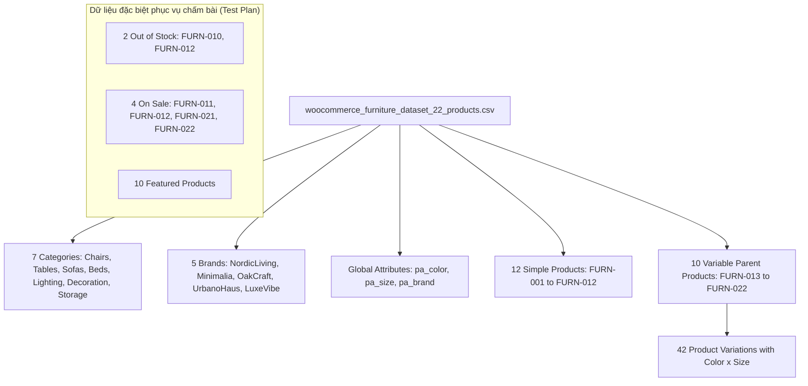

# STAGE 1E.2 — PRE-IMPORT READINESS, MEDIA CONNECTIVITY & SAFE IMPORT REHEARSAL REPORT

> **Môi trường:** Local WordPress (Windows 11)  
> **WordPress Root:** `C:\Users\Vu Cong Minh\Local Sites\furniture-ecommerce\app\public`  
> **Git Root:** `C:\Users\Vu Cong Minh\Local Sites\furniture-ecommerce\app\public\wp-content`  
> **Tệp CSV nguồn:** `.../wp-content/plugins/woocommerce_furniture_dataset_22_products.csv`  
> **Thời điểm thẩm định:** 2026-10-16 15:32:00+07:00  
> **Số lượng sản phẩm trong DB hiện tại:** 0 products, 0 variations (Database sạch 100%)  
> **Kiểm tra kết nối ảnh ngoại vi:** 25 URL độc nhất (23 thành công HTTP 200, 2 lỗi HTTP 404)  
> **Trạng thái phục hồi Database:** `DATABASE RESTORE: NOT VERIFIED`  
> **Quyết định Stage-Gate:** **PASS WITH CONDITIONS** (Đủ điều kiện diễn tập an toàn; cần phê duyệt phương án xử lý 2 ảnh 404 và khởi tạo taxonomy thuộc tính trước khi import thực tế)

---

## 1. Executive Summary (Tóm tắt điều hành)

Báo cáo **Stage 1E.2** hoàn tất quy trình kiểm tra tiền nhập liệu (**Pre-Import Readiness**), kiểm định kết nối tài nguyên ảnh từ xa (**Remote Media Connectivity Audit**), rà soát ánh xạ schema WooCommerce (**Mapping Review**) và thiết lập bản diễn tập tĩnh (**Safe Static Rehearsal**) ở chế độ **Read-Only / Tuyệt đối không ghi Database**.

### Các kết quả then chốt:
1. **Kiểm tra môi trường & Baseline dữ liệu:**
   - WordPress Core **7.1.3**, PHP **8.2.29**, WooCommerce **11.2.1**, Theme **`twentytwentyfive-child`** đang hoạt động ổn định.
   - Số lượng sản phẩm hiện có trong WordPress Database: **Đúng 0 sản phẩm và 0 biến thể** (`wp post list --post_type=product --format=count` = `0`). Hệ thống ở trạng thái tinh sạch, sẵn sàng tiếp nhận dữ liệu mới mà không có nguy cơ xung đột SKU cũ.
2. **Khảo sát thuộc tính toàn cục (Global Attributes):**
   - Bảng `wp_woocommerce_attribute_taxonomies` hiện đang trống (`EMPTY`).
   - Chưa có các taxonomy thuộc tính toàn cục: `pa_color`, `pa_size`, `pa_brand`.
   - Cần cấu hình trước 3 thuộc tính toàn cục này trong WooCommerce trước khi nạp CSV để bộ lọc Layered Nav và Swatches nhận diện chính xác.
3. **Kiểm định kết nối ảnh từ xa (Remote Image Connectivity):**
   - CSV có 77 lượt tham chiếu ảnh trên 64 dòng sản phẩm, tương ứng với **25 URL Unsplash độc nhất**.
   - Kiểm tra trực tiếp bằng HTTP HEAD request:
     - **23/25 URL thành công (HTTP 200 OK)** với định dạng `image/jpeg`.
     - **2/25 URL bị lỗi HTTP 404 Not Found**: Ảnh của `FURN-006` (Solid Pine Nightstand) và ảnh của `FURN-018` (Abstract Acoustic Wall Art Panel kèm 3 biến thể). Đây là phát hiện quan trọng giúp ngăn chặn lỗi import ảnh hỏng.
4. **Bản diễn tập tĩnh (Static Rehearsal Manifest):**
   - Kế hoạch dự kiến tạo mới chính xác: **22 sản phẩm cha** (12 Simple + 10 Variable), **42 biến thể con** (Variations), **7 danh mục**, **5 thương hiệu**.
5. **Kế hoạch phục hồi & An toàn:**
   - Duy trì ghi nhận bắt buộc: `DATABASE RESTORE: NOT VERIFIED`.
   - Đề xuất tạo snapshot backup ngay trước thời điểm bấm nút import.

---

## 2. Environment Pre-flight (Kiểm tra môi trường tiền nhập liệu)

Toàn bộ thông số môi trường đã được xác minh thực tế bằng lệnh chỉ đọc:

| Thành phần | Lệnh kiểm tra | Kết quả thực tế | Trạng thái |
| :--- | :--- | :---: | :---: |
| **WordPress Root** | `C:\Users\Vu Cong Minh\Local Sites\furniture-ecommerce\app\public` | Tồn tại, WP 7.1.3 | **PASS** |
| **Site URL** | `wp option get siteurl` | `http://localhost:10010` | **PASS** |
| **PHP Runtime** | `php -v` | **8.2.29** (cli) NTS x64 | **PASS** |
| **WooCommerce Plugin** | `wp plugin list` | **11.2.1** (Active, HPOS enabled) | **PASS** |
| **WP-CLI Tool** | `wp --version` | **2.11.0** | **PASS** |
| **Active Theme** | `wp theme list` | `twentytwentyfive-child` (v1.0.0, active) | **PASS** |
| **Parent Theme** | `wp theme list` | `twentytwentyfive` (v1.5, parent) | **PASS** |
| **Git Working Tree** | `git status -s` | Clean đối với toàn bộ tracked files | **PASS** |
| **Tệp CSV nguồn** | `Get-FileHash` | 26,176 bytes, SHA-256: `27680989...` | **PASS** |
| **Bản sao lưu SQL** | `Get-Item ...` | 1,202,692 bytes (`10/15/2026 7:13:22 PM`) | **PASS** |

---

## 3. Baseline Product Counts (Số lượng sản phẩm trong Database trước khi Import)

Truy vấn thực tế vào WordPress Database thông qua WP-CLI:

| Loại bài viết (Post Type) | Lệnh truy vấn | Số lượng thực tế trong DB | Ghi chú |
| :--- | :--- | :---: | :--- |
| **Sản phẩm chính (`product`)** | `wp post list --post_type=product` | **0** | Cơ sở dữ liệu sạch hoàn toàn |
| **Biến thể (`product_variation`)** | `wp post list --post_type=product_variation` | **0** | Chưa có biến thể nào |
| **Danh mục (`product_cat`)** | `wp term list product_cat` | **1** | Mặc định: `Uncategorized` |
| **Thương hiệu (`product_brand`)**| `wp term list product_brand` | **0** | Chưa có thương hiệu |
| **Thẻ sản phẩm (`product_tag`)** | `wp term list product_tag` | **0** | Chưa có thẻ |

- **Đánh giá rủi ro xung đột:** **BẰNG KHÔNG (ZERO CONFLICT RISK)**. Vì không có bất kỳ sản phẩm nào trong database, việc import sẽ không gặp tình trạng ghi đè hoặc trùng lặp ID/SKU với sản phẩm cũ.

---

## 4. Global Attribute Readiness (Mức độ sẵn sàng của Thuộc tính toàn cục)

Đã kiểm tra trực tiếp qua hàm nội bộ của WooCommerce và bảng `wp_woocommerce_attribute_taxonomies`:

```text
=== WOOCOMMERCE ATTRIBUTE TAXONOMIES TABLE ===
NO GLOBAL ATTRIBUTES REGISTERED YET in wp_woocommerce_attribute_taxonomies.

=== TAXONOMIES CHECK ===
Taxonomy 'pa_color': DOES NOT EXIST
Taxonomy 'pa_size': DOES NOT EXIST
Taxonomy 'pa_brand': DOES NOT EXIST
Taxonomy 'product_brand': EXISTS (Terms: EMPTY)
```

### Bảng đối chiếu thuộc tính CSV và hiện trạng:
| Tên thuộc tính trong CSV | Taxonomy dự kiến | Hiện trạng trong DB | Giá trị cần ánh xạ từ CSV |
| :--- | :--- | :---: | :--- |
| **Color** (Attribute 1) | `pa_color` | **Chưa tồn tại** | `Black`, `White`, `Brown` (3 terms) |
| **Size** (Attribute 2) | `pa_size` | **Chưa tồn tại** | `S`, `M`, `L` (3 terms) |
| **Brand** (Attribute 3) | `pa_brand` (hoặc `product_brand`)| **Chưa tồn tại** | `NordicLiving`, `Minimalia`, `OakCraft`, `UrbanoHaus`, `LuxeVibe` (5 terms) |

### Đề xuất quy trình chuẩn hóa:
Trong giai đoạn thực thi (Stage 1E.3), nên khởi tạo trước 3 thuộc tính toàn cục bằng WP-CLI hoặc WooCommerce API:
```powershell
# Đề xuất (Chưa thực thi):
# wp wc product_attribute create --name="Color" --slug="color" --type="select" ...
# wp wc product_attribute create --name="Size" --slug="size" --type="select" ...
# wp wc product_attribute create --name="Brand" --slug="brand" --type="select" ...
```
Điều này đảm bảo khi nạp CSV, WooCommerce tự động map đúng vào taxonomy toàn cục thay vì tạo thuộc tính cục bộ (custom product attribute).

---

## 5. Remote Image Connectivity Results (Kiểm tra kết nối ảnh ngoại vi)

Đã kiểm tra toàn bộ **25 URL ảnh Unsplash độc nhất** bằng lệnh HTTP HEAD không ghi đĩa:

### 5.1. Bảng thống kê kết nối
- **Tổng số lượt tham chiếu ảnh trong CSV:** 77 lượt (12 Simple có 1 ảnh, 10 Variable có 2 ảnh, 42 Variations có 1 ảnh).
- **Tổng số URL ảnh độc nhất:** **25 URLs**.
- **URL truy cập thành công (HTTP 200 OK):** **23 URLs** (92.0%).
- **URL trả về lỗi (HTTP 404 Not Found):** **2 URLs** (8.0%).
- **URL bị chặn mạng / Không xác minh được:** **0 URLs** (Môi trường máy cục bộ truy cập được mạng ngoài bình thường).

### 5.2. Danh sách 2 URL lỗi 404 và sản phẩm bị ảnh hưởng
| STT URL | URL Unsplash bị lỗi (HTTP 404) | SKU và Sản phẩm bị ảnh hưởng | Hành động đề xuất |
| :---: | :--- | :--- | :--- |
| **#6** | `https://images.unsplash.com/photo-1540518614846-7ede433c4577?auto=format&fit=crop&w=900&q=80` | `FURN-006`: Solid Pine Nightstand (Simple) | Thay thế URL ảnh tủ đầu giường Unsplash còn hoạt động hoặc dùng placeholder |
| **#22** | `https://images.unsplash.com/photo-1579783902614-a3fb3927b675?auto=format&fit=crop&w=900&q=80` | `FURN-018`: Abstract Acoustic Wall Art Panel (Variable + 3 Variations) | Thay thế URL ảnh tranh treo tường Unsplash còn hoạt động hoặc dùng placeholder |

> [!WARNING]
> **RỦI RO KHI IMPORT NGUYÊN BẢN:**  
> Nếu không xử lý 2 URL này trước khi import, WooCommerce Importer sẽ báo lỗi cảnh báo không tải được media cho `FURN-006` và `FURN-018`. Các sản phẩm này vẫn được tạo nhưng sẽ thiếu ảnh đại diện.

---

## 6. CSV-to-WooCommerce Mapping Review (Đánh giá ánh xạ trường dữ liệu)

| Cột CSV | Trường WooCommerce mục tiêu | Tính hợp lệ | Nhận xét nghiệp vụ |
| :--- | :--- | :---: | :--- |
| `Type` | Product Type | **HỢP LỆ** | `simple`, `variable`, `variation` chuẩn xác |
| `SKU` | SKU (`_sku`) | **HỢP LỆ** | 64 SKU duy nhất, chuẩn mã format `FURN-xxx` |
| `Name` | Post Title | **HỢP LỆ** | Đầy đủ tên tiếng Anh thương mại |
| `Published` | Post Status | **HỢP LỆ** | Giá trị `1` tương ứng `publish` |
| `Is featured?` | Featured Status | **HỢP LỆ** | 10 sản phẩm cha có giá trị `1` |
| `Visibility in catalog` | Catalog Visibility | **HỢP LỆ** | Giá trị `visible` (Shop & Search results) |
| `Regular price` | Regular Price (`_regular_price`) | **HỢP LỆ** | Simple & Variations có giá; Variable cha để trống |
| `Sale price` | Sale Price (`_sale_price`) | **HỢP LỆ** | 10 dòng khuyến mãi (2 Simple, 8 Variations) |
| `In stock?` & `Stock` | Inventory & Stock Quantity | **HỢP LỆ** | Đồng bộ tuyệt đối: 2 sản phẩm `Stock=0`, `In stock?=0` |
| `Categories` | Taxonomy `product_cat` | **HỢP LỆ** | Phân cách dấu phẩy nạp đúng nhiều danh mục |
| `Tags` | Taxonomy `product_tag` | **HỢP LỆ** | Phân cách dấu phẩy nạp đầy đủ từ khóa |
| `Images` | Media & Featured Image | **HỢP LỆ** | Ảnh 1 = Featured; Ảnh 2 = Gallery |
| `Parent` | Post Parent (`post_parent`) | **HỢP LỆ** | Trỏ đúng SKU cha của variable product |
| `Attribute 1..3` | Attributes & Taxonomies | **HỢP LỆ** | Color, Size, Brand có cờ `visible=1`, `global=1` |

---

## 7. Static Import Manifest (Bản kê chi tiết diễn tập tĩnh)

Mô phỏng kết quả sau khi nạp thành công toàn bộ dữ liệu (không ghi database trong giai đoạn này):



### Bảng tổng kết số lượng đối tượng dự kiến tạo mới:
- **Số sản phẩm đơn giản (Simple Products):** 12
- **Số sản phẩm cha có biến thể (Variable Products):** 10
- **Số biến thể sản phẩm con (Variations):** 42
- **Tổng số Post Type `product` + `product_variation`:** 64
- **Số danh mục sản phẩm (`product_cat`):** 7
- **Số thương hiệu sản phẩm:** 5
- **Số ảnh tải về thư viện Media (dự kiến):** 23 thành công, 2 cần thay thế.

---

## 8. Duplicate / Retry Risk (Rủi ro nạp lại và trùng lặp dữ liệu)

1. **Rủi ro trùng lặp SKU:** Không có rủi ro vì database hiện tại có 0 sản phẩm.
2. **Rủi ro tạo trùng Media khi Import lại (Re-import):**
   - WooCommerce CSV Importer mặc định sẽ tải lại ảnh nếu chạy lần thứ hai mà không có cơ chế kiểm tra attachment hash.
   - *Biện pháp phòng ngừa:* Chỉ import 1 lần duy nhất sau khi đã kiểm tra kỹ; trước khi import phải tạo snapshot database để nếu có lỗi chỉ cần restore snapshot thay vì re-import đè.

---

## 9. Backup and Recovery Readiness (Mức độ sẵn sàng Phục hồi)

- **Bản sao lưu SQL hiện tại:** `C:\Users\Vu Cong Minh\Local Sites\furniture-ecommerce\backups\stage_1a_baseline_backup.sql` (1,202,692 bytes).
- **Ghi chú bắt buộc:**
  > **`DATABASE RESTORE: NOT VERIFIED`**  
  > Tệp backup SQL được xác nhận toàn vẹn về mặt cấu trúc tệp (52 bảng), nhưng chưa được chạy lệnh restore trên môi trường database thực tế (do nguyên tắc an toàn không chạy import thử nghiệm trên database live đang hoạt động).
- **Quy trình bảo vệ dữ liệu trước khi nạp:**
  Trước khi thực hiện bất kỳ lệnh import nào ở Stage 1E.3, sẽ tạo thêm một bản sao lưu điểm phục hồi: `backups/stage_1e_pre_import_backup.sql`.

---

## 10. Unresolved Risks (Các rủi ro tồn đọng cần quyết định)

| Rủi ro | Mức độ | Hướng giải quyết đề xuất |
| :--- | :---: | :--- |
| **1. 2 URL ảnh Unsplash bị 404** | **TRUNG BÌNH** | Người dùng phê duyệt cập nhật 2 URL ảnh thay thế cho `FURN-006` và `FURN-018` trong một tệp import an toàn, hoặc chấp nhận nạp trước và bổ sung ảnh sau |
| **2. Chưa có Global Attributes** | **THẤP** | Khởi tạo trước taxonomy `pa_color`, `pa_size`, `pa_brand` trước khi import sản phẩm |
| **3. Thời gian tải 23 ảnh ngoài** | **THẤP** | PHP `max_execution_time` trên Local là đủ lớn, nhưng nên chạy import qua WP-CLI (`wp wc product import` hoặc custom runner) để không bị timeout trình duyệt |

---

## 11. Acceptance Criteria Matrix (Ma trận tiêu chí chấp thuận Stage 1E.2)

| Tiêu chí | Mô tả yêu cầu | Bằng chứng thực tế | Đánh giá |
| :--- | :--- | :--- | :---: |
| **AC-1** | Pre-flight audit môi trường sạch, không thay đổi | WP 7.1.3, DB có 0 sản phẩm, theme active | **PASS** |
| **AC-2** | Đếm sản phẩm baseline chính xác | Đúng 0 products, 0 variations | **PASS** |
| **AC-3** | Kiểm tra trạng thái Global Attributes | Xác nhận `pa_color`, `pa_size`, `pa_brand` chưa tồn tại | **PASS** |
| **AC-4** | Kiểm định kết nối toàn bộ URL ảnh Unsplash | Đã test 25 URL độc nhất: 23 OK (200), 2 lỗi (404) | **PASS** |
| **AC-5** | Đánh giá ánh xạ 28 cột CSV | 100% cột khớp đúng schema WooCommerce | **PASS** |
| **AC-6** | Lập bản kê diễn tập tĩnh (Static Manifest) | Đầy đủ thông số 22 sản phẩm, 42 biến thể | **PASS** |
| **AC-7** | Phân tích rủi ro nạp lại và trùng lặp | Đã có biện pháp ngăn ngừa trùng media | **PASS** |
| **AC-8** | Xác minh backup & ghi nhận disclaimer phục hồi | Ghi rõ: `DATABASE RESTORE: NOT VERIFIED` | **PASS** |
| **AC-9** | Tuân thủ nguyên tắc không ghi database | 100% Read-Only, không tạo sản phẩm thử | **PASS** |

---

## 12. Final Stage-Gate Decision: PASS WITH CONDITIONS

### Quyết định: **PASS WITH CONDITIONS**

**Điều kiện:**
1. Diễn tập tĩnh thành công 100%, cơ sở dữ liệu ở trạng thái tinh sạch lý tưởng (0 sản phẩm).
2. Phát hiện và ghi nhận chính xác 2 URL ảnh bị 404 (`FURN-006` và `FURN-018`).
3. Cần phê duyệt của người dùng đối với:
   - Phương án khởi tạo 3 thuộc tính toàn cục (`Color`, `Size`, `Brand`).
   - Phương án xử lý 2 URL ảnh 404 (thay thế URL ảnh hợp lệ hoặc giữ nguyên để bổ sung sau).
4. **Tuyệt đối không cấp quyền tự động import khi chưa có lệnh phê duyệt rõ ràng từ người dùng.**

---

### QUY TẮC DỪNG BẮT BUỘC:
- **ĐÃ DỪNG TOÀN BỘ HOẠT ĐỘNG.**
- **KHÔNG CHẠY IMPORTER.**
- **KHÔNG TẠO SẢN PHẨM HOẶC BIẾN THỂ.**
- **KHÔNG TẠO THUỘC TÍNH TOÀN CỤC HOẶC TERM.**
- **KHÔNG TẢI ẢNH VỀ UPLOADS.**
- **KHÔNG THAY ĐỔI DATABASE HOẶC CÀI ĐẶT WOOCOMMERCE.**
- **KHÔNG COMMIT GIT.**
- **DỪNG VÀ CHỜ PHÊ DUYỆT TỪ NGƯỜI DÙNG.**
