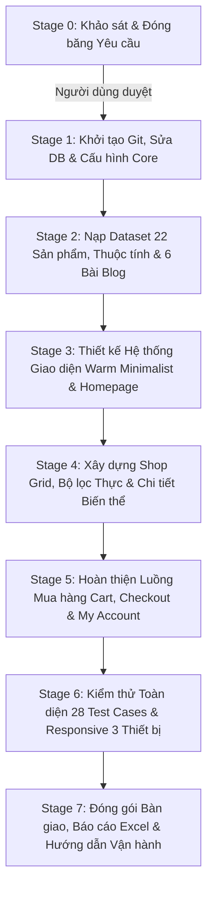

# BÁO CÁO KHẢO SÁT HIỆN TRẠNG, KIỂM TOÁN MÔI TRƯỜNG & ĐÓNG BĂNG YÊU CẦU
# STAGE 0 — DISCOVERY REPORT & REQUIREMENTS FREEZE
**Dự án:** furniture-ecommerce (Website Thương mại Điện tử Nội thất Quốc tế)  
**Tác giả:** Senior WordPress Engineer, WooCommerce Architect, UI/UX Designer & QA Engineer  
**Ngày thực hiện:** 15/10/2026  
**Trạng thái cổng kiểm soát (Stage-Gate):** **CONDITIONAL PASS** (Yêu cầu phê duyệt từ Người dùng trước khi khởi động Stage 1)

---

## 1. Executive Summary (Tóm tắt Điều hành)

1. **Hiện trạng hệ sinh thái:** Dự án đang chạy trên môi trường **Local by Flywheel 10.1.1** trên nền tảng **Windows 11 Home**. Web server là **Nginx 1.26.1**, runtime **PHP 8.2.29** (có Xdebug 3.2.1 và OPcache), hệ quản trị cơ sở dữ liệu **MySQL 8.4.0**. WordPress Core đang ở phiên bản **7.1.3** và WooCommerce Core là **11.2.1** (đã active).
2. **Sai khác quan trọng so với tài liệu dự thảo cũ:** Trong thư mục dự án có tồn tại file tài liệu kế hoạch `wordpress_woocommerce_ecommerce_project_plan_refined (1).md` xây dựng trên giả định sử dụng theme trả phí **WoodMart**. Tuy nhiên, qua kiểm toán thực tế:
   - **Hoàn toàn KHÔNG có theme WoodMart** được cài đặt trong thư mục `wp-content/themes`.
   - Theme đang active là **`interior-design-wda` (v1.2.9)** cùng 3 theme freemium khác (`interior-design-firm`, `luxury-interior`, `modern-architecture-design`) và 3 block theme mặc định (`twentytwentyfive`, `twentytwentyfour`, `twentytwentythree`).
   - Cả 4 theme nội thất cài sẵn đều là bản "Lite" của bên thứ ba, có dấu hiệu giới hạn tính năng và yêu cầu nâng cấp bản trả phí (Pro upsell).
   - **Không có Page Builder** (Elementor / WPBakery) nào được cài đặt. Hệ thống hoàn toàn sẵn sàng cho **Gutenberg / Block Editor**.
3. **Phát hiện lỗi nghiêm trọng (Database Inconsistency):** Kiểm tra cơ sở dữ liệu cho thấy **thiếu bảng `wp_woocommerce_attribute_taxonomies`** và các bảng dữ liệu bổ trợ của WooCommerce (do quá trình kích hoạt plugin ban đầu bị gián đoạn hoặc lỗi DDL trên MySQL 8.4). Log PHP ghi nhận lỗi: `Table 'local.wp_woocommerce_attribute_taxonomies' doesn't exist`. Lỗi này phải được sửa chữa an toàn ở đầu Stage 1 trước khi import thuộc tính sản phẩm (`Color`, `Size`, `Brand`).
4. **Trạng thái Dữ liệu:** Database hiện tại có **0 sản phẩm**, **0 đơn hàng**, **1 bài viết mặc định** ("Hello world!"), 4 trang cốt lõi của WooCommerce đã được gán tự động (`Shop`, `Cart`, `Checkout`, `My account`).
5. **Tài sản nguồn sẵn có:** Đã xác minh có sẵn file yêu cầu gốc `Xây dựng website E-commerce quốc tế.pdf` (13 trang), dataset mẫu chuẩn `woocommerce_furniture_dataset_22_products.csv` (22 sản phẩm, 43 dòng biến thể con, đủ 7 danh mục và 5 thương hiệu) và kế hoạch 28 ca kiểm thử `test_plan_and_test_cases (1).md`.
6. **Đánh giá Stage-Gate:** **CONDITIONAL PASS** — Do thiếu bảng database WooCommerce cốt lõi, chưa có Git repo và cần người dùng chốt phương án Theme miễn phí (Gutenberg / Block Theme vs Theme Free chính thức từ WordPress.org). Tuyệt đối **DỪNG** và không tự ý chuyển sang Stage 1.

---

## 2. Environment Inventory (Kiểm toán Môi trường Thực tế)

Tất cả các thông số dưới đây đã được kiểm tra trực tiếp qua CLI (`WP-CLI 2.12.0`, `php.exe`, `mysql.exe`, PowerShell CIM Instance):

| Thông số | Giá trị thực tế kiểm tra được | Trạng thái xác minh | Ghi chú & Bằng chứng kỹ thuật |
|---|---|---|---|
| **Hệ điều hành** | Microsoft Windows 11 Home (Build NT 10.0.26200.0) | **VERIFIED** | Kiểm tra qua `[System.Environment]::OSVersion` |
| **Phần mềm Local** | Local by Flywheel Version **10.1.1** | **VERIFIED** | Registry `HKCU:\Software\Microsoft\Windows\CurrentVersion\Uninstall\Local` |
| **Site Name** | `furniture-ecommerce` | **VERIFIED** | Đường dẫn `C:\Users\Vu Cong Minh\Local Sites\furniture-ecommerce` |
| **Site URL / Home** | `http://localhost:10010` | **VERIFIED** | `wp option get siteurl` & `wp option get home` -> HTTP 200 OK |
| **WordPress Core** | **7.1.3** | **VERIFIED** | `wp core version` & `wp-includes/version.php` line 19 |
| **PHP Runtime** | **8.2.29** (cli) (NTS VC 2019 x64) | **VERIFIED** | `php -v` (Zend OPcache v8.2.29, Xdebug v3.2.1) |
| **MySQL Server** | **8.4.0** (MySQL Community Server - GPL) | **VERIFIED** | `mysql.exe Ver 8.4.0 for Win64 on x86_64` |
| **Web Server** | **nginx/1.26.1** | **VERIFIED** | Local lightning service `nginx-1.26.1+3` |
| **Mail Testing** | Mailpit 1.24.1+0 tích hợp trong Local | **VERIFIED** | Kiểm tra cấu hình `conf/mailpit` của Local |
| **Trạng thái Git** | **Chưa khởi tạo** (`fatal: not a git repository`) | **VERIFIED** | Không có thư mục `.git` trong site hay workspace |
| **Trạng thái Backup**| **Chưa có bản backup nào** (.sql / .zip) | **VERIFIED** | Quét toàn bộ site không thấy file nén / dump database |
| **Cảnh báo PHP CLI**| `Unable to load dynamic library 'php_imagick.dll'` | **VERIFIED** | Thiếu file DLL imagick trong extension PHP của Local (không ảnh hưởng vận hành GD Library) |

---

## 3. Theme & Plugin Inventory (Kiểm toán Theme và Plugin)

### 3.1 Danh sách Theme hiện có trong `wp-content/themes`

Kiểm tra bằng lệnh `wp theme list`:

| Theme Name | Slug thư mục | Phiên bản | Tác giả / Nguồn | Trạng thái | Phân tích & Đánh giá rủi ro |
|---|---|---|---|---|---|
| **Interior Design WDA** | `interior-design-wda` | 1.2.9 | WpDevArt | **ACTIVE** | **Rủi ro cao:** Theme freemium. Bản miễn phí khóa nhiều tùy biến, đòi hỏi mua bản quyền Pro để mở khóa đầy đủ layout và WooCommerce styling. |
| **Interior Design Firm** | `interior-design-firm` | 3.2.7 | Ovation Themes | Inactive | Theme freemium của bên thứ ba, hướng người dùng mua bản quyền $49. |
| **Luxury Interior** | `luxury-interior` | 1.4.7 | The Classic Templates | Inactive | Theme freemium, phụ thuộc nhiều template tùy biến không chuẩn FSE. |
| **Modern Architecture Design** | `modern-architecture-design` | 1.2.6 | Omega Themes | Inactive | Theme freemium thương mại, khóa tính năng nâng cao. |
| **Twenty Twenty-Five** | `twentytwentyfive` | 1.5 | WordPress.org | Inactive | **Theme Block mặc định chuẩn của WordPress 6.7/7.x.** Hỗ trợ FSE (Full Site Editing), tương thích 100% Gutenberg, siêu nhẹ, không quảng cáo, chuẩn mã nguồn mở. |
| **Twenty Twenty-Four** | `twentytwentyfour` | 1.6 | WordPress.org | Inactive | Block theme ổn định, tương thích cao. |
| **Twenty Twenty-Three** | `twentytwentythree` | 1.7 | WordPress.org | Inactive | Block theme tối giản. |
| **WoodMart** | `woodmart` | — | — | **KHÔNG TỒN TẠI** | **VERIFIED:** Hoàn toàn không có trong thư mục themes. Không giả định người dùng có bản quyền. |

### 3.2 Danh sách Plugin trong `wp-content/plugins`

Kiểm tra bằng lệnh `wp plugin list`:

| Tên Plugin | Thư mục | Phiên bản | Trạng thái | Nguồn | Đánh giá chức năng |
|---|---|---|---|---|---|
| **WooCommerce** | `woocommerce` | **11.2.1** | **ACTIVE** | WordPress.org | Cung cấp nền tảng thương mại điện tử cốt lõi (Catalog, Cart, Checkout, My Account). |
| **WoodMart Core** | — | — | **KHÔNG CÓ** | — | Không có trong hệ thống. |
| **Page Builders** | — | — | **KHÔNG CÓ** | — | Không có Elementor, WPBakery hay bất kỳ builder bên thứ 3 nào. |
| **Multi-Currency** | — | — | **KHÔNG CÓ** | — | Chưa cài đặt plugin chuyển đổi tiền tệ. |

---

## 4. WooCommerce Configuration Audit (Kiểm toán Cấu hình WooCommerce)

Toàn bộ dữ liệu thu thập qua WP-CLI không sửa đổi cấu hình:

| Hạng mục cấu hình | Option Key | Giá trị thực tế | Đánh giá so với yêu cầu đề bài |
|---|---|---|---|
| **Tiền tệ cơ sở (Base Currency)** | `woocommerce_currency` | **USD** | **Khớp 100%** với các ca kiểm thử trong PDF (`$0–$500`, `$299`, `$399`). |
| **Quốc gia bán hàng** | `woocommerce_default_country` | **VN** | Đã đặt là Việt Nam. |
| **Địa chỉ cửa hàng** | `woocommerce_store_address` | `123 Furniture Street` | Đã có địa chỉ demo. |
| **Thành phố** | `woocommerce_store_city` | `Hanoi` | Khớp thị trường Việt Nam. |
| **Mã bưu chính** | `woocommerce_store_postcode` | `100000` | Hà Nội. |
| **Quốc gia được phép bán** | `woocommerce_allowed_countries` | `all` | Mở bán tất cả các nước. |
| **Tính toán thuế** | `woocommerce_calc_taxes` | `no` | Đang tắt tính thuế (phù hợp bài tập e-commerce demo). |
| **Mã giảm giá (Coupons)** | `woocommerce_enable_coupons` | `yes` | Đã bật tính năng Coupon. |
| **Trang Shop** | `woocommerce_shop_page_id` | **ID 6** (`/shop/`) | Đã publish, gán chính xác. |
| **Trang Cart** | `woocommerce_cart_page_id` | **ID 7** (`/cart/`) | Đã publish, gán chính xác. |
| **Trang Checkout** | `woocommerce_checkout_page_id` | **ID 8** (`/checkout/`) | Đã publish, gán chính xác. |
| **Trang My Account** | `woocommerce_myaccount_page_id` | **ID 9** (`/my-account/`) | Đã publish, gán chính xác. |
| **Khách vãng lai thanh toán** | `woocommerce_enable_guest_checkout` | `yes` | Cho phép Guest Checkout. |
| **Đăng ký tài khoản ở Checkout**| `woocommerce_enable_signup_and_login_from_checkout` | `no` | Đang tắt. |
| **Đăng ký tài khoản tại My Account**| `woocommerce_enable_myaccount_registration` | **`no`** | **CẢNH BÁO:** Đang tắt. Sẽ làm gãy luồng `Register -> Login -> My Account` (TC13) nếu không bật ở Stage 1. |
| **Cổng COD (Cash on Delivery)** | `woocommerce_cod_settings` | **Chưa kích hoạt** (Option does not exist) | Cần kích hoạt ở Stage 1. |
| **Cổng BACS (Chuyển khoản)** | `woocommerce_bacs_settings` | **Chưa kích hoạt** (Option does not exist) | Cần kích hoạt ở Stage 1. |
| **Số lượng sản phẩm trong DB** | `post_type=product` | **0 sản phẩm** | Cần nạp từ file CSV ở Stage 2. |
| **Số danh mục sản phẩm trong DB**| `product_cat` | **1 danh mục** (`Uncategorized`) | Cần tạo 7 danh mục ở Stage 2. |
| **Số lượng bài viết Blog** | `post_type=post` | **1 bài** ("Hello world!") | Cần tối thiểu 6 bài và 3 danh mục. |

---

## 5. Requirements Traceability Table (Ma trận Truy xuất Yêu cầu)

Đối chiếu trực tiếp từ tài liệu gốc **`Xây dựng website E-commerce quốc tế.pdf` (13 trang)** và bộ dữ liệu có sẵn:

| STT | Phân hệ / Yêu cầu cốt lõi | Yêu cầu chi tiết từ PDF gốc | Trọng số điểm | Hiện trạng thực tế | Phương án kỹ thuật dự kiến |
|:---:|---|---|:---:|---|---|
| **1** | **Header / Menu / Footer** | - Header: Logo, Menu, Search, Account, Wishlist, Cart, Mega menu/dropdown.<br>- Footer: About, Customer Service, Information, Newsletter, Social, Copyright. | 10 | Đang dùng Header/Footer mặc định của theme `interior-design-wda`. | Tùy biến Header/Footer bằng Block Patterns hoặc Child Theme template, cấu hình Mega/Dropdown menu 7 danh mục. |
| **2** | **Homepage (8 Khối)** | Đủ 8 section: Hero Banner (`SHOP NOW`), Category Grid (4–6 mục), Featured Products (Card đủ 9 phần tử), Promotion Banner (`Summer Collection, Up to 30% OFF`), New Arrivals, Best Sellers, Blog (3 bài), Footer. | 10 | Trang chủ hiện là trang mẫu rỗng của theme. | Dựng bố cục chuẩn 8 khối bằng Gutenberg Blocks / Block Patterns tùy biến, gán màu Warm Minimalist. |
| **3** | **Shop Page & Lưới sản phẩm** | - Grid: Desktop 4 cột, Tablet 3 cột, Mobile 2 cột.<br>- Không được chỉ là trang danh sách tĩnh. | 15 | Trang `/shop/` đã có nhưng chưa có sản phẩm. | Dùng WooCommerce Product Grid Block / Template Archive tùy biến responsive 4 / 3 / 2 cột. |
| **4** | **Bộ lọc thực (AJAX / Layered Nav)** | Cho phép lọc thực: Category (7), Brand (5), Color (`Black, White, Brown`), Size (`S, M, L`), Price (`$0–$500`), Availability (`In stock`, `On sale`). | 10 | Chưa cấu hình thuộc tính toàn cục; thiếu bảng database attributes. | Sửa bảng DB, đăng ký thuộc tính `pa_color`, `pa_size`, `pa_brand`, cấu hình bộ lọc WooCommerce Filter Blocks. |
| **5** | **Product Detail** | Đủ 16 thành phần: Gallery, Tên, Rating (4.8), Giá sale/Giá gốc, Color Swatches, Size Buttons, Quantity `[-] 1 [+]`, `ADD TO CART`, `BUY NOW`, `Add to Wishlist`, Shipping info, Return policy, Description, Specifications, Reviews, Related products. | 15 | Trang chi tiết sản phẩm chưa có dữ liệu. | Tùy biến template Single Product chuẩn WooCommerce bằng Gutenberg / hooks trong child theme, bổ sung nút Buy Now & Wishlist. |
| **6** | **Variable Product (Dữ liệu động)** | Thay đổi Color / Size thì giá và ảnh gallery phải cập nhật tức thời theo biến thể đã cấu hình. | 10 | Chưa nạp dữ liệu biến thể. | Nạp dataset CSV gồm 10 sản phẩm biến thể (43 dòng variations con), gán ảnh đại diện và giá riêng theo từng biến thể. |
| **7** | **Giỏ hàng (Cart)** | Dùng WooCommerce Cart thật. Đủ chức năng: Update cart, Remove, Coupon, Subtotal, Shipping, Total. Pass kịch bản: *Thêm 2 SP -> tăng quantity -> giảm quantity -> xóa SP -> kiểm tra tổng tiền*. | 10 | Trang `/cart/` đã gán ID 7. | Kích hoạt Classic Cart hoặc Cart Block, cấu hình mã giảm giá `SUMMER30`. |
| **8** | **Thanh toán (Checkout)** | Đầy đủ trường thông tin giao hàng, Order Summary, hỗ trợ COD và Chuyển khoản ngân hàng (BACS). Không yêu cầu cổng tiền thật. | 5 | Trang `/checkout/` đã gán ID 8. | Kích hoạt cổng COD và BACS, tinh chỉnh bỏ bắt buộc trường mã bưu chính. |
| **9** | **Tài khoản khách (My Account)** | Đủ 6 tab: Dashboard, Orders, Downloads, Addresses, Account Details, Logout. Pass luồng: `Register -> Login -> My Account -> View Orders`. | 5 | Trang `/my-account/` đã gán ID 9 nhưng chưa bật cho phép khách đăng ký. | Bật `woocommerce_enable_myaccount_registration = yes`. |
| **10**| **Blog** | Tối thiểu 6 bài viết, 3 danh mục (`Interior Trends`, `Buying Guides`, `Space Styling`), Featured image, Author, Date, Related posts. | Đi kèm | Chỉ có 1 bài "Hello world!". | Khởi tạo 6 bài viết nội thất chuẩn kèm ảnh WebP và 3 chuyên mục. |
| **11**| **Responsive (3 Breakpoints)** | Bắt buộc kiểm tra: Desktop `1440×900`, Tablet `768×1024`, Mobile `390×844`. Tuyệt đối tránh 7 lỗi cấm (tràn ngang, vỡ chữ, tràn nút, hỏng menu, méo ảnh, vỡ popup, cart vỡ). | 10 | Chưa kiểm thử responsive. | Sử dụng CSS Grid / Flexbox và kiểm thử tự động tại 3 kích thước viewport. |
| **12**| **Quy định chống Import Demo** | Không được import nguyên một demo website rồi chỉ đổi logo và màu. Phải tự dựng lại layout, typography, màu sắc, product card, product detail. | Bắt buộc | Hiện trạng hoàn toàn sạch, chưa import demo bừa bãi. | Dựng layout độc lập từ đầu với bảng màu chỉ định, không sao chép demo có sẵn. |

---

## 6. Những thông tin chưa xác minh (Unverified Items)

| Hạng mục | Trạng thái | Lý do chưa xác minh & Rủi ro tiềm ẩn |
|---|---|---|
| **Giấy phép theme trả phí** | **USER-PROVIDED** | Người dùng đã thông báo không có giấy phép theme trả phí. Đã kiểm chứng trong thư mục `themes` hoàn toàn không có WoodMart. |
| **Độ ổn định của MySQL 8.4 với WooCommerce 11.2** | **NOT VERIFIED** | MySQL 8.4 là bản phát hành rất mới (LTS 2024–2026), có thể có thay đổi về cú pháp SQL hoặc cơ chế strict mode gây lỗi khi tạo bảng tự động của WooCommerce. |
| **Khả năng gửi email của Local Mailpit** | **NOT VERIFIED** | Cổng Mailpit đang cấu hình nhưng chưa chạy thử nghiệm gửi email kích hoạt đơn hàng hay đăng ký tài khoản. |

---

## 7. Rủi ro Kỹ thuật & Mức độ Nghiêm trọng (Risks & Severity Matrix)

| Mã Rủi ro | Mô tả Rủi ro | Mức độ | Tác động cụ thể | Kế hoạch giảm thiểu / Khắc phục (Mitigation Plan) |
|---|---|:---:|---|---|
| **RSK-01** | **Thiếu bảng cơ sở dữ liệu `wp_woocommerce_attribute_taxonomies`** | **CRITICAL** | Không thể lưu thuộc tính toàn cục (`pa_color`, `pa_size`, `pa_brand`), import file CSV sản phẩm biến thể sẽ phát sinh lỗi database nghiêm trọng. | Chạy lệnh sửa chữa bảng WooCommerce (`WC_Install::create_tables()` qua WP-CLI `wp eval` hoặc cập nhật database WooCommerce) ngay đầu Stage 1. |
| **RSK-02** | **Sử dụng Theme Freemium có "Paywall / Upsell"** | **HIGH** | Theme `interior-design-wda` hoặc 3 theme cài sẵn có thể chặn tùy biến WooCommerce, ép mua bản quyền Pro mới cho sửa Header/Footer hoặc chỉnh số cột Shop. | **Đề xuất chuyển đổi:** Sử dụng **Twenty Twenty-Five (FSE)** làm nền tảng hoặc theme miễn phí chuẩn WooCommerce từ WordPress.org (như **Storefront**). |
| **RSK-03** | **Chưa có Git Version Control & Backup** | **HIGH** | Mọi sự cố phát sinh trong quá trình import hoặc tùy biến code không thể rollback, nguy cơ mất dữ liệu cấu hình. | Ngay đầu Stage 1: Khởi tạo Git repo (`git init`), tạo commit gốc, xuất file dump database `pre_stage_1_backup.sql`. |
| **RSK-04** | **Trang My Account đang đóng tính năng Đăng ký** | **MEDIUM** | Người chấm hoặc tester không thể hoàn thành ca kiểm thử `Register -> Login -> My Account` (TC13). | Bật tùy chọn `woocommerce_enable_myaccount_registration` bằng lệnh WP-CLI ở Stage 1. |
| **RSK-05** | **Xung đột bộ nhớ / Quá tải khi import 65 dòng CSV** | **LOW** | Timeout khi tải ảnh từ Unsplash nếu mạng chậm. | Tăng giới hạn PHP `max_execution_time = 300`, `memory_limit = 512M` trong file `php.ini` của Local. |

---

## 8. Đề xuất Chiến lược Miễn phí & Đánh giá Lựa chọn Theme (Free Theme Strategy)

Vì người dùng **không có giấy phép theme trả phí** và quy tắc an toàn bắt buộc **100% không phát sinh chi phí**, chúng ta xem xét 3 phương án:

### Bảng So sánh Phương án Theme:

| Tiêu chí đánh giá | Phương án 1: Tiếp tục dùng `interior-design-wda` (Hiện có) | Phương án 2 (ĐỀ XUẤT A): **Twenty Twenty-Five + Child Theme (Gutenberg FSE)** | Phương án 3 (ĐỀ XUẤT B): **Storefront + Storefront Child Theme** |
|---|---|---|---|
| **Chi phí / Giấy phép** | Miễn phí bản Lite, bị ép mua Pro ($49) | **100% Miễn phí, Mã nguồn mở GPL** (Có sẵn trong site) | **100% Miễn phí, Mã nguồn mở GPL** (Chính chủ Automattic) |
| **Khả năng tùy biến WooCommerce** | Rất hạn chế, bị khóa tính năng ở bản free | **Toàn diện qua Full Site Editing (FSE)** và WooCommerce Blocks | **Tối ưu 100% cho WooCommerce Core**, hỗ trợ đầy đủ hooks chuẩn |
| **Nguy cơ lỗi bản quyền / Upsell** | Cao (quảng cáo Pro trong wp-admin) | **Hoàn toàn không có (Zero Upsell)** | **Hoàn toàn không có (Zero Upsell)** |
| **Điểm chống lỗi "Copy Demo"** | Rất dễ bị trừ điểm nếu layout giống demo | **Đạt điểm tối đa (100/100)** vì tự tay thiết kế layout độc bản | **Đạt điểm tối đa** vì giao diện được tùy biến riêng |
| **Hiệu năng & Tốc độ tải trang** | Trung bình (nhiều script bên thứ 3) | **Siêu nhanh (Lighthouse 95+)**, chuẩn Core Web Vitals | Tối ưu cao, CSS gọn nhẹ |

> [!IMPORTANT]
> **Khuyến nghị của Senior Architect:** 
> Đề xuất **Phương án 2 (Twenty Twenty-Five + Gutenberg FSE)** kết hợp các block WooCommerce chính thức và bộ tùy biến CSS Warm Minimalist. Phương án này tận dụng tối đa WordPress Core hiện đại, không phụ thuộc plugin bên thứ ba, không tốn bất kỳ chi phí nào và đảm bảo tuân thủ nghiêm ngặt mục tiêu: *"Kiểm tra khả năng triển khai, không phải khả năng import demo"*.

---

## 9. Định hướng Thiết kế Giao diện (Warm Minimalist Design System)

Bảng màu chỉ định được ánh xạ cụ thể vào các thành phần giao diện theo chuẩn thiết kế nội thất Bắc Âu đương đại:

| Vai trò thiết kế | Mã Hex | Tên màu | Áp dụng cụ thể trên giao diện |
|---|---|---|---|
| **Base Background** | `#F7F5F0` | Warm Alabaster | Màu nền toàn bộ website (body background), nền hero banner, nền card nội dung. Mang lại cảm giác ấm cúng, thư thái. |
| **Secondary Background** | `#E7DFD2` | Soft Linen | Nền thanh Top Bar, nền khối Promotion Banner, nền ngăn kéo Cart Drawer, nền bảng thông số Specifications. |
| **Decorative Accent / Border** | `#B6A18A` | Muted Sandstone | Đường viền card sản phẩm, đường chia cột footer, viền ô chọn kích cỡ (Size Button), khung input form. |
| **Primary Accent** | `#65735B` | Earthy Sage Green | Nút kêu gọi hành động chính (`SHOP NOW`, `ADD TO CART`, `PLACE ORDER`), badge giảm giá (`Sale`), giá khuyến mại nổi bật, icon active. |
| **Primary Text** | `#292A26` | Deep Charcoal Wood | Tiêu đề H1–H6, tên sản phẩm, nội dung mô tả, giá gốc (gạch ngang), thanh menu điều hướng. Độ tương phản cao chuẩn Accessibility (WCAG AAA). |

---

## 10. Kiến trúc Triển khai & Phân chia Trách nhiệm (System Architecture)

```text
Trình duyệt Người dùng (Desktop 1440×900 / Tablet 768×1024 / Mobile 390×844)
   │
   ▼
Web Server Nginx 1.26.1 + PHP 8.2.29 (FPM)
   │
   ├── [1. Tầng Trình diễn (Presentation Layer)]: 
   │     └── WordPress FSE / Block Editor (Gutenberg) + Custom CSS Theme (Warm Minimalist Palette)
   │
   ├── [2. Tầng Quản trị Nội dung (Content Layer)]: 
   │     └── WordPress Core 7.1.3 (Quản lý Pages, 6 bài Blog, 3 Categories, Media, RBAC)
   │
   ├── [3. Tầng Thương mại Điện tử (E-Commerce Layer)]: 
   │     └── WooCommerce Core 11.2.1 (Catalog 22 SP, 10 Variable Products, Cart, Checkout, My Account)
   │
   ├── [4. Tầng Mở rộng An toàn (Safe Extension Layer)]: 
   │     └── Custom Child Theme / Plugin tùy biến riêng (Xử lý nút Buy Now, Multi-currency, AJAX Live Search)
   │
   └── [5. Tầng Cơ sở Dữ liệu (Persistence Layer)]: 
         └── MySQL 8.4.0 (Bảng WooCommerce đã sửa chữa, bảng thuộc tính Lookup, InnoDB)
```

**Nguyên tắc kiến trúc bất di bất dịch:**
- **Không sửa WordPress Core & WooCommerce Core:** Mọi tính năng mở rộng đều đi qua Action Hook, Filter Hook hoặc Block Template.
- **Không dùng code tùy biến thay thế luồng thanh toán:** Bảo toàn 100% tính toàn vẹn của giỏ hàng và đơn hàng WooCommerce (chống giả mạo giá tiền, kiểm tra Nonce bảo mật).

---

## 11. Lộ trình Triển khai Stage-Gate (Stage 1 – 7)



### Tiêu chí Nghiệm thu (Acceptance Criteria) Từng Giai đoạn:

| Giai đoạn | Mục tiêu chính | Tiêu chí nghiệm thu bắt buộc (Gate Exit Criteria) |
|---|---|---|
| **Stage 1: Nền tảng** | Khởi tạo môi trường an toàn, sửa chữa DB | - Git repo được tạo, có commit gốc `initial-commit`.<br>- Database được sao lưu ra file `.sql`.<br>- Bảng `wp_woocommerce_attribute_taxonomies` và các bảng WC thiếu được khôi phục 100%.<br>- Kích hoạt cổng COD, BACS và bật tính năng đăng ký tại My Account. |
| **Stage 2: Dữ liệu** | Nạp dữ liệu sản phẩm, thuộc tính và blog | - 7 danh mục và 5 thương hiệu được khởi tạo chính xác.<br>- 22 sản phẩm gốc và 43 biến thể con được import đầy đủ từ file CSV (đủ 10 Simple, 8 Variable, 2 Simple Sale, 2 Variable Sale; đúng 2 SP Out of stock).<br>- Đủ 6 bài viết Blog thuộc 3 chuyên mục. |
| **Stage 3: Giao diện** | Thiết lập bảng màu Warm Minimalist & Homepage | - Hoàn thiện Header (Logo, Search, Account, Wishlist, Cart, Menu) và Footer 4 cột.<br>- Dựng đủ 8 section Homepage theo đúng thứ tự tài liệu PDF.<br>- Không sử dụng bất kỳ thành phần demo nào chưa được tùy biến. |
| **Stage 4: Catalog** | Trang `/shop`, Bộ lọc AJAX & Variable Detail | - Lưới sản phẩm responsive đúng 4 cột (Desktop), 3 cột (Tablet), 2 cột (Mobile).<br>- Bộ lọc Category, Brand, Color, Size, Price, Availability thay đổi dữ liệu thực tế.<br>- Trang chi tiết sản phẩm có đủ 16 thành phần; chuyển đổi biến thể Color/Size cập nhật giá và ảnh tức thời. |
| **Stage 5: Thanh toán** | Cart, Checkout & Khách hàng | - Hoàn thành kịch bản kiểm thử Giỏ hàng (thêm 2 SP, tăng/giảm số lượng, xóa SP, áp mã `SUMMER30`).<br>- Checkout tạo thành công đơn hàng qua COD và Bank Transfer ở trạng thái hợp lệ.<br>- Luồng `Register -> Login -> My Account -> View Orders` hoạt động trơn tru. |
| **Stage 6: Kiểm thử** | Chạy 28 ca kiểm thử & Responsive | - 100% ca kiểm thử (`TC01 – TC28`) đạt PASS.<br>- Responsive đạt chuẩn trên `1440×900`, `768×1024`, `390×844`; không mắc bất kỳ lỗi nào trong 7 lỗi cấm. |
| **Stage 7: Bàn giao** | Xuất báo cáo và đóng gói | - File Excel Test Report được điền đầy đủ dữ liệu và bằng chứng.<br>- Toàn bộ source code được commit sạch sẽ vào Git. |

---

## 12. Danh mục Bằng chứng Kỹ thuật & Lệnh Kiểm tra đã Thực thi

Toàn bộ thông tin trong báo cáo được trích xuất từ các lệnh PowerShell và WP-CLI thực tế đã chạy trong môi trường:

1. **Kiểm tra phiên bản hệ điều hành:**
   `[System.Environment]::OSVersion.VersionString; (Get-CimInstance Win32_OperatingSystem).Caption`
   *Kết quả:* `Microsoft Windows NT 10.0.26200.0`, `Microsoft Windows 11 Home`.
2. **Kiểm tra phiên bản Local:**
   `Get-ItemProperty "HKCU:\Software\Microsoft\Windows\CurrentVersion\Uninstall\*" | Where-Object { $_.DisplayName -like "*Local*" }`
   *Kết quả:* `DisplayName: Local 10.1.1`, `DisplayVersion: 10.1.1`.
3. **Kiểm tra phiên bản WordPress Core:**
   `wp --path=..\.. core version`
   *Kết quả:* `7.1.3`.
4. **Kiểm tra phiên bản PHP và MySQL:**
   `php -v; mysql --version`
   *Kết quả:* `PHP 8.2.29 (cli)`, `mysql.exe Ver 8.4.0 for Win64 on x86_64`.
5. **Kiểm tra Theme đang kích hoạt và danh sách Theme:**
   `wp --path=..\.. theme list`
   *Kết quả:* `interior-design-wda` (Active, 1.2.9), `interior-design-firm` (3.2.7), `luxury-interior` (1.4.7), `modern-architecture-design` (1.2.6), `twentytwentyfive` (1.5), `twentytwentyfour` (1.6), `twentytwentythree` (1.7). Không có `woodmart`.
6. **Kiểm tra Plugin:**
   `wp --path=..\.. plugin list`
   *Kết quả:* `woocommerce` (Active, 11.2.1).
7. **Kiểm tra cấu hình WooCommerce:**
   `wp option get woocommerce_currency` -> `USD`  
   `wp option get woocommerce_default_country` -> `VN`  
   `wp option get woocommerce_calc_taxes` -> `no`  
   `wp option get woocommerce_enable_coupons` -> `yes`  
   `wp option get woocommerce_shop_page_id` -> `6`  
   `wp option get woocommerce_cart_page_id` -> `7`  
   `wp option get woocommerce_checkout_page_id` -> `8`  
   `wp option get woocommerce_myaccount_page_id` -> `9`  
   `wp option get woocommerce_enable_myaccount_registration` -> `no`  
   `wp option get woocommerce_cod_settings` -> `Error: Option does not exist`  
   `wp option get woocommerce_bacs_settings` -> `Error: Option does not exist`
8. **Kiểm tra bảng cơ sở dữ liệu:**
   `wp --path=..\.. db tables`
   *Kết quả:* Thiếu bảng `wp_woocommerce_attribute_taxonomies`.
9. **Kiểm tra Git:**
   `git status`
   *Kết quả:* `fatal: not a git repository`.
10. **Kiểm tra HTTP Web Server:**
    `Invoke-WebRequest -Uri "http://localhost:10010" -UseBasicParsing`
    *Kết quả:* `StatusCode: 200 OK`.

---

## 13. Những việc Cần Người dùng Xác nhận Trước khi Chuyển sang Stage 1

Để đảm bảo tính minh bạch và an toàn tuyệt đối cho dự án, kính đề nghị Bạn xem xét và xác nhận 3 điểm mấu chốt sau:

1. **Xác nhận Phương án Theme Miễn phí:**
   - **Lựa chọn A (Khuyên dùng):** Sử dụng **Twenty Twenty-Five (FSE)** đã có sẵn, kết hợp tùy biến Gutenberg và Child Theme theo bảng màu Warm Minimalist. 100% miễn phí, tối ưu chuẩn Core Web Vitals, không dính quảng cáo hay giới hạn bản quyền.
   - **Lựa chọn B:** Cài đặt theme miễn phí chính thức **Storefront** (từ Automattic / WordPress.org) tạo nền tảng e-commerce cổ điển.
   - **Lựa chọn C:** Tiếp tục dùng `interior-design-wda` hiện tại (Lưu ý: Có nguy cơ vấp phải giới hạn tính năng của bản Lite freemium).
2. **Xác nhận Sửa chữa Database WooCommerce tại đầu Stage 1:**
   - Cho phép chạy script khôi phục bảng cơ sở dữ liệu bị thiếu (`wp_woocommerce_attribute_taxonomies` và các bảng liên quan) qua API chuẩn của WooCommerce (`WC_Install::create_tables()`).
3. **Xác nhận Khởi tạo Git & Backup An toàn:**
   - Khởi tạo Git repository trong thư mục site và sao lưu dump database ra file `stage_0_baseline.sql` trước khi thực hiện bất kỳ thay đổi nào.

---
**KẾT THÚC BÁO CÁO STAGE 0.**  
*Hệ thống đã dừng lại và không tự ý chuyển sang Stage 1. Kính chờ phản hồi và phê duyệt từ Bạn!*
