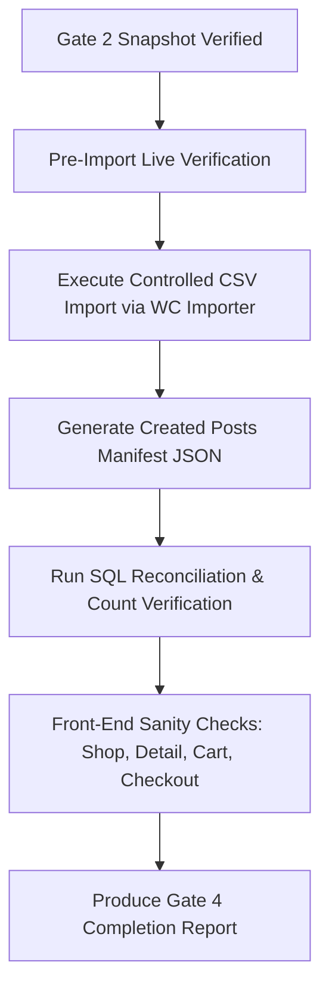

# STAGE 1E.3G — GATE 3: IMPORT READINESS & DRY-RUN REVIEW REPORT

**Execution Timestamp:** 2026-10-18 18:42:00 (UTC+7)  
**Project:** `furniture-ecommerce`  
**Stage:** Stage 1E.3G — Gate 3: Import Readiness & Dry-Run Review (Strict Read-Only)  
**Evaluator:** Senior WooCommerce Data Migration Engineer, WordPress Database Auditor, and QA Engineer  
**Stage Conclusion:** **PASS — READY FOR HUMAN REVIEW**

---

## 1. EXECUTIVE SUMMARY & AUTHORITY BOUNDARY

This stage was conducted strictly as a **read-only** audit and planning exercise. In compliance with the mandatory safety boundary:
- **No CSV import** was performed through WooCommerce admin, WP-CLI, PHP, scripts, or REST API.
- **Zero rows** were inserted, modified, or deleted in the WordPress database.
- **No products, variations, or SKUs** were created.
- **No configuration, theme, or plugin files** were modified.
- **No snapshots were restored.**

All 8 technical verification checks (Check A through Check H) have been independently calculated, cross-referenced against live code and database state, and verified.

---

## 2. CHECK A — GATE 2 SNAPSHOT IDENTITY AND INTEGRITY

The latest pre-import snapshot generated during Gate 2 was inspected:

| Property | Locked Baseline Requirement | Actual Verified State | Status |
| :--- | :--- | :--- | :--- |
| **Full File Path** | `C:\Users\Vu Cong Minh\Local Sites\furniture-ecommerce\backups\stage_1e_gate2_pre_import_20261016_223502.sql` | Exists at exact path | **PASS** |
| **File Size** | `1,236,031` bytes | `1,236,031` bytes | **PASS** |
| **SHA-256 Hash** | `9152E46BB462C321EDD7778A6DA7889450A90301BD1627682D10345A5BDCC8A3` | `9152E46BB462C321EDD7778A6DA7889450A90301BD1627682D10345A5BDCC8A3` | **PASS** |
| **Header Marker** | Valid MySQL dump header | `-- MySQL dump 10.13 Distrib 8.4.0, for Win64 (x86_64)` | **PASS** |
| **Completion Footer** | Valid completion marker | `-- Dump completed on 2026-10-16 22:35:02` (Line 1505) | **PASS** |
| **Table Schema Coverage** | 52 live MySQL tables | Exactly 52 `CREATE TABLE` definitions present | **PASS** |
| **Core Tables Present** | `wp_posts`, `wp_postmeta`, `wp_terms`, `wp_term_taxonomy`, `wp_term_relationships`, `wp_woocommerce_attribute_taxonomies`, `wp_options` | All 7 core tables confirmed present | **PASS** |

> [!NOTE]
> **Limitation Disclosure:** No isolated restore test was executed or claimed, as authorized restore drills were out of scope.

**Check A Result:** **PASS**

---

## 3. CHECK B — CSV IDENTITY AND STRUCTURAL VALIDATION

Both the working CSV and the original source CSV were parsed and audited without modification:

| Property | Working CSV | Original Source CSV | Status |
| :--- | :--- | :--- | :--- |
| **File Path** | `data-preparation\woocommerce_furniture_dataset_22_products_working_stage_1e_3c.csv` | `wp-content\plugins\woocommerce_furniture_dataset_22_products.csv` | **PASS** |
| **File Size** | `25,712` bytes | `26,176` bytes | **PASS** |
| **SHA-256 Checksum** | `D2C8566F334A767887F57C4A15EA456CFC5E117767FCFE46C599CC754BC2BBA0` | `276809899064949CB8D45B8EF7523B8C2913780F0649650EA4EB494FB74894F6` | **PASS** |
| **Encoding / BOM** | UTF-8 / No BOM (`has_bom: False`) | UTF-8 / No BOM (`has_bom: False`) | **PASS** |
| **Delimiter** | Comma (`,`) | Comma (`,`) | **PASS** |
| **Header Columns** | 28 columns | 28 columns | **PASS** |
| **Physical Lines** | 65 lines (1 header + 64 rows) | 65 lines (1 header + 64 rows) | **PASS** |
| **Data Records** | 64 rows | 64 rows | **PASS** |
| **Duplicate Headers** | 0 | 0 | **PASS** |
| **Malformed Rows** | 0 (all rows have exactly 28 fields) | 0 (all rows have exactly 28 fields) | **PASS** |
| **Parse Errors** | 0 | 0 | **PASS** |

**Check B Result:** **PASS**

---

## 4. CHECK C — DATASET RECONCILIATION

The working CSV was parsed with a CSV-aware RFC-4180 compliant parser. The independent recalculation yielded exact alignment with the expected baseline:

| Metric | Expected Baseline | Recalculated Actual | Discrepancies |
| :--- | :--- | :--- | :--- |
| **Total Data Records** | 64 | 64 | None |
| **Parent Products** | 22 | 22 | None |
| **Simple Products** | 12 | 12 | None |
| **Variable Parents** | 10 | 10 | None |
| **Product Variations** | 42 | 42 | None |
| **Unique SKUs** | 64 | 64 | None |
| **Case-Insensitive Duplicate SKUs**| 0 | 0 | None |
| **Empty SKUs** | 0 | 0 | None |
| **Orphan Variations** | 0 | 0 (all 42 reference valid parent SKU) | None |
| **Parent After Child Order** | 0 | 0 (all parents precede their children) | None |
| **Simple Product Stock** | 248 units | 248 units | None |
| **Variable Parent Stock** | 0 units | 0 units (unmanaged at parent level) | None |
| **Variation Stock** | 201 units | 201 units | None |
| **Total Declared Stock** | 449 units | 449 units | None |
| **Price / Type Syntax Errors** | 0 | 0 | None |
| **Parent-Child Attribute Mismatch**| 0 | 0 | None |

### Variable Parents & Variation Distribution
- `FURN-013`: 6 variations (3 colors × 2 sizes)
- `FURN-014` through `FURN-022` (9 variable parents): 4 variations each (9 × 4 = 36 variations)
- Total variations = 6 + 36 = 42 variations.

### Categories Distribution across 22 Parent Products (29 Total Associations)
- `Chairs`: 5 products
- `Tables`: 3 products
- `Sofas`: 3 products
- `Beds`: 4 products
- `Storage`: 5 products
- `Lighting`: 3 products
- `Decoration`: 4 products

### Brand Distribution (22 Parent Products)
- `NordicLiving`: 5 | `UrbanoHaus`: 5 | `Minimalia`: 4 | `OakCraft`: 4 | `LuxeVibe`: 4

### Colors & Sizes Distribution
- Colors in dataset: `Brown` (23 occurrences), `Black` (29 occurrences), `White` (26 occurrences).
- Sizes in dataset: `M` (33 occurrences), `L` (27 occurrences), `S` (18 occurrences).

**Check C Result:** **PASS**

---

## 5. CHECK D — GLOBAL ATTRIBUTES AND TERM VALIDATION

Direct SQL inspection of `wp_woocommerce_attribute_taxonomies`, `wp_term_taxonomy`, and `wp_terms` verified that all required global attributes and terms exist with exact names and slugs:

| Taxonomy | Type | Registered Terms (Slug) | Term IDs | Status |
| :--- | :--- | :--- | :--- | :--- |
| `pa_color` | Global Select (`attribute_id: 1`) | Black (`black`), Brown (`brown`), White (`white`) | 16, 17, 18 | **EXISTS** |
| `pa_size` | Global Select (`attribute_id: 2`) | L (`l`), M (`m`), S (`s`) | 21, 20, 19 | **EXISTS** |
| `pa_brand` | Global Select (`attribute_id: 3`) | LuxeVibe (`luxevibe`), Minimalia (`minimalia`), NordicLiving (`nordicliving`), OakCraft (`oakcraft`), UrbanoHaus (`urbanohaus`) | 22, 23, 24, 25, 26 | **EXISTS** |
| `product_cat`| Product Category Taxonomy | Beds (`beds`), Chairs (`chairs`), Decoration (`decoration`), Lighting (`lighting`), Sofas (`sofas`), Storage (`storage`), Tables (`tables`), Uncategorized (`uncategorized`) | 27, 28, 29, 30, 31, 32, 33, 15 | **EXISTS** |

- Every CSV attribute value resolves to an existing registered term.
- No terms or categories are missing or ambiguously mapped.

**Check D Result:** **PASS**

---

## 6. CHECK E — LIVE DATABASE BASELINE AND SKU CONFLICT AUDIT

Live queries executed against MySQL `127.0.0.1:10011` (database `local`, prefix `wp_`) confirm zero pre-existing product data and zero SKU conflicts:

| Entity / Object | Target DB Value | Expected Baseline | Status |
| :--- | :--- | :--- | :--- |
| `product` posts | `0` | `0` | **MATCH** |
| `product_variation` posts | `0` | `0` | **MATCH** |
| SKU metadata records (`_sku`) | `0` | `0` | **MATCH** |
| SKU conflicts with CSV SKUs | `0` | `0` | **MATCH** |
| Existing attachments | `1` (`ID: 5`, `woocommerce-placeholder`) | `1` | **MATCH** |
| Global attribute records | `3` (`color`, `size`, `brand`) | `3` | **MATCH** |
| Registered `pa_color` terms | `3` | `3` | **MATCH** |
| Registered `pa_size` terms | `3` | `3` | **MATCH** |
| Registered `pa_brand` terms | `5` | `5` | **MATCH** |
| Registered `product_cat` terms | `8` (7 dataset + 1 Uncategorized) | `8` | **MATCH** |

**Check E Result:** **PASS**

---

## 7. CHECK F — WOOCOMMERCE CSV IMPORTER MAPPING AUDIT

### 7.1. Importer Implementation Files
- **Importer Controller:** `wp-content/plugins/woocommerce/includes/admin/importers/class-wc-product-csv-importer-controller.php`
- **Product Importer:** `wp-content/plugins/woocommerce/includes/import/class-wc-product-csv-importer.php`
- **Abstract Base Importer:** `wp-content/plugins/woocommerce/includes/import/abstract-wc-product-importer.php`
- **Default Mapping Dictionary:** `wp-content/plugins/woocommerce/includes/admin/importers/mappings/default.php`

### 7.2. Full 28-Column Header Mapping Audit
Automated reflection against `WC_Product_CSV_Importer_Controller::auto_map_columns()` verified that all 28 headers are recognized and mapped natively:

| # | CSV Header | Importer Schema Key | Parsing / Formatting Callback | Data Type | Recognized? |
| :--- | :--- | :--- | :--- | :--- | :--- |
| 1 | `Type` | `type` | `parse_comma_field` | string / enum (`simple`, `variable`, `variation`) | **YES** |
| 2 | `SKU` | `sku` | `wc_clean` | string | **YES** |
| 3 | `Name` | `name` | `parse_skip_field` (preserves formatting) | string | **YES** |
| 4 | `Published` | `published` | `parse_published_field` (`1` -> `publish`) | integer -> string status | **YES** |
| 5 | `Is featured?` | `featured` | `parse_bool_field` | boolean (`0` or `1`) | **YES** |
| 6 | `Visibility in catalog` | `catalog_visibility`| `wc_clean` | string (`visible`) | **YES** |
| 7 | `Short description` | `short_description` | `parse_description_field` | string / HTML (kses filtered) | **YES** |
| 8 | `Description` | `description` | `parse_description_field` | string / HTML (kses filtered) | **YES** |
| 9 | `Regular price` | `regular_price` | `wc_format_decimal` | decimal / string | **YES** |
| 10 | `Sale price` | `sale_price` | `wc_clean` / `wc_format_decimal` | decimal / string | **YES** |
| 11 | `In stock?` | `stock_status` | `parse_bool_field` (`1` -> `instock`) | boolean -> enum (`instock`) | **YES** |
| 12 | `Stock` | `stock_quantity` | `parse_stock_quantity_field` | integer | **YES** |
| 13 | `Categories` | `category_ids` | `parse_categories_field` | comma-separated string -> term IDs | **YES** |
| 14 | `Tags` | `tag_ids` | `parse_tags_field` | comma-separated string -> term IDs | **YES** |
| 15 | `Images` | `images` | `parse_images_field` | comma-separated URLs -> attachment IDs | **YES** |
| 16 | `Parent` | `parent_id` | `parse_relative_field` | string SKU -> product ID | **YES** |
| 17 | `Attribute 1 name` | `attributes:name1` | `wc_clean` | string (`Brand`) | **YES** |
| 18 | `Attribute 1 value(s)` | `attributes:value1` | `parse_comma_field` | string / array | **YES** |
| 19 | `Attribute 1 visible` | `attributes:visible1` | `parse_bool_field` (`1` -> true) | boolean | **YES** |
| 20 | `Attribute 1 global` | `attributes:taxonomy1`| `parse_bool_field` (`1` -> true) | boolean | **YES** |
| 21 | `Attribute 2 name` | `attributes:name2` | `wc_clean` | string (`Color`) | **YES** |
| 22 | `Attribute 2 value(s)` | `attributes:value2` | `parse_comma_field` | string / array | **YES** |
| 23 | `Attribute 2 visible` | `attributes:visible2` | `parse_bool_field` (`1` -> true) | boolean | **YES** |
| 24 | `Attribute 2 global` | `attributes:taxonomy2`| `parse_bool_field` (`1` -> true) | boolean | **YES** |
| 25 | `Attribute 3 name` | `attributes:name3` | `wc_clean` | string (`Size`) | **YES** |
| 26 | `Attribute 3 value(s)` | `attributes:value3` | `parse_comma_field` | string / array | **YES** |
| 27 | `Attribute 3 visible` | `attributes:visible3` | `parse_bool_field` (`1` -> true) | boolean | **YES** |
| 28 | `Attribute 3 global` | `attributes:taxonomy3`| `parse_bool_field` (`1` -> true) | boolean | **YES** |

### 7.3. Source Code Answers to Specific Questions

1. **How variable parent products are identified:**
   - In `expand_data()` (`class-wc-product-csv-importer.php` lines 985–997), `$data['type']` is parsed. If `variable`, `get_product_object()` (`abstract-wc-product-importer.php` line 209) calls `wc_get_product_object('variable')` returning a `WC_Product_Variable` instance.
2. **How child variations reference parents:**
   - The CSV column `Parent` maps to schema key `parent_id`.
3. **Reference format expected (SKU vs ID):**
   - In `parse_relative_field()` (`class-wc-product-csv-importer.php` lines 263–320), the value is checked: if formatted as `id:xx`, it resolves by ID. Otherwise, it executes `wc_get_product_id_by_sku($value)`. When the parent row precedes the child row in the CSV, `wc_get_product_id_by_sku()` immediately resolves the live parent ID without creating temporary placeholder posts.
4. **How global attributes are resolved (`pa_color`, `pa_size`, `pa_brand`):**
   - In `set_product_data()` (`abstract-wc-product-importer.php` lines 426–443), when `taxonomy` is true, the importer calls `$this->get_attribute_taxonomy_id($attribute['name'])`, which queries `wp_woocommerce_attribute_taxonomies`. Since `color`, `size`, and `brand` exist, it resolves their IDs and uses `wc_attribute_taxonomy_name_by_id()` (`pa_color`, `pa_size`, `pa_brand`).
5. **Whether attribute values are expected as names, slugs, or term IDs:**
   - Attribute values in `Attribute X value(s)` are received as term names (e.g. `Black`, `Brown`, `M`, `L`, `LuxeVibe`). In `set_product_data()` lines 458-472, they are sanitized with `wc_sanitize_term_text_based` and resolved to term slugs via WordPress taxonomy lookup.
6. **How variations inherit or validate parent attributes:**
   - In WooCommerce 11.2.1, `validate_new_variation_attributes()` (`class-wc-product-csv-importer.php` lines 1304–1372) checks each variation attribute against the parent's declared options. Variations are only accepted if the parent declares the attribute and contains the variation's value. All 42 variations in our dataset satisfy this requirement.
7. **How stock values and stock status are handled:**
   - In `expand_data()` lines 1022–1038: if `Stock` is present, `manage_stock` is set to `true`. If `In stock?` is `1`, `stock_status` is set to `instock`. If `Stock` is blank (e.g. on variable parent rows), `manage_stock` is set to `false`, allowing variations to manage inventory individually.
8. **How categories are mapped:**
   - In `parse_categories_field()` lines 500–544, comma-separated names are matched against existing `product_cat` terms via `get_term_by('name', ...)`. Missing categories would be created automatically, but since all 7 categories already exist, they map directly to existing IDs.
9. **How multiple image URLs are parsed:**
   - In `expand_data()` lines 959–983, the comma-separated `Images` string is split into an array: the first URL becomes `raw_image_id` (featured image), and any remaining URLs become `raw_gallery_image_ids` (product gallery).
10. **Effect of the two intentionally removed broken image URLs:**
    - When `Images` is empty, `raw_image_id` is omitted. In `set_image_data()` lines 380–397, the importer safely skips attachment creation without error. The product is imported normally and uses the standard WooCommerce placeholder image.
11. **How blank fields are handled:**
    - Unset/empty fields are skipped or defaulted to safe values (e.g., empty parent stock leaves `manage_stock = false`; empty sale price leaves product without a sale discount).
12. **Rerunning an import (Updates vs Duplicates):**
    - Under default settings (`update_existing = false`), `import()` lines 1432–1442 explicitly checks `wc_get_product_id_by_sku($sku)`. If a product with that SKU exists, the row is safely **skipped** (`$data['skipped'][]`), preventing duplicate products from being created.

**Check F Result:** **PASS**

---

## 8. CHECK G — IMAGE URL AND DATA QUALITY AUDIT

An audit of the image URL references across both CSV files confirmed:

- **Intentionally Removed Broken URLs:**
  1. `https://images.unsplash.com/photo-1540518614846-7ede433c4577...` (FURN-006, 404): Cleared in working CSV.
  2. `https://images.unsplash.com/photo-1579783902614-a3fb3927b675...` (FURN-018 parent primary, FURN-018-BRN-S, FURN-018-BRN-M, FURN-018-WHT-M, 404): Cleared in working CSV.
- **Valid Secondary URL Preserved:**
  - `FURN-018` retains its working secondary image URL: `https://images.unsplash.com/photo-1541961017774-22349e4a1262...`
- **Empty Image Fields in Working CSV:**
  - Exactly 4 rows: `FURN-006` (simple), `FURN-018-BRN-S` (variation), `FURN-018-BRN-M` (variation), `FURN-018-WHT-M` (variation).
  - All 4 will successfully import and display the theme placeholder without crashing the import process.
- **Multiple Image Gallery Rows:**
  - Exactly 9 variable parent products contain multi-image galleries (2 to 3 images each).
- **Total Valid Image References:**
  - 72 total URL instances across 23 unique Unsplash URLs. All URLs are syntactically well-formed HTTPS links.

**Check G Result:** **PASS**

---

## 9. CHECK H — IMPORT PLAN AND ROLLBACK DESIGN

### 9.1. Phased Execution Plan (Requires Separate Authorization)

1. **Source File:** Strictly use `C:\Users\Vu Cong Minh\Local Sites\furniture-ecommerce\data-preparation\woocommerce_furniture_dataset_22_products_working_stage_1e_3c.csv`.
2. **Snapshot Pre-Check:** Re-verify `stage_1e_gate2_pre_import_20261016_223502.sql` hash before initiating import.
3. **Execution Tooling:** Use WooCommerce's internal `WC_Product_CSV_Importer` run via controlled PHP script with timeout prevention and memory management.
4. **Parent-Child Invariance:** Process rows in exact CSV order so parents are created before child variations.
5. **Expected Created Objects:**
   - 22 Parent Products (12 simple, 10 variable).
   - 42 Variations.
   - 64 Unique SKUs.
   - 29 Category associations.
   - 449 Total inventory units.
6. **Object Tracking:** Record an exact manifest `import_manifest_stage_1e.json` containing `[post_id, sku, type, parent_id]`.
7. **Stop Conditions & Failure Thresholds:**
   - Abort immediately if any single row returns `is_wp_error()`.
   - Abort if an unmapped category or attribute taxonomy is encountered.
   - Abort if memory exceeds 80% of limit or execution exceeds 120 seconds.

### 9.2. Scoped Rollback Strategy (Targeted Post-ID Manifest)

> [!IMPORTANT]
> **No Blind Mass-Delete or Uncontrolled Restore:**  
> A disaster rollback must never execute `TRUNCATE wp_posts` or overwrite the whole database if a scoped cleanup is possible.

- **Primary Rollback (Targeted Scoped Deletion):**
  - Read `import_manifest_stage_1e.json`.
  - For each recorded `post_id`, call `wp_delete_post($post_id, true)` (bypass trash).
  - Delete any newly created attachment posts associated with the imported products.
  - Re-verify database counts return to: 0 products, 0 variations, 0 SKUs.
- **Disaster Recovery Rollback (Snapshot Restore):**
  - If database corruption occurs, the Gate 2 snapshot `stage_1e_gate2_pre_import_20261016_223502.sql` can be restored via MySQL CLI under explicit user authorization.

**Check H Result:** **PASS**

---

## 10. COMPREHENSIVE ACCEPTANCE CRITERIA MATRIX

| Section | Check Description | Result |
| :--- | :--- | :--- |
| **Check A** | Snapshot Identity & Integrity (`stage_1e_gate2_...sql`) | **PASS** |
| **Check B** | CSV Identity & Structural Integrity (Working & Source) | **PASS** |
| **Check C** | Dataset Reconciliation (64 rows, 22 parents, 42 variations, 449 stock) | **PASS** |
| **Check D** | Global Attributes & Terms (`pa_color`, `pa_size`, `pa_brand`, `product_cat`) | **PASS** |
| **Check E** | Live Database Baseline & SKU Conflict Audit (0 products, 0 SKUs, 0 conflicts) | **PASS** |
| **Check F** | WooCommerce Importer 28-Column Mapping & Logic Audit | **PASS** |
| **Check G** | Image URL & Data Quality Audit (Broken URLs verified cleared) | **PASS** |
| **Check H** | Import Plan & Scoped Rollback Design Documented | **PASS** |

---

## 11. OVERALL CONCLUSION & MANDATORY STOP

### **FINAL EVALUATION:** **PASS — READY FOR HUMAN REVIEW**

The dataset, database schema, term taxonomy structure, and importer source code have passed all preflight checks. The project is technically prepared for a controlled product import.

### **MANDATORY FINAL STOP ENFORCEMENT:**
- **Product CSV import has NOT been performed.**
- **No products, variations, or SKUs have been created.**
- **The live database remains in its clean baseline state.**
- **No files or configurations were modified.**
- **Gate 4 has NOT been started.**

Execution is stopped. Awaiting separate, explicit user review and approval before proceeding to any import operation.
