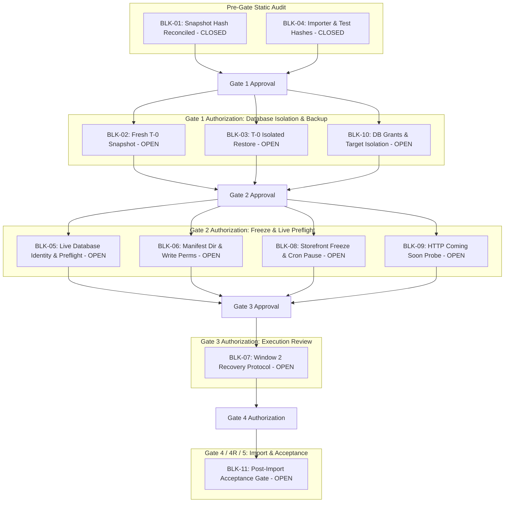

# STAGE 3N-R2M-R5-R5 — FINAL GATE 4 BLOCKER REGISTER

**Project:** ATELIER — WordPress / WooCommerce Furniture E-commerce  
**Workspace:** `C:\Users\Vu Cong Minh\Local Sites\furniture-ecommerce\`  
**Scope:** Authoritative Blocker Register for Operational Execution Readiness  
**Audit Mode:** STRICTLY READ-ONLY STATIC AUDIT  
**Authorization Status:** GATE 4 STRICTLY BLOCKED — NO EXECUTION AUTHORIZATION

---

## 1. Blocker Evaluation Framework

Every blocker in this register represents an operational prerequisite, safety invariant, or unverified runtime claim that must be objectively resolved before Gate 4 (Controlled Import Execution) can be authorized. 

No blocker may be marked closed without physical, auditable evidence produced during an authorized operational phase.

---

## 2. Master Blocker Register

| Blocker ID | Severity | Description | Evidence Classification | Affected Phase | Required Action | Acceptance Criteria | Evidence Artifact | Responsible Role | Approval Required | Stop Condition |
|---|---|---|---|---|---|---|---|---|---|---|
| **BLK-01** | HIGH | **Historical Gate 2 Snapshot Hash Discrepancy:** Documentation recorded two conflicting SHA-256 hashes for `stage_1e_gate2_pre_import_20261016_223502.sql` (`...EB87...` vs `...62C3...`). | CONTRADICTED (Historical) / STATIC VERIFIED (Physical File) | P-01 (Pre-Gate) | Reconcile physical file hash on disk and document that `...62C3...` is the true physical hash. Forbid using this snapshot for production disaster recovery. | Physical hash matches `9152E46BB462C321EDD7778A6DA7889450A90301BD1627682D10345A5BDCC8A3`; documentation updated. | `STAGE_3N-R2M-R5-R5_FINAL_GATE4_EVIDENCE_AUDIT.md` Section 4.A | Lead Auditor | Pre-Gate Approval | If physical file is missing or hash does not match `...62C3...`. |
| **BLK-02** | CRITICAL | **Stale Pre-Stage-1F Snapshot (T-0 Missing):** Existing snapshot `stage_1e_gate2_...` was captured on 2026-10-16 and lacks all Stage 1F block templates. Restoring it destroys the storefront design. | STATIC VERIFIED | P-03 / Gate 1 | Create a fresh, pristine baseline snapshot (`stage_3n_t0_snapshot.sql`) capturing all post-Stage-1F database tables immediately prior to import. | mysqldump completes with exit code 0; file size > 1.2 MB; contains 52 tables including Stage 1F templates. | `stage_3n_t0_snapshot.sql` and SHA-256 hash log | Database Administrator | **Gate 1 Approval** | mysqldump error, nonzero exit code, or truncated SQL dump file. |
| **BLK-03** | CRITICAL | **Isolated Restoration of T-0 Undemonstrated:** Fresh snapshot T-0 has not been verified for structural integrity or restoration fidelity in an isolated auxiliary instance. | NOT VERIFIED | P-04 / Gate 1 | Restore `stage_3n_t0_snapshot.sql` into an isolated auxiliary database (`local_isolated_restore`) and verify schema and row count match. | Restoration exits 0; table count exactly 52; `wp_posts` row count matches production baseline; zero corruption errors. | `docs/STAGE_3N_T0_ISOLATED_RESTORE_REPORT.md` | QA Lead & DBA | **Gate 1 Approval** | Any SQL syntax error, table count mismatch, or schema divergence. |
| **BLK-04** | LOW | **Importer & Test Suite Hash Verification:** Verify current physical code on disk matches authorized R2M-R4 audited digests. | STATIC VERIFIED | P-01 (Pre-Gate) | Compute SHA-256 of `run_controlled_import.php` and `test_r2m_isolated_suite.php`. Confirm exact match. | Importer matches `DBF3F73C...`; Test Suite matches `C8843ED5...`. | `STAGE_3N-R2M-R5-R5_FINAL_GATE4_EVIDENCE_AUDIT.md` Section 4.C | Lead Engineer | Pre-Gate Approval | Any hash mismatch indicating unreviewed code changes. |
| **BLK-05** | HIGH | **Live Database Identity & Product Baseline Unverified:** Current live database host, port (10011), database name (`local`), prefix (`wp_`), and product count (0) have not been verified via live connection. | NOT VERIFIED | P-06 / Gate 2 | Run `run_controlled_import.php --action=verify --csv=...` under Gate 2 authorization. | Live target is confirmed `local`; prefix is `wp_`; product count is 0; Attachment ID 5 is verified; exit code 0. | CLI verification stdout log and `docs/STAGE_3N_PREFLIGHT_VERIFY_REPORT.md` | Technical Lead | **Gate 2 Approval** | Any preflight check failure, nonzero product count, or wrong DB identity. |
| **BLK-06** | HIGH | **Live Manifest Directory & Writable State Unverified:** `backups/manifests/` directory does not currently exist on disk and runtime write permission is unverified. | STATIC VERIFIED (Filesystem) / NOT VERIFIED (Live) | P-06 / Gate 2 | Verify during preflight that `Controlled_Import_Path_Resolver` can create and write to `backups/manifests/`. | Directory created with 0750 permissions; test write and read succeeds and test file removed. | CLI preflight check 8 PASS log | Technical Lead | **Gate 2 Approval** | Filesystem permission denied or path outside canonical manifest root. |
| **BLK-07** | HIGH | **Window 2 Crash Boundary & Fail-Closed Orphan Scope:** Software rollback cannot safely delete untagged post objects created during Window 2 crash without risking deletion of legitimate store content. | STATIC VERIFIED | P-08 / Gate 4 & P-11 / Gate 4R-DR | Strictly enforce storefront freeze (Coming Soon) during import. Document DBA manual surgical cleanup procedure if post-T-0 mutations occur. | Disaster recovery runbook explicitly specifies P-11 snapshot restore as primary for Window 2, with manual DBA cleanup as fallback. | `STAGE_3N-R2M-R5_GATE4_PREFLIGHT_RUNBOOK_DESIGN_V3_DRAFT.md` Section 9.3 | System Architect | **Gate 3 Approval** | Any attempt to introduce unsafe heuristic/fuzzy deletion into rollback. |
| **BLK-08** | HIGH | **Storefront Freeze & Background Job Enforcement:** Public visitors or background cron jobs could insert comments, orders, or posts during import execution. | NOT VERIFIED | P-05 / Gate 2 | Enable `woocommerce_coming_soon`, pause WordPress cron (`DISABLE_WP_CRON` or option lock), and terminate active user sessions. | Unauthenticated HTTP request returns 200 with Coming Soon banner; WP cron is inert; zero active non-admin sessions. | HTTP probe response body capture and `wp_options` verification log | Operations Engineer | **Gate 2 Approval** | Public shop or product pages accessible to unauthenticated visitors. |
| **BLK-09** | HIGH | **Effective Storefront Lock Verification (HTTP Probe):** Verification that Coming Soon mode actually intercepts unauthenticated catalog requests on the block-theme storefront. | NOT VERIFIED | P-05 / Gate 2 | Execute automated curl/HTTP probe against `http://localhost:10010/` and `http://localhost:10010/shop/`. | Both endpoints return HTTP Coming Soon template containing expected title; zero product blocks rendered. | cURL stdout and HTTP header/body capture log | QA Engineer | **Gate 2 Approval** | HTTP 200 returning live shop archive or product catalog. |
| **BLK-10** | MEDIUM | **Restricted Database Privilege Verification:** Importer runs as MySQL `root` user in LocalWP; restricted DDL user behavior is unverified. | NOT VERIFIED | P-02 / Gate 1 | Verify DB connection credentials and grants; ensure operations are strictly bounded to target database `local`. | Connection verified to `local` on port 10011; `SELECT DATABASE()` returns `local`. | Database connection audit log | DBA | **Gate 1 Approval** | Importer connects to wrong database, master system database, or wrong port. |
| **BLK-11** | CRITICAL | **Post-Import Acceptance & Rollback Authorization Gate:** Formal authorization boundaries between import acceptance (P-09), emergency rollback (P-10), and release (P-12). | STATIC VERIFIED | P-09..P-12 / Gates 4, 4R, 5 | Enforce strict reconciliation: exactly 64 products, 449 stock, 64 SKUs. If any metric fails, Gate 4R rollback is mandatory before any release. | Automated reconciliation script confirms all 64 products created, 449 stock, lookup tables populated; zero orphaned posts. | `docs/STAGE_3N_POST_IMPORT_RECONCILIATION_REPORT.md` | Project Owner & QA Lead | **Gate 4 / Gate 4R / Gate 5** | Any metric mismatch, missing variations, or stock discrepancy. |

---

## 3. Blocker Status Summary & Gate Dependencies

---

## 4. Operational Sign-Off Invariant

**MANDATORY INVARIANT:**  
No blocker marked **OPEN** in this register may be bypassed or closed without verifiable runtime evidence gathered under its respective authorized Approval Gate. 

**GATE 4 REMAINS STRICTLY BLOCKED. THIS REGISTER AUTHORIZES ZERO MUTATIONS.**
