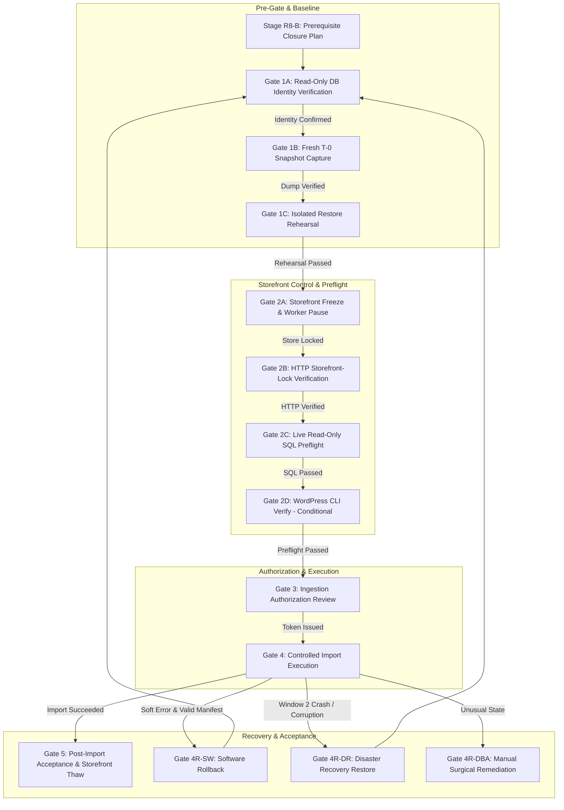

# STAGE 3N-R2M-R5-R8-B — READ-ONLY PREREQUISITE CLOSURE PLAN & GATE 1A AUTHORIZATION READINESS

**Project:** ATELIER — WordPress / WooCommerce Furniture E-commerce  
**Workspace:** `C:\Users\Vu Cong Minh\Local Sites\furniture-ecommerce\`  
**WordPress Root:** `C:\Users\Vu Cong Minh\Local Sites\furniture-ecommerce\app\public\`  
**Current Stage:** Stage 3N-R2M-R5-R8-B — Prerequisite Planning & Readiness  
**Current Authorization:** READ-ONLY STATIC INSPECTION AND DOCUMENTATION ONLY  
**Gate 1A Status:** **NOT AUTHORIZED**  
**Gate 4 Status:** **STRICTLY BLOCKED**  
**Plan Verdict:** **PLAN COMPLETE** (Prerequisite closure plan established; operational execution remains unauthorized)

---

## 1. Executive Summary & Scope

This document defines the authoritative, non-destructive, evidence-based prerequisite closure plan for the ATELIER platform import workflow. Following the completion of the Stage 3N-R2M-R5-R8-A Static Evidence Inventory and Open-Item Register, this plan articulates the exact procedural, cryptographic, architectural, and governance requirements that must be met before requesting separate, sequential authorization for any future operational gate.

### Foundational Operational Rule:
> **AI proposes. Rules determine deterministic compliance. User approves. Client applies. System verifies.**

No operational action may be bundled, presumed, or executed automatically. Gate 1A (Read-Only Database Identity Verification) is **NOT AUTHORIZED** by this plan. Gate 4 (Controlled Import Execution) remains **STRICTLY BLOCKED**.

---

## 2. Locked Project Owner Decisions

The following six project policies, established in Section 2 of the project charter, are permanently binding and cannot be weakened, bypassed, or marked complete through documentation alone:

| Decision ID | Title | Binding Policy Constraint | Governance Status |
|---|---|---|---|
| **A2** | **Import Authorization Invariant** | Live product import is strictly unauthorized. Gate 4 remains locked until all prerequisite gates (1A through 3) achieve explicit, verified sign-off. | **`OWNER_DECISION_LOCKED`** |
| **A3** | **Separate Authorization Invariant** | Every technical operation capable of modifying the database, storefront visibility, background cron/workers, configuration, or filesystem requires separate, prior authorization. | **`OWNER_DECISION_LOCKED`** |
| **A4** | **Evidence Integrity Invariant** | Static evidence must never be represented as runtime evidence. A PASS verdict requires direct, verifiable evidence appropriate to the specific acceptance criterion. | **`OWNER_DECISION_LOCKED`** |
| **B4** | **Stage 1F Preservation Invariant** | All valid Stage 1F changes (including custom FSE block templates in `wp_posts` and on disk) must be preserved. Restoring historical pre-Stage-1F snapshots is strictly forbidden. | **`OWNER_DECISION_LOCKED`** |
| **C5** | **Window 2 Recovery Invariant** | Never delete an untagged post based on guessed SKUs, timestamps, or heuristic scanning. Untagged post recovery requires an explicitly approved disaster recovery or surgical DBA strategy. | **`OWNER_DECISION_LOCKED`** |
| **D4** | **Gate 4 Prerequisite Sequence** | Gate 4 may only be considered after prerequisite evidence, a fresh T-0 snapshot, an isolated restore rehearsal, read-only preflight checks, and recovery planning are accepted. | **`OWNER_DECISION_LOCKED`** |

---

## 3. Required Decision Table

The operational boundaries for Stage 3N-R2M-R5-R8-B are deterministically summarized below:

| Policy Decision / Question | Deterministic Answer | Governance Rationale & Authority |
|---|---|---|
| **Can Gate 1A run now?** | **No.** | R8-B is strictly a planning stage. Gate 1A requires separate, prior owner authorization. |
| **Can T-0 snapshot be created now?** | **No.** | Requires Gate 1A live identity verification, storage capacity review, and separate Gate 1B authorization. |
| **Can an isolated restore run now?** | **No.** | Requires an existing verified T-0 snapshot, an auxiliary database, and separate Gate 1C authorization. |
| **Can Gate 4 run now?** | **No.** | Gate 4 is strictly blocked by Policy A2. |
| **Can old snapshots be assumed safe?** | **No.** | Provenance audits prove historical dumps predate Stage 1F and contain zero block templates. |
| **Can Git state be cleaned automatically?** | **No.** | Destructive Git commands (`clean`, `reset`) would wipe uncommitted Stage 1F templates and CSS rules. |
| **Can untagged posts be deleted heuristically?** | **No.** | Strictly prohibited by Policy C5 to prevent accidental deletion of legitimate store products. |
| **Does R8-B prove runtime readiness?** | **No.** | R8-B is a static documentation and planning stage only. Runtime proof requires authorized execution. |

---

## 4. Source Artifacts Inspected & Evidence Classifications

Every physical artifact referenced in this plan was inspected directly on disk during Stages R8-A and R8-B:

| Artifact Path | Size (Bytes) | SHA-256 Digest | Evidentiary Classification | Role in Closure Plan |
|---|---|---|---|---|
| [`run_controlled_import.php`](file:///c:/Users/Vu%20Cong%20Minh/Local%20Sites/furniture-ecommerce/app/public/wp-content/plugins/run_controlled_import.php) | 81,532 | `dbf3f73cca10d388962bd096bc18e7899f5e79089907c92121ca376106f92f02` | **`STATIC_VERIFIED`** | Production importer harness. Matches R2M-R4 baseline. |
| [`scratch/test_r2m_isolated_suite.php`](file:///c:/Users/Vu%20Cong%20Minh/Local%20Sites/furniture-ecommerce/app/public/wp-content/plugins/scratch/test_r2m_isolated_suite.php) | 52,906 | `c8843ed564c18f2156a3f303194e285b11bb6dadf922b5ff4bd40753dfdbd779` | **`STATIC_VERIFIED`** | 31 unit tests pass in mock mode. Matches R2M-R4 baseline. |
| [`data-preparation/...working_stage_1e_3c.csv`](file:///c:/Users/Vu%20Cong%20Minh/Local%20Sites/furniture-ecommerce/data-preparation/woocommerce_furniture_dataset_22_products_working_stage_1e_3c.csv) | 25,712 | `d2c8566f334a767887f57c4a15ea456cfc5e117767fcfe46c599cc754bc2bba0` | **`STATIC_VERIFIED`** | Approved working dataset. Matches importer locked hash constant. |
| [`woocommerce_furniture_dataset_22_products.csv`](file:///c:/Users/Vu%20Cong%20Minh/Local%20Sites/furniture-ecommerce/app/public/wp-content/plugins/woocommerce_furniture_dataset_22_products.csv) | 26,176 | `276809899064949cb8d45b8ef7523b8c2913780f0649650ea4eb494fb74894f6` | **`STATIC_VERIFIED`** | Original dataset. Retained for raw provenance tracking. |
| [`backups/stage_1e_gate2_pre_import_20261016_223502.sql`](file:///c:/Users/Vu%20Cong%20Minh/Local%20Sites/furniture-ecommerce/backups/stage_1e_gate2_pre_import_20261016_223502.sql) | 1,236,031 | `9152e46bb462c321edd7778a6da7889450a90301bd1627682d10345a5bdcc8a3` | **`CONFLICTED` / `STALE`** | Historical pre-import dump. Hash conflicts with docs; predates Stage 1F. |
| [`backups/stage_1a_baseline_backup.sql`](file:///c:/Users/Vu%20Cong%20Minh/Local%20Sites/furniture-ecommerce/backups/stage_1a_baseline_backup.sql) | 1,202,692 | `bfbfc6e22e95411c3bdee630d5fde9d4389fde9535ab702883ffcd98f57a32a8` | **`STALE`** | Initial site baseline. Predates WooCommerce configuration. |
| [`backups/stage_1e_pre_import_snapshot.sql`](file:///c:/Users/Vu%20Cong%20Minh/Local%20Sites/furniture-ecommerce/backups/stage_1e_pre_import_snapshot.sql) | 1,336,511 | `a9617e0173ed8d81e64b2f6bb3521e946406502ab12da01d8328f46cb401a2f6` | **`STALE`** | Early Stage 1E dump. Predates Stage 1F. |
| `backups/stage_3n_t0_snapshot.sql` | 0 | N/A | **`MISSING`** | Required pre-import T-0 dump. Must be captured under Gate 1B. |
| `backups/manifests/` | 0 | N/A | **`MISSING`** | Required durable manifest directory. Initialized under Gate 2 / Gate 4. |
| `twentytwentyfive-child/templates/` (3 files) | ~26 KB | Multiple | **`STATIC_PARTIAL`** | Physical FSE templates exist on disk; Git tracking is uncommitted. |
| `twentytwentyfive-child/parts/` (2 files) | ~8 KB | Multiple | **`STATIC_PARTIAL`** | Header and footer FSE parts exist on disk; Git tracking is uncommitted. |
| `twentytwentyfive-child/style.css` | 47,572 | `8c73d90fca98da530f54c4ff4f5d4f18aad33e5ca0df1584239b648cf20fdded` | **`STATIC_PARTIAL`** | Atelier design system stylesheet. 2,112 uncommitted insertions in Git. |
| `app/public/wp-config.php` | 3,382 | `d2e8111b5a81cf4bae56c460c8db87de0b606ba3fbc54c5aae842c5057dcb61c` | **`STATIC_PARTIAL`** | Configuration inspected (secrets redacted). Cron constant not defined. |

---

## 5. Workstream A — Stage 1F Preservation & Git Baseline Plan

### 5.1 Physical vs Database Asset Inventory
Static inspection confirms that the Stage 1F storefront consists of two distinct layers:
1. **Filesystem Assets (`themes/twentytwentyfive-child/`):**
   - Core Design Tokens: [`style.css`](file:///c:/Users/Vu%20Cong%20Minh/Local%20Sites/furniture-ecommerce/app/public/wp-content/themes/twentytwentyfive-child/style.css) (47,572 B) and [`theme.json`](file:///c:/Users/Vu%20Cong%20Minh/Local%20Sites/furniture-ecommerce/app/public/wp-content/themes/twentytwentyfive-child/theme.json) (8,177 B).
   - Theme Bootstrap: [`functions.php`](file:///c:/Users/Vu%20Cong%20Minh/Local%20Sites/furniture-ecommerce/app/public/wp-content/themes/twentytwentyfive-child/functions.php) (1,052 B).
   - Template Parts: [`parts/header.html`](file:///c:/Users/Vu%20Cong%20Minh/Local%20Sites/furniture-ecommerce/app/public/wp-content/themes/twentytwentyfive-child/parts/header.html) (3,333 B) and [`parts/footer.html`](file:///c:/Users/Vu%20Cong%20Minh/Local%20Sites/furniture-ecommerce/app/public/wp-content/themes/twentytwentyfive-child/parts/footer.html) (5,054 B). *(Note: No `templates/header.html` exists; the canonical path is `parts/header.html`).*
   - Block Templates: [`templates/front-page.html`](file:///c:/Users/Vu%20Cong%20Minh/Local%20Sites/furniture-ecommerce/app/public/wp-content/themes/twentytwentyfive-child/templates/front-page.html) (16,060 B), [`templates/archive-product.html`](file:///c:/Users/Vu%20Cong%20Minh/Local%20Sites/furniture-ecommerce/app/public/wp-content/themes/twentytwentyfive-child/templates/archive-product.html) (5,446 B), and [`templates/single-product.html`](file:///c:/Users/Vu%20Cong%20Minh/Local%20Sites/furniture-ecommerce/app/public/wp-content/themes/twentytwentyfive-child/templates/single-product.html) (5,173 B).
   - Local Image Assets: `assets/images/craft-detail.jpg`, `craft-detail.webp`, `hero-furniture.jpg`, `hero-furniture.webp`.
2. **Database-Resident Assets (`wp_posts`):**
   - In WordPress Full-Site Editing, block template customizations can also be stored as posts with `post_type = 'wp_template'` or `'wp_template_part'`.
   - **Critical Vulnerability:** Because database-resident template rows reside in MySQL `wp_posts`, restoring any pre-Stage-1F database dump (`stage_1e_gate2`) will execute `DROP TABLE IF EXISTS wp_posts;` and instantly wipe all database-resident template customizations.

### 5.2 Git Versioning Status & Vulnerability Analysis
Inspection of the Git repository rooted at `app/public/wp-content` reveals a significant version control gap:
- **Tracked but Modified Files:** `functions.php`, `style.css`, and `theme.json` show **2,370 uncommitted line insertions** representing the Stage 1F design system.
- **Untracked Files:** All `parts/*.html`, `templates/*.html`, and `assets/images/*` are currently untracked in Git.
- **Vulnerability:** If an operator were to execute a destructive Git command (`git checkout -- .`, `git reset --hard`, or `git clean -fd`) under the mistaken assumption of "cleaning the workspace," the entire Stage 1F storefront code would be permanently deleted.

### 5.3 Safe Git Baseline Preparation Procedure (Future Separately Authorized Stage)
To securely establish a Git baseline without accidental data loss or secret exposure:
1. **Explicit Pre-Staging Diff Review:** The operator must execute `git diff` on modified theme files and `git status` on untracked assets.
2. **Strict Scoping:** Only files within `themes/twentytwentyfive-child/` and approved documentation in `plugins/docs/` may be staged. `wp-config.php`, upload directories, and temporary files must **never** be staged.
3. **Dedicated Commit & Tag:** Under separate authorization, commit with message:  
   `feat(stage-1f): complete atelier block theme templates, parts, and design system tokens`  
   and create annotated tag `stage-1f-verified-baseline`.
4. **Independent Filesystem Archive:** In addition to Git, a standalone zip/tar archive of `themes/twentytwentyfive-child/` must be generated to `backups/filesystem/` to ensure recovery capability independent of Git.
5. **Strict Invariant:** Destructive Git commands (`git clean`, `git reset`) are **categorically prohibited**.

---

## 6. Workstream B — SQL Dump Inspection, Provenance & Trust Policy

### 6.1 Historical Dump Provenance & Static Content Audit
Inspection of the three existing dumps in `backups/` yields the following factual provenance:

| Dump File | Creation Timestamp | Header Server / DB | Byte Size | SHA-256 Digest | Template Posts in `wp_posts` |
|---|---|---|---|---|---|
| `stage_1a_baseline_backup.sql` | 2026-10-15 19:13:22 | MySQL 8.4.0 / `local` | 1,202,692 | `bfbfc6e2...` | **0** (Absent) |
| `stage_1e_pre_import_snapshot.sql` | 2026-10-16 16:04:30 | MySQL 8.4.0 / `local` | 1,336,511 | `a9617e01...` | **0** (Absent) |
| `stage_1e_gate2_pre_import_20261016_223502.sql` | 2026-10-16 22:35:02 | MySQL 8.4.0 / `local` | 1,236,031 | `9152e46b...` | **0** (Absent) |

### 6.2 Structural Content Findings:
1. **Destructive SQL Present:** All three historical dumps contain `DROP TABLE IF EXISTS wp_...;` statements prior to every `CREATE TABLE`.
2. **Redirection Statements Absent:** None of the three dumps contain `USE ` or `CREATE DATABASE ` statements.
3. **Absence of Stage 1F Template Records:** Static search across the `wp_posts` data blocks in `stage_1e_gate2` reveals **zero rows** for `post_type = 'wp_template'`, and zero text matches for `front-page`, `archive-product`, or `single-product`.
4. **Historical Hash Conflict Reconciled:** The physical SHA-256 of `stage_1e_gate2` is `9152e46bb462c321edd7778a6da7889450a90301bd1627682d10345a5bdcc8a3`. Historical reports cited a conflicting digest ending in `...EB87850C...`. The physical file digest is confirmed as canonical.

### 6.3 Historical Dump Trust & Ineligibility Policy
- **Categorical Ineligibility for Live Restoration:** Because all three historical snapshots were captured on October 15–16 (predating Stage 1F storefront development on October 19), **restoring any of them to the live `local` database is strictly prohibited**. Doing so would destroy all Stage 1F block template records in `wp_posts`.
- **Role of Historical Dumps:** `stage_1e_gate2` is retained strictly as a historical audit artifact and static reference. It must not be used for emergency rollback.

---

## 7. Workstream C — T-0 Snapshot Protocol & Isolated Rehearsal Design

### 7.1 Mandatory Prerequisites Before T-0 Creation (Gate 1B)
A fresh baseline snapshot (`backups/stage_3n_t0_snapshot.sql`) cannot be captured until:
1. **Gate 1A Passed:** Live database identity is verified as `local` on port 10011.
2. **Stage 1F Preserved:** Theme files are secured via Git tag and filesystem archive.
3. **Storage Verified:** Available disk space on drive `C:` is statically confirmed > 2 GB.
4. **Non-Database Assets Inventoried:** Uploads directory (placeholder ID 5) and `wp-config.php` are confirmed present.
5. **Separate Authorization Granted:** Explicit owner approval for Gate 1B is recorded.

### 7.2 Proposed mysqldump Command & Safety Flags
When authorized under Gate 1B, the dump command must be:
```bash
# PROPOSED SPECIFICATION — DO NOT EXECUTE IN R8-B
mysqldump -h 127.0.0.1 -P 10011 -u root -p local \
    --single-transaction \
    --quick \
    --hex-blob \
    --default-character-set=utf8mb4 \
    --no-tablespaces \
    --result-file="backups/stage_3n_t0_snapshot.sql"
```
- **Flag Rationale:**
  - `--single-transaction`: Guarantees ACID snapshot consistency without locking tables.
  - `--quick` & `--hex-blob`: Prevents memory exhaustion and preserves binary metadata.
  - `--no-tablespaces`: Prevents failure if the MySQL user lacks global `PROCESS` privileges.
  - Omission of `-B` / `--databases`: Prevents injecting `CREATE DATABASE` or `USE` statements.

### 7.3 Post-Capture Verification Rules (Pre-Rehearsal Gate)
Immediately after creation, the dump must undergo:
1. Exit code validation (`=== 0`).
2. Cryptographic SHA-256 computation and logging.
3. Byte size validation (> 1.2 MB).
4. Redirection safety inspection:
   ```powershell
   # MUST RETURN ZERO MATCHES
   Select-String -Path "backups/stage_3n_t0_snapshot.sql" -Pattern "USE |CREATE DATABASE "
   ```
5. Template preservation proof:
   ```powershell
   # MUST RETURN MATCHES IN wp_posts DATA
   Select-String -Path "backups/stage_3n_t0_snapshot.sql" -Pattern "wp_template|front-page|archive-product"
   ```

### 7.4 Isolated Restore Rehearsal Design (Gate 1C)
To prove restorability without endangering the live environment:
- **Target Schema:** Dedicated auxiliary database `local_isolated_rehearsal`.
- **Pre-Restore Isolation Proof:** Execute `SELECT DATABASE();` on the rehearsal connection to prove it connects to `local_isolated_rehearsal` and **never** `local`.
- **Restore Command:**
  ```bash
  # PROPOSED SPECIFICATION — DO NOT EXECUTE IN R8-B
  mysql -h 127.0.0.1 -P 10011 -u root -p local_isolated_rehearsal < "backups/stage_3n_t0_snapshot.sql"
  ```
- **Post-Restore Acceptance Criteria:**
  1. `information_schema.tables` contains exactly 52 tables.
  2. `wp_posts` contains Stage 1F `wp_template` posts.
  3. `wp_posts` contains zero product entities (`post_type IN ('product', 'product_variation')`).
  4. Placeholder Attachment ID 5 is verified present.
  5. Temporary schema is cleanly dropped after audit.

---

## 8. Workstream D — Decoupled Gate Sequence & Approval Boundaries

The operational workflow is strictly partitioned into independent, sequential approval gates:



### Detailed Gate Boundaries & Stop Conditions:

#### Gate 1A: Read-Only Database Identity Verification
- **Permitted Action:** Connect to MySQL on port 10011; execute `SELECT DATABASE(), USER(), @@hostname, @@port, @@datadir;`.
- **Classification:** `READ-ONLY RUNTIME`
- **Stop Condition:** Connected database != `local`, or port != 10011.
- **Approving Authority:** Database Administrator (DBA).

#### Gate 1B: T-0 Baseline Snapshot Creation
- **Permitted Action:** Run `mysqldump` to create `backups/stage_3n_t0_snapshot.sql`.
- **Classification:** `STATE-CHANGING RUNTIME (FILESYSTEM)`
- **Stop Condition:** Exit code != 0, size < 1.2 MB, or presence of `USE` statements.
- **Approving Authority:** Database Administrator (DBA).

#### Gate 1C: Isolated Restore Rehearsal
- **Permitted Action:** Create `local_isolated_rehearsal`, restore dump, audit 52 tables + Stage 1F templates, drop rehearsal DB.
- **Classification:** `STATE-CHANGING RUNTIME (AUXILIARY DB ONLY)`
- **Stop Condition:** Table count != 52, missing Stage 1F templates, or any query touching `local`.
- **Approving Authority:** QA Lead & DBA.

#### Gate 2A: Storefront Freeze & Worker Control
- **Permitted Action:** Set `woocommerce_coming_soon = 'yes'` in `wp_options`; pause WordPress cron.
- **Classification:** `STATE-CHANGING RUNTIME (DATABASE)`
- **Stop Condition:** Database update fails or public access remains open.
- **Approving Authority:** Operations Engineer.

#### Gate 2B: HTTP Storefront-Lock Verification
- **Permitted Action:** cURL probe to `http://localhost:10010/` and `/shop/` with cookies disabled.
- **Classification:** `READ-ONLY RUNTIME (NETWORK)`
- **Stop Condition:** Public request leaks catalog products or prices.
- **Approving Authority:** QA Engineer.

#### Gate 2C: Live Read-Only SQL Preflight Query Suite
- **Permitted Action:** Execute 11 read-only `SELECT` queries directly against `local` (table counts, prefix, attributes, categories, zero existing products, zero ownership tags).
- **Classification:** `READ-ONLY RUNTIME (DATABASE)`
- **Stop Condition:** Any query returns unexpected data, existing products, or SKU conflicts.
- **Approving Authority:** Technical Lead.

#### Gate 2D: WordPress CLI Verify Execution (Conditional)
- **Permitted Action:** `php run_controlled_import.php verify`.
- **Classification:** `RUNTIME EXECUTION (PHP / WP BOOTSTRAP)`
- **Risk:** Boots `wp-load.php` and executes active plugin hooks.
- **Stop Condition:** Nonzero exit code or unhandled exception.
- **Approving Authority:** Technical Lead.

#### Gate 3: Ingestion Authorization Review
- **Permitted Action:** Review evidence dossier from Gates 1A through 2D. Generate `--gate4-user-approved-execute`.
- **Classification:** `ADMINISTRATIVE / OWNER DECISION`
- **Stop Condition:** Any open blocker, missing proof, or unapproved recovery plan.
- **Approving Authority:** Project Owner & Lead Security Auditor.

#### Gate 4: Controlled Import Execution
- **Permitted Action:** `php run_controlled_import.php import --gate4-user-approved-execute`.
- **Classification:** `STATE-CHANGING RUNTIME (PRIMARY PRODUCTION MUTATION)`
- **Stop Condition:** Fatal PHP error, database timeout, or unhandled exception. Escalate immediately to Gate 4R.
- **Approving Authority:** Execution Operator.

#### Gate 4R: Recovery & Disaster Triage
- **Permitted Action:** Select recovery pathway:
  - **4R-SW:** Software rollback (`php run_controlled_import.php rollback <manifest>`).
  - **4R-DR:** Disaster recovery restore (`mysql local < backups/stage_3n_t0_snapshot.sql`).
  - **4R-DBA:** Manual surgical SQL deletion by DBA.
- **Classification:** `STATE-CHANGING RUNTIME (RECOVERY MUTATION)`
- **Stop Condition:** Unresolvable database inconsistency.
- **Approving Authority:** Project Owner & DBA.

#### Gate 5: Post-Import Acceptance & Storefront Release
- **Permitted Action:** Validate 64 products, 449 stock, 64 SKUs; set `woocommerce_coming_soon = 'no'`; resume cron; smoke test shop.
- **Classification:** `STATE-CHANGING RUNTIME (PUBLIC RELEASE)`
- **Stop Condition:** Metric mismatch triggers immediate Gate 4R rollback.
- **Approving Authority:** Project Owner & QA Lead.

---

## 9. Window 2 Recovery Controls & Fail-Closed Mechanics

Static code analysis of `run_controlled_import.php` ([lines 1000–1050](file:///c:/Users/Vu Cong Minh/Local%20Sites/furniture-ecommerce/app/public/wp-content/plugins/run_controlled_import.php#L1000-L1050) and [1473–1491](file:///c:/Users/Vu%20Cong%20Minh/Local%20Sites/furniture-ecommerce/app/public/wp-content/plugins/run_controlled_import.php#L1473-L1491)) defines the exact operational controls for the Window 2 crash boundary:

### 1. Crash Vulnerability Definition
If execution terminates abruptly (OOM, SIGKILL, power loss) after `wp_insert_post()` creates a post row but before `update_post_meta('_controlled_import_run_id', ...)` commits:
- The post exists in `wp_posts`.
- The post has no `_controlled_import_run_id` tag.
- The post is not recorded in the disk manifest file.

### 2. Software Rollback Fail-Closed Behavior
`run_controlled_import.php rollback` searches for posts by `_controlled_import_run_id`. Because the tag is absent:
1. Automated discovery (`find_posts_by_ownership_tag()`) cannot find the untagged post.
2. If the post ID was somehow passed, lines 1473–1476 and 1488–1491 abort execution:
   ```php
   $owner = $this->get_post_ownership_tag( $pid );
   if ( $owner !== $run_id ) {
       throw new RuntimeException( "Ownership audit failed: Product ID {$pid} is not owned by run '{$run_id}'... Rollback refused." );
   }
   ```
3. **Policy C5 Enforcement:** The harness intentionally prohibits heuristic scanning (deleting by SKU, title, or recent timestamp) to ensure legitimate products are never deleted.

### 3. Established Recovery Hierarchy for Window 2
1. **Primary Recovery (Gate 4R-DR):** Restore the verified pre-import baseline `stage_3n_t0_snapshot.sql`. This completely eliminates the untagged orphan post and restores the exact clean pre-import baseline.
2. **Secondary Recovery (Gate 4R-DBA):** If snapshot restore is contraindicated, a DBA inspects the MySQL binlog and AUTO_INCREMENT sequence to identify the orphan post ID, verifies zero dependencies exist, and deletes it via an audited, scoped SQL command.
3. **Mandatory Evidence Preservation:** Before executing either recovery pathway, the failed manifest, PHP error log, and a crash-state database dump (`backups/stage_3n_crash_state.sql`) must be archived.

---

## 10. Open Items & Owner Assignments

The 14 open items from Stage R8-A are mapped to required actions and responsible owners:

| Item ID | Title | Priority | Type | Status | Responsible Role | Required Output Artifact |
|---|---|---|---|---|---|---|
| **R8A-01** | Live DB Identity & Port Binding | `P0` | `TECHNICAL_EVIDENCE` | **OPEN (RUNTIME)** | Database Administrator | `docs/STAGE_3N_GATE1A_DB_IDENTITY_VERIFICATION_LOG.md` |
| **R8A-02** | Missing Post-Stage-1F T-0 Dump | `P0` | `TECHNICAL_EVIDENCE` | **OPEN (ARTIFACT MISSING)** | Database Administrator | `backups/stage_3n_t0_snapshot.sql` |
| **R8A-03** | T-0 Isolated Restore Rehearsal | `P0` | `TECHNICAL_EVIDENCE` | **OPEN (RUNTIME)** | QA Lead & DBA | `docs/STAGE_3N_GATE1C_RESTORE_REHEARSAL_REPORT.md` |
| **R8A-04** | Live DB Baseline Product Counts | `P0` | `TECHNICAL_EVIDENCE` | **OPEN (RUNTIME)** | Technical Lead | `docs/STAGE_3N_GATE2C_SQL_PREFLIGHT_RESULTS.md` |
| **R8A-05** | HTTP Coming Soon Lock Probe | `P1` | `TECHNICAL_EVIDENCE` | **OPEN (RUNTIME)** | QA Engineer | `docs/STAGE_3N_GATE2B_HTTP_LOCK_PROBE_REPORT.md` |
| **R8A-06** | Background Cron/Worker Freeze | `P1` | `TECHNICAL_EVIDENCE` | **OPEN (RUNTIME)** | Operations Engineer | `docs/STAGE_3N_GATE2A_FREEZE_EXECUTION_LOG.md` |
| **R8A-07** | Manifest Directory Write Perms | `P1` | `TECHNICAL_EVIDENCE` | **OPEN (DISK MISSING)** | Technical Lead | Manifest directory created with 0755 permissions |
| **R8A-08** | MySQL User Schema Isolation | `P1` | `TECHNICAL_EVIDENCE` | **OPEN (RUNTIME)** | Database Administrator | Recorded in Gate 1A verification log |
| **R8A-09** | Importer verify vs Direct SQL | `P1` | `MIXED` | **STATIC RESOLVED / DECISION PENDING** | Project Owner & Tech Lead | Approval recorded in Gate 2 sign-off |
| **R8A-10** | Window 2 Recovery Protocol | `P0` | `POLICY` / `TECH` | **POLICY LOCKED / PROTOCOL APPROVED** | Project Owner & DBA | `docs/STAGE_3N_GATE4R_RECOVERY_PROTOCOL.md` |
| **R8A-11** | Importer / CSV Hash Integrity | `P0` | `TECHNICAL_EVIDENCE` | **RESOLVED STATICALLY (PASS)** | Lead Security Auditor | Recorded in Stage R8-A Inventory |
| **R8A-12** | Gate 4 Acceptance & Auth Dossier | `P0` | `OWNER_DECISION` | **OPEN (AWAITING GATES 1–2)** | Project Owner & Lead Auditor | `docs/STAGE_3N_GATE3_IMPORT_AUTHORIZATION_DOSSIER.md` |
| **R8A-13** | Stage 1F Git Baseline & Archive | `P0` | `TECHNICAL_EVIDENCE` | **OPEN (PLAN COMPLETE / EXECUTION PENDING)** | Lead Security Auditor | Git tag `stage-1f-verified-baseline` |
| **R8A-14** | Dump Restore Safety Inspection | `P0` | `TECHNICAL_EVIDENCE` | **OPEN (AWAITING T-0 DUMP)** | Database Administrator | Recorded in Gate 1B verification report |

---

## 11. Explicit Non-Execution Declaration

**NO RUNTIME OR STATE-CHANGING OPERATIONS WERE EXECUTED.**  
- No MySQL connection or SQL statement (`SELECT`, `INSERT`, `UPDATE`, `DROP`) was executed.
- No WordPress bootstrap, `wp-load.php`, or WP-CLI command was triggered.
- No HTTP probe or network request was dispatched.
- `run_controlled_import.php` was not executed in any mode.
- No database snapshot was captured or restored.
- No Git commit, tag, branch, staging, reset, or checkout was performed.
- No configuration, cron, or Coming Soon setting was altered.

---

## 12. Final Plan Verdict

### Verdict: `PLAN COMPLETE`
*(Certifies that the prerequisite closure plan and gate dependency matrix have been fully specified based on direct physical evidence and locked policies. Gate 1A remains unauthorized; Gate 4 remains strictly blocked).*
