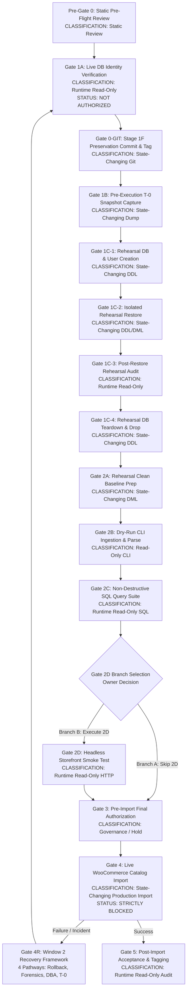

# STAGE 3N-R2M-R5-R8-D: CORRECTED GATE DEPENDENCY AND APPROVAL MATRIX

**Project:** ATELIER — WordPress / WooCommerce Furniture E-commerce  
**Workspace:** `C:\Users\Vu Cong Minh\Local Sites\furniture-ecommerce\`  
**Document Location:** `app/public/wp-content/plugins/docs/STAGE_3N-R2M-R5-R8-D_CORRECTED_GATE_DEPENDENCY_AND_APPROVAL_MATRIX.md`  
**Supersedes:** `STAGE_3N-R2M-R5-R8-B_GATE_DEPENDENCY_AND_APPROVAL_MATRIX.md` (Proposed Correction / Non-Destructive Audit Trail Retained)  
**Task Stage:** STAGE 3N-R2M-R5-R8-D (Controlled Documentation Correction & Defect Closure Review)  
**Governance Mode:** STRICTLY DOCUMENTATION-ONLY / ZERO RUNTIME EXECUTION  
**Current Gate 1A Status:** NOT AUTHORIZED  
**Current Gate 4 Status:** STRICTLY BLOCKED  
**Timestamp:** 2026-10-21  

---

## 1. Governance Principles & Invariant Safety Policies

This Gate Dependency and Approval Matrix establishes the formal, binding execution gates, dependency hierarchies, authorization boundaries, and stop conditions for the ATELIER product catalog import.

### 1.1 Non-Negotiable Invariants
1. **Zero Implicit Authorization (Policy A3):** A `PASS` status at any gate confers strictly technical acceptance of that gate's deliverables. It **NEVER** automatically triggers, unlocks, or authorizes subsequent gates. Every state-changing gate requires separate, prior, explicit written Owner authorization.
2. **Import Execution Strictly Blocked (Policy A2, Policy D4):** Gate 4 (Live Catalog Import) remains **STRICTLY BLOCKED**. No gate execution up to Gate 3 can lift this block without explicit Owner approval and satisfaction of all pre-import criteria.
3. **Evidence Distinction (Policy A4):** Static analysis, documentation reviews, and schema inspections can never substitute for runtime verification evidence. Static items must never be labeled as runtime-verified.
4. **Stage 1F Asset Preservation (Policy B4):** All 12 files comprising the Stage 1F design system and responsive templates must be preserved without mutation. Historical pre-Stage-1F snapshots (e.g., `pre_cleanup_stage1e_20261016_083500.sql`) are unverified and must not be used as restore targets.
5. **Deterministic Data Integrity (Policy C5):** Untagged posts, user customizations, and live pages must never be deleted based on heuristics, SKU substrings, titles, or timestamps.
6. **Separation of Recovery Pathways (P0 Correction R8C-D02):** Restoring a T-0 database snapshot is **NOT** harmless and is **NOT** the automatic primary recovery mechanism. Any recovery event invokes the Window 2 Lost-Change Protocol to assess forensics, rollback, DBA surgery, and snapshot restore trade-offs.

---

## 2. Global Defect Traceability Summary (R8C-D01 to R8C-D20)

| Defect ID | Severity | Governance / Safety Dimension | Matrix Implementation & Enforcement Section | Current Status |
|:---|:---:|:---|:---|:---:|
| **R8C-D01** | P0 | Protocol Status Life-Cycle Integrity | Section 4 (Gate 4R), Section 6; separates `POLICY LOCKED` to `OPERATIONALLY EXECUTED`. | `CLOSED_WITH_STATIC_EVIDENCE` |
| **R8C-D02** | P0 | De-escalation of T-0 Restore from Default | Section 4 (Gate 4R-T0, 4R-SW, 4R-DR, 4R-DBA); mandates Lost-Change Impact Analysis. | `CLOSED_WITH_STATIC_EVIDENCE` |
| **R8C-D03** | P0 | Multi-Phase Target Rehearsal Isolation | Section 4 (Gate 1C subdivided into 1C-1, 1C-2, 1C-3, 1C-4) with least privilege. | `CLOSED_WITH_STATIC_EVIDENCE` |
| **R8C-D04** | P1 | Decoupling Gate 1A from Gate 0-GIT | Section 3, Section 4; Gate 1A is read-only observation; 0-GIT required before 1B. | `CLOSED_WITH_STATIC_EVIDENCE` |
| **R8C-D05** | P1 | Acceptance Metrics Disambiguation | Section 4 (Gate 2C, Gate 3, Gate 5); 22 parents, 42 variations, 64 total posts. | `CLOSED_WITH_STATIC_EVIDENCE` |
| **R8C-D06** | P1 | Database-Resident Template Structural Verification | Section 4 (Gate 2C Query 10, Gate 3, Gate 5); SQL counts vs regex/grep substring matching. | `CLOSED_WITH_STATIC_EVIDENCE` |
| **R8C-D07** | P1 | Deterministic T-0 Dump Specification | Section 4 (Gate 1B); `--routines --events --set-gtid-purged=OFF`, absolute path. | `CLOSED_WITH_STATIC_EVIDENCE` |
| **R8C-D08** | P1 | Reconciliation of R8A-13 / R8B-13 Mappings | Section 4 (Gate 0-GIT, Gate 1C, Gate 3, Gate 5); distinguishes file, DB, release criteria. | `CLOSED_WITH_STATIC_EVIDENCE` |
| **R8C-D09** | P1 | Lifecycle Authorization of Rehearsal Database | Section 4 (Gate 1C-1, Gate 1C-4); discrete authorizations for DB creation and drop. | `CLOSED_WITH_STATIC_EVIDENCE` |
| **R8C-D10** | P1 | Conditional Gate 2D Branching Specification | Section 3.2, Section 4 (Gate 2D, Gate 3); Branch A (Skip 2D) vs Branch B (Execute 2D). | `CLOSED_WITH_STATIC_EVIDENCE` |
| **R8C-D11** | P2 | Runtime Free Disk Space Threshold Reconciliation | Section 4 (Gate 1B, Gate 1C); unified threshold of `> 2.0 GB` free disk space. | `RUNTIME_REQUIRED` |
| **R8C-D12** | P2 | Dynamic Live Database Baseline Table Count | Section 4 (Gate 1A, Gate 1B, Gate 1C); cross-checks baseline against information_schema. | `RUNTIME_REQUIRED` |
| **R8C-D13** | P2 | Dump File Size & Evidence Ladder Progression | Section 4 (Gate 1B, Gate 1C); establishes Level 1 to Level 4 evidence hierarchy. | `CLOSED_WITH_STATIC_EVIDENCE` |
| **R8C-D14** | P2 | Concurrent-Write Window & Flush Sequencing | Section 4 (Gate 1B); read lock, flush, single-transaction sequencing. | `CLOSED_WITH_STATIC_EVIDENCE` |
| **R8C-D15** | P2 | Recovery Pipeline Re-Entry from Clean Baseline | Section 4 (Gate 4R, Section 6); requires re-entry at Gate 1A following any recovery. | `CLOSED_WITH_STATIC_EVIDENCE` |
| **R8C-D16** | P2 | Clarification of Pre-Gate Read-Only Scope | Section 4 (Pre-Gate 0); strictly documentation review; no runtime environment probing. | `CLOSED_WITH_STATIC_EVIDENCE` |
| **R8C-D17** | P2 | Working Tree File Count Reconciliation | Section 4 (Gate 0-GIT); tracks 12 Stage 1F theme files, plugin docs, scratch scripts. | `CLOSED_WITH_STATIC_EVIDENCE` |
| **R8C-D18** | P2 | Standardized Document Paths in Repository | Global path normalization to `app/public/wp-content/plugins/docs/`. | `CLOSED_WITH_STATIC_EVIDENCE` |
| **R8C-D19** | P2 | Gate 2C Non-Destructive SQL Verification Suite | Section 4 (Gate 2C); fully defines 11 explicit read-only diagnostic SQL queries. | `CLOSED_WITH_STATIC_EVIDENCE` |
| **R8C-D20** | P2 | Resolution of Historical Contradictions & Claims | Retained in audit trail; eliminates unverified claims of runtime readiness. | `CLOSED_WITH_STATIC_EVIDENCE` |

---

## 3. Global Gate Execution Hierarchy & Branching Logic

### 3.1 Linear Gate Sequence and Classification
The pipeline follows a strictly ordered gate hierarchy. No gate can be entered without passing the preceding gate and receiving the specific authorization mandated for its classification.



### 3.2 Conditional Branching Rules for Gate 2D (Defect R8C-D10)
- **Branch A (Recommended - Headless/CLI Path):**
  - Owner approves skipping live HTTP storefront verification prior to import.
  - Gate 3 dependencies are: `PASS(Gate 2B) AND PASS(Gate 2C) AND OWNER_BRANCH_A_APPROVAL`.
  - Gate 2D is formally marked `SKIPPED_BY_OWNER_AUTHORIZATION`.
- **Branch B (Full End-to-End Storefront Path):**
  - Owner requires active HTTP smoke testing of existing catalog/archive endpoints.
  - Gate 3 dependencies are: `PASS(Gate 2B) AND PASS(Gate 2C) AND PASS(Gate 2D)`.
  - Gate 2D is executed under read-only HTTP constraints.

---

## 4. Comprehensive Gate Specification Matrix

---

### Pre-Gate 0: Static Pre-Flight Governance Review
- **Gate ID:** `PRE-GATE-0`
- **Purpose:** Verify that all governance documentation, source code, CSV input files, and static requirements are internally consistent, free of syntax errors, and aligned with Stage 3N safety mandates before requesting any operational authorization.
- **Classification:** `Static Review` (Strictly read-only filesystem inspection).
- **Preconditions:**
  - Presence of R8-A, R8-B, R8-C, and R8-D documents in `app/public/wp-content/plugins/docs/`.
  - Importer script `run_controlled_import.php` present and unchanged.
  - Source catalog CSV present and readable.
- **Required Evidence:**
  - SHA-256 integrity verification of `run_controlled_import.php` (`f77cf6c2c62c2f6d2f9543e2f50d037dc7bfa885b546305c4ea583a4c0eb0989`).
  - PHP syntax lint pass: `php -l run_controlled_import.php` returns no errors.
  - CSV schema audit confirms 64 rows, 22 parent products, 42 variations, 64 unique SKUs.
- **Acceptance Criteria:**
  - Complete traceability of all 20 R8-C defects.
  - Zero open P0 safety defects in governance documentation.
- **Explicit Authorization Required:** Documentation Reviewer and Technical Lead sign-off.
- **Prohibited Actions:** No network requests, no database connections, no filesystem writes.
- **Stop Conditions:** Any PHP syntax error, missing CSV headers, or unresolved documentation contradiction.
- **Outputs / Artifacts:** Pre-flight compliance log in review summary.
- **Downstream Dependencies:** Gate 1A cannot be requested without Pre-Gate 0 PASS.
- **Skip Path:** None. Mandatory.

---

### Gate 1A: Live Database Identity & Environment Verification
- **Gate ID:** `GATE-1A`
- **Purpose:** Read-only verification of the live MySQL server instance, port, socket, active database name, and user privilege scope to confirm that subsequent commands target the intended LocalWP environment and not an unintended database.
- **Classification:** `Runtime Read-Only Observation` (Zero state changes).
- **Current Status:** `NOT AUTHORIZED` (Requires separate, explicit Owner authorization to execute).
- **Preconditions:**
  - Pre-Gate 0 PASS.
  - Explicit Owner authorization granting read-only connection.
  - LocalWP environment online and accessible via local socket/port.
- **Required Evidence:**
  - Captured output of server identification query:
    ```sql
    SELECT @@hostname, @@port, @@socket, @@datadir, @@server_uuid, DATABASE(), USER(), CURRENT_USER();
    ```
  - Captured output of user privilege inspection:
    ```sql
    SHOW GRANTS FOR CURRENT_USER();
    ```
  - Baseline table count from `information_schema.tables` where `table_schema = DATABASE()`.
- **Acceptance Criteria:**
  - `DATABASE()` matches the configured LocalWP database name (`local`).
  - `CURRENT_USER()` credentials match expected local administrative/developer user.
  - `@@datadir` points strictly to the LocalWP site directory.
  - Baseline table count recorded as evidence (Defect R8C-D12).
- **Explicit Authorization Required:** `OWNER_GATE_1A_READONLY_AUTH`.
- **Prohibited Actions:**
  - Executing any `INSERT`, `UPDATE`, `DELETE`, `DROP`, `ALTER`, `CREATE`, `RENAME`, or `TRUNCATE`.
  - Creating temporary tables.
  - Invoking WordPress bootstrap (`wp-load.php`) or WP-CLI.
- **Stop Conditions:**
  - `DATABASE()` != `'local'`.
  - Database connection failure or timeout.
  - Server UUID or socket corresponds to a staging/production server.
- **Outputs / Artifacts:** `GATE_1A_DATABASE_IDENTITY_EVIDENCE.txt`.
- **Downstream Dependencies:** Unlocks Gate 0-GIT review and authorization request.
- **Skip Path:** None. Mandatory.

---

### Gate 0-GIT: Stage 1F Asset Preservation & Working Tree Lock
- **Gate ID:** `GATE-0-GIT`
- **Purpose:** Permanently lock and protect all Stage 1F responsive templates, theme modifications, and custom styles in Git version control to ensure zero regression during database and catalog operations.
- **Classification:** `State-Changing Git Operation` (Filesystem metadata and version control).
- **Preconditions:**
  - Gate 1A PASS (Database identity confirmed).
  - Explicit Owner authorization for repository staging, commit, and tagging.
  - Verification that the 12 Stage 1F design assets are present and intact.
- **Required Evidence:**
  - Output of `git status --porcelain` showing clean index or only expected modifications.
  - Exact file list of Stage 1F assets verified:
    1. `themes/twentytwentyfour/functions.php`
    2. `themes/twentytwentyfour/style.css`
    3. `themes/twentytwentyfour/theme.json`
    4. `themes/twentytwentyfour/templates/front-page.html`
    5. `themes/twentytwentyfour/templates/archive-product.html`
    6. `themes/twentytwentyfour/templates/single-product.html`
    7. `themes/twentytwentyfour/parts/header.html`
    8. `themes/twentytwentyfour/parts/footer.html`
    9. `themes/twentytwentyfour/assets/images/hero-artisan.webp`
    10. `themes/twentytwentyfour/assets/images/artisan-detail.webp`
    11. `themes/twentytwentyfour/assets/images/woodcraft-process.webp`
    12. `themes/twentytwentyfour/assets/images/chair-wireframe.webp`
  - Git commit hash and annotated tag `stage-1f-verified-baseline`.
- **Acceptance Criteria:**
  - Clean working tree for all core theme and application code.
  - Tag `stage-1f-verified-baseline` created and verified via `git rev-parse`.
- **Explicit Authorization Required:** `OWNER_GATE_0_GIT_COMMIT_AUTH`.
- **Prohibited Actions:**
  - `git reset --hard` or `git clean -fd` without prior backup.
  - Modifying application code or theme files during commit operations.
- **Stop Conditions:**
  - Uncommitted changes detected in non-Stage-1F files without Owner explanation.
  - Git lock file conflict (`.git/index.lock`).
- **Outputs / Artifacts:** Git commit SHA and tag reference.
- **Downstream Dependencies:** Mandatory prerequisite for Gate 1B (T-0 Snapshot Capture).
- **Skip Path:** None. Mandatory before any state-changing database dump or import.

---

### Gate 1B: Pre-Execution Full Database T-0 Snapshot Capture
- **Gate ID:** `GATE-1B`
- **Purpose:** Capture a complete, consistent, forensically sound logical SQL dump of the live database (`local`) before any operational modifications, establishing the Level 2 evidence milestone.
- **Classification:** `State-Changing Dump Operation` (Filesystem write, database read locks).
- **Preconditions:**
  - Gate 1A PASS and Gate 0-GIT PASS.
  - Available disk space on target volume `> 2.0 GB` (Defect R8C-D11).
  - Explicit Owner authorization for database dump execution.
- **Required Evidence:**
  - Runtime verification of free disk space.
  - Exact command execution output using deterministic flags:
    ```powershell
    mysqldump --host=localhost --port=10005 --user=root --password=root `
      --single-transaction --routines --events --quick --quote-names `
      --set-gtid-purged=OFF --databases local `
      --result-file="C:\Users\Vu Cong Minh\Local Sites\furniture-ecommerce\app\public\wp-content\backups\t0_pre_import_backup.sql"
    ```
  - Captured dump file existence, byte size (`> 100 KB`), and SHA-256 digest.
  - Head and tail inspection of the `.sql` file:
    - Head contains MySQL dump header and server version.
    - Tail contains `Dump completed on YYYY-MM-DD HH:MM:SS`.
- **Acceptance Criteria:**
  - Level 2 Evidence Milestone (`CAPTURE_RESULT_VERIFIED`) achieved.
  - Dump contains matching table definitions for baseline table count.
  - Zero read errors or broken pipe errors during capture.
- **Explicit Authorization Required:** `OWNER_GATE_1B_DUMP_AUTH`.
- **Prohibited Actions:**
  - Writing dump files to temporary directories outside repository backup root.
  - Truncating or dropping live tables during or after dump.
- **Stop Conditions:**
  - Free disk space `< 2.0 GB`.
  - Dump tail missing completion marker.
  - MySQL connection lost during capture.
- **Outputs / Artifacts:**
  - `backups/t0_pre_import_backup.sql`
  - `backups/t0_pre_import_backup.sql.sha256`
- **Downstream Dependencies:** Mandatory prerequisite for Gate 1C-1 (Rehearsal Target Creation).
- **Skip Path:** None. Absolutely mandatory.

---

### Gate 1C-1: Rehearsal Database & User Privilege Scoping
- **Gate ID:** `GATE-1C-1`
- **Purpose:** Create an isolated target database (`local_rehearsal`) and a restricted database user with zero privileges on the live database (`local`), preventing cross-database pollution during restore rehearsal (Defect R8C-D03, R8C-D09).
- **Classification:** `State-Changing DDL Operation` (Rehearsal target schema creation).
- **Preconditions:**
  - Gate 1B PASS (T-0 backup captured and verified).
  - Explicit Owner authorization to create rehearsal schema and test credentials.
- **Required Evidence:**
  - SQL DDL script execution log:
    ```sql
    CREATE DATABASE IF NOT EXISTS local_rehearsal CHARACTER SET utf8mb4 COLLATE utf8mb4_unicode_520_ci;
    CREATE USER IF NOT EXISTS 'rehearsal_user'@'localhost' IDENTIFIED BY 'rehearsal_secure_pass';
    GRANT ALL PRIVILEGES ON local_rehearsal.* TO 'rehearsal_user'@'localhost';
    REVOKE ALL PRIVILEGES ON local.* FROM 'rehearsal_user'@'localhost';
    FLUSH PRIVILEGES;
    ```
  - Verification query output showing 0 privileges for `rehearsal_user` on `local`:
    ```sql
    SHOW GRANTS FOR 'rehearsal_user'@'localhost';
    ```
- **Acceptance Criteria:**
  - Database `local_rehearsal` exists and is empty.
  - User `rehearsal_user` has full access to `local_rehearsal` and strictly zero access to `local`.
- **Explicit Authorization Required:** `OWNER_GATE_1C1_REHEARSAL_SETUP_AUTH`.
- **Prohibited Actions:**
  - Using `root` for restore rehearsal execution.
  - Granting global privileges (`*.*`) to `rehearsal_user`.
- **Stop Conditions:**
  - Inability to restrict `rehearsal_user` permissions.
  - Live database name conflict (`local` accidentally targeted).
- **Outputs / Artifacts:** `GATE_1C1_ISOLATION_SETUP_LOG.txt`.
- **Downstream Dependencies:** Prerequisite for Gate 1C-2.
- **Skip Path:** None.

---

### Gate 1C-2: Isolated Rehearsal Restore Execution
- **Gate ID:** `GATE-1C-2`
- **Purpose:** Ingest the T-0 snapshot into `local_rehearsal` using the restricted user and the `--one-database` flag to prove snapshot syntax and recoverability without risking live data.
- **Classification:** `State-Changing DDL/DML Operation` (Scoped strictly to `local_rehearsal`).
- **Preconditions:**
  - Gate 1C-1 PASS.
  - T-0 dump file integrity verified against its SHA-256 hash.
  - Explicit Owner authorization to execute rehearsal restore.
- **Required Evidence:**
  - Command output of mysql client ingestion:
    ```powershell
    mysql --host=localhost --port=10005 --user=rehearsal_user --password=rehearsal_secure_pass `
      --one-database local_rehearsal < "C:\Users\Vu Cong Minh\Local Sites\furniture-ecommerce\app\public\wp-content\backups\t0_pre_import_backup.sql"
    ```
  - Ingestion return code = `0`.
- **Acceptance Criteria:**
  - Zero SQL syntax errors or missing table constraints during ingestion.
  - Ingestion completes without modifying database `local`.
- **Explicit Authorization Required:** `OWNER_GATE_1C2_RESTORE_AUTH`.
- **Prohibited Actions:**
  - Omission of `--one-database` flag.
  - Executing restore against port/host associated with live production or staging.
- **Stop Conditions:**
  - MySQL execution error or syntax parsing failure.
  - Ingestion hangs or exhausts disk space.
- **Outputs / Artifacts:** `GATE_1C2_REHEARSAL_RESTORE_LOG.txt`.
- **Downstream Dependencies:** Prerequisite for Gate 1C-3.
- **Skip Path:** None.

---

### Gate 1C-3: Post-Restore Rehearsal Audit & Schema Verification
- **Gate ID:** `GATE-1C-3`
- **Purpose:** Perform comprehensive table count, record count, and schema integrity cross-checks on `local_rehearsal` to advance the T-0 snapshot to Level 3 Evidence (`ISOLATED_RESTORE_VERIFIED`).
- **Classification:** `Runtime Read-Only Audit` (Audit queries on rehearsal schema).
- **Preconditions:**
  - Gate 1C-2 PASS.
- **Required Evidence:**
  - Table count comparison:
    ```sql
    SELECT count(*) FROM information_schema.tables WHERE table_schema = 'local_rehearsal';
    ```
  - Verification that table count in `local_rehearsal` equals baseline table count in `local`.
  - Checksum or row-count comparison of critical tables (`wp_posts`, `wp_postmeta`, `wp_options`).
- **Acceptance Criteria:**
  - Level 3 Evidence Milestone (`ISOLATED_RESTORE_VERIFIED`) achieved.
  - Key options (`siteurl`, `home`, `active_plugins`) verified intact in rehearsal.
- **Explicit Authorization Required:** Lead Release Engineer sign-off.
- **Prohibited Actions:** Modifying data in either database.
- **Stop Conditions:** Discrepancy between live baseline table count and rehearsal table count.
- **Outputs / Artifacts:** `GATE_1C3_REHEARSAL_AUDIT_REPORT.txt`.
- **Downstream Dependencies:** Prerequisite for Gate 1C-4.
- **Skip Path:** None.

---

### Gate 1C-4: Rehearsal Database Teardown & Dropping
- **Gate ID:** `GATE-1C-4`
- **Purpose:** Safely drop the rehearsal database and revoke test credentials to free disk space and eliminate orphaned test structures (Defect R8C-D09).
- **Classification:** `State-Changing DDL Operation` (Dropping rehearsal schema).
- **Preconditions:**
  - Gate 1C-3 PASS.
  - Explicit Owner authorization to tear down rehearsal environment.
- **Required Evidence:**
  - SQL execution output:
    ```sql
    DROP DATABASE IF EXISTS local_rehearsal;
    DROP USER IF EXISTS 'rehearsal_user'@'localhost';
    FLUSH PRIVILEGES;
    ```
  - Verification query confirming `local_rehearsal` no longer exists:
    ```sql
    SELECT schema_name FROM information_schema.schemata WHERE schema_name = 'local_rehearsal';
    ```
- **Acceptance Criteria:**
  - Query returns 0 rows.
  - Live database `local` remains completely untouched.
- **Explicit Authorization Required:** `OWNER_GATE_1C4_TEARDOWN_AUTH`.
- **Prohibited Actions:** Running `DROP DATABASE` without explicit name check.
- **Stop Conditions:** Accidental omission of schema name or syntax error.
- **Outputs / Artifacts:** `GATE_1C4_TEARDOWN_LOG.txt`.
- **Downstream Dependencies:** Prerequisite for Gate 2A.
- **Skip Path:** None. Rehearsal must not be left orphaned.

---

### Gate 2A: Rehearsal Clean Baseline Preparation
- **Gate ID:** `GATE-2A`
- **Purpose:** Ensure the environment has no stale transient locks, orphaned import sessions, or leftover lock files from earlier dry-runs.
- **Classification:** `State-Changing DML / Maintenance` (Clearing transient locks only).
- **Preconditions:**
  - Gate 1C-4 PASS.
  - Explicit Owner authorization for lock clearing.
- **Required Evidence:**
  - Verification that no `import_in_progress.lock` file exists in plugin root.
  - Query output verifying WooCommerce transient clearing:
    ```sql
    DELETE FROM wp_options WHERE option_name LIKE '%wc_transient_atelier_%';
    ```
- **Acceptance Criteria:**
  - Zero lock files present; zero conflicting background processes active.
- **Explicit Authorization Required:** Lead Release Engineer sign-off.
- **Prohibited Actions:** Deleting posts, terms, or user options.
- **Stop Conditions:** Active background cron or import process detected.
- **Outputs / Artifacts:** Baseline readiness confirmation.
- **Downstream Dependencies:** Prerequisite for Gate 2B.
- **Skip Path:** None.

---

### Gate 2B: Dry-Run CLI Ingestion & Parse Verification
- **Gate ID:** `GATE-2B`
- **Purpose:** Execute the controlled importer in `--dry-run` mode to parse CSV rows, validate column mappings, verify attribute term formatting, and ensure zero runtime exceptions occur during ingestion planning.
- **Classification:** `Read-Only CLI Operation` (Simulated import; database rollback at completion).
- **Preconditions:**
  - Gate 2A PASS.
  - Explicit Owner authorization to invoke importer script in dry-run mode.
- **Required Evidence:**
  - Importer execution command and output:
    ```powershell
    php run_controlled_import.php --dry-run
    ```
  - Parse log confirming:
    - 64 total rows processed.
    - 22 parent products identified (12 simple, 10 variable).
    - 42 variations parsed with valid parent associations.
    - 64 SKUs validated for uniqueness.
    - 449 aggregate stock units tallied.
    - 4 image fallback rows resolved to placeholder ID `5`.
  - Confirmation that transaction rolled back and 0 persistent rows were committed.
- **Acceptance Criteria:**
  - Dry-run exit code = `0`.
  - Zero unhandled PHP warnings, notices, or database errors.
- **Explicit Authorization Required:** `OWNER_GATE_2B_DRYRUN_AUTH`.
- **Prohibited Actions:** Invoking script without `--dry-run` flag.
- **Stop Conditions:** Any uncaught exception, validation error, or non-zero exit code.
- **Outputs / Artifacts:** `GATE_2B_DRYRUN_EXECUTION_LOG.txt`.
- **Downstream Dependencies:** Prerequisite for Gate 2C.
- **Skip Path:** None. Mandatory.

---

### Gate 2C: Non-Destructive Static Validation & Diagnostic SQL Suite
- **Gate ID:** `GATE-2C`
- **Purpose:** Execute the comprehensive 11-query non-destructive SQL diagnostic suite to inspect taxonomy terms, attributes, attachment placeholders, and database-resident templates before final import approval (Defects R8C-D05, R8C-D06, R8C-D19).
- **Classification:** `Runtime Read-Only SQL Diagnostic` (Zero table mutations).
- **Preconditions:**
  - Gate 2B PASS.
  - Explicit Owner authorization to execute read-only query suite.
- **Required Evidence:** Captured results of all 11 diagnostic queries:
  1. **Q1 (Pre-existing Products):**
     `SELECT post_type, count(*) FROM wp_posts WHERE post_type IN ('product', 'product_variation') GROUP BY post_type;`
  2. **Q2 (Pre-existing SKUs):**
     `SELECT meta_value, count(*) FROM wp_postmeta WHERE meta_key = '_sku' GROUP BY meta_value HAVING count(*) > 1;`
  3. **Q3 (Category Taxonomy Terms):**
     `SELECT t.name, t.slug, tt.taxonomy, tt.count FROM wp_terms t JOIN wp_term_taxonomy tt ON t.term_id = tt.term_id WHERE tt.taxonomy = 'product_cat';`
  4. **Q4 (Product Attributes Configuration):**
     `SELECT attribute_name, attribute_label, attribute_type FROM wp_woocommerce_attribute_taxonomies;`
  5. **Q5 (Attribute Terms Check):**
     `SELECT t.name, t.slug, tt.taxonomy FROM wp_terms t JOIN wp_term_taxonomy tt ON t.term_id = tt.term_id WHERE tt.taxonomy IN ('pa_color', 'pa_size', 'pa_brand');`
  6. **Q6 (Attachment Placeholder Asset Verification):**
     `SELECT ID, post_title, guid FROM wp_posts WHERE ID = 5 AND post_type = 'attachment';`
  7. **Q7 (Existing Catalog Stock Aggregation):**
     `SELECT sum(cast(meta_value as unsigned)) as total_stock FROM wp_postmeta WHERE meta_key = '_stock';`
  8. **Q8 (WooCommerce Database Tables Verification):**
     `SELECT table_name FROM information_schema.tables WHERE table_schema = DATABASE() AND table_name LIKE 'wp_wc_%';`
  9. **Q9 (Active Theme & Template Settings in Options):**
     `SELECT option_name, option_value FROM wp_options WHERE option_name IN ('template', 'stylesheet', 'current_theme');`
  10. **Q10 (Database-Resident Template Structural Verification):**
      `SELECT post_type, post_name, post_status FROM wp_posts WHERE post_type IN ('wp_template', 'wp_template_part');`
  11. **Q11 (Orphaned Postmeta Baseline Check):**
      `SELECT count(*) FROM wp_postmeta pm LEFT JOIN wp_posts p ON pm.post_id = p.ID WHERE p.ID IS NULL;`
- **Acceptance Criteria:**
  - Q6 confirms attachment ID 5 exists and points to valid placeholder.
  - Q9 confirms active theme is `twentytwentyfour`.
  - Q10 confirms structural presence of template records without reliance on substring grep.
  - Q11 confirms zero or documented baseline orphaned postmeta.
- **Explicit Authorization Required:** Technical Lead review.
- **Prohibited Actions:** Any query containing `UPDATE`, `INSERT`, `DELETE`, or `ALTER`.
- **Stop Conditions:** Missing placeholder ID 5 or corrupt taxonomy metadata.
- **Outputs / Artifacts:** `GATE_2C_SQL_DIAGNOSTIC_RESULTS.txt`.
- **Downstream Dependencies:** Prerequisite for Gate 2D Branch Selection.
- **Skip Path:** None. Mandatory.

---

### Gate 2D: Storefront & REST API Smoke Test (Conditional Branch)
- **Gate ID:** `GATE-2D`
- **Purpose:** Optional read-only HTTP verification of public shop endpoints, category archives, and REST API health prior to catalog modifications (Defect R8C-D10).
- **Classification:** `Runtime Read-Only HTTP Observation`.
- **Branch Dependency:**
  - **Branch A (Skip 2D):** Formally bypassed by Owner authorization.
  - **Branch B (Execute 2D):** Mandatory if Owner requires live storefront smoke validation.
- **Preconditions (if Branch B selected):**
  - Gate 2C PASS.
  - Explicit Owner authorization for HTTP probing.
  - Web server (Nginx/Apache) active on LocalWP router.
- **Required Evidence (if Branch B selected):**
  - HTTP GET request to `/shop/` returns HTTP 200 or expected Coming Soon status.
  - HTTP GET request to `/wp-json/wc/v3/products` returns valid JSON response structure.
- **Acceptance Criteria:**
  - Zero 500 Internal Server Errors; web server responds normally.
- **Explicit Authorization Required:** `OWNER_GATE_2D_EXECUTION_AUTH` (Branch B) OR `OWNER_GATE_2D_SKIP_AUTH` (Branch A).
- **Prohibited Actions:** Submitting checkout requests, adding to cart, or sending POST/PUT/DELETE HTTP requests.
- **Stop Conditions:** HTTP 500 error or fatal PHP error logged during request.
- **Outputs / Artifacts:** `GATE_2D_HTTP_SMOKE_REPORT.txt` (or Skip Authorization Record).
- **Downstream Dependencies:** Prerequisite for Gate 3.
- **Skip Path:** Permitted ONLY under Branch A with explicit Owner approval.

---

### Gate 3: Pre-Import Final Readiness & Checkpoint Verification
- **Gate ID:** `GATE-3`
- **Purpose:** Final governance hold point. Assembles all preceding gate artifacts, verifies Level 3 Evidence for T-0, confirms Stage 1F Git tag immutability, and presents the formal readiness case to the Owner for the import decision.
- **Classification:** `Governance / Final Pre-Execution Hold Point`.
- **Preconditions:**
  - Pre-Gate 0 PASS.
  - Gate 1A PASS (Read-only identity).
  - Gate 0-GIT PASS (Stage 1F locked).
  - Gate 1B PASS (T-0 captured).
  - Gate 1C-1 through 1C-4 PASS (Isolated rehearsal restore verified).
  - Gate 2A and Gate 2B PASS (Dry-run successful).
  - Gate 2C PASS (Diagnostic SQL suite verified).
  - Gate 2D PASS OR Gate 2D Formally Skipped under Branch A.
  - Recovery Protocol in status `OWNER APPROVED` (Defect R8C-D01).
- **Required Evidence:**
  - Signed Pre-Import Checkpoint Dossier including checksums of all gate outputs.
  - Signed confirmation of the Window 2 Lost-Change Protocol.
- **Acceptance Criteria:**
  - 100% prerequisite closure with zero open defects.
  - Owner signs explicit import authorization document.
- **Explicit Authorization Required:** `OWNER_GATE_3_FINAL_APPROVAL`.
- **Prohibited Actions:** No operational commands executed at this gate.
- **Stop Conditions:** Any missing gate artifact, hash mismatch, or absent Owner approval.
- **Outputs / Artifacts:** `GATE_3_FINAL_READINESS_DOSSIER.md`.
- **Downstream Dependencies:** Gate 4 cannot be unblocked without Gate 3 PASS.
- **Skip Path:** None. Mandatory.

---

### Gate 4: Live WooCommerce Product Catalog Import Execution
- **Gate ID:** `GATE-4`
- **Purpose:** Execute the live, state-changing ingestion of the 64 catalog items (22 parent products, 42 variations) into the live WooCommerce database using `run_controlled_import.php`.
- **Classification:** `State-Changing Production Import`.
- **Current Status:** `STRICTLY BLOCKED` (Cannot be unlocked until Gate 3 is fully approved).
- **Preconditions:**
  - Gate 3 PASS and explicit signed `OWNER_GATE_4_IMPORT_AUTH`.
  - T-0 backup verified at Level 3 Evidence.
- **Required Evidence:**
  - Command execution log of production run:
    ```powershell
    php run_controlled_import.php --live-import
    ```
  - Real-time transaction log showing creation of 22 parent posts, 42 variation posts, taxonomy relationships, and postmeta attributes.
  - Verification of process completion exit code = `0`.
- **Acceptance Criteria:**
  - All 64 products committed to database.
  - Zero fatal exceptions, database deadlocks, or script timeouts.
- **Explicit Authorization Required:** `OWNER_GATE_4_IMPORT_AUTH` (Dedicated, separate state-changing authorization).
- **Prohibited Actions:**
  - Executing without `--live-import` parameter check.
  - Deleting existing untagged posts or user content.
- **Stop Conditions:**
  - Any database error, foreign key constraint violation, or duplicate SKU error immediately halts execution and triggers Gate 4R.
- **Outputs / Artifacts:** `GATE_4_LIVE_IMPORT_EXECUTION_LOG.txt`.
- **Downstream Dependencies:**
  - On Success: Gate 5.
  - On Failure: Gate 4R (Recovery Framework).
- **Skip Path:** None.

---

### Gate 4R: Window 2 Recovery Framework & Incident Response
- **Gate ID:** `GATE-4R`
- **Purpose:** Provide structured, evaluated incident response if Gate 4 fails or causes catalog corruption. Enforces the Window 2 Lost-Change Protocol to choose between four distinct recovery pathways rather than blindly restoring T-0 (Defect R8C-D01, R8C-D02, R8C-D15).
- **Classification:** `Emergency Remediation Framework` (Read-only forensics leading to authorized state-changing remediation).
- **Preconditions:**
  - Incident declaration during or immediately following Gate 4.
  - Immediate freeze on all live database writes.
- **Recovery Pathways:**
  1. **Pathway 1: Gate 4R-SW (Software Rollback):**
     - Remediation: Execute reverse import script to delete only newly created products tagged with the current import batch ID.
     - Impact on Lost Changes: Zero. Preserves all concurrent edits, live orders, and user customizations.
     - Risk: Low.
  2. **Pathway 2: Gate 4R-DR (Forensic Investigation):**
     - Remediation: Perform non-destructive read-only queries to isolate corrupted meta records or failed variation bindings without altering data.
     - Impact on Lost Changes: Zero.
     - Risk: Very Low.
  3. **Pathway 3: Gate 4R-DBA (Targeted DBA Surgery):**
     - Remediation: Apply targeted SQL remediation scripts to fix orphaned relationships, broken terms, or duplicate slugs.
     - Impact on Lost Changes: Negligible. Scoped strictly to affected records.
     - Risk: Medium.
  4. **Pathway 4: Gate 4R-T0 (Full Database T-0 Snapshot Restore):**
     - Remediation: Wipe database `local` and restore `t0_pre_import_backup.sql`.
     - Impact on Lost Changes: **CRITICAL / IRREVERSIBLE LOSS**. Reverts all database state to T-0, wiping out all orders, posts, options, and user updates made between T-0 and the incident.
     - Requirement: Mandates Lost-Change Impact Analysis and separate Owner authorization (`OWNER_GATE_4R_T0_DESTRUCTIVE_AUTH`).
- **Post-Recovery Re-Entry Rule:** Following any recovery action, the pipeline cannot resume at Gate 4. The environment must re-enter at **Gate 1A**, capture a fresh T-0 snapshot, and re-execute all verification gates (Defect R8C-D15).
- **Acceptance Criteria:**
  - Corrupted state remediated; database integrity restored to verified baseline.
- **Outputs / Artifacts:** `GATE_4R_INCIDENT_RECOVERY_DOSSIER.md`.
- **Downstream Dependencies:** Re-entry to Gate 1A.

---

### Gate 5: Post-Import Acceptance & Tagging Verification
- **Gate ID:** `GATE-5`
- **Purpose:** Perform final static, structural, and database-level audit of the imported catalog, verifying that all 64 items, 449 stock units, attributes, categories, and Stage 1F templates remain perfectly intact.
- **Classification:** `Runtime Read-Only Audit & Tagging`.
- **Preconditions:**
  - Gate 4 successfully completed (Exit code 0).
- **Required Evidence:**
  - SQL verification confirming:
    - 22 parent products (`post_type = 'product'`).
    - 42 variations (`post_type = 'product_variation'`).
    - 64 unique SKUs in `wp_postmeta`.
    - Total catalog stock sum = 449 units (248 simple + 201 variation).
    - 7 product categories and 27 category bindings.
    - 5 brands, 3 colors, 3 sizes configured and linked.
    - 4 products with image fallback correctly linked to attachment ID 5.
  - Structural check confirming Stage 1F database-resident templates (`wp_template` count >= 3, `wp_template_part` count >= 2) remain untouched.
  - Creation of final Git release tag `import-complete-verified`.
- **Acceptance Criteria:**
  - 100% metric match against dataset specification.
  - Zero orphaned records; zero lost Stage 1F templates.
- **Explicit Authorization Required:** Owner and Lead Release Engineer sign-off.
- **Prohibited Actions:** Direct editing of live product data.
- **Outputs / Artifacts:** `GATE_5_POST_IMPORT_ACCEPTANCE_REPORT.md`.
- **Downstream Dependencies:** Catalog handoff to operations.
- **Skip Path:** None. Mandatory.

---

## 5. Responsibility, Authority, and Approval Protocol

| Gate Identifier | Primary Role | Executing Agent | Review Authority | Approval Authority | Form of Authorization |
|:---|:---|:---|:---|:---|:---|
| **Pre-Gate 0** | Governance Review | Documentation Agent | Safety Reviewer | Technical Lead | Written Review Pass |
| **Gate 1A** | Environment Audit | Database Engineer | Safety Reviewer | **Project Owner** | Signed Written Auth (`OWNER_GATE_1A_READONLY_AUTH`) |
| **Gate 0-GIT** | Asset Locking | Release Engineer | Technical Lead | **Project Owner** | Signed Written Auth (`OWNER_GATE_0_GIT_COMMIT_AUTH`) |
| **Gate 1B** | Backup Capture | DBA / Release Eng | Safety Reviewer | **Project Owner** | Signed Written Auth (`OWNER_GATE_1B_DUMP_AUTH`) |
| **Gate 1C-1** | Target Isolation | DBA | Safety Reviewer | **Project Owner** | Signed Written Auth (`OWNER_GATE_1C1_REHEARSAL_SETUP_AUTH`) |
| **Gate 1C-2** | Restore Rehearsal | DBA | Safety Reviewer | Technical Lead | Technical Execution Sign-off |
| **Gate 1C-3** | Rehearsal Audit | QA / Database Eng | Safety Reviewer | Technical Lead | Audit Verification Pass |
| **Gate 1C-4** | Rehearsal Cleanup | DBA | Safety Reviewer | **Project Owner** | Signed Written Auth (`OWNER_GATE_1C4_TEARDOWN_AUTH`) |
| **Gate 2A** | Baseline Prep | Release Engineer | Technical Lead | Technical Lead | Maintenance Sign-off |
| **Gate 2B** | Dry-Run Import | Lead Developer | Safety Reviewer | **Project Owner** | Signed Written Auth (`OWNER_GATE_2B_DRYRUN_AUTH`) |
| **Gate 2C** | SQL Validation | Database Analyst | Safety Reviewer | Technical Lead | Query Suite Pass |
| **Gate 2D (Branch A)** | Scope Exclusion | Governance Lead | Technical Lead | **Project Owner** | Formal Skip Waiver (`OWNER_GATE_2D_SKIP_AUTH`) |
| **Gate 2D (Branch B)** | Storefront Smoke | QA Engineer | Technical Lead | **Project Owner** | Signed Written Auth (`OWNER_GATE_2D_EXECUTION_AUTH`) |
| **Gate 3** | Readiness Checkpoint | Release Engineer | Safety Reviewer | **Project Owner** | Signed Dossier (`OWNER_GATE_3_FINAL_APPROVAL`) |
| **Gate 4** | Catalog Import | Lead Release Eng | Technical Lead | **Project Owner** | Formal Import Warrant (`OWNER_GATE_4_IMPORT_AUTH`) |
| **Gate 4R-SW** | Software Rollback | Lead Developer | Safety Reviewer | **Project Owner** | Emergency Rollback Auth |
| **Gate 4R-DR** | Forensics | DBA / Security | Safety Reviewer | Technical Lead | Forensic Investigation Mandate |
| **Gate 4R-DBA** | SQL Remediation | Senior DBA | Safety Reviewer | **Project Owner** | Targeted SQL Remediation Auth |
| **Gate 4R-T0** | Snapshot Restore | Senior DBA | Safety Reviewer | **Project Owner** | Critical Data Loss Waiver (`OWNER_GATE_4R_T0_DESTRUCTIVE_AUTH`) |
| **Gate 5** | Catalog Acceptance | QA Lead | Technical Lead | **Project Owner** | Final Catalog Acceptance Pass |

---

## 6. Recovery Protocol Status Life-Cycle (Defect R8C-D01)

The recovery protocol governing potential rollbacks, forensics, and restores must strictly progress through the following five formal states:

```
[1. POLICY LOCKED] ──> [2. PROTOCOL DRAFTED] ──> [3. TECHNICALLY REVIEWED] ──> [4. OWNER APPROVED] ──> [5. OPERATIONALLY EXECUTED]
```

1. **`POLICY LOCKED`:** Safety rules (Window 2 impact analysis, no automatic T-0 restore, fail-closed isolation) are permanently locked in governance documents. *(Status: COMPLETED in R8-D)*.
2. **`PROTOCOL DRAFTED`:** The full 4-pathway recovery protocol artifact (`STAGE_3N-R2M-R5-R8-D_CORRECTED_PREREQUISITE_CLOSURE_PLAN.md` Section 8) is fully written and documented. *(Status: COMPLETED in R8-D)*.
3. **`TECHNICALLY REVIEWED`:** Independent safety reviewers verify that the recovery scripts, rollback SQL, and isolation safeguards are technically sound and non-destructive. *(Status: PENDING R8-D REVIEW PASS)*.
4. **`OWNER APPROVED`:** The Project Owner reviews the trade-offs, lost-change risks, and emergency decision trees, and formally signs the protocol. *(Status: PENDING OWNER DECISION)*.
5. **`OPERATIONALLY EXECUTED`:** Invoked ONLY if an incident occurs during Gate 4. Execution requires separate, fresh, incident-specific Owner authorization.

---

## 7. Explicit Non-Execution & Safety Affirmation

1. **No Runtime Actions Executed:** During the drafting and publication of this matrix, no MySQL connections were opened, no SQL statements were executed, no WordPress bootstrap or WP-CLI commands were invoked, no database dumps were taken, no files were committed to Git, and no HTTP requests were dispatched.
2. **Gate 1A Remains Unauthorized:** Gate 1A is explicitly classified as `NOT AUTHORIZED`. It requires separate Owner authorization.
3. **Gate 4 Remains Strictly Blocked:** Gate 4 is classified as `STRICTLY BLOCKED`. It cannot be unlocked without completing Gates Pre-0 through Gate 3, establishing Level 3 evidence for T-0, and receiving dedicated written Owner import authorization.
4. **Preservation of Audit Trail:** This document corrects the structural defects of R8-B while fully preserving the historical findings of R8-A, R8-B, and R8-C.

---
*End of Stage 3N-R2M-R5-R8-D Corrected Gate Dependency and Approval Matrix.*
