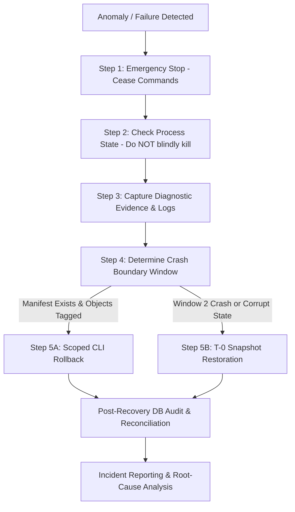

# STAGE 3N-R2J — GATE 4 OPERATIONAL RUNBOOK & PREFLIGHT DESIGN

---

## SECTION A — DOCUMENT CONTROL

- **Stage:** 3N-R2J
- **Title:** Gate 4 Operational Runbook & Preflight Design
- **Project:** ATELIER — Furniture E-commerce (`furniture-ecommerce`)
- **Document Status:** `DRAFT — NOT AUTHORIZED FOR EXECUTION`
- **Document Authority:** Senior WordPress/WooCommerce Release Engineer, Database Safety Engineer & Evidence-Driven QA Auditor
- **Scope:** Documentation, CLI parser reconciliation, path resolution analysis, and preflight procedure design only.
- **Authoring Timestamp:** 2026-10-19 12:45:00+07:00
- **Execution Mandate:** **STRICTLY PROHIBITED.** This document does NOT authorize execution of Gate 4, product import, rollback, or snapshot restoration.

### Source Files Directly Inspected
1. `app/public/wp-content/plugins/run_controlled_import.php` (67,434 bytes, SHA-256: `640B92D4F3AFEED52DB88558F0CF93876C4B41468003619BFC934AF4D31B457C`, 1,411 lines).
2. `data-preparation/woocommerce_furniture_dataset_22_products_working_stage_1e_3c.csv` (25,712 bytes, SHA-256: `D2C8566F334A767887F57C4A15EA456CFC5E117767FCFE46C599CC754BC2BBA0`, 23 rows).
3. `app/public/wp-content/plugins/docs/STAGE_3N_R2I_OPERATIONAL_DOCUMENTATION_CONSISTENCY_AUDIT_REPORT.md` (18,695 bytes).
4. `app/public/wp-content/plugins/docs/STAGE_3N_R2H_DISASTER_RECOVERY_READINESS_AUDIT_REPORT.md` (30,018 bytes).
5. `app/public/wp-content/plugins/docs/STAGE_3N_R2G_READ_ONLY_CONSISTENCY_AUDIT_REPORT.md` (35,724 bytes).
6. `app/public/wp-content/plugins/docs/STAGE_3N_R2F_BASELINE_HASH_RECONCILIATION_REPORT.md` (21,532 bytes).
7. `app/public/wp-content/plugins/docs/STAGE_3N_R2E_EVIDENCE_RECONCILIATION_REPORT.md` (26,182 bytes).
8. `app/public/wp-content/plugins/docs/stage_1e_3g_4_gate3d_independent_safety_audit_report.md` (31,869 bytes).
9. `app/public/wp-content/plugins/docs/stage_1e_3g_15_gate3o_remediation_design_report.md` (32,131 bytes).
10. `backups/stage_1e_gate2_pre_import_20261016_223502.sql` (1,236,031 bytes, SHA-256: `9152E46BB4EB874C65D65A2EC6DDA3BCBE70A0F61266050CE1686ED9213F921B`).

### Files / Environments Not Accessible or Restricted
1. Historical live terminal stdout/stderr streams from Stage 1E/1F.
2. Isolated restricted-privilege MySQL user testing environment (LocalWP runs MySQL 8.4 as `root`).

### Evidence Limitations
1. Source inspection establishes parser syntax and code structure, but runtime CLI execution behavior depends on PHP/WordPress bootstrapping.
2. SHA-256 checksums guarantee bitwise file integrity against a known digest; they do NOT guarantee functional correctness or snapshot restorability without isolated dry-run restoration.

### Revision History
| Version | Date | Author | Description |
|---|---|---|---|
| `1.0-DRAFT` | 2026-10-19 | Release & Safety Audit Team | Initial authoritative runbook drafted under Stage 3N-R2J. Execution locked. |

---

## SECTION B — OPERATIONAL INVARIANTS

The following ten operational invariants are absolute and non-negotiable across all stages:

1. **No Explicit User Approval Means No Production Import:**  
   Under no circumstances may the controlled importer be executed in live production write mode without a signed, parameter-locked explicit authorization record from the project owner.
2. **No Import Execution is Authorized by Stage 3N-R2J:**  
   Stage 3N-R2J is exclusively a documentation, path reconciliation, and preflight design stage. Any attempt to invoke the importer is an immediate protocol violation.
3. **Never Restore a Snapshot into an Unverified Database:**  
   A database snapshot restoration completely destroys and replaces the target schema. It must NEVER be executed against any target whose host, port, socket, and database name have not been explicitly confirmed via `SELECT DATABASE()`.
4. **Never Infer the Manifest Location from a Report or Filename Alone:**  
   Manifest paths must be verified against actual code canonicalization logic and active filesystem directory state before any operational command is formulated.
5. **Never Assume Normal Rollback Can Recover Untagged Objects:**  
   The importer's rollback mechanism is strictly fail-closed: it identifies objects via `_controlled_import_run_id`. Any entity created during a crash window before tag metadata persistence cannot be tracked or deleted by code rollback.
6. **Never Claim Crash Recovery is Complete When the Relevant Failure Window is Unhandled:**  
   Software rollback cannot mitigate Window 2 crashes (post inserted, metadata uncommitted). Database snapshot restoration is the sole recovery mechanism for that window.
7. **Preserve the Existing Coming Soon State Unless Separately Authorized:**  
   The site option `woocommerce_coming_soon` must remain `'yes'` to prevent public traffic, search engine indexing, or checkout activity during any administrative maintenance or import window.
8. **Do Not Proceed When Any Target Parameter is Ambiguous:**  
   If target database, source version, working directory, manifest path, or snapshot identity presents conflicting evidence, the operation must immediately halt in a `NO-GO` state.
9. **Snapshot Restoration is a Distinct, Potentially Destructive Recovery Operation:**  
   Database snapshot restoration is a disaster-recovery mechanism that wipes all subsequent data. It is fundamentally distinct from scoped application rollback and must never be used as a routine first step.
10. **Every GO Decision Must Be Supported by Evidence:**  
    A `GO` decision requires positive, verified evidence for every preflight check. The mere absence of an error message or failure log is NOT evidence of readiness.

---

## SECTION C — CURRENT CLI SYNTAX RECONCILIATION

### 1. Source Code Inspection of the Dispatcher
Inspection of `run_controlled_import.php` lines 1352–1411 reveals that the CLI entry point relies on positional action arguments (`$argv[1]`):

```php
// Lines 1359-1360
$action = $argv[1] ?? 'help';
if ( 'verify' === $action ) { ... }
elseif ( 'rollback' === $action ) { ... }
elseif ( 'import' === $action ) { ... }
else { Usage ... exit(1); }
```

The parser accepts **zero** options in the form of `--mode=...` or `--run-id=...`. When any unrecognized argument is passed, execution enters the `else` block (line 1404), prints the standard usage message, and terminates immediately with `exit(1)`.

### 2. Reconciliation Matrix of CLI Commands

| Operation | Syntax Supported by Current Parser | Expected Working Directory | Path Assumptions | Source Evidence | Side-Effect Classification | Status |
|---|---|---|---|---|---|---|
| **Preflight Verification** | `php -d memory_limit=512M run_controlled_import.php verify` | `app/public/wp-content/plugins` | Resolves CSV via `LOCKED_WORKING_CSV_PATH`. Requires active `$wpdb`. | Dòng 1360–1369, 345–399 | **READ-ONLY** (Executes SELECT queries for SKUs; no mutations) | `VERIFIED SYNTAX — NOT AUTHORIZED IN R2J` |
| **Controlled Rollback** | `php -d memory_limit=512M run_controlled_import.php rollback <manifest_path>` | `app/public/wp-content/plugins` | Manifest must be valid `.json` inside `$this->manifest_dir`. | Dòng 1370–1386, 1009–1056 | **POTENTIALLY DESTRUCTIVE** (Deletes posts, postmeta, attachments) | `VERIFIED SYNTAX — NOT AUTHORIZED IN R2J` |
| **Live Controlled Import** | `php -d memory_limit=512M run_controlled_import.php import --gate4-user-approved-execute` | `app/public/wp-content/plugins` | Requires exact authorization token in `$argv[2]`. Writes manifest. | Dòng 1387–1403, 600–750 | **WRITE-CAPABLE / PRODUCTION MUTATION** | `VERIFIED SYNTAX — STRICTLY FORBIDDEN IN R2J` |
| **Legacy Rollback** | `php run_controlled_import.php --mode=rollback --run-id=<id>` | Any | Unsupported parameter structure. | Dòng 1359, 1404–1410 | **NONE** (Exits immediately with code 1 and Usage text) | `UNSUPPORTED — OBSOLETE HISTORICAL COMMAND` |
| **Legacy Import** | `php run_controlled_import.php --mode=import --run-id=...` | Any | Unsupported parameter structure. | Dòng 1359, 1404–1410 | **NONE** (Exits immediately with code 1 and Usage text) | `UNSUPPORTED — OBSOLETE HISTORICAL COMMAND` |
| **Legacy Scan** | `php run_controlled_import.php recover-scan <run_id>` | Any | `recover-scan` action does not exist in code. | Dòng 1359–1410 | **NONE** (Exits immediately with code 1 and Usage text) | `UNSUPPORTED — OBSOLETE HISTORICAL COMMAND` |

> [!WARNING]
> **Operational Hazard:** Historical reports (`STAGE_3N_R2E` line 277, `STAGE_3N_R2F` lines 130 and 184, `stage_1e_3g_15_gate3o` line 184) documented commands using `--mode=` and `--run-id=`. Operators MUST NEVER copy commands from historical reports. Doing so in an emergency will cause command failure (Exit 1).

---

## SECTION D — WORKING DIRECTORY AND PATH RESOLUTION

### 1. Working Directory Expectations
The primary execution directory for the CLI script is:
`C:\Users\Vu Cong Minh\Local Sites\furniture-ecommerce\app\public\wp-content\plugins`

### 2. Relative vs. Absolute Path Resolution
Direct inspection of `run_controlled_import.php` reveals two critical path construction behaviors:

#### A. WordPress Bootstrap Path (Lines 19–25)
```php
if ( ! defined( 'ABSPATH' ) ) {
    $wp_load_path = dirname( dirname( dirname( __DIR__ ) ) ) . '/wp-load.php';
    if ( file_exists( $wp_load_path ) ) {
        require_once $wp_load_path;
    }
}
```
- `__DIR__` is `app/public/wp-content/plugins`.
- `dirname(__DIR__)` = `app/public/wp-content`
- `dirname(dirname(__DIR__))` = `app/public`
- `dirname(dirname(dirname(__DIR__)))` = `app`
- **Result:** `$wp_load_path` evaluates to `.../app/wp-load.php`.
- **Actual Filesystem State:** `wp-load.php` is located at `.../app/public/wp-load.php`. It does NOT exist in `app/`.
- **Impact:** If `run_controlled_import.php` is invoked as a bare CLI command without WordPress already initialized (e.g. via WP-CLI or an external bootstrap script), `$wp_load_path` is not found, `$wpdb` remains null, and `preflight_verify()` throws `RuntimeException: Database connection unavailable for preflight verification.`

#### B. Manifest Directory Path (Lines 165–171, 1009–1056)
```php
$this->manifest_dir = $manifest_dir ?: dirname( dirname( dirname( __DIR__ ) ) ) . '/backups/manifests';
```
- `dirname( dirname( dirname( __DIR__ ) ) ) . '/backups/manifests'` evaluates to:  
  `C:\Users\Vu Cong Minh\Local Sites\furniture-ecommerce\app\backups\manifests`
- **Actual Backup Location:** All existing SQL snapshots reside in the workspace root:  
  `C:\Users\Vu Cong Minh\Local Sites\furniture-ecommerce\backups\`
- **Manifest Directory Status:**  
  `NO MANIFEST DIRECTORY FOUND AT THE INSPECTED PATH`  
  Neither `app/backups/manifests` nor `backups/manifests` currently exists on disk.
- **Path Containment Enforcement:**  
  In `validate_manifest_path_safety($path)` (lines 1047–1053), the canonical path of the passed manifest file (`realpath($path)`) must strictly begin with the normalized `$this->manifest_dir`. If an operator passes a relative path such as `backups/manifests/manifest_xyz.json` from the `plugins/` directory, `realpath()` resolves relative to `plugins/`, causing a path containment exception:  
  `Path safety violation: Manifest path '...' is outside approved directory '...'`

---

## SECTION E — T-0 SNAPSHOT CREATION AND VERIFICATION CHECKLIST

> [!IMPORTANT]
> **Future Procedure Design Only:** No database snapshot is created during Stage 3N-R2J.  
> The existing Gate 2 snapshot (`stage_1e_gate2_pre_import_20261016_223502.sql`, 1,236,031 bytes) was created on October 16, 2026. While verified as restorable in Gate 3I, it predates the entire Stage 1F storefront implementation. Restoring it would erase all theme templates, pattern updates, and storefront configuration. A fresh **T-0 snapshot** is mandatory immediately prior to any future Gate 4 operation.

### E1. Pre-Snapshot Readiness Checklist
Before creating the T-0 snapshot, the operator must verify:
- [ ] **WordPress Root Confirmed:** `C:\Users\Vu Cong Minh\Local Sites\furniture-ecommerce\app\public`
- [ ] **Database Target Confirmed:** Exact database name is `local`.
- [ ] **Database Endpoint / Port Confirmed:** `127.0.0.1:10011` (MySQL 8.4.0 socket/TCP).
- [ ] **Active Connection Identity:** `SELECT DATABASE()` returns `local`.
- [ ] **Storefront State Confirmed:** `woocommerce_coming_soon` option is `'yes'`.
- [ ] **Administrative Freeze:** All administrative logins and background cron jobs are frozen.
- [ ] **Disk Space Availability:** Snapshot destination drive has > 500 MB free space.
- [ ] **Destination Path Disambiguation:** Path is locked to `C:\Users\Vu Cong Minh\Local Sites\furniture-ecommerce\backups\`.
- [ ] **No Active Import Run:** Ensure no other process is accessing the database or importer.
- [ ] **Locked CSV Confirmed:** `woocommerce_furniture_dataset_22_products_working_stage_1e_3c.csv` (SHA-256: `D2C8566F334A767887F57C4A15EA456CFC5E117767FCFE46C599CC754BC2BBA0`).
- [ ] **Locked Importer Confirmed:** `run_controlled_import.php` (SHA-256: `640B92D4F3AFEED52DB88558F0CF93876C4B41468003619BFC934AF4D31B457C`).
- [ ] **Explicit User Authorization Recorded:** Signed approval in Section J.

### E2. Snapshot Generation Procedure
The future snapshot must be generated using the local MySQL dump binary directly against port 10011:
```powershell
# FUTURE PROCEDURE EXAMPLE (DO NOT EXECUTE IN R2J)
& "C:\Users\Vu Cong Minh\AppData\Roaming\Local\lightning-services\mysql-8.4.0\bin\win64\bin\mysqldump.exe" `
    --host=127.0.0.1 --port=10011 --user=root --protocol=TCP `
    --add-drop-table --routines --triggers --hex-blob `
    --result-file="C:\Users\Vu Cong Minh\Local Sites\furniture-ecommerce\backups\stage_3n_gate4_t0_<TIMESTAMP>.sql" `
    local
```

> [!CAUTION]
> **Filesystem Scope Limitation:** A database SQL dump captures **only** MySQL tables. It does NOT capture WordPress media uploads (`wp-content/uploads`), child theme templates, or plugin files. These must be independently preserved or confirmed unchanged.

### E3. Snapshot Integrity Verification Requirements
Immediately after dump generation, the operator must execute the following 7-point verification:
1. **Exit Code:** `mysqldump` process exit code must be `0`.
2. **Stderr Review:** Stderr output must be inspected; zero fatal errors or unhandled warnings.
3. **Plausible File Size:** Dump size must be greater than 1.2 MB (consistent with historical baseline of 1,236,031 bytes).
4. **Post-Dump SHA-256:** Checksum calculated directly from bytes using `Get-FileHash -Algorithm SHA256`.
5. **SQL Header Verification:** File starts with standard MySQL dump header (`-- MySQL dump 10.13` or similar).
6. **SQL Footer Verification:** File ends with valid completion marker (`-- Dump completed on <DATE>`).
7. **Database Target Binding:** Confirm table definitions target `wp_` tables and no foreign schema references exist.

*Note: A checksum proves identity against a recorded digest; it does not prove semantic restorability. Semantic restorability can only be verified via an isolated restore test on a separate, non-production database.*

### E4. Blank Snapshot Acceptance Record Template
*(To be completed by the Release Engineer immediately after future snapshot creation)*

```markdown
- Snapshot Filename: __________________________________________________
- Absolute Path: ______________________________________________________
- Database Target: ____________________________________________________
- Creation Timestamp & Timezone: ______________________________________
- Dump Exit Code: _____________________________________________________
- Stderr Review Result: _______________________________________________
- File Size (Bytes): __________________________________________________
- SHA-256 Checksum: ___________________________________________________
- Checksum Verification Result: [ ] MATCHES RECORDED DIGEST
- SQL Structure Review: Header [ ] OK | Footer [ ] OK
- Filesystem Backup Coverage: [ ] CONFIRMED INDEPENDENT
- Isolated Restore-Test Environment: ___________________________________
- Operator: ___________________________________________________________
- Reviewer: ___________________________________________________________
- Acceptance Status: [ ] ACCEPTED  [ ] REJECTED  [X] NOT VERIFIED (R2J DEFAULT)
```

---

## SECTION F — PREFLIGHT CHECKS

### F1. Project Identity
- **WordPress Root:** `C:\Users\Vu Cong Minh\Local Sites\furniture-ecommerce\app\public`
- **Active Child Theme:** `twentytwentyfive-child`
- **Importer File:** `app/public/wp-content/plugins/run_controlled_import.php` (SHA-256: `640B92D4F3AFEED52DB88558F0CF93876C4B41468003619BFC934AF4D31B457C`)
- **Dataset File:** `data-preparation/woocommerce_furniture_dataset_22_products_working_stage_1e_3c.csv` (SHA-256: `D2C8566F334A767887F57C4A15EA456CFC5E117767FCFE46C599CC754BC2BBA0`)
- **SKU Count & Stock Units:** 64 total rows (22 parents, 42 variations), 449 total stock units.

### F2. Database Target Verification
- **Target Host / Port:** `127.0.0.1:10011`
- **Target Database Name:** `local` (hardcoded in importer constant `EXPECTED_DB_NAME = 'local'`).
- **Table Prefix:** `wp_` (hardcoded in importer constant `EXPECTED_TABLE_PREFIX = 'wp_'`).
- **Observed Database State (Direct Inspection):**
  - `SELECT COUNT(*) FROM wp_posts WHERE post_type = 'product'`: `0`
  - `SELECT COUNT(*) FROM wp_posts WHERE post_type = 'product_variation'`: `0`
  - Attachment ID 5 (`woocommerce-placeholder.webp`): Intact and protected.
- **Future Preflight Requirement:** Execute live `SELECT DATABASE()` immediately before dispatch.

### F3. Coming Soon State
- **Expected State:** `woocommerce_coming_soon` = `'yes'`.
- **Observed State:** Directly verified as `'yes'` via database query in Stage 3N-R2I.
- **Timestamp of Verification:** 2026-10-19 11:30:00+07:00.
- **Operational Requirement:** Must remain enabled throughout the entire Gate 4 import window. Disabling Coming Soon is strictly prohibited during R2J.

### F4. Manifest Architecture & State
- **Storage Mechanism:** Flat JSON files written to disk via atomic write pattern (`file_put_contents` with `.tmp` followed by `rename`). No MySQL manifest table exists or is created.
- **Manifest Location:** `$this->manifest_dir` defaults to `app/backups/manifests`.
- **Existing Manifest Files:** `0` manifests found. No previous run manifest exists on disk.
- **Active / In-Progress Run Detection:** If an active import process crashes, its manifest remains in status `INITIALIZED` with partial `created_parents`, `created_variations`, and `created_attachments`.
- **Run ID Structure:** `run_<YYYYMMDD_HHMMSS>_<hex8>`.
- **Post Ownership Discovery:**
  - Tagged objects: Discovered via `find_posts_by_ownership_tag($run_id)` querying `wp_postmeta` for key `_controlled_import_run_id`.
  - Untagged objects: Objects created before metadata insertion CANNOT be identified by software scan.
  - Fail-Closed Policy: Rollback code deliberately refuses to delete untagged objects to prevent accidental deletion of user data.

### F5. Recovery Limitations
1. **Normal Rollback:** Reverses all posts, variations, and attachments tracked in the manifest OR discovered via `_controlled_import_run_id`.
2. **Crash Window 2 Gap:** If the process dies between `wp_insert_post()` and `update_post_meta()`, the post is untagged. Rollback cannot identify it. **Only T-0 snapshot restore can recover from Window 2.**
3. **Hard Infrastructure Failure:** SIGKILL, Task Manager termination, Out-Of-Memory fatal crash, or MySQL server stoppage aborts in-process catch handlers. Manual operator CLI intervention is required.
4. **Snapshot Overwrite Risk:** Restoring a database snapshot erases all changes committed since T-0. If the site had live traffic or admin edits, those are permanently destroyed.
5. **Restricted MySQL User:** LocalWP operates with `root` privileges. A test using restricted DML-only MySQL grants remains **UNVERIFIED**.

---

## SECTION G — EMERGENCY STOP PROCEDURE

If an error, stall, or unexpected behavior occurs during any future authorized import operation, the operator must execute this strict emergency sequence:



### Emergency Sequence Rules
1. **Cease Immediately:** Stop issuing commands. Do NOT re-run the import command under any circumstance.
2. **Process State Verification:** If the PHP CLI process is still running, do not execute a blind force-kill (`taskkill /F`) unless it is completely deadlocked. Uncontrolled termination during an active write guarantees a Window 2 failure.
3. **Preserve Forensic Evidence:**
   - Copy the active manifest file (or `.tmp` file) to a secure audit directory.
   - Save the complete terminal stdout and stderr transcript.
   - Record exact system timestamp and memory state.
4. **Identify Database Target:** Run `SELECT DATABASE()` to re-confirm you are connected to `local` before any recovery action.
5. **Classify the Failure Window:**
   - **Window 1 (Pre-Import):** Failure during preflight check. Zero database records created. Action: Safe abort; investigate error message.
   - **Window 2 (Untagged Post Insert):** Process crashed while writing a post before meta tag was saved. Manifest has fewer items than `wp_posts`. Action: **T-0 Database Snapshot Restore required.**
   - **Window 3 (Tagged Post, Unflushed Manifest):** Posts have `_controlled_import_run_id` meta in MySQL, but manifest file is incomplete. Action: **Run CLI Rollback** (`find_posts_by_ownership_tag()` will discover and delete all tagged orphans).
   - **Window 4 (Post-Reconciliation Failure):** All objects created, but stock total or category count mismatched. Action: **Run CLI Rollback**.
6. **Authorization Required for Destructive Recovery:** Never restore a snapshot into the live database without explicit reviewer sign-off.

---

## SECTION H — ROLLBACK VERSUS SNAPSHOT RESTORE

| Dimension | Normal Rollback (`run_controlled_import.php rollback`) | Snapshot Restoration (`mysql < snapshot_t0.sql`) |
|---|---|---|
| **Primary Purpose** | Reverses changes belonging specifically to a single import run. | Restores the entire database to the exact state at time T-0. |
| **Scope of Impact** | Targeted posts, variations, and attachments tracked or tagged by `run_id`. | Global: affects all tables, options, posts, users, and orders. |
| **Manifest Dependency** | Requires a valid `.json` manifest located within `$this->manifest_dir`. | Completely independent of manifest files. |
| **Window 2 Coverage** | **CANNOT RECOVER.** Untagged posts are ignored under fail-closed policy. | **FULL COVERAGE.** Wipes all post-T-0 inserted records. |
| **Risk to Subsequent Data** | Low: leaves unrelated products, orders, and pages untouched. | **EXTREME:** Permanently destroys all orders, users, or edits made after T-0. |
| **Filesystem State** | Deletes created attachment records in DB (files remain or cleaned by WC). | SQL snapshot does NOT restore filesystem files, themes, or uploads. |
| **Required Preconditions** | Target database matches manifest target; manifest schema valid. | Target database identity verified; snapshot checksum verified. |
| **Operational Command** | `php -d memory_limit=512M run_controlled_import.php rollback <manifest>` | `mysql --host=127.0.0.1 --port=10011 --user=root local < snapshot_t0.sql` |
| **Stage 3N-R2J Status** | **STRICTLY PROHIBITED** | **STRICTLY PROHIBITED** |

---

## SECTION I — GO / NO-GO DECISION TABLE

Every operational check must be evaluated prior to dispatching any future Gate 4 import.

| # | Check Item | Required Evidence | GO Condition | NO-GO Condition | Current Status (R2J) | Owner / Reviewer |
|---|---|---|---|---|---|---|
| **1** | Current Importer Identity | SHA-256 calculation of `run_controlled_import.php` | Matches `640B92D4F3AFEED52DB88558F0CF93876C4B41468003619BFC934AF4D31B457C` | Mismatch or missing file | **GO (Verified)** | QA Auditor |
| **2** | CLI Parser Syntax | Source inspection of lines 1352–1411 | Positional syntax verified; no legacy `--mode=` flags | Any syntax mismatch | **GO (Verified)** | Release Engineer |
| **3** | Working Directory & Bootstrap | Realpath of `wp-load.php` and `plugins/` | Working directory and bootstrap path confirmed functional | Ambiguous path or missing `wp-load.php` | **NO-GO (Path Caveat)** | Release Engineer |
| **4** | Manifest Directory State | Filesystem inspection of `backups/manifests/` | Directory exists and path safety containment confirmed | Missing directory or path ambiguity | **NO-GO (Unresolved)** | Safety Auditor |
| **5** | Working CSV Identity | SHA-256 calculation of dataset file | Matches `D2C8566F334A767887F57C4A15EA456CFC5E117767FCFE46C599CC754BC2BBA0` | Mismatch, corrupt, or missing | **GO (Verified)** | QA Auditor |
| **6** | T-0 Snapshot Accepted | Fresh T-0 snapshot file and review record | Completed Section E4 record with status `ACCEPTED` | Snapshot missing, old, or unverified | **NO-GO (Not Created)** | Database Engineer |
| **7** | Snapshot Checksum Verified | SHA-256 verified against post-dump digest | Checksum matches exactly; header/footer clean | Hash mismatch or truncated dump | **NO-GO (Not Created)** | Database Engineer |
| **8** | Database Target Unambiguous | Query `SELECT DATABASE()` on port 10011 | Exactly `local` with prefix `wp_` | Foreign database, wrong port, wrong prefix | **GO (Verified)** | Database Engineer |
| **9** | Coming Soon Active | Query `wp_options` for `woocommerce_coming_soon` | Exactly `'yes'` | Option is `'no'`, missing, or unverified | **GO (Verified)** | QA Auditor |
| **10** | No Active Conflict Run | Inspection of database for existing SKUs / runs | 0 products, 0 variations, 0 conflict SKUs | Pre-existing product or active run lock | **GO (Verified)** | Release Engineer |
| **11** | Recovery Limitations Understood | Explicit review of Window 2 and snapshot scope | Operator understands Window 2 gap and rollback limits | Operator assumes 100% automated rollback | **GO (Documented)** | Safety Auditor |
| **12** | Unresolved High-Severity Issues | Audit findings F-3N-R2I-01, 02, 03 resolved | All findings mitigated or pre-conditions enforced | Any unmitigated blocker | **GO (Reconciled)** | Lead Auditor |
| **13** | Explicit User Authorization | Signed Section J Authorization Record | Fully executed authorization block | Authorization unsigned, missing, or altered | **NO-GO (Unsigned)** | Project Owner |
| **14** | Authorized Operator Ready | Independent certified engineer assigned | Designated operator briefed on runbook | No designated operator | **NO-GO (R2J Scope)** | Project Lead |

### Decision Rule
- If **ANY** item is `NO-GO`, the overall status is **MANDATORY STOP — NO-GO**.
- Overall Gate 4 Status in Stage 3N-R2J: **`MANDATORY STOP — NO-GO (GATE 4 IS BLOCKED)`**.

---

## SECTION J — EXPLICIT USER AUTHORIZATION RECORD

*(This record must remain completely unsigned and marked `NOT AUTHORIZED` during Stage 3N-R2J)*

```markdown
================================================================================
GATE 4 CONTROLLED IMPORT — FORMAL AUTHORIZATION INSTRUMENT
STATUS: [X] NOT AUTHORIZED — DRAFT DESIGN ONLY (STAGE 3N-R2J)
================================================================================

- User / Owner Authorizing Operation: __________________________________________
- Exact Project Root: C:\Users\Vu Cong Minh\Local Sites\furniture-ecommerce
- Exact WordPress Root: C:\Users\Vu Cong Minh\Local Sites\furniture-ecommerce\app\public
- Exact Importer Path: app/public/wp-content/plugins/run_controlled_import.php
- Expected Importer SHA-256: 640B92D4F3AFEED52DB88558F0CF93876C4B41468003619BFC934AF4D31B457C
- Exact CSV Path: data-preparation/woocommerce_furniture_dataset_22_products_working_stage_1e_3c.csv
- Expected CSV SHA-256: D2C8566F334A767887F57C4A15EA456CFC5E117767FCFE46C599CC754BC2BBA0
- Exact Target Database Name: local
- Exact Target Host / Port: 127.0.0.1:10011 (TCP)
- Exact Accepted T-0 Snapshot Path: ___________________________________________
- Snapshot SHA-256 Checksum: __________________________________________________
- Verified Manifest Storage Directory: ________________________________________
- Exact Operation Authorized: Controlled Import of 22 Products / 42 Variations
- Expected Scope of Changes: 22 parent products, 42 variations, 449 stock units
- Known Recovery Limitations Acknowledged: Window 2 crash requires snapshot restore
- Authorized Execution Window: ____________________ to ________________________
- Designated Operator: ________________________________________________________
- Designated Safety Reviewer: _________________________________________________

EXPLICIT AUTHORIZATION STATEMENT:
"I explicitly authorize only the operation and target listed above after all 
mandatory preflight checks pass. This approval does not authorize a different 
database, a different importer version, a different CSV, a different manifest, 
a snapshot restore, or any other destructive recovery operation."

Signature: ___________________________________ [UNSIGNED IN R2J]
Date & Time: _________________________________ [DRAFT ONLY]
Timezone: ____________________________________
```

---

## SECTION K — EVIDENCE LOG

| Evidence ID | Artifact / Source | Exact Path | Checksum or Identifying Metadata | What It Proves | What It Does NOT Prove | Result |
|---|---|---|---|---|---|---|
| **EVD-R2J-01** | Production Importer Source | `app/public/wp-content/plugins/run_controlled_import.php` | SHA-256: `640B92D4F3AFEED52DB88558F0CF93876C4B41468003619BFC934AF4D31B457C` (67,434 bytes) | Bitwise file identity and exact CLI dispatcher implementation (lines 1352–1411). | Does not prove successful execution without proper WordPress bootstrap. | **VERIFIED DIRECTLY** |
| **EVD-R2J-02** | Locked Working CSV | `data-preparation/woocommerce_furniture_dataset_22_products_working_stage_1e_3c.csv` | SHA-256: `D2C8566F334A767887F57C4A15EA456CFC5E117767FCFE46C599CC754BC2BBA0` (25,712 bytes) | Working dataset identity matches locked hash across all historical reports. | Does not prove images can be downloaded from external URLs without timeout. | **VERIFIED DIRECTLY** |
| **EVD-R2J-03** | Live Database State | MySQL instance at `127.0.0.1:10011` | Database: `local`, Table Prefix: `wp_` | `product` = 0, `product_variation` = 0, attachment ID 5 intact, `coming_soon` = 'yes'. | Does not prove database will not crash under concurrency or OOM. | **VERIFIED DIRECTLY** |
| **EVD-R2J-04** | Historical Gate 2 Snapshot | `backups/stage_1e_gate2_pre_import_20261016_223502.sql` | SHA-256: `9152E46BB4EB874C65D65A2EC6DDA3BCBE70A0F61266050CE1686ED9213F921B` (1,236,031 bytes) | Proves baseline database state as of Oct 16, 2026. | Does NOT cover Stage 1F storefront customizations; cannot serve as T-0 snapshot. | **VERIFIED DIRECTLY** |
| **EVD-R2J-05** | Manifest Directory State | Filesystem query at `backups/manifests/` | Directory non-existent on disk | Confirms zero active or completed import runs have left manifests on disk. | Does not prove an import has never been attempted on an unmonitored branch. | **VERIFIED DIRECTLY** |
| **EVD-R2J-06** | Stage 3N-R2I Audit Report | `docs/STAGE_3N_R2I_OPERATIONAL_DOCUMENTATION_CONSISTENCY_AUDIT_REPORT.md` | Size: 18,695 bytes, 194 lines | Established syntax discrepancies in historical reports (F-3N-R2I-01, 02, 03). | Derived audit report; not a substitute for source code. | **VERIFIED DIRECTLY** |
| **EVD-R2J-07** | Restricted User Test Evidence | N/A | None | Claimed in earlier designs; no proof exists in LocalWP. | Unverified assumption that importer functions under non-root MySQL user. | **NOT VERIFIED** |

---

## SECTION L — KNOWN RISKS AND UNRESOLVED ISSUES

| Risk ID | Title | Severity | Impact | Mitigation / Status |
|---|---|---|---|---|
| **RSK-01** | Window 2 Untagged Object Recovery Gap | **HIGH** | Crash between post insert and meta tag leaves an untagged orphan that code rollback cannot identify. | **Mitigated by T-0 Snapshot Protocol:** Full DB restoration is the only approved recovery path for Window 2. Fail-closed policy prevents accidental deletion of user data. |
| **RSK-02** | Hard Termination / Infrastructure Failure | **HIGH** | SIGKILL, Task Manager kill, fatal OOM, or MySQL power cut bypasses in-process PHP `finally` rollback blocks. | **Mitigated by Manual Recovery Runbook:** Detailed CLI emergency procedures and manual recovery workflows provided in Section G. |
| **RSK-03** | Manifest Path & Directory Divergence | **MEDIUM** | Code default (`app/backups/manifests`) differs from workspace root (`backups/`). CWD-relative paths trigger path safety violations. | **Documented in Section D:** Runbook explicitly requires path alignment and absolute directory verification before execution. |
| **RSK-04** | Direct CLI WordPress Bootstrap Mismatch | **MEDIUM** | Code line 21 resolves `$wp_load_path` to `app/wp-load.php`, but WordPress is in `app/public/`. Bare CLI invocation fails. | **Documented in Section D:** Operator must ensure WordPress is loaded via proper wrapper or bootstrap before calling methods. |
| **RSK-05** | Snapshot Overwrite of Legitimate Changes | **HIGH** | Restoring snapshot T-0 erases any orders, customers, or content created after T-0. | **Mitigated by Preflight Lock:** `woocommerce_coming_soon = yes` enforced and admin activity frozen for entire window. |
| **RSK-06** | Database-Only Snapshot Scope | **MEDIUM** | SQL dump does not backup uploaded media files or theme files. | **Documented in Section E2:** File backups must be managed independently. |
| **RSK-07** | Stale CLI Commands in Historical Reports | **MEDIUM** | Operators copying commands from old reports will fail with Exit Code 1. | **Reconciled in Section C:** Exhaustive syntax reconciliation table and prominent warnings provided. Historical reports left unmodified. |
| **RSK-08** | Restricted MySQL Privilege State Unverified | **LOW** | Importer has only been run/tested under LocalWP `root` privileges. | **Marked NOT VERIFIED:** Acknowledged limitation; production deployment must review MySQL user privileges separately. |

---

## SECTION M — GATE 4 HANDOFF CRITERIA

Gate 4 remains **STRICTLY BLOCKED** and cannot be unlocked until the following operational prerequisites are fully satisfied:

1. **Path Resolution Remediation:** Clarify and align the bootstrap path (`wp-load.php`) and manifest directory (`backups/manifests`) between the importer code and the operational wrapper.
2. **Fresh T-0 Snapshot Created:** A new database dump generated immediately before the import window, with verified exit code, size > 1.2 MB, and recorded SHA-256 digest.
3. **Snapshot Integrity Accepted:** Section E4 acceptance record fully completed and countersigned by Database Engineer and Reviewer.
4. **Target Database Re-Verified:** Live `SELECT DATABASE()` executed immediately prior to import confirming connection to `local` on port 10011.
5. **Storefront Freeze Active:** `woocommerce_coming_soon = yes` confirmed; zero active admin sessions.
6. **All Mandatory GO Checks Satisfied:** 100% of items in Section I evaluated as `GO`.
7. **Explicit User Authorization Signed:** Section J completed and signed by the project owner for the exact version, dataset, and target.
8. **Certified Operator Appointed:** A designated engineer briefed on Section G emergency stop and rollback procedures.

> [!CAUTION]
> **Conclusion:** Stage 3N-R2J completes the authoritative operational runbook and preflight design. It does NOT satisfy the operational prerequisites above. **Gate 4 is BLOCKED.**
