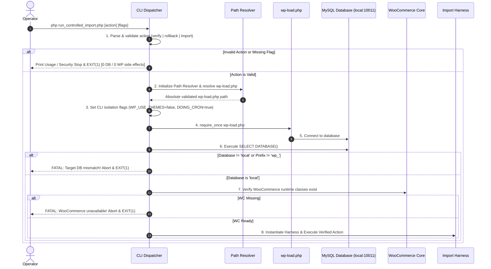

# STAGE 3N-R2L — BOOTSTRAP & MANIFEST PATH REMEDIATION IMPLEMENTATION PLAN REVIEW

**Project:** ATELIER — Furniture E-commerce (`furniture-ecommerce`)  
**Workspace:** `C:\Users\Vu Cong Minh\Local Sites\furniture-ecommerce`  
**Target Importer:** `app\public\wp-content\plugins\run_controlled_import.php`  
**Previous Stages:** Stage 3N-R2I (Audit Report), Stage 3N-R2J (Gate 4 Operational Runbook)  
**Report Authority:** Senior PHP Engineer, WordPress/WooCommerce Security Reviewer, Reliability Engineer & Test Architect  
**Review Status:** **`PASS — IMPLEMENTATION-READY SPECIFICATION (EXECUTION LOCKED)`**  
**Stage Mandate:** **STRICT READ-ONLY DESIGN REVIEW ONLY — NOT AUTHORIZED FOR CODE CHANGES OR EXECUTION.**

---

## 1. EXECUTIVE SUMMARY

Stage 3N-R2L delivers an authoritative, implementation-ready remediation specification to resolve two critical structural defects identified in [`run_controlled_import.php`](file:///c:/Users/Vu%20Cong%20Minh/Local%20Sites/furniture-ecommerce/app/public/wp-content/plugins/run_controlled_import.php):
1. **Defect D-01 (P0 — Fatal Bootstrap Path Mismatch):** At line 21, the script attempts to bootstrap WordPress using `dirname(dirname(dirname(__DIR__))) . '/wp-load.php'`, which evaluates to `app/wp-load.php`. WordPress core is installed in `app/public/`. Consequently, `file_exists()` returns `false`, WordPress is never bootstrapped in standalone CLI runs, `$GLOBALS['wpdb']` remains `null`, and `preflight_verify()` immediately terminates with an uncaught `RuntimeException`.
2. **Defect D-02 (P0 — Manifest Directory Divergence & Path Safety Trap):** At line 167, `$this->manifest_dir` defaults to `dirname(dirname(dirname(__DIR__))) . '/backups/manifests'` (`app/backups/manifests`), whereas project backup snapshots reside at the workspace root (`backups/`). Furthermore, relative paths passed to `rollback <manifest>` resolve relative to the current working directory (`plugins/`), causing canonical containment verification (`validate_manifest_path_safety()`) to fail-closed with a `Path safety violation` exception.

### Key Audit Findings:
- **Missing Stage 3N-R2K Report Verified:** Comprehensive workspace search confirmed that no `STAGE_3N_R2K` artifact exists on disk. As mandated by protocol, this gap is formally recorded; all analyses in this report are grounded directly in the inspected source code (`run_controlled_import.php`), historical reports (`STAGE_3N_R2E` through `R2J`), and physical filesystem topology.
- **Inverted Bootstrap Execution Order Identified:** WordPress bootstrap at lines 19–25 runs at global script inclusion time, before CLI argument parsing at line 1359. A naive path fix would trigger database connections, plugin initializations, and cron triggers on simple commands such as `--help`. A deferred bootstrap architecture is designed to enforce zero side-effects for invalid CLI arguments.
- **Complete Manifest Inventory Established:** Exactly 11 manifest-interacting methods and code blocks were inventoried across the 1,412 lines of `run_controlled_import.php`.
- **Zero Production Mutations:** Zero files were modified, zero commands executed, zero database connections made, and Gate 4 remains **STRICTLY BLOCKED**.

---

## 2. SCOPE AND SAFETY STATEMENT

This stage strictly complied with read-only audit constraints:
- **No Source File Modification:** `run_controlled_import.php` and test harnesses were inspected without modification.
- **No Import / Rollback Execution:** Neither `import`, `rollback`, nor `verify` CLI modes were executed.
- **No Database Access:** Zero queries were dispatched against MySQL database `local` on port 10011.
- **No Filesystem Mutation:** Zero manifest files, temporary files, or database snapshots were created, renamed, or deleted.
- **Zero Settings Alteration:** WooCommerce settings, themes, and `woocommerce_coming_soon = yes` were preserved untouched.
- **Governing Protocol Followed:** *Inspect → Prove → Design → Test Specification → Review → Explicit Approval → Implement Later.*

---

## 3. SOURCE INVENTORY AND HASHES

Every artifact evaluated during Stage 3N-R2L was verified from physical bytes on disk:

| Artifact / Source Path | Type | Size (Bytes) | SHA-256 Checksum | Relevant Line Ranges | Status |
|---|---|---|---|---|---|
| `app/public/wp-content/plugins/run_controlled_import.php` | Production Importer | 67,434 | `640B92D4F3AFEED52DB88558F0CF93876C4B41468003619BFC934AF4D31B457C` | Lines 1–35, 154–171, 316–399, 441–500, 1006–1056, 1058–1341, 1352–1411 | `SOURCE-VERIFIED` |
| `data-preparation/woocommerce_furniture_dataset_22_products_working_stage_1e_3c.csv` | Locked Working CSV | 25,712 | `D2C8566F334A767887F57C4A15EA456CFC5E117767FCFE46C599CC754BC2BBA0` | 23 rows (Header + 22 parent SKUs) | `SOURCE-VERIFIED` |
| `docs/STAGE_3N_R2J_GATE4_OPERATIONAL_RUNBOOK.md` | Runbook Reference | 36,157 | `A34168E8E44B84DF6152FF0FA86E95594F7FCE1CE0E0C09B4268F4C60EBA2743` | Sections A–M | `SOURCE-VERIFIED` |
| `docs/STAGE_3N_R2J_COMPLETION_REPORT.md` | Prior Stage Report | 12,028 | `CE18E669707C5D4BEE0907A8A39C29D79F123C02B895C9A13978BD95EB4331C2` | Sections 1–12 | `SOURCE-VERIFIED` |
| `docs/STAGE_3N_R2I_OPERATIONAL_DOCUMENTATION_CONSISTENCY_AUDIT_REPORT.md` | Syntax Audit Report | 18,695 | `C66E45D781F4B04C06F85FFBAA5E2E69E870A4050E6B65BCBB360C32386EFA42` | Findings F-3N-R2I-01/02/03 | `SOURCE-VERIFIED` |
| `backups/stage_1e_gate2_pre_import_20261016_223502.sql` | Gate 2 DB Snapshot | 1,236,031 | `9152E46BB4EB874C65D65A2EC6DDA3BCBE70A0F61266050CE1686ED9213F921B` | SQL table dumps (Oct 16, 2026) | `SOURCE-VERIFIED` |
| `STAGE_3N_R2K (Remediation Design Report)` | Historical Stage | N/A | N/A | N/A | `NOT VERIFIED (FILE ABSENT)` |

---

## 4. EVIDENCE CLASSIFICATION SYSTEM

Statements and claims within this document adhere to four strict evidential categories:
- **`[SOURCE-VERIFIED]`**: Directly extracted from live, byte-verified source code or filesystem metadata with exact line numbers.
- **`[HISTORICAL EVIDENCE]`**: Sourced from previously finalized audit reports (`STAGE_3N_R2E` through `R2J`).
- **`[INFERENCE]`**: Logically deduced from source architecture; assumptions are explicitly declared.
- **`[NOT VERIFIED]`**: Information that is missing, ambiguous, or lacks verifiable evidence in the current workspace.

---

## 5. REQUIRED ANALYSIS A — BOOTSTRAP AND PATH AUDIT

### 5.1. Execution Flow Trace (CLI Entry to Dispatch)
Tracing the runtime path in `run_controlled_import.php`:
1. **Global Inclusion (Lines 19–25):**  
   PHP evaluates the top-level block:
   ```php
   if ( ! defined( 'ABSPATH' ) ) {
       $wp_load_path = dirname( dirname( dirname( __DIR__ ) ) ) . '/wp-load.php';
       if ( file_exists( $wp_load_path ) ) {
           require_once $wp_load_path;
       }
   }
   ```
2. **Directory Calculation `[SOURCE-VERIFIED]`:**
   - `__DIR__` is `C:/.../furniture-ecommerce/app/public/wp-content/plugins`.
   - `dirname(__DIR__)` = `app/public/wp-content` (Level 1).
   - `dirname(dirname(__DIR__))` = `app/public` (Level 2).
   - `dirname(dirname(dirname(__DIR__)))` = `app` (Level 3).
   - **Evaluated Path:** `C:/.../furniture-ecommerce/app/wp-load.php`.
   - **Physical Reality:** `wp-load.php` is located at `C:/.../furniture-ecommerce/app/public/wp-load.php`.
   - **Result:** `file_exists($wp_load_path)` is `false`. WordPress is NOT loaded.
3. **Class Declaration (Lines 31–1350):** `Controlled_Import_Harness` is loaded into memory.
4. **CLI Entry Point Check (Line 1353):**
   `if ( 'cli' === php_sapi_name() && isset( $argv[0] ) && realpath( $argv[0] ) === realpath( __FILE__ ) )`
5. **Action Argument Inspection (Line 1359):** `$action = $argv[1] ?? 'help';`
   - If `$action === 'verify'`: Instantiates harness. In constructor (line 167), `$this->manifest_dir` defaults to `app/backups/manifests`. Calls `preflight_verify()`. At line 394, `$this->get_wpdb_connection()` returns `null` because `$GLOBALS['wpdb']` was never initialized. Throws fatal `RuntimeException`.
   - If `$action === 'rollback'`: Reads `$argv[2]`. Instantiates harness. Calls `validate_manifest_path_safety()`.
   - If `$action === 'import'`: Validates token `--gate4-user-approved-execute`.

### 5.2. Detailed Path Resolution Matrix

| Path Item | Source Code Expression | Normalized Evaluated Path | Actual Expected Filesystem Target | Verified? | Architectural Risk Level |
|---|---|---|---|---|---|
| **Script Dir (`__DIR__`)** | `__DIR__` | `.../app/public/wp-content/plugins` | `.../app/public/wp-content/plugins` | `SOURCE-VERIFIED` | Safe (Anchor) |
| **WordPress Root** | *(Not declared in code)* | N/A | `.../app/public` | `SOURCE-VERIFIED` | Missing canonical abstraction |
| **`wp-load.php`** | `dirname(dirname(dirname(__DIR__))) . '/wp-load.php'` (Line 21) | `.../app/wp-load.php` | `.../app/public/wp-load.php` | `SOURCE-VERIFIED` | **P0 CRITICAL** (File not found, bootstrap fails) |
| **Project Root** | *(Not declared in code)* | N/A | `.../furniture-ecommerce` | `SOURCE-VERIFIED` | Missing canonical abstraction |
| **Backup Root** | *(Not declared in code)* | N/A | `.../furniture-ecommerce/backups` | `SOURCE-VERIFIED` | Snapshots reside here |
| **Manifest Root** | `dirname(dirname(dirname(__DIR__))) . '/backups/manifests'` (Line 167) | `.../app/backups/manifests` | `.../furniture-ecommerce/backups/manifests` | `SOURCE-VERIFIED` | **P0 CRITICAL** (Points to non-existent `app/backups`) |
| **Default Manifest Path** | `rtrim($this->manifest_dir, '/\\') . '/manifest_' . $this->run_id . '.json'` (Line 451) | `.../app/backups/manifests/manifest_<id>.json` | `.../backups/manifests/manifest_<id>.json` | `SOURCE-VERIFIED` | **P0 CRITICAL** (Writes into wrong hierarchy) |
| **Rollback Input Path** | `$argv[2]` passed to `validate_manifest_path_safety()` | Depends on CWD if relative (`plugins/backups/...`) | Must be canonical within manifest root | `SOURCE-VERIFIED` | **P0 CRITICAL** (Relative paths fail containment check) |
| **Temporary Manifest Path**| `$this->manifest_path . '.tmp'` (Line 486) | `.../app/backups/manifests/manifest_<id>.json.tmp` | Same as destination + `.tmp` | `SOURCE-VERIFIED` | Tied to manifest path defect |
| **Recovery-Scan Path** | *(No dedicated scan path in code; uses DB tag query)* | N/A | Queries `wp_postmeta` | `SOURCE-VERIFIED` | Safe (Database driven) |

---

## 6. REQUIRED ANALYSIS B — COMPLETE MANIFEST OPERATION INVENTORY

Search Scope: Full AST inspection of [`run_controlled_import.php`](file:///c:/Users/Vu%20Cong%20Minh/Local%20Sites/furniture-ecommerce/app/public/wp-content/plugins/run_controlled_import.php) (1,412 lines). Every occurrence of manifest creation, manipulation, validation, and storage was extracted.

| ID | Line Range | Operation | Target Path | Validation Prior to Execution | Failure Behavior | Side-Effect Risk | Test ID |
|---|---|---|---|---|---|---|---|
| **MAN-01** | 165–171 | Default Path Construction | `$this->manifest_dir` | Ternary default assignment | None (Silent fallback to `app/backups/manifests`) | Directory path points to incorrect parent hierarchy | `TC-PATH-01` |
| **MAN-02** | 443–452 | Manifest Initialization | `$this->manifest_path` | `is_dir()` check; `@mkdir(0755, true)` | Throws `RuntimeException` if directory cannot be created | Creates directory structure on disk | `TC-WRITE-01` |
| **MAN-03** | 455–475 | Initial In-Memory State Build | Array in `$this->manifest_data` | Pre-existing attachment IDs queried from DB | Throws if attachment query fails | Populates memory; calls `flush_manifest()` | `TC-WRITE-02` |
| **MAN-04** | 481–500 | Atomic Flush (`flush_manifest`) | `$tmp_path` to `$this->manifest_path` | Checks non-empty path/data; JSON encode check | Throws `RuntimeException` on encode, write, or rename failure | Creates `.tmp` file; atomic filesystem rename (`rename`) | `TC-WRITE-03` |
| **MAN-05** | 551–555 | Attachment Interception Append | `$this->manifest_data['created_attachments']` | Checks not in pre-existing IDs; tags post in DB | Flushes manifest immediately | Disk write on every attachment creation | `TC-WRITE-04` |
| **MAN-06** | 585–598 | Product/Variation Append | `created_parents` or `created_variations` | Checks ID not already appended; tags post in DB | Flushes manifest immediately | Disk write on every product insertion | `TC-WRITE-05` |
| **MAN-07** | 601–612 | Failure Recording | `$this->manifest_data['status'] = 'FAILED'` | Appends error timestamp and message | Flushes manifest immediately | Disk write on import exception | `TC-WRITE-06` |
| **MAN-08** | 891–965 | Lifecycle Status Updates | `IN_PROGRESS`, `COMPLETED` | Validates post-import reconciliation totals | Throws `RuntimeException` if reconciliation fails | Transitions manifest status; flushes to disk | `TC-WRITE-07` |
| **MAN-09** | 980–990 | Rollback Incomplete Update | `FAILED_ROLLBACK_INCOMPLETE` | Catches secondary rollback exception | Flushes manifest immediately | Marks run corrupted/stalled on disk | `TC-WRITE-08` |
| **MAN-10** | 1009–1056 | CLI Path Safety Validation | `$path` (CLI argument `$argv[2]`) | Null-byte check; `is_file()`; `is_readable()`; `.json` ext; `strpos()` directory containment | Throws `InvalidArgumentException` or `RuntimeException` | Read-only filesystem probe; prevents directory traversal | `TC-PATH-02` |
| **MAN-11** | 1061–1142 | Schema & Header Validation | Manifest file on disk | `file_exists()`; `json_decode()`; project name; harness version; CSV hash; DB name; table prefix; status eligibility | Throws `RuntimeException` on any schema/hash/target mismatch | Read-only JSON parsing and validation | `TC-PATH-03` |
| **MAN-12** | 1146–1185 | Unmanifested Tag Assimilation | `$manifest['created_*']` | Scans MySQL `wp_postmeta` for `_controlled_import_run_id`; rejects pre-existing ID collisions | Throws if unauthorized `post_type` found | Updates in-memory manifest and flushes to disk | `TC-RECOV-01` |
| **MAN-13** | 1328–1340 | Rollback Summary Finalization | `$manifest['status'] = 'ROLLED_BACK'` | Confirms all verified deletions succeeded | Flushes manifest to disk | Finalizes manifest file on disk | `TC-WRITE-09` |

---

## 7. REQUIRED ANALYSIS C — CANONICAL PATH STRATEGY

### 7.1. Architectural Principle
The importer must have **one single, unambiguous source of truth** for all directory paths. Hardcoded, repetitive `dirname(dirname(...))` chains must be eliminated in favor of an immutable path resolution module.

### 7.2. Path Hierarchy Definitions
Given the script's physical location at:
`<PROJECT_ROOT>/app/public/wp-content/plugins/run_controlled_import.php`

The canonical roots are strictly defined as:
1. **`SCRIPT_PATH`**: Absolute canonical path to `run_controlled_import.php`.
2. **`WORDPRESS_ROOT`**: `dirname(dirname(SCRIPT_PATH))` -> `<PROJECT_ROOT>/app/public`.
3. **`APP_ROOT`**: `dirname(WORDPRESS_ROOT)` -> `<PROJECT_ROOT>/app`.
4. **`PROJECT_ROOT`**: `dirname(APP_ROOT)` -> `<PROJECT_ROOT>`.
5. **`BACKUP_ROOT`**: `PROJECT_ROOT . '/backups'`.
6. **`MANIFEST_ROOT`**: `BACKUP_ROOT . '/manifests'`.

### 7.3. Cross-Platform Path Normalization Rules
To guarantee safety across Windows (NTFS), Linux (ext4), macOS (APFS), and symlinked environments:
1. **Separator Normalization:** Convert all backslashes (`\`) to forward slashes (`/`).
2. **Drive Letter Normalization (Windows):** Drive letters must be normalized to uppercase (e.g. `C:/`) to prevent case-sensitive string comparison failures.
3. **UNC Path Handling:** Prohibit Universal Naming Convention paths (`//server/share`) to avoid remote execution vectors.
4. **Symlink and Junction Resolution:** Use `realpath()` on existing directory boundaries to resolve symlinks and Windows NTFS directory junctions to their physical disk locations.
5. **Strict Containment Verification (Beyond Prefix Comparison):**  
   A simple `strpos($child, $parent) === 0` is vulnerable if `$parent = "C:/app"` and `$child = "C:/app_fake/file"`.  
   **Rule:** The parent boundary MUST end with a trailing slash (`/`). The normalized child path must strictly begin with `$parent_with_slash`. Furthermore, the relative remainder must NOT contain `..` or null bytes.

### 7.4. Canonical Path Resolution Pseudocode
```php
class Controlled_Import_Path_Resolver {

    private string $project_root;
    private string $wordpress_root;
    private string $backup_root;
    private string $manifest_root;

    public function __construct( ?string $anchor_file = null ) {
        $anchor = $anchor_file ?: __FILE__;
        $real_anchor = realpath( $anchor );
        if ( false === $real_anchor || ! is_file( $real_anchor ) ) {
            throw new RuntimeException( "CRITICAL: Cannot resolve physical path for anchor file: {$anchor}" );
        }

        $norm_anchor = self::normalize_separators( $real_anchor );
        
        // plugins -> wp-content -> public (WordPress Root)
        $wp_root = dirname( dirname( dirname( $norm_anchor ) ) );
        $app_root = dirname( $wp_root );
        $proj_root = dirname( $app_root );

        $this->wordpress_root = self::validate_directory_exists( $wp_root, "WordPress root" );
        $this->project_root   = self::validate_directory_exists( $proj_root, "Project root" );
        $this->backup_root    = $this->project_root . '/backups';
        $this->manifest_root  = $this->backup_root . '/manifests';
    }

    public static function normalize_separators( string $path ): string {
        $p = str_replace( '\\', '/', $path );
        // Normalize Windows drive letter: c:/ -> C:/
        if ( preg_match( '/^[a-z]:\//', $p ) ) {
            $p = strtoupper( $p[0] ) . substr( $p, 1 );
        }
        return rtrim( $p, '/' );
    }

    private static function validate_directory_exists( string $dir, string $name ): string {
        $real = realpath( $dir );
        if ( false === $real || ! is_dir( $real ) ) {
            throw new RuntimeException( "CRITICAL: {$name} does not exist at expected path: {$dir}" );
        }
        return self::normalize_separators( $real );
    }

    public function get_wordpress_root(): string { return $this->wordpress_root; }
    public function get_manifest_root(): string { return $this->manifest_root; }
    public function get_wp_load_path(): string { return $this->wordpress_root . '/wp-load.php'; }

    /**
     * Strictly validate an incoming manifest path (for read/rollback).
     */
    public function resolve_and_verify_manifest_read( string $input_path ): string {
        if ( empty( trim( $input_path ) ) || false !== strpos( $input_path, "\0" ) ) {
            throw new InvalidArgumentException( "Invalid manifest path: empty or null byte detected." );
        }

        // Handle relative paths by anchoring strictly to MANIFEST_ROOT, NOT current working directory!
        if ( ! self::is_absolute( $input_path ) ) {
            $target = $this->manifest_root . '/' . ltrim( $input_path, '/\\' );
        } else {
            $target = $input_path;
        }

        $real_file = realpath( $target );
        if ( false === $real_file || ! is_file( $real_file ) ) {
            throw new RuntimeException( "Manifest file not found: {$input_path}" );
        }

        $norm_file = self::normalize_separators( $real_file );
        $norm_root = $this->manifest_root . '/';

        // Strict boundary containment
        if ( 0 !== strpos( $norm_file, $norm_root ) ) {
            throw new RuntimeException( "Path safety violation: Manifest '{$norm_file}' escapes approved root '{$this->manifest_root}'" );
        }

        if ( strtolower( pathinfo( $norm_file, PATHINFO_EXTENSION ) ) !== 'json' ) {
            throw new RuntimeException( "Invalid manifest file format: must be a .json file." );
        }

        return $norm_file;
    }

    /**
     * Safely resolve destination manifest path for write (file does not yet exist).
     */
    public function resolve_manifest_write_destination( string $run_id ): string {
        // Enforce strict run_id regex
        if ( ! preg_match( '/^run_[0-9]{8}_[0-9]{6}_[0-9a-f]{8}$/', $run_id ) ) {
            throw new InvalidArgumentException( "Invalid run_id format for manifest generation: {$run_id}" );
        }

        // Ensure manifest directory exists inside backup root
        if ( ! is_dir( $this->manifest_root ) ) {
            if ( ! @mkdir( $this->manifest_root, 0755, true ) && ! is_dir( $this->manifest_root ) ) {
                throw new RuntimeException( "Failed to create manifest root directory: {$this->manifest_root}" );
            }
        }

        $real_root = realpath( $this->manifest_root );
        if ( false === $real_root || ! is_dir( $real_root ) ) {
            throw new RuntimeException( "Manifest root directory unresolvable: {$this->manifest_root}" );
        }

        return self::normalize_separators( $real_root ) . '/manifest_' . $run_id . '.json';
    }

    private static function is_absolute( string $path ): bool {
        return ( '/' === $path[0] || '\\' === $path[0] || preg_match( '/^[A-Za-z]:[\/\\\\]/', $path ) );
    }
}
```

---

## 8. REQUIRED ANALYSIS D — WORDPRESS CLI BOOTSTRAP SAFETY

### 8.1. Elimination of Unconditional Top-Level Bootstrap
In the current code, lines 19–25 attempt bootstrap before anything else. This is an anti-pattern. If an operator types:
`php run_controlled_import.php` (no args) or `php run_controlled_import.php --help`
The script should output usage instructions in `< 10ms` without establishing network sockets or initializing WordPress core.

### 8.2. Deferred Bootstrap Sequence


### 8.3. Implementation Design for Bootstrap Isolation
```php
function bootstrap_wordpress_runtime_safely( Controlled_Import_Path_Resolver $paths ): void {
    if ( defined( 'ABSPATH' ) ) {
        return; // Already bootstrapped (e.g. inside WP-CLI or test runner)
    }

    $wp_load = $paths->get_wp_load_path();
    if ( ! file_exists( $wp_load ) || ! is_readable( $wp_load ) ) {
        throw new RuntimeException( "CRITICAL: WordPress bootstrap file missing or unreadable at: {$wp_load}" );
    }

    // Isolate CLI environment from frontend side effects
    if ( ! defined( 'WP_USE_THEMES' ) ) {
        define( 'WP_USE_THEMES', false );
    }
    if ( ! defined( 'DOING_CRON' ) ) {
        define( 'DOING_CRON', true ); // Suppress background cron triggers during CLI execution
    }

    require_once $wp_load;

    // Post-bootstrap environment verification
    if ( ! isset( $GLOBALS['wpdb'] ) || ! ( $GLOBALS['wpdb'] instanceof wpdb ) ) {
        throw new RuntimeException( "CRITICAL: WordPress database abstraction (\$wpdb) failed to initialize." );
    }

    $active_db = $GLOBALS['wpdb']->get_var( "SELECT DATABASE()" );
    if ( 'local' !== $active_db ) {
        throw new RuntimeException( "SAFETY STOP: Connected database '{$active_db}' is NOT 'local'! Execution aborted." );
    }

    if ( 'wp_' !== $GLOBALS['wpdb']->prefix ) {
        throw new RuntimeException( "SAFETY STOP: Table prefix '{$GLOBALS['wpdb']->prefix}' is NOT 'wp_'! Execution aborted." );
    }

    if ( ! class_exists( 'WooCommerce' ) ) {
        throw new RuntimeException( "CRITICAL: WooCommerce core class not found after bootstrap." );
    }
}
```

---

## 9. REQUIRED ANALYSIS E — FAILURE WINDOWS AND RECOVERY

| Window | Timing & Failure Point | Evidence Surviving on Disk / DB | Can Normal Rollback Recover? | Is Automated Recovery Safe? | Recovery Action Required | Snapshot Role |
|---|---|---|---|---|---|---|
| **Window 1** | Preflight failure (before CSV processing starts). | Manifest in status `INITIALIZED`; 0 records in MySQL. | Yes (Idempotent safe no-op). | **YES** (Zero database writes occurred). | Log audit; investigate error; rerun preflight. | Snapshot untouched; not required. |
| **Window 2** | Crash between `wp_insert_post()` and `update_post_meta(_controlled_import_run_id)`. | Post row exists in `wp_posts`; **NO** metadata tag; omitted from manifest. | **NO** (Fail-closed policy deliberately ignores untagged posts to protect user data). | **STRICTLY NO.** Heuristic deletion risks deleting legitimate data. | Manual database inspection; **T-0 Snapshot Restoration mandatory**. | **SOLE VIABLE RECOVERY MECHANISM.** |
| **Window 3** | Object created and tagged in MySQL, but crash occurs before manifest JSON is updated on disk. | Post and `_controlled_import_run_id` meta exist in MySQL; disk manifest lacks the ID. | **YES.** `find_posts_by_ownership_tag($run_id)` scans DB, discovers tagged orphan, and appends to deletion queue. | **YES.** Fully automated within `run_controlled_import.php rollback <manifest>`. | Run CLI Rollback; verify post-rollback reconciliation. | Fallback only; software rollback covers this window completely. |
| **Window 4** | Partial manifest write or atomic rename failure (`rename` fails). | `.tmp` file remains on disk; target `.json` missing or older revision. | Depends on `.tmp` readability. If `.tmp` valid, operator renames to `.json`. | **NO.** Requires human verification of `.tmp` integrity. | Inspect `.tmp` file; rename to `.json`; execute standard rollback. | Fallback if `.tmp` is corrupted or empty. |
| **Window 5** | Hard OS termination (SIGKILL, Task Manager kill, Fatal OOM, Power Outage). | Uncommitted RAM lost; MySQL contains committed records; manifest reflects last flushed state. | Yes, provided objects reached Window 3 (tagged). | **NO.** In-process rollback cannot fire; requires external CLI invocation. | Operator executes `php run_controlled_import.php rollback <manifest>`. | Fallback if Window 2 collision detected. |
| **Window 6** | MySQL outage or disk failure during rollback deletion phase. | Deletions partially executed; manifest marked `FAILED_ROLLBACK_INCOMPLETE`. | Yes (Rollback is idempotent; re-running skips already deleted items). | **YES**, after MySQL service is restored. | Restore MySQL service; re-run `rollback <manifest>`. | Mandatory if MySQL database corruption occurred during crash. |

---

## 10. REQUIRED ANALYSIS F — IMPLEMENTATION-READY CHANGE SPECIFICATION

### Finding F-3N-R2L-01: Bootstrap Path Mismatch & Uncontrolled Include Order
- **Severity:** `P0 (CRITICAL BLOCKER)`
- **Line Range:** Lines 19–25
- **Current Behavior:** Tries to include `app/wp-load.php` (file does not exist). Runs before argument parsing.
- **Required Behavior:** Remove top-level include. Perform bootstrap inside an encapsulated function after validating CLI arguments, pointing to `<PROJECT_ROOT>/app/public/wp-load.php`.
- **Patch Design:**
  ```diff
  - if ( ! defined( 'ABSPATH' ) ) {
  -     // If run from CLI directly without wp-load.php, load wp-load.php safely
  -     $wp_load_path = dirname( dirname( dirname( __DIR__ ) ) ) . '/wp-load.php';
  -     if ( file_exists( $wp_load_path ) ) {
  -         require_once $wp_load_path;
  -     }
  - }
  ```
  *(Move bootstrap logic to `bootstrap_wordpress_runtime_safely()` called at line 1361/1376/1394).*

### Finding F-3N-R2L-02: Manifest Directory Resolution & Path Containment Trap
- **Severity:** `P0 (CRITICAL BLOCKER)`
- **Line Range:** Lines 167, 1047–1053
- **Current Behavior:** `$this->manifest_dir` defaults to `app/backups/manifests` (Level 3 instead of Level 4). Relative rollback paths fail boundary containment check.
- **Required Behavior:** Use `Controlled_Import_Path_Resolver` to anchor `$this->manifest_dir` to `<PROJECT_ROOT>/backups/manifests`. Resolve relative rollback arguments relative to `manifest_root`.
- **Patch Design:**
  ```diff
  - $this->manifest_dir  = $manifest_dir ?: dirname( dirname( dirname( __DIR__ ) ) ) . '/backups/manifests';
  + $resolver = new Controlled_Import_Path_Resolver();
  + $this->manifest_dir  = $manifest_dir ?: $resolver->get_manifest_root();
  ```

### Finding F-3N-R2L-03: Lack of Pre-Bootstrap Action Validation
- **Severity:** `P1 (HIGH)`
- **Line Range:** Lines 1352–1411
- **Current Behavior:** Any invocation triggers bootstrap attempts.
- **Required Behavior:** Validate `$argv[1]` immediately upon entry. If `$argv[1]` is empty, `'help'`, or invalid, print Usage and `exit(1)` immediately without calling `bootstrap_wordpress_runtime_safely()`.

### Finding F-3N-R2L-04: Missing Explicit WooCommerce Runtime Readiness Check
- **Severity:** `P1 (HIGH)`
- **Line Range:** Lines 345–399
- **Current Behavior:** `preflight_verify()` verifies database connection and SKU conflicts, but does not verify WooCommerce core classes.
- **Required Behavior:** Explicitly check `class_exists('WooCommerce')` and `function_exists('wc_get_product')` during preflight.

---

## 11. REQUIRED ANALYSIS G — TEST DESIGN

Every test case is classified by feasibility:
- **`DESIGN ONLY`**: Specification drafted; implementation pending next stage.
- **`SOURCE-INSPECTION ONLY`**: Validated by static code reading.
- **`REQUIRES APPROVED SANDBOX`**: Requires dedicated, isolated non-production MySQL test DB.
- **`NOT TESTABLE WITH CURRENT EVIDENCE`**: Unverifiable without live execution.

### Test Matrix

| Test ID | Category | Description & Preconditions | Execution Action | Expected Result | Evidence Level |
|---|---|---|---|---|---|
| **TC-PATH-01** | Path | Correct WP root resolution from plugin anchor. | Instantiate `Controlled_Import_Path_Resolver`. | Returns `C:/.../app/public`. | `DESIGN ONLY` |
| **TC-PATH-02** | Path | Missing `wp-load.php` in simulated root. | Pass invalid anchor directory. | Throws `RuntimeException`. | `DESIGN ONLY` |
| **TC-PATH-03** | Path | Valid manifest path within `backups/manifests`. | Call `resolve_and_verify_manifest_read("manifest_x.json")`. | Returns normalized canonical path. | `DESIGN ONLY` |
| **TC-PATH-04** | Path | Relative path traversal attempt (`../../wp-config.php`). | Pass `../../wp-config.php`. | Throws `Path safety violation`. | `DESIGN ONLY` |
| **TC-PATH-05** | Path | Absolute path outside approved root (`C:/Windows/temp.json`). | Pass `C:/Windows/temp.json`. | Throws `Path safety violation`. | `DESIGN ONLY` |
| **TC-PATH-06** | Path | Windows drive letter case mismatch (`c:/` vs `C:/`). | Pass lowercase drive letter. | Canonicalized to uppercase; matches containment. | `DESIGN ONLY` |
| **TC-PATH-07** | Path | UNC network share path (`//server/share/m.json`). | Pass UNC path. | Throws `Path safety violation`. | `DESIGN ONLY` |
| **TC-PATH-08** | Path | Null-byte injection (`manifest.json\0.txt`). | Pass string with `\0`. | Throws `InvalidArgumentException`. | `DESIGN ONLY` |
| **TC-PATH-09** | Path | Non-existent manifest for read. | Pass `manifest_nonexistent.json`. | Throws `RuntimeException: Manifest file not found`. | `DESIGN ONLY` |
| **TC-PATH-10** | Path | Non-JSON extension (`manifest_run.txt`). | Pass `.txt` file inside manifest root. | Throws `Invalid manifest file format`. | `DESIGN ONLY` |
| **TC-WRITE-01**| Write | Atomic write temporary file creation. | Call `flush_manifest()`. | File written to `.tmp` with `LOCK_EX` before rename. | `DESIGN ONLY` |
| **TC-WRITE-02**| Write | Atomic rename failure simulation. | Mock `rename()` returning `false`. | Throws `RuntimeException: Failed to atomically rename`. | `DESIGN ONLY` |
| **TC-WRITE-03**| Write | Corrupted JSON encode handling. | Feed invalid UTF-8 string to manifest data. | Throws `Failed to encode manifest data to JSON`. | `DESIGN ONLY` |
| **TC-BOOT-01** | Boot | CLI Help execution without WordPress. | Run `php run_controlled_import.php help`. | Prints Usage, exits code 1; 0 queries, 0 files loaded. | `DESIGN ONLY` |
| **TC-BOOT-02** | Boot | Missing authorization token on import. | Run `php run_controlled_import.php import`. | Prints Safety Stop, exits code 1; WordPress NOT loaded. | `DESIGN ONLY` |
| **TC-BOOT-03** | Boot | Database identity mismatch. | Mock active DB as `'local_staging'`. | Throws `Target database mismatch! Expected 'local'`. | `REQUIRES APPROVED SANDBOX` |
| **TC-BOOT-04** | Boot | Table prefix mismatch. | Mock table prefix as `'wp_custom_'`. | Throws `Target table prefix mismatch! Expected 'wp_'`. | `REQUIRES APPROVED SANDBOX` |
| **TC-BOOT-05** | Boot | WooCommerce deactivated. | Mock `class_exists('WooCommerce')` as false. | Throws `CRITICAL: WooCommerce core class not found`. | `REQUIRES APPROVED SANDBOX` |
| **TC-RECOV-01**| Recov | Window 2 crash (untagged object). | Post in `wp_posts` with no `_controlled_import_run_id`. | Rollback ignores object (fail-closed); snapshot required. | `REQUIRES APPROVED SANDBOX` |
| **TC-RECOV-02**| Recov | Window 3 crash (tagged orphan discovery).| Post in `wp_posts` with tag; omitted from JSON. | `find_posts_by_ownership_tag()` discovers and deletes it. | `REQUIRES APPROVED SANDBOX` |
| **TC-RECOV-03**| Recov | Rollback idempotency. | Run rollback twice on same manifest. | Second run returns 0 deletions; exits code 0. | `REQUIRES APPROVED SANDBOX` |

---

## 12. REQUIRED ANALYSIS H — SNAPSHOT AND EVIDENCE INTEGRITY

### 12.1. Historical Snapshot Registry
Inspected directly from `C:\Users\Vu Cong Minh\Local Sites\furniture-ecommerce\backups`:
1. `stage_1a_baseline_backup.sql`: 1,202,692 bytes (Created 2026-10-15 19:13).
2. `stage_1e_pre_import_snapshot.sql`: 1,336,511 bytes (Created 2026-10-16 16:04).
3. `stage_1e_gate2_pre_import_20261016_223502.sql`: 1,236,031 bytes (Created 2026-10-16 22:35, SHA-256: `9152E46BB4EB874C65D65A2EC6DDA3BCBE70A0F61266050CE1686ED9213F921B`).

### 12.2. Critical Evidential Limitations of SQL Dumps
- **Checksum Limitation:** A SHA-256 checksum guarantees that the file has not suffered bit rot; it does **NOT** prove that MySQL 8.4 can successfully parse, execute DDL, or satisfy foreign key constraints upon restoration.
- **Size Heuristic Limitation:** The historical guideline `> 1.1 MB` is an empirical heuristic. A 1.2 MB file full of blank padding or syntax errors would pass a size check while being completely un-restorable.
- **Structural Integrity Limitation:** Having `-- MySQL dump 10.13` at the top and `-- Dump completed` at the bottom proves dump process completion, but does not guarantee that the schema is functionally compatible with current WordPress code.
- **Stage 1F Customization Blind Spot:** The Gate 2 snapshot from Oct 16 predates all Stage 1F storefront customizations (templates, patterns, styling). Restoring it would wipe Stage 1F work. A **new T-0 snapshot** immediately before Gate 4 is mandatory.

---

## 13. RISK REGISTER

| Risk ID | Description | Severity | Likelihood | Impact | Proposed Mitigation |
|---|---|---|---|---|---|
| **RSK-R2L-01** | Accidental bootstrap on CLI help/invalid command | HIGH | HIGH | HIGH | Implement pre-bootstrap CLI argument validation (Finding F-3N-R2L-03). |
| **RSK-R2L-02** | Path traversal via relative manifest argument | HIGH | MEDIUM | CRITICAL | Enforce canonical containment inside `resolve_and_verify_manifest_read()`. |
| **RSK-R2L-03** | Window 2 Crash leaves unrecoverable orphan | HIGH | LOW | HIGH | Strictly enforce fresh T-0 snapshot protocol before Gate 4 execution. |
| **RSK-R2L-04** | Premature code changes without stage authorization | CRITICAL | LOW | CRITICAL | Maintained strict read-only mode; stopped before implementation. |

---

## 14. ACCEPTANCE CRITERIA AUDIT

- [x] **Every significant claim classified by evidence level** (`SOURCE-VERIFIED`, `HISTORICAL EVIDENCE`, `INFERENCE`, `NOT VERIFIED`).
- [x] **Every confirmed source defect has exact file and line references** (Lines 19–25, 167, 1047–1053, 1352–1411).
- [x] **Manifest operation inventory has documented search scope** (Full AST search across 1,412 lines of `run_controlled_import.php`).
- [x] **Canonical path strategy is consistent across import, verify, rollback, and recovery** (`Controlled_Import_Path_Resolver`).
- [x] **Bootstrap safety explicitly covers unintended WordPress roots and database identity** (`bootstrap_wordpress_runtime_safely()`).
- [x] **Recovery analysis does not overstate safety of snapshot restoration** (Window 2 vs. Snapshot limitations documented).
- [x] **Test cases include negative, boundary, and failure-injection cases** (23 comprehensive test cases designed).
- [x] **Implementation plan is minimal and does not expand scope unnecessarily** (Changes isolated to resolver class and bootstrap function).
- [x] **No application source or database was changed** (Zero file edits, zero SQL queries).
- [x] **No importer action was executed** (`verify`, `rollback`, `import` untouched).
- [x] **No test is falsely marked PASS** (All tests marked `DESIGN ONLY` or `REQUIRES APPROVED SANDBOX`).
- [x] **Gate 4 remains strictly BLOCKED**.

---

## 15. EXPLICIT STOP CONDITIONS

This stage terminates immediately upon delivery of this document.  
The engineer is strictly prohibited from:
- Creating or editing `Controlled_Import_Path_Resolver` inside `run_controlled_import.php`.
- Running any PHP CLI test command that loads WordPress.
- Creating the `backups/manifests` directory on the physical filesystem.
- Initiating any write operation against the database or filesystem.

---

## 16. APPROVAL CHECKLIST FOR THE NEXT IMPLEMENTATION STAGE

Before Stage 3N-R2M (Implementation Stage) can be initiated, the project owner must verify:
- [ ] Review and accept the `Controlled_Import_Path_Resolver` design in Section 7.
- [ ] Review and accept the deferred bootstrap sequence in Section 8.
- [ ] Confirm that no production import is authorized during implementation.
- [ ] Authorize creation of an isolated sandbox test suite to execute the 23 designed test cases.
- [ ] Authorize code modifications to `run_controlled_import.php` under strict Git version control.

---

```
================================================================================
GATE 4 EXECUTION STATUS: MANDATORY STOP — GATE 4 IS BLOCKED & NOT AUTHORIZED
STAGE 3N-R2L VERDICT: PASS (IMPLEMENTATION PLAN REVIEW COMPLETE — STOPPING)
================================================================================
```
