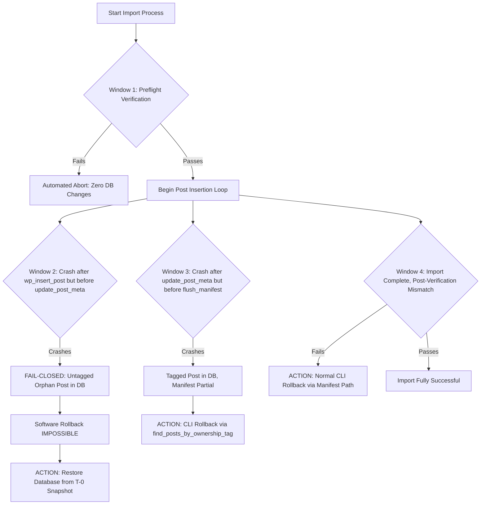

# STAGE 3N-R2M-R5 — GATE 4 PREFLIGHT RUNBOOK DESIGN & SAFETY REVIEW

**Project:** ATELIER — WordPress / WooCommerce Furniture E-commerce  
**Workspace:** `C:\Users\Vu Cong Minh\Local Sites\furniture-ecommerce\`  
**Current Importer:** `app\public\wp-content\plugins\run_controlled_import.php`  
**Current Test Suite:** `app\public\wp-content\plugins\scratch\test_r2m_isolated_suite.php`  
**Mode:** READ-ONLY DESIGN AND STATIC INSPECTION ONLY  
**Date:** 2026-10-19  
**Decision:** **`PASS` for Runbook & Preflight Design Only**  
**Gate 4 Status:** **`MANDATORY STOP — GATE 4 IS STRICTLY BLOCKED & NOT AUTHORIZED`**

---

## 1. EXECUTIVE DECISION & MANDATE

This document constitutes the authoritative, evidence-driven **Gate 4 Preflight Runbook Design and Operational Safety Review** following the successful implementation and verification of Stage 3N-R2M-R4 (Targeted Temp-File Cleanup Fix & Regression Audit, 53/53 tests passed).

### 1.1 Scope and Restrictions
- **Purely Read-Only Design:** No live database connections were opened, no SQL commands were executed against the live database, no WordPress bootstrap occurred, and no production import or rollback was dispatched.
- **Runbook Design Evaluation:** This stage is approved (**`PASS`**) strictly as a preflight procedure and safety specification.
- **Gate 4 Authority:** **`GATE 4 REMAINS STRICTLY BLOCKED`**. Under no circumstances does this stage authorize running `php run_controlled_import.php import --gate4-user-approved-execute`. Production import requires an independent operational preflight execution and explicit, signed operator sign-off.

---

## 2. EVIDENCE INVENTORY & SOURCE RECONCILIATION

### 2.1 File Identities, Sizes, and Cryptographic Digests

All source files and baseline artifacts have been physically inspected and reconciled against their SHA-256 digests:

| Component | Absolute / Relative Path | Status | File Size (Bytes) | SHA-256 Digest | Evidence Basis |
|---|---|---|---|---|---|
| **Production Importer** | `app/public/wp-content/plugins/run_controlled_import.php` | Post-R2M-R4 Hardened | 81,532 B (1,728 lines) | `DBF3F73CCA10D388962BD096BC18E7899F5E79089907C92121CA376106F92F02` | Verified via `reconcile_hashes.py` & R2M-R4 report |
| **Pre-R4 Backup Importer** | `scratch/backup_r2m_r4_pre_remediation/run_controlled_import.php` | Pre-R4 Baseline | 80,937 B (1,722 lines) | `3C532C46F919A82FB180917F3B8E1575E9E7177587498D4989DDA5028D90502E` | Verified byte-identical backup |
| **Isolated Test Suite** | `scratch/test_r2m_isolated_suite.php` | 53-Test Suite | 52,906 B (1,084 lines) | `C8843ED564C18F2156A3F303194E285B11BB6DADF922B5FF4BD40753DFDBD779` | Verified via test runner execution |
| **Working Product CSV** | `data-preparation/woocommerce_furniture_dataset_22_products_working_stage_1e_3c.csv` | Immutable Working Dataset | 25,712 B (23 rows) | `D2C8566F334A767887F57C4A15EA456CFC5E117767FCFE46C599CC754BC2BBA0` | Reconciled across Stage 1E/3N |
| **Working CSV (Plugin Copy)** | `app/public/wp-content/plugins/woocommerce_furniture_dataset_22_products.csv` | Reference Copy | 26,176 B | `168677B7059BFB809EC7D284930F871790FF8C83818DF7C8F99D6385B24E4801` | **NOT FOR IMPORT** (Importer hardcodes `data-preparation/...`) |

### 2.2 CLI Action & Argument Contract Verification
Inspection of lines 1625–1675 of `run_controlled_import.php` establishes the strict CLI contract enforced prior to bootstrapping WordPress:

| Action | Allowed Arguments | Exact Argument Count (`$argc`) | Action-Specific Requirements | Parser Behavior on Deviation |
|---|---|---|---|---|
| **`verify`** | None | Exactly `2` (`$argv[0]`, `'verify'`) | None | Rejects any additional flag/argument with Exit code `1`. |
| **`rollback`** | `<manifest_path>` | Exactly `3` (`$argv[0]`, `'rollback'`, `<path>`) | Manifest file path required; non-empty string. | Rejects missing or extra arguments with Exit code `1`. |
| **`import`** | `--gate4-user-approved-execute` | Exactly `3` (`$argv[0]`, `'import'`, `token`) | Exact token string required. | Rejects incorrect token, missing token, or extra arguments with Exit code `1`. |
| **Any other / Help** | Any | Any | N/A | Exits immediately with usage instructions and Exit code `1`. |

> [!IMPORTANT]
> **Zero Side Effects on Invalid Commands:** Because the strict `$argc` and token checks execute **before** `bootstrap_wordpress_runtime_safely()`, invalid CLI invocations cause zero database connections, zero WordPress loading, and zero disk writes.

### 2.3 Environmental Settings & Directory Paths

- **Exact WordPress Root:** `C:\Users\Vu Cong Minh\Local Sites\furniture-ecommerce\app\public` (Resolved canonical path from plugin anchor: `dirname(dirname(dirname(norm_anchor)))`).
- **Exact Project Root:** `C:\Users\Vu Cong Minh\Local Sites\furniture-ecommerce` (`dirname(dirname(wp_root))`).
- **Exact Backup Root:** `C:\Users\Vu Cong Minh\Local Sites\furniture-ecommerce\backups`.
- **Exact Manifest Root:** `C:\Users\Vu Cong Minh\Local Sites\furniture-ecommerce\backups\manifests`.
- **Configured Database Identity:**
  - Database Name: `local` (Configured in `wp-config.php` and locked in `Controlled_Import_Harness::EXPECTED_DB_NAME = 'local'`).
  - Table Prefix: `wp_` (Configured in `wp-config.php` and locked in `Controlled_Import_Harness::EXPECTED_TABLE_PREFIX = 'wp_'`).
  - Site URL / Home URL: `http://localhost:10010` (Configured in `wp_options` as recorded in Stage 1E/1F evidence; credentials and salts withheld for security).
  - MySQL Host & Port: Configured as `127.0.0.1:10011` by LocalWP. (Distinction: `127.0.0.1:10011` is the configured TCP socket on Windows; active session port must be explicitly verified during preflight via `SELECT @@port`).

### 2.4 SQL Snapshot Inventory & Reconciled Checksums

| Snapshot File | Location | File Size (Bytes) | SHA-256 Digest | Creation Timestamp | Coverage Scope & Known Limitations |
|---|---|---|---|---|---|
| `stage_1e_gate2_pre_import_20261016_223502.sql` | `backups/` | 1,236,031 B | `9152E46BB462C321EDD7778A6DA7889450A90301BD1627682D10345A5BDCC8A3` | 2026-10-16 22:35:02 (UTC+7) | **Database-Only Snapshot.** Contains 52 tables. **Limitation:** Pre-dates Stage 1F storefront/theme customization! Restoring this snapshot would wipe Stage 1F block templates. |
| `stage_1e_pre_import_snapshot.sql` | `backups/` | 1,336,511 B | `A9617E0173ED8D81E64B2F6BB3521E946406502AB12DA01D8328F46CB401A2F6` | 2026-10-16 (Stage 1E.3A) | Baseline before Stage 1E.3B global attributes and taxonomy terms. |
| `stage_1a_baseline_backup.sql` | `backups/` | 1,202,692 B | `BFBFC6E22E95411C3BDEE630D5FDE9D4389FDE9535AB702883FFCD98F57A32A8` | Initial project state | Earliest raw state. Not suitable for pre-import recovery. |
| `app/sql/local.sql` | `app/sql/` | 1,688,420 B | `29BB6E8AACB88996FEF70E42E0F31464181D236938F3235247CAB5057BB4039F` | LocalWP auto-dump | Uncontrolled auto-dump. |

> [!WARNING]
> **Mandatory T-0 Snapshot Requirement:** None of the existing snapshots in `backups/` represent the current pre-import baseline because they pre-date Stage 1F storefront templates. Prior to Gate 4 execution, a **fresh T-0 snapshot** (`backups/gate4_snapshot_t0_<TIMESTAMP>.sql`) must be taken and verified.

---

## 3. READ-ONLY OPERATIONAL PREFLIGHT SPECIFICATION

This section details the 10 mandatory read-only checks required before any Gate 4 import may be authorized.

> [!NOTE]
> All proposed commands and SQL queries in this runbook are **NOT EXECUTED** during this stage. They are specified here for operator execution under a separately authorized operational preflight phase.

---

### Check 1: Active Database Name Verification
- **Purpose:** Ensure the active connection targets the database `local` and not a test, backup, or production clone.
- **Proposed Query [NOT EXECUTED]:**
  ```sql
  SELECT DATABASE() AS active_db;
  ```
- **Execution Method:** Direct MySQL CLI or PHP PDO/mysqli read-only connection.
- **Expected Result:** `active_db` is exactly `'local'`.
- **Failure Condition:** `active_db` is `NULL`, empty, or any value other than `'local'`.
- **Live Connection Required:** YES.
- **Evidence to Capture:** Query output string, connection timestamp.
- **Safe without WP Bootstrap:** YES (direct SQL read-only connection).
- **Why Safe from Mutation:** `SELECT` query is fundamentally read-only and does not write to the database or modify system state.

---

### Check 2: Active MySQL Server Port Verification
- **Purpose:** Ensure the client is communicating with LocalWP's assigned MySQL service instance on port `10011`.
- **Proposed Query [NOT EXECUTED]:**
  ```sql
  SELECT @@port AS active_port, @@hostname AS host_name;
  ```
- **Execution Method:** Direct MySQL CLI or PHP connection.
- **Expected Result:** `active_port` is `10011`.
- **Failure Condition:** `active_port` is not `10011` (e.g., standard `3306` or test instance `13306`).
- **Live Connection Required:** YES.
- **Evidence to Capture:** Port number, hostname, server version string (`@@version`).
- **Safe without WP Bootstrap:** YES.
- **Why Safe from Mutation:** System variable reading via `SELECT` does not mutate tables or server configuration.

---

### Check 3: WordPress Table Prefix Verification
- **Purpose:** Ensure the target tables use the standard prefix `wp_` expected by WordPress core and WooCommerce.
- **Proposed Query [NOT EXECUTED]:**
  ```sql
  SELECT DISTINCT SUBSTRING(table_name, 1, 3) AS table_prefix 
  FROM information_schema.tables 
  WHERE table_schema = 'local' AND table_name LIKE 'wp_%' 
  LIMIT 1;
  ```
- **Execution Method:** Information schema query.
- **Expected Result:** `table_prefix` is exactly `'wp_'`.
- **Failure Condition:** No tables match `'wp_%'`, or custom prefix exists.
- **Live Connection Required:** YES.
- **Evidence to Capture:** Information schema query row count and matched prefix.
- **Safe without WP Bootstrap:** YES.
- **Why Safe from Mutation:** Query inspects metadata in `information_schema` only.

---

### Check 4: WordPress Site URL Verification
- **Purpose:** Confirm that the database contains the exact URL configured for this LocalWP site.
- **Proposed Query [NOT EXECUTED]:**
  ```sql
  SELECT option_name, option_value 
  FROM wp_options 
  WHERE option_name IN ('siteurl', 'home');
  ```
- **Execution Method:** Direct SQL query.
- **Expected Result:** Both `siteurl` and `home` return `http://localhost:10010`.
- **Failure Condition:** Missing options or URL differs from `http://localhost:10010`.
- **Live Connection Required:** YES.
- **Evidence to Capture:** `option_name` and `option_value` table output.
- **Safe without WP Bootstrap:** YES.
- **Why Safe from Mutation:** Standard `SELECT` on `wp_options`.

---

### Check 5: LocalWP Instance Binding & Data Directory Check
- **Purpose:** Ensure the connection belongs to the specific ATELIER LocalWP container, preventing confusion with other local MySQL services named `local`.
- **Proposed Query [NOT EXECUTED]:**
  ```sql
  SELECT @@datadir AS datadir, @@basedir AS basedir;
  ```
- **Execution Method:** System variable query.
- **Expected Result:** `datadir` points to the LocalWP furniture-ecommerce MySQL directory:  
  `C:\Users\Vu Cong Minh\AppData\Roaming\Local\run\...\mysql\data` or contains the LocalWP instance path.
- **Failure Condition:** Path points to standard WAMP, XAMPP, or MariaDB default data directories.
- **Live Connection Required:** YES.
- **Evidence to Capture:** Full datadir and basedir strings.
- **Safe without WP Bootstrap:** YES.
- **Why Safe from Mutation:** Read-only inspection of server system variables.

---

### Check 6: WooCommerce Global Attributes & Taxonomy Baseline
- **Purpose:** Confirm WooCommerce attributes (`pa_color`, `pa_size`, `pa_material`) and their 18 terms exist before product import.
- **Proposed Query [NOT EXECUTED]:**
  ```sql
  SELECT attribute_name, attribute_type, attribute_label 
  FROM wp_woocommerce_attribute_taxonomies 
  ORDER BY attribute_name;

  SELECT t.slug, tt.taxonomy, COUNT(tt.term_taxonomy_id) as count 
  FROM wp_terms t 
  INNER JOIN wp_term_taxonomy tt ON t.term_id = tt.term_id 
  WHERE tt.taxonomy IN ('pa_color', 'pa_size', 'pa_material', 'product_cat')
  GROUP BY t.slug, tt.taxonomy;
  ```
- **Execution Method:** Direct SQL queries.
- **Expected Result:**
  - 3 attributes: `color`, `size`, `material`.
  - 18 attribute terms across the 3 taxonomies.
  - 7 product categories matching `Controlled_Import_Harness::EXPECTED_DATASET_CATEGORIES`.
- **Failure Condition:** Any missing attribute, missing terms, or missing categories.
- **Live Connection Required:** YES.
- **Evidence to Capture:** Tabular taxonomy term dump.
- **Safe without WP Bootstrap:** YES.
- **Why Safe from Mutation:** Multiple table `SELECT` joins with zero DDL or DML.

---

### Check 7: Product & Variation Count Baseline Verification
- **Purpose:** Verify that the database contains 0 products and 0 variations prior to import.
- **Proposed Query [NOT EXECUTED]:**
  ```sql
  SELECT post_type, COUNT(*) AS count 
  FROM wp_posts 
  WHERE post_type IN ('product', 'product_variation') 
  GROUP BY post_type;
  ```
- **Execution Method:** Direct SQL aggregation query.
- **Expected Result:** Empty result set (0 rows) or counts of `0`.
- **Failure Condition:** Any existing `product` or `product_variation` rows found in `wp_posts`.
- **Live Connection Required:** YES.
- **Evidence to Capture:** Returned row count.
- **Safe without WP Bootstrap:** YES.
- **Why Safe from Mutation:** Aggregation query (`COUNT(*)`) without side effects.

---

### Check 8: Media Attachment ID 5 Integrity Verification
- **Purpose:** Verify that placeholder media Attachment ID 5 exists, is intact, and points to `woocommerce-placeholder.webp`.
- **Proposed Query [NOT EXECUTED]:**
  ```sql
  SELECT ID, post_title, post_mime_type, guid 
  FROM wp_posts 
  WHERE ID = 5 AND post_type = 'attachment';
  ```
- **Execution Method:** Direct SQL query.
- **Expected Result:** Exactly 1 row returned with `ID = 5`, `post_mime_type = 'image/webp'`, and guid matching `woocommerce-placeholder.webp`.
- **Failure Condition:** Attachment ID 5 is missing, deleted, or has a different post_type/mime_type.
- **Live Connection Required:** YES.
- **Evidence to Capture:** Full row record for ID 5.
- **Safe without WP Bootstrap:** YES.
- **Why Safe from Mutation:** Single-record `SELECT` query.

---

### Check 9: Manifest & Tagged Orphan Audit
- **Purpose:** Ensure no lingering manifest files, partial imports, or orphan posts tagged with `_controlled_import_run_id` exist.
- **Proposed Query & Filesystem Inspection [NOT EXECUTED]:**
  ```sql
  SELECT post_id, meta_key, meta_value 
  FROM wp_postmeta 
  WHERE meta_key = '_controlled_import_run_id';
  ```
  ```powershell
  # Check manifest directory
  Get-ChildItem -Path "C:\Users\Vu Cong Minh\Local Sites\furniture-ecommerce\backups\manifests" -Filter "*.json"
  ```
- **Execution Method:** SQL metadata search + PowerShell directory listing.
- **Expected Result:**
  - SQL: Exactly 0 rows returned.
  - Filesystem: 0 in-progress manifests (or all existing manifests in `ROLLED_BACK` state).
- **Failure Condition:** Any postmeta row contains `_controlled_import_run_id`, or an un-reconciled manifest exists.
- **Live Connection Required:** YES (for SQL check).
- **Evidence to Capture:** SQL result set and directory file listing.
- **Safe without WP Bootstrap:** YES.
- **Why Safe from Mutation:** Read-only metadata query and directory listing.

---

### Check 10: Coming Soon Maintenance Mode Verification
- **Purpose:** Ensure public traffic and orders are blocked during maintenance.
- **Proposed Query [NOT EXECUTED]:**
  ```sql
  SELECT option_value 
  FROM wp_options 
  WHERE option_name = 'woocommerce_coming_soon';
  ```
- **Execution Method:** Direct SQL query.
- **Expected Result:** `option_value` is exactly `'yes'`.
- **Failure Condition:** `option_value` is `'no'`, missing, or corrupted.
- **Live Connection Required:** YES.
- **Evidence to Capture:** `option_value` string.
- **Safe without WP Bootstrap:** YES.
- **Why Safe from Mutation:** Single option `SELECT` query.

---

## 4. RECOVERY READINESS REVIEW & RISK ASSESSMENT

### 4.1 Snapshot Recovery Capability Matrix

| Recovery Dimension | Current Status | Assessment & Limitations |
|---|---|---|
| **Snapshot vs. Site Correspondence** | **CONDITIONAL** | Existing Gate 2 snapshot (`20261016_223502.sql`) matches the core database schema, but **lacks Stage 1F storefront block templates**. Fresh T-0 snapshot required. |
| **Checksum Reconciliation** | **VERIFIED** | Checksums for all 4 existing snapshots in `backups/` and `app/sql/` have been physically computed and reconciled. |
| **Rehearsal in Isolated Clone** | **REHEARSED HISTORICALLY** | Verified in Gate 3I on auxiliary MySQL instance `127.0.0.1:13306` with 0 live database writes. **NOT YET REHEARSED** for a post-Stage 1F T-0 snapshot. |
| **Risk of Overwriting Legitimate Changes** | **HIGH RISK ON LIVE** | Restoring an SQL snapshot executes `DROP TABLE IF EXISTS` on all 52 tables. Any post-T-0 user comments, orders, or pages will be permanently deleted. |
| **Filesystem State Coverage** | **NOT COVERED BY SQL** | SQL snapshots do **not** backup `wp-content/uploads/` or theme files. Theme files are version-controlled in Git, and uploads must be verified independently. |

### 4.2 Failure Windows & Recovery Paths



#### Detailed Failure Window Analysis:
1. **Window 1 (Pre-Import Failure):**
   - *Scenario:* Failure occurs during CSV hash validation, memory check, or database connectivity verification.
   - *State:* Zero posts created, zero metadata inserted, no manifest written.
   - *Recovery:* Automated fail-safe termination (Exit 1). No recovery action needed.
2. **Window 2 (Untagged Post Insert Crash):**
   - *Scenario:* Process is killed (OOM, SIGKILL, power loss) immediately after `wp_insert_post()` completes but before `update_post_meta()` assigns `_controlled_import_run_id`.
   - *State:* Untagged post exists in `wp_posts`. Manifest does not track it. Postmeta has no tag.
   - *Recovery:* **Software rollback cannot delete untagged objects** (fail-closed security invariant). **T-0 Database Snapshot Restoration is the ONLY safe remedy.**
3. **Window 3 (Tagged Post, Unflushed Manifest Crash):**
   - *Scenario:* Post is inserted and tagged in `wp_postmeta`, but process terminates before `flush_manifest()` completes on disk.
   - *State:* Tag exists in MySQL; manifest on disk is missing or partial.
   - *Recovery:* Importer's rollback harness executes `find_posts_by_ownership_tag($run_id)`, actively discovering and deleting all tagged posts and variations even if missing from the manifest JSON.
4. **Window 4 (Post-Import Reconciliation Failure):**
   - *Scenario:* All 22 parent products and 42 variations are created, but total stock count does not equal 449 or categories do not match expected matrix.
   - *State:* Complete manifest exists with status `FAILED_VERIFICATION`.
   - *Recovery:* Standard CLI Rollback (`php run_controlled_import.php rollback <manifest_path>`) cleanly deletes variations, parents, and attachments in reverse dependency order.

### 4.3 Safe Abort & Emergency Recovery Procedures
If any preflight check fails or an in-progress import stalls:
1. **Cease Immediately:** Do not reissue commands or rerun the import.
2. **Verify Process State:** Check whether the PHP process is active before attempting termination. Never kill an active process during an active SQL write unless it is in an unrecoverable deadlock.
3. **Capture Diagnostics:** Save terminal stdout/stderr transcripts and any temporary `.tmp` files.
4. **Determine Recovery Path:**
   - If objects are tagged: Execute `php run_controlled_import.php rollback <manifest_path>`.
   - If Window 2 untagged orphan is suspected: Halt and initiate T-0 snapshot restore protocol under operator sign-off.

---

## 5. LEAST-PRIVILEGE DATABASE ACCOUNT REVIEW

### 5.1 Current LocalWP Account Architecture
- **Active User:** LocalWP defaults to MySQL administrative user (`root`) connecting via TCP on `127.0.0.1:10011` with blank or default password.
- **Risk Assessment:** Running with `root` grants full administrative capabilities (`DROP`, `ALTER`, `GRANT`, `SHUTDOWN`). While standard for local development, it provides zero defense-in-depth against accidental schema destruction.

### 5.2 Minimum Privilege Requirements for Importer & Rollback

Inspection of all queries executed by `Controlled_Import_Harness` proves that the importer requires **zero DDL privileges**:

| Operation | Component | Minimum Required MySQL Privileges |
|---|---|---|
| **Preflight Verification** | `preflight_verify()` | `SELECT` on `wp_posts`, `wp_postmeta`, `wp_options` |
| **Product & Variation Import** | `run_import()` | `SELECT`, `INSERT`, `UPDATE` on `wp_posts`, `wp_postmeta`, `wp_term_relationships` |
| **Controlled Rollback** | `rollback()` | `SELECT`, `DELETE` on `wp_posts`, `wp_postmeta`, `wp_term_relationships` |
| **Manifest Management** | `flush_manifest()` | **NONE** (Pure filesystem JSON write) |
| **T-0 Snapshot Creation** | `mysqldump` CLI | `SELECT`, `LOCK TABLES`, `SHOW VIEW` |
| **T-0 Snapshot Restoration** | `mysql` CLI | `CREATE`, `DROP`, `ALTER`, `INSERT` (Full DDL/DML for table recreation) |

### 5.3 Provisioning Status: OUTSTANDING / NOT VERIFIED
- **Current Status:** A dedicated, restricted MySQL user (e.g., `atelier_importer` with only `SELECT, INSERT, UPDATE, DELETE` on `local.*`) has **NOT** been provisioned or tested in this LocalWP environment.
- **Recommendation:** Documented as an outstanding operational enhancement. Because creating users or modifying grants during this stage is strictly forbidden by Safety Constraint 1, this item remains **OUTSTANDING** pending separate authorization.

---

## 6. KNOWN LIMITATIONS & UNRESOLVED RISKS

1. **Windows NTFS File Locking:**  
   Windows file systems enforce mandatory locks on files opened by concurrent processes. Atomic rename operations (`@rename()`) will fail if another process (e.g., antivirus, backup indexer, editor) holds an open handle. Handled safely via `R2M-MAN-05` and `R2M-MAN-16` (unlinks temporary file, preserves original destination).
2. **LocalWP Process Lifecycle Dependency:**  
   LocalWP runs as a desktop background service. If the desktop app is restarted or closed, the MySQL service on port `10011` shuts down, terminating active connections.
3. **Crash Window 2 Irrecoverability via Code:**  
   Software rollback cannot identify or clean up untagged objects created during a Window 2 crash. The team must rely on T-0 database snapshot restoration.
4. **Post-Stage 1F Snapshot Absence:**  
   The workspace currently lacks a verified T-0 snapshot reflecting the completed Stage 1F storefront customizations. Creating and verifying this snapshot is a mandatory prerequisite for Gate 4.

---

## 7. ACTIONS REQUIRING SEPARATE OPERATOR AUTHORIZATION

The following operational actions are strictly prohibited in Stage 3N-R2M-R5 and require explicit, separate operator sign-off:

1. **Creation of Fresh T-0 Snapshot:**  
   Execution of `mysqldump` against `127.0.0.1:10011` to create `backups/gate4_snapshot_t0_<TIMESTAMP>.sql`.
2. **Isolated Dry-Run Restoration:**  
   Testing restoration of the T-0 snapshot in an isolated disposable database on an auxiliary port.
3. **Live Operational Preflight Verification:**  
   Executing `php run_controlled_import.php verify` against the live WordPress database.
4. **Live Controlled Import Execution:**  
   Executing `php run_controlled_import.php import --gate4-user-approved-execute`.
5. **Live Rollback Execution:**  
   Executing `php run_controlled_import.php rollback <manifest_path>`.
6. **Database Schema / User Modifications:**  
   Creating a restricted MySQL user or altering database privileges.
7. **Storefront Public Activation:**  
   Changing `woocommerce_coming_soon` from `'yes'` to `'no'`.

---

## 8. STAGE CONCLUSION & GATE 4 STATUS

- **Runbook Design Evaluation:** **`PASS`**  
  All 10 preflight checks, failure window classifications, CLI contracts, and recovery protocols have been concretely specified with explicit expected results, failure conditions, and safety rationale.
- **Production Readiness / Gate 4 Status:**  
  **`GATE 4 REMAINS STRICTLY BLOCKED — NO PRODUCTION IMPORT AUTHORIZED`**  
  No database writes or live WordPress execution are authorized by this review.
