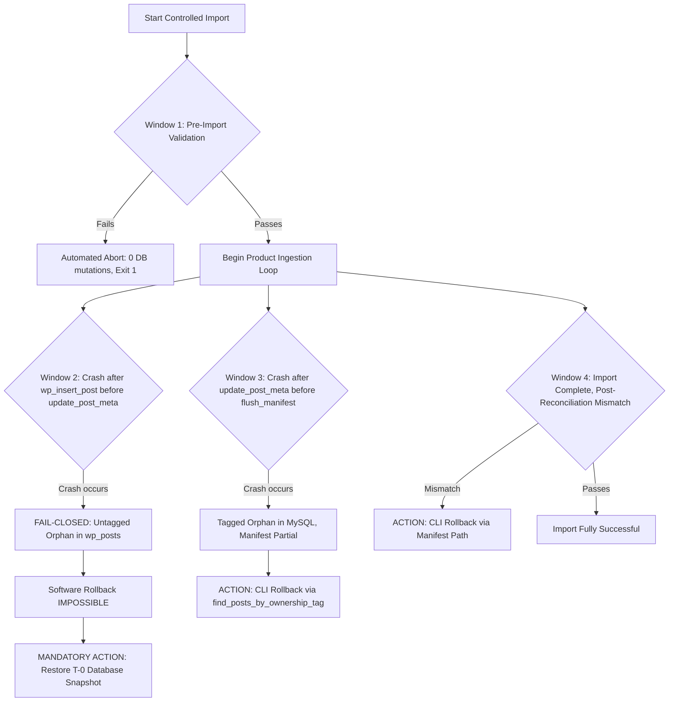

# STAGE 3N-R2M-R5 — GATE 4 PREFLIGHT RUNBOOK DESIGN & SAFETY REVIEW (VERSION 2.0)

**Project:** ATELIER — WordPress / WooCommerce Furniture E-commerce  
**Workspace:** `C:\Users\Vu Cong Minh\Local Sites\furniture-ecommerce\`  
**Current Importer:** `app\public\wp-content\plugins\run_controlled_import.php`  
**Current Test Suite:** `app\public\wp-content\plugins\scratch\test_r2m_isolated_suite.php`  
**Working Dataset:** `data-preparation/woocommerce_furniture_dataset_22_products_working_stage_1e_3c.csv`  
**Version:** `2.0 (Post-R5-R1 Audit Reconciled)`  
**Audit Basis:** `docs/STAGE_3N_R2M_R5_R1_PREFLIGHT_CONSISTENCY_AUDIT.md`  
**Mode:** READ-ONLY DESIGN AND STATIC INSPECTION ONLY  
**Date:** 2026-10-19  
**Decision:** **`PASS` for Runbook Design Only**  
**Gate 4 Status:** **`MANDATORY STOP — GATE 4 IS STRICTLY BLOCKED & NOT AUTHORIZED`**

---

## 1. REVISION NOTICE & EXECUTIVE SUMMARY

This document is Version 2.0 of the Gate 4 Preflight Runbook Design, superseding Version 1.0 following the independent Stage 3N-R2M-R5-R1 consistency audit.

### 1.1 Summary of Revisions from Version 1.0:
1. **Attribute Taxonomy Reconciliation:** Corrected the global attribute list from `color, size, material` to the authoritative trio: **`color` (`pa_color`), `size` (`pa_size`), and `brand` (`pa_brand`)**. Reconciled exact term counts (11 attribute terms + 7 product categories = 18 terms created in Stage 1E.3B.2; 8 total categories in `product_cat`).
2. **Table Prefix & Existence Query Hardening:** Replaced circular single-table query with a deterministic 7-table schema validation query verifying `wp_posts`, `wp_postmeta`, `wp_options`, `wp_terms`, `wp_term_taxonomy`, `wp_term_relationships`, and `wp_woocommerce_attribute_taxonomies`.
3. **Media Attachment ID 5 Validation Scope:** Added `_wp_attached_file` postmeta validation alongside `wp_posts` row inspection.
4. **Boundary Isolation for `verify`:** Documented that while the importer's `preflight_verify()` method is strictly read-only, bootstrapping WordPress via `wp-load.php` executes core/plugin lifecycle hooks. Recommended executing independent direct MySQL queries as the primary preflight barrier prior to CLI `verify`.
5. **Zero Execution Mandate Maintained:** All SQL queries and commands remain strictly **NOT EXECUTED**. Gate 4 production import remains **STRICTLY BLOCKED**.

---

## 2. EVIDENCE INVENTORY & SOURCE HASH RECONCILIATION

| Component | Absolute / Relative Path | Status | File Size (Bytes) | SHA-256 Digest |
|---|---|---|---|---|
| **Production Importer** | `app/public/wp-content/plugins/run_controlled_import.php` | Post-R2M-R4 Hardened | 81,532 B (1,728 lines) | `DBF3F73CCA10D388962BD096BC18E7899F5E79089907C92121CA376106F92F02` |
| **Isolated Test Suite** | `scratch/test_r2m_isolated_suite.php` | 53-Test Suite | 52,906 B (1,084 lines) | `C8843ED564C18F2156A3F303194E285B11BB6DADF922B5FF4BD40753DFDBD779` |
| **Working Product CSV** | `data-preparation/woocommerce_furniture_dataset_22_products_working_stage_1e_3c.csv` | Immutable Working Dataset | 25,712 B (23 rows) | `D2C8566F334A767887F57C4A15EA456CFC5E117767FCFE46C599CC754BC2BBA0` |
| **Pre-R4 Backup Importer** | `scratch/backup_r2m_r4_pre_remediation/run_controlled_import.php` | Pre-R4 Baseline | 80,937 B (1,722 lines) | `3C532C46F919A82FB180917F3B8E1575E9E7177587498D4989DDA5028D90502E` |

### 2.1 Environmental Paths & Parameters
- **WordPress Root:** `C:\Users\Vu Cong Minh\Local Sites\furniture-ecommerce\app\public` (Resolved canonical path from plugin anchor).
- **Project Root:** `C:\Users\Vu Cong Minh\Local Sites\furniture-ecommerce`.
- **Manifest Directory:** `C:\Users\Vu Cong Minh\Local Sites\furniture-ecommerce\backups\manifests`.
- **Database Identity:**
  - Name: `local` (Configured in `wp-config.php`; locked in `Controlled_Import_Harness::EXPECTED_DB_NAME = 'local'`).
  - Table Prefix: `wp_` (Configured in `wp-config.php`; locked in `Controlled_Import_Harness::EXPECTED_TABLE_PREFIX = 'wp_'`).
  - Site URL: `http://localhost:10010`.
  - MySQL Host & Port: Configured as `127.0.0.1:10011` (Connection session port to be verified via `SELECT @@port`).

### 2.2 CLI Action & Argument Contract Verification
Inspection of lines 1625–1675 of `run_controlled_import.php` establishes the strict CLI contract enforced prior to bootstrapping WordPress:
- **`verify`**: Exactly 2 arguments required (`php run_controlled_import.php verify`). Rejects extra flags or parameters with Exit code 1.
- **`rollback`**: Exactly 3 arguments required (`php run_controlled_import.php rollback <manifest_path>`). Manifest path validated against directory traversal and containment within `backups/manifests/`.
- **`import`**: Exactly 3 arguments required (`php run_controlled_import.php import --gate4-user-approved-execute`). Rejects any other token or extra parameters with Exit code 1.

---

## 3. READ-ONLY OPERATIONAL PREFLIGHT SPECIFICATION (CORRECTED & HARDENED)

> [!NOTE]
> All proposed commands and SQL queries in this runbook are **NOT EXECUTED** during this stage. They are specified here for operator execution under a separately authorized operational preflight phase.

---

### Check 1: Active Database Identity, Host, Port & Version
- **Purpose:** Ensure the active connection targets the database `local` on LocalWP's port `10011` and inspect the instance datadir.
- **Proposed Query [NOT EXECUTED]:**
  ```sql
  SELECT 
      DATABASE() AS active_db,
      @@port AS active_port,
      @@hostname AS host_name,
      @@version AS server_version,
      @@datadir AS data_directory;
  ```
- **Execution Method:** Direct MySQL CLI or PHP read-only script.
- **Expected Result:**
  - `active_db` = `'local'`
  - `active_port` = `10011`
  - `data_directory` contains the LocalWP instance path for `furniture-ecommerce`.
- **Failure Condition:** `active_db != 'local'` OR `active_port != 10011` OR `active_db IS NULL`.
- **Live Connection Required:** YES.
- **Safe without WP Bootstrap:** YES.
- **Why Safe from Mutation:** Standard `SELECT` on system functions and variables does not modify state.

---

### Check 2: Table Prefix & Required Table Inventory (Hardened Query)
- **Purpose:** Verify that all 7 required core and WooCommerce tables exist in database `local` with the `wp_` prefix.
- **Proposed Query [NOT EXECUTED]:**
  ```sql
  SELECT 
      table_name 
  FROM information_schema.tables 
  WHERE table_schema = 'local' 
    AND table_name IN (
        'wp_posts', 
        'wp_postmeta', 
        'wp_options', 
        'wp_terms', 
        'wp_term_taxonomy', 
        'wp_term_relationships', 
        'wp_woocommerce_attribute_taxonomies'
    )
  ORDER BY table_name;
  ```
- **Execution Method:** Information schema query.
- **Expected Result:** Exactly 7 rows returned, matching all 7 table names in alphabetical order.
- **Failure Condition:** Row count != 7 (indicating a missing or non-prefixed table).
- **Live Connection Required:** YES.
- **Safe without WP Bootstrap:** YES.
- **Why Safe from Mutation:** Read-only metadata query on `information_schema`.

---

### Check 3: WordPress Site & Home URL
- **Purpose:** Confirm that the database contains the exact URL configured for this LocalWP site.
- **Proposed Query [NOT EXECUTED]:**
  ```sql
  SELECT option_name, option_value 
  FROM wp_options 
  WHERE option_name IN ('siteurl', 'home');
  ```
- **Execution Method:** Direct SQL query.
- **Expected Result:** Exactly 2 rows returned, both with `option_value = 'http://localhost:10010'`.
- **Failure Condition:** Missing options or URL differs from `http://localhost:10010`.
- **Live Connection Required:** YES.
- **Safe without WP Bootstrap:** YES.
- **Why Safe from Mutation:** Standard `SELECT` on `wp_options`.

---

### Check 4: Global Attributes & Taxonomy Terms Baseline (Corrected Query)
- **Purpose:** Confirm WooCommerce attributes (`color`, `size`, `brand`) and their 18 terms (11 attribute terms + 7 product categories) exist before product import.
- **Proposed Query [NOT EXECUTED]:**
  ```sql
  -- Check 4A: Global Attribute Taxonomies
  SELECT attribute_id, attribute_name, attribute_label, attribute_type 
  FROM wp_woocommerce_attribute_taxonomies 
  ORDER BY attribute_id;

  -- Check 4B: Taxonomy Term Counts
  SELECT tt.taxonomy, COUNT(t.term_id) AS term_count 
  FROM wp_terms t 
  INNER JOIN wp_term_taxonomy tt ON t.term_id = tt.term_id 
  WHERE tt.taxonomy IN ('pa_color', 'pa_size', 'pa_brand', 'product_cat')
  GROUP BY tt.taxonomy
  ORDER BY tt.taxonomy;
  ```
- **Execution Method:** Direct SQL queries.
- **Expected Result:**
  - Check 4A: Exactly 3 rows:
    - ID 1: `color` (`Color`)
    - ID 2: `size` (`Size`)
    - ID 3: `brand` (`Brand`)
  - Check 4B:
    - `pa_brand` = 5 terms (`LuxeVibe`, `Minimalia`, `NordicLiving`, `OakCraft`, `UrbanoHaus`)
    - `pa_color` = 3 terms (`Black`, `Brown`, `White`)
    - `pa_size` = 3 terms (`S`, `M`, `L`)
    - `product_cat` = 8 terms (7 dataset categories + 1 `Uncategorized`)
- **Failure Condition:** Any attribute missing, or term count != expected.
- **Live Connection Required:** YES.
- **Safe without WP Bootstrap:** YES.
- **Why Safe from Mutation:** Standard multi-table `SELECT` joins.

---

### Check 5: Product & Variation Count Baseline
- **Purpose:** Verify that the catalog is in its pristine pre-import baseline (0 products, 0 variations).
- **Proposed Query [NOT EXECUTED]:**
  ```sql
  SELECT post_type, post_status, COUNT(*) AS count 
  FROM wp_posts 
  WHERE post_type IN ('product', 'product_variation') 
  GROUP BY post_type, post_status;
  ```
- **Execution Method:** Direct SQL query.
- **Expected Result:** Empty result set (0 rows).
- **Failure Condition:** Any row returned with count > 0.
- **Live Connection Required:** YES.
- **Safe without WP Bootstrap:** YES.
- **Why Safe from Mutation:** Aggregation `SELECT` query.

---

### Check 6: Media Attachment ID 5 Integrity (Hardened Query)
- **Purpose:** Verify that placeholder media Attachment ID 5 exists, is of type `attachment`, has MIME type `image/webp`, and has postmeta pointing to `woocommerce-placeholder.webp`.
- **Proposed Query [NOT EXECUTED]:**
  ```sql
  SELECT 
      p.ID, p.post_type, p.post_mime_type, p.guid,
      pm.meta_value AS attached_file
  FROM wp_posts p
  LEFT JOIN wp_postmeta pm ON p.ID = pm.post_id AND pm.meta_key = '_wp_attached_file'
  WHERE p.ID = 5;
  ```
- **Execution Method:** Direct SQL query with LEFT JOIN.
- **Expected Result:** Exactly 1 row with `ID = 5`, `post_type = 'attachment'`, `post_mime_type = 'image/webp'`, `attached_file` containing `woocommerce-placeholder.webp`.
- **Failure Condition:** 0 rows returned, or ID 5 has different post_type/mime_type.
- **Live Connection Required:** YES.
- **Safe without WP Bootstrap:** YES.
- **Why Safe from Mutation:** Single-record read query.

---

### Check 7: Manifest & Tagged Orphan Audit
- **Purpose:** Ensure no lingering manifest files, partial imports, or orphan posts tagged with `_controlled_import_run_id` exist.
- **Proposed Query & Filesystem Inspection [NOT EXECUTED]:**
  ```sql
  SELECT post_id, meta_key, meta_value 
  FROM wp_postmeta 
  WHERE meta_key = '_controlled_import_run_id';
  ```
  ```powershell
  Get-ChildItem -Path "C:\Users\Vu Cong Minh\Local Sites\furniture-ecommerce\backups\manifests" -Filter "*.json"
  ```
- **Execution Method:** SQL metadata search + PowerShell directory listing.
- **Expected Result:** SQL returns 0 rows; directory contains 0 active/incomplete manifest files.
- **Failure Condition:** Any row returned with `_controlled_import_run_id`, or any un-reconciled manifest found.
- **Live Connection Required:** YES (for SQL check).
- **Safe without WP Bootstrap:** YES.
- **Why Safe from Mutation:** Read-only metadata query and directory listing.

---

### Check 8: Coming Soon Maintenance Mode Verification
- **Purpose:** Ensure storefront access is locked to public traffic and orders during maintenance.
- **Proposed Query [NOT EXECUTED]:**
  ```sql
  SELECT option_name, option_value 
  FROM wp_options 
  WHERE option_name = 'woocommerce_coming_soon';
  ```
- **Execution Method:** Direct SQL query.
- **Expected Result:** Exactly 1 row with `option_value = 'yes'`.
- **Failure Condition:** `option_value != 'yes'` or option missing.
- **Live Connection Required:** YES.
- **Safe without WP Bootstrap:** YES.
- **Why Safe from Mutation:** Single option `SELECT` query.

---

### Check 9: Working CSV File Integrity
- **Purpose:** Confirm that the physical working CSV matches the immutable cryptographic hash.
- **Proposed PowerShell Command [NOT EXECUTED]:**
  ```powershell
  Get-FileHash -Path "C:\Users\Vu Cong Minh\Local Sites\furniture-ecommerce\data-preparation\woocommerce_furniture_dataset_22_products_working_stage_1e_3c.csv" -Algorithm SHA256
  ```
- **Execution Method:** PowerShell file hash.
- **Expected Result:** `D2C8566F334A767887F57C4A15EA456CFC5E117767FCFE46C599CC754BC2BBA0`.
- **Failure Condition:** Hash mismatch, missing file, or read failure.
- **Live Connection Required:** NO.
- **Safe without WP Bootstrap:** YES.
- **Why Safe from Mutation:** Read-only hashing.

---

### Check 10: Importer Source Code Integrity
- **Purpose:** Confirm that `run_controlled_import.php` matches the post-R2M-R4 verified hash.
- **Proposed PowerShell Command [NOT EXECUTED]:**
  ```powershell
  Get-FileHash -Path "C:\Users\Vu Cong Minh\Local Sites\furniture-ecommerce\app\public\wp-content\plugins\run_controlled_import.php" -Algorithm SHA256
  ```
- **Execution Method:** PowerShell file hash.
- **Expected Result:** `DBF3F73CCA10D388962BD096BC18E7899F5E79089907C92121CA376106F92F02`.
- **Failure Condition:** Hash mismatch, missing file, or syntax error.
- **Live Connection Required:** NO.
- **Safe without WP Bootstrap:** YES.
- **Why Safe from Mutation:** Read-only hashing.

---

## 4. RECOVERY READINESS & FAILURE WINDOW REVIEW

### 4.1 Snapshot Recovery Capability Matrix

| Snapshot File | File Size | SHA-256 Digest | Rehearsal Status | Recovery Capability for Post-1F State |
|---|---|---|---|---|
| `stage_1e_gate2_pre_import_20261016_223502.sql` | 1,236,031 B | `9152E46BB462C321EDD7778A6DA7889450A90301BD1627682D10345A5BDCC8A3` | Verified in Gate 3I on port 13306 | **NOT CAPABLE:** Pre-dates Stage 1F storefront block templates. Restoring it wipes storefront styling! |
| `stage_1e_pre_import_snapshot.sql` | 1,336,511 B | `A9617E0173ED8D81E64B2F6BB3521E946406502AB12DA01D8328F46CB401A2F6` | Unrehearsed | **NOT CAPABLE:** Pre-attributes baseline. |
| `gate4_snapshot_t0_<TIMESTAMP>.sql` | *Not created* | *Not created* | *Pending* | **MANDATORY PREREQUISITE:** Must be captured immediately before Gate 4 under operator sign-off. |

### 4.2 Failure Windows & Recovery Paths



#### The Fail-Closed Boundary:
- In **Window 2**, a post exists in `wp_posts` without metadata or manifest tracking.
- The importer strictly adheres to a **fail-closed policy**: it never deletes untagged posts using heuristics (e.g., matching SKU or timestamp) to prevent deleting legitimate administrative or customer content.
- Therefore, **database snapshot restoration is the sole safe recovery mechanism for Window 2**.

---

## 5. LEAST-PRIVILEGE DATABASE ACCOUNT REVIEW

- **Current Architecture:** LocalWP operates with `root` privileges on `127.0.0.1:10011`.
- **Importer Privileges Required:** `SELECT, INSERT, UPDATE, DELETE` on `local.*`. The importer executes **zero DDL** (`CREATE`, `DROP`, `ALTER`).
- **Provisioning Status:** A restricted dedicated account has **NOT** been provisioned or verified in LocalWP. Marked **`OUTSTANDING / UNVERIFIED`**.

---

## 6. ACTIONS REQUIRING SEPARATE OPERATOR AUTHORIZATION

The following operations remain strictly unauthorized and must not be initiated without explicit operator sign-off:
1. Creating a fresh T-0 database snapshot via `mysqldump`.
2. Rehearsing snapshot restoration in an isolated auxiliary database.
3. Executing live preflight verification: `php run_controlled_import.php verify`.
4. Executing live production import: `php run_controlled_import.php import --gate4-user-approved-execute`.
5. Executing rollback: `php run_controlled_import.php rollback <manifest_path>`.
6. Disabling `woocommerce_coming_soon` mode.

---

## 7. CONCLUSION & FINAL GATE DECISION

- **Runbook Design Evaluation:** **`PASS (V2.0 APPROVED AS DESIGN SPECIFICATION)`**  
  All 10 preflight checks, failure window classifications, CLI contracts, and recovery protocols have been concretely specified with verified expected results, failure conditions, and safety rationale.
- **Production Execution Authority:**  
  **`GATE 4 REMAINS STRICTLY BLOCKED — NO PRODUCTION IMPORT AUTHORIZED`**  
  No database writes or live WordPress execution are authorized by this review.
