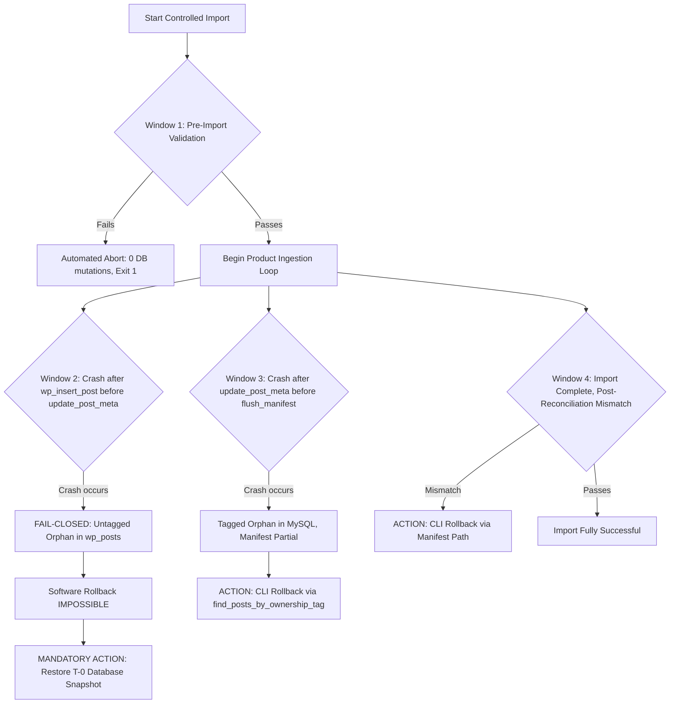

# STAGE 3N-R2M-R5 — GATE 4 PREFLIGHT RUNBOOK DESIGN & SAFETY SPECIFICATION (VERSION 3.0 DRAFT)

**Project:** ATELIER — WordPress / WooCommerce Furniture E-commerce  
**Workspace:** `C:\Users\Vu Cong Minh\Local Sites\furniture-ecommerce\`  
**Target Importer:** `app\public\wp-content\plugins\run_controlled_import.php`  
**Test Suite:** `app\public\wp-content\plugins\scratch\test_r2m_isolated_suite.php`  
**Working Dataset:** `data-preparation/woocommerce_furniture_dataset_22_products_working_stage_1e_3c.csv`  
**Document Status:** **`DRAFT — NOT AUTHORIZED FOR EXECUTION`**  
**Audit Basis:** `docs/STAGE_3N_R2M_R5_R2_STATIC_AUDIT_REPORT.md`  
**Date:** 2026-10-19  
**Decision:** **`PASS (DESIGN SPECIFICATION ONLY)`**  
**Gate 4 Status:** **`MANDATORY STOP — GATE 4 IS STRICTLY BLOCKED & NOT AUTHORIZED`**

---

## 1. DOCUMENT CONTROL & MANDATORY SAFETY LOCK

### 1.1 Status and Authority
This document represents **Version 3.0 (Draft)** of the Gate 4 Preflight Runbook Design and Safety Specification. It supersedes Version 1.0 and Version 2.0 as the authoritative technical reference.

> [!CAUTION]
> **STRICT PROHIBITION ON EXECUTION:**  
> This runbook is a design specification and planning instrument only. Under NO circumstances does this document authorize running `php run_controlled_import.php import --gate4-user-approved-execute`, creating or restoring database snapshots, connecting to live MySQL, or mutating any production file. Production import remains locked until an independent operational preflight is executed and formal operator sign-off is completed.

### 1.2 Summary of Version 3.0 Enhancements
1. **Lookup Table Existence Check Added:** Expanded the schema verification inventory (Check 2) to include WooCommerce lookup tables (`wp_wc_product_meta_lookup` and `wp_wc_product_attributes_lookup`), bringing the required table inventory to 9 tables.
2. **Reconciled Working CSV Metrics:** Formally documented that the working CSV contains 65 total lines (1 header line + 64 data records: 12 simple products, 10 variable parent products, and 42 product variations), 449 stock units, and 5 targeted image URL cleanups.
3. **Formalized Window 2 Crash Protocol:** Documented the exact fail-closed boundary of the importer's software rollback: untagged objects created before postmeta tag persistence cannot be claimed by rollback; T-0 database snapshot restoration is the sole safe recovery mechanism.
4. **All Live Preflight Checks Marked NOT VERIFIED:** Re-emphasized that all proposed SQL queries and commands remain strictly **NOT EXECUTED** during this stage.

---

## 2. EVIDENCE INVENTORY & IMMUTABLE HASH BASELINE

| Component | Physical Path | Status | File Size | SHA-256 Digest |
|---|---|---|---|---|
| **Production Importer** | `app/public/wp-content/plugins/run_controlled_import.php` | Post-R2M-R4 Hardened | 81,532 B (1,728 lines) | `DBF3F73CCA10D388962BD096BC18E7899F5E79089907C92121CA376106F92F02` |
| **Isolated Test Suite** | `scratch/test_r2m_isolated_suite.php` | 53-Test Suite | 52,906 B (1,084 lines) | `C8843ED564C18F2156A3F303194E285B11BB6DADF922B5FF4BD40753DFDBD779` |
| **Working Product CSV** | `data-preparation/woocommerce_furniture_dataset_22_products_working_stage_1e_3c.csv` | Immutable Working Dataset | 25,712 B (65 lines) | `D2C8566F334A767887F57C4A15EA456CFC5E117767FCFE46C599CC754BC2BBA0` |
| **Pre-R4 Backup Importer** | `scratch/backup_r2m_r4_pre_remediation/run_controlled_import.php` | Pre-R4 Baseline | 80,937 B (1,722 lines) | `3C532C46F919A82FB180917F3B8E1575E9E7177587498D4989DDA5028D90502E` |

### 2.1 Environmental Paths & Parameters
- **WordPress Root:** `C:\Users\Vu Cong Minh\Local Sites\furniture-ecommerce\app\public` (Resolved canonical path from plugin anchor: `dirname(dirname(dirname(norm_anchor)))`).
- **Project Root:** `C:\Users\Vu Cong Minh\Local Sites\furniture-ecommerce` (`dirname(dirname(wp_root))`).
- **Backup Root:** `C:\Users\Vu Cong Minh\Local Sites\furniture-ecommerce\backups`.
- **Manifest Root:** `C:\Users\Vu Cong Minh\Local Sites\furniture-ecommerce\backups\manifests`.
- **Target Database Identity:**
  - Name: `local` (Configured in `wp-config.php`; locked in `Controlled_Import_Harness::EXPECTED_DB_NAME = 'local'`).
  - Table Prefix: `wp_` (Configured in `wp-config.php`; locked in `Controlled_Import_Harness::EXPECTED_TABLE_PREFIX = 'wp_'`).
  - Site URL: `http://localhost:10010`.
  - Target MySQL Host & Port: Configured as `127.0.0.1:10011` (Active session port to be confirmed via `SELECT @@port`).

### 2.2 CLI Contract Enforcement
Inspection of lines 1625–1675 of `run_controlled_import.php` verifies strict pre-bootstrap dispatch:
- **`verify`**: Exactly 2 arguments required (`php run_controlled_import.php verify`). Rejects extra flags or parameters with Exit code 1.
- **`rollback`**: Exactly 3 arguments required (`php run_controlled_import.php rollback <manifest_path>`). Manifest path validated against directory traversal and containment within `backups/manifests/`.
- **`import`**: Exactly 3 arguments required (`php run_controlled_import.php import --gate4-user-approved-execute`). Rejects any other token or extra parameters with Exit code 1.
- **Deviation Behavior:** Terminated with Exit code 1 **prior** to bootstrapping WordPress or connecting to MySQL.

---

## 3. OPERATIONAL READINESS PREFLIGHT SPECIFICATION

> [!IMPORTANT]
> **ALL QUERIES AND COMMANDS DOCUMENTED BELOW ARE NOT EXECUTED.**  
> During this stage, all live database checks are classified as **`NOT VERIFIED`**.

---

### Check 1: Active Database Identity, Host, Port & Version
- **Purpose:** Ensure the client session connects to database `local` on port `10011` and belongs to LocalWP's instance.
- **Proposed Query [NOT EXECUTED]:**
  ```sql
  SELECT 
      DATABASE() AS active_db,
      @@port AS active_port,
      @@hostname AS host_name,
      @@version AS server_version,
      @@datadir AS data_directory;
  ```
- **Preconditions:** MySQL service active on `127.0.0.1:10011`.
- **Expected Result:**
  - `active_db` = `'local'`
  - `active_port` = `10011`
  - `data_directory` contains the LocalWP instance path for `furniture-ecommerce`.
- **Failure / Stop Condition:** `active_db != 'local'` OR `active_port != 10011` OR `active_db IS NULL`.
- **What It Proves:** Proves connection target matches expected LocalWP database and network port.
- **What It Does NOT Prove:** Does not prove tables exist or are undamaged.
- **Connection Requirements:** Live MySQL connection required. WordPress bootstrap NOT required.
- **Side Effect Risk:** ZERO. Read-only system function query.

---

### Check 2: Table Prefix & 9-Table Schema Inventory (Expanded)
- **Purpose:** Verify that all 7 mandatory core WordPress/WooCommerce tables and 2 WooCommerce lookup tables exist in database `local` under the `wp_` prefix.
- **Proposed Query [NOT EXECUTED]:**
  ```sql
  SELECT 
      table_name 
  FROM information_schema.tables 
  WHERE table_schema = 'local' 
    AND table_name IN (
        'wp_posts', 
        'wp_postmeta', 
        'wp_options', 
        'wp_terms', 
        'wp_term_taxonomy', 
        'wp_term_relationships', 
        'wp_woocommerce_attribute_taxonomies',
        'wp_wc_product_meta_lookup',
        'wp_wc_product_attributes_lookup'
    )
  ORDER BY table_name;
  ```
- **Preconditions:** Active connection to database `local`.
- **Expected Result:** Exactly 9 rows returned matching all specified table names.
- **Failure / Stop Condition:** Row count != 9 (any required table missing).
- **What It Proves:** Proves all required tables exist under the expected prefix.
- **What It Does NOT Prove:** Does not prove row counts or table integrity.
- **Connection Requirements:** Live MySQL connection required. WordPress bootstrap NOT required.
- **Side Effect Risk:** ZERO. Read-only information schema inspection.

---

### Check 3: WordPress Site & Home URL Routing
- **Purpose:** Confirm that the database contains the exact URL configured for this LocalWP site.
- **Proposed Query [NOT EXECUTED]:**
  ```sql
  SELECT option_name, option_value 
  FROM wp_options 
  WHERE option_name IN ('siteurl', 'home');
  ```
- **Preconditions:** `wp_options` table exists.
- **Expected Result:** Exactly 2 rows returned, both with `option_value = 'http://localhost:10010'`.
- **Failure / Stop Condition:** Missing options or URL differs from `http://localhost:10010`.
- **What It Proves:** Proves WordPress internal routing options point to LocalWP.
- **What It Does NOT Prove:** Does not prove the web server daemon is running.
- **Connection Requirements:** Live MySQL connection required. WordPress bootstrap NOT required.
- **Side Effect Risk:** ZERO. Standard `SELECT`.

---

### Check 4: Global Attributes & Taxonomy Terms Baseline
- **Purpose:** Confirm WooCommerce attributes (`color`, `size`, `brand`) and their 18 terms (11 attribute terms + 7 product categories) exist before product import.
- **Proposed Query [NOT EXECUTED]:**
  ```sql
  -- Check 4A: Global Attribute Taxonomies
  SELECT attribute_id, attribute_name, attribute_label, attribute_type 
  FROM wp_woocommerce_attribute_taxonomies 
  ORDER BY attribute_id;

  -- Check 4B: Taxonomy Term Counts
  SELECT tt.taxonomy, COUNT(t.term_id) AS count 
  FROM wp_terms t 
  INNER JOIN wp_term_taxonomy tt ON t.term_id = tt.term_id 
  WHERE tt.taxonomy IN ('pa_color', 'pa_size', 'pa_brand', 'product_cat')
  GROUP BY tt.taxonomy
  ORDER BY tt.taxonomy;
  ```
- **Preconditions:** Attributes and taxonomy tables exist.
- **Expected Result:**
  - Check 4A: Exactly 3 rows:
    - ID 1: `color` (`Color`)
    - ID 2: `size` (`Size`)
    - ID 3: `brand` (`Brand`)
  - Check 4B:
    - `pa_brand` = 5 terms (`LuxeVibe`, `Minimalia`, `NordicLiving`, `OakCraft`, `UrbanoHaus`)
    - `pa_color` = 3 terms (`Black`, `Brown`, `White`)
    - `pa_size` = 3 terms (`S`, `M`, `L`)
    - `product_cat` = 8 terms (7 dataset categories + 1 `Uncategorized`)
- **Failure / Stop Condition:** Missing attribute row, or term count mismatch.
- **What It Proves:** Proves all required attribute taxonomies and terms exist in the database.
- **What It Does NOT Prove:** Does not prove terms are assigned to posts.
- **Connection Requirements:** Live MySQL connection required. WordPress bootstrap NOT required.
- **Side Effect Risk:** ZERO. Multi-table read-only `SELECT`.

---

### Check 5: Product & Variation Count Baseline
- **Purpose:** Verify that the catalog is in its pristine pre-import baseline (0 products, 0 variations across all statuses).
- **Proposed Query [NOT EXECUTED]:**
  ```sql
  SELECT post_type, post_status, COUNT(*) AS count 
  FROM wp_posts 
  WHERE post_type IN ('product', 'product_variation') 
  GROUP BY post_type, post_status;
  ```
- **Preconditions:** `wp_posts` table exists.
- **Expected Result:** Empty result set (0 rows).
- **Failure / Stop Condition:** Any row returned with count > 0.
- **What It Proves:** Proves database has zero products or variations in any status (`publish`, `draft`, `trash`).
- **What It Does NOT Prove:** Does not prove absence of non-product posts.
- **Connection Requirements:** Live MySQL connection required. WordPress bootstrap NOT required.
- **Side Effect Risk:** ZERO. Aggregation read query.

---

### Check 6: Media Attachment ID 5 Integrity
- **Purpose:** Verify that placeholder media Attachment ID 5 exists, is of type `attachment`, has MIME type `image/webp`, and has postmeta pointing to `woocommerce-placeholder.webp`.
- **Proposed Query [NOT EXECUTED]:**
  ```sql
  SELECT 
      p.ID, p.post_type, p.post_mime_type, p.guid,
      pm.meta_value AS attached_file
  FROM wp_posts p
  LEFT JOIN wp_postmeta pm ON p.ID = pm.post_id AND pm.meta_key = '_wp_attached_file'
  WHERE p.ID = 5;
  ```
- **Preconditions:** `wp_posts` and `wp_postmeta` exist.
- **Expected Result:** Exactly 1 row with `ID = 5`, `post_type = 'attachment'`, `post_mime_type = 'image/webp'`, `attached_file` containing `woocommerce-placeholder.webp`.
- **Failure / Stop Condition:** 0 rows returned, or ID 5 has different post_type/mime_type.
- **What It Proves:** Proves placeholder attachment record is intact.
- **What It Does NOT Prove:** Does not prove the physical file exists on disk.
- **Connection Requirements:** Live MySQL connection required. WordPress bootstrap NOT required.
- **Side Effect Risk:** ZERO. Read-only query.

---

### Check 7: Manifest & Tagged Orphan Audit
- **Purpose:** Ensure no lingering manifest files, partial imports, or orphan posts tagged with `_controlled_import_run_id` exist.
- **Proposed Query & Filesystem Inspection [NOT EXECUTED]:**
  ```sql
  SELECT post_id, meta_key, meta_value 
  FROM wp_postmeta 
  WHERE meta_key = '_controlled_import_run_id';
  ```
  ```powershell
  Get-ChildItem -Path "C:\Users\Vu Cong Minh\Local Sites\furniture-ecommerce\backups\manifests" -Filter "*.json"
  ```
- **Preconditions:** Database accessible; filesystem accessible.
- **Expected Result:** SQL returns 0 rows; directory contains 0 active/incomplete manifest files.
- **Failure / Stop Condition:** Any row returned with `_controlled_import_run_id`, or any un-reconciled manifest found.
- **What It Proves:** Proves no leftover tagged objects from a previous crashed run exist.
- **What It Does NOT Prove:** Does not detect Window 2 untagged orphans (which have no postmeta tag).
- **Connection Requirements:** Live MySQL connection required for SQL. WordPress bootstrap NOT required.
- **Side Effect Risk:** ZERO. Read-only query and directory listing.

---

### Check 8: Coming Soon Maintenance Mode Verification
- **Purpose:** Ensure storefront access is locked to public traffic and orders during maintenance.
- **Proposed Query [NOT EXECUTED]:**
  ```sql
  SELECT option_name, option_value 
  FROM wp_options 
  WHERE option_name = 'woocommerce_coming_soon';
  ```
- **Preconditions:** `wp_options` table exists.
- **Expected Result:** Exactly 1 row with `option_value = 'yes'`.
- **Failure / Stop Condition:** `option_value != 'yes'` or option missing.
- **What It Proves:** Proves public storefront lock is enabled in options.
- **What It Does NOT Prove:** Does not prove cookie bypass status.
- **Connection Requirements:** Live MySQL connection required. WordPress bootstrap NOT required.
- **Side Effect Risk:** ZERO. Single option `SELECT` query.

---

### Check 9: Working CSV File Integrity & Metric Reconciliation
- **Purpose:** Confirm that the physical working CSV matches the immutable cryptographic hash and reconciled row counts.
- **Proposed PowerShell Command [NOT EXECUTED]:**
  ```powershell
  Get-FileHash -Path "C:\Users\Vu Cong Minh\Local Sites\furniture-ecommerce\data-preparation\woocommerce_furniture_dataset_22_products_working_stage_1e_3c.csv" -Algorithm SHA256
  ```
- **Preconditions:** Filesystem access to `data-preparation/`.
- **Expected Result:**
  - SHA-256 Digest: `D2C8566F334A767887F57C4A15EA456CFC5E117767FCFE46C599CC754BC2BBA0`
  - File Size: `25,712 bytes`
  - Total Physical Lines: `65` (1 header row + 64 data records: 12 simple, 10 variable parent, 42 product variations)
  - Total Unique SKUs: `64`
  - Total Inventory Stock: `449 units`
  - 5 targeted image URL cleanups in column `Images`.
- **Failure / Stop Condition:** Hash mismatch, missing file, or line count != 65.
- **What It Proves:** Proves working CSV matches the approved dataset.
- **What It Does NOT Prove:** Does not prove external image hosts are reachable.
- **Connection Requirements:** Filesystem only. No database connection required.
- **Side Effect Risk:** ZERO. Read-only file hash.

---

### Check 10: Importer & Test Suite Source Integrity
- **Purpose:** Confirm that `run_controlled_import.php` and `test_r2m_isolated_suite.php` match verified hashes.
- **Proposed PowerShell Command [NOT EXECUTED]:**
  ```powershell
  Get-FileHash 'run_controlled_import.php', 'scratch\test_r2m_isolated_suite.php' -Algorithm SHA256
  ```
- **Preconditions:** Filesystem access to `plugins/` directory.
- **Expected Result:**
  - Importer: `DBF3F73CCA10D388962BD096BC18E7899F5E79089907C92121CA376106F92F02` (81,532 B)
  - Test Suite: `C8843ED564C18F2156A3F303194E285B11BB6DADF922B5FF4BD40753DFDBD779` (52,906 B)
- **Failure / Stop Condition:** Hash mismatch or file read error.
- **What It Proves:** Proves source code has zero unauthorized modifications since R2M-R4.
- **What It Does NOT Prove:** Does not prove live database runtime compatibility.
- **Connection Requirements:** Filesystem only. No database connection required.
- **Side Effect Risk:** ZERO. Read-only file hash.

---

## 4. SNAPSHOT AND RECOVERY SAFETY DESIGN

### 4.1 Acceptance Criteria for Future T-0 Backup (Design Specification)
Before Gate 4 dispatch, a fresh T-0 snapshot must be captured and accepted under this 6-tier standard:
1. **File Existence & Location:** Output file located at `<project_root>/backups/gate4_snapshot_t0_<TIMESTAMP>.sql`.
2. **File Size Baseline:** Must exceed 1.2 MB (consistent with historical pre-import size of ~1.24 MB).
3. **Cryptographic Checksum:** Post-dump SHA-256 computed immediately and recorded in preflight evidence.
4. **Dump Header & Footer:** Begins with standard MySQL header (`-- MySQL dump`) and concludes with `-- Dump completed on ...`.
5. **Schema Containment:** Exactly 52 table definitions targeting `wp_` tables. Zero foreign `CREATE DATABASE` statements.
6. **Isolated Restore Rehearsal:** The snapshot must be test-restored into an auxiliary, disposable MySQL instance (e.g. port `13306`) with zero writes to `127.0.0.1:10011`. Table counts and term counts must match baseline.

### 4.2 Failure Windows & Recovery Decision Flowchart



### 4.3 Window 2 Fail-Closed Boundary & Overwrite Risks
- **Why Software Rollback Cannot Recover Window 2:** If the process is terminated after `wp_insert_post()` but before `update_post_meta()` assigns `_controlled_import_run_id`, the post exists with no tag in `wp_postmeta`. Software rollback searches strictly by tag. Using heuristic scans (e.g. searching by SKU or timestamp) violates safety invariants and risks deleting non-import data. Thus, the importer fails closed.
- **Snapshot Restoration as Sole Recovery:** In a Window 2 failure, restoring the database from the T-0 snapshot is the only reliable way to clear untagged orphan posts.
- **Post-T-0 Overwrite Risk:** Snapshot restoration drops all tables and replaces the entire database. If any legitimate orders, comments, or settings were modified after T-0, they are permanently destroyed.
- **Mitigation:** A strict **administrative freeze** and `woocommerce_coming_soon = 'yes'` lock are non-negotiable.

---

## 5. LEAST-PRIVILEGE DATABASE ACCOUNT REVIEW

- **Current Environment:** LocalWP runs as `root` without password constraints.
- **Importer Operation Privilege Profile:** The importer's own code requires only `SELECT, INSERT, UPDATE, DELETE` on `local.*`.
- **WooCommerce & Core Hooks Risk:** During product ingestion, WooCommerce Core and active plugins execute hooks (`save_post`, `woocommerce_new_product`, etc.). Certain extensions may attempt `CREATE TEMPORARY TABLE`, `SHOW TABLES`, or transient updates on `wp_options`.
- **Status:** Provisioning a restricted user has **NOT** been performed in LocalWP. Marked **`OUTSTANDING / UNVERIFIED`**.

---

## 6. GATE 4 READINESS BLOCKERS CHECKLIST

Gate 4 remains strictly **BLOCKED**. The following blockers must be resolved before any production import can be authorized:

- [ ] **Blocker 1 (T-0 Snapshot Missing):** Fresh post-Stage-1F T-0 snapshot captured and SHA-256 recorded.
- [ ] **Blocker 2 (Isolated Restore Rehearsal):** T-0 snapshot test-restored on isolated auxiliary port with zero writes to port 10011.
- [ ] **Blocker 3 (Operational Preflight Execution):** All 10 read-only preflight checks executed live and producing 100% PASS evidence.
- [ ] **Blocker 4 (Administrative Freeze Active):** Confirmation that no administrative users or cron jobs are active.
- [ ] **Blocker 5 (Storefront Lock Active):** `woocommerce_coming_soon` confirmed as `'yes'`.
- [ ] **Blocker 6 (Operator Sign-Off):** Formal written authorization signed by project owner and lead engineer.

---

## 7. CONCLUSION & FINAL GATE VERDICT

- **Runbook Design Evaluation:** **`PASS (V3.0 DRAFT APPROVED AS DESIGN SPECIFICATION ONLY)`**  
  All 10 preflight checks, lookup table inclusions, failure window classifications, CLI contracts, and recovery protocols are rigorously specified.
- **Production Execution Authority:**  
  **`MANDATORY STOP — GATE 4 REMAINS STRICTLY BLOCKED`**  
  No production import, live database connection, or snapshot restoration is authorized by this specification.
