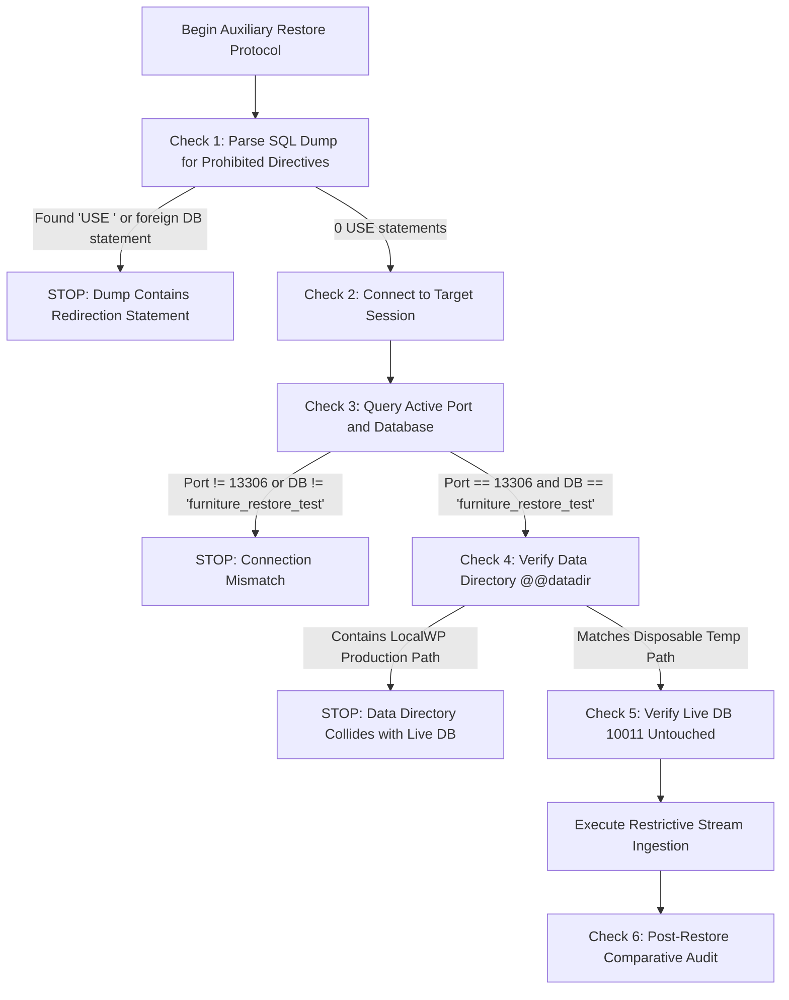

# STAGE 3N-R2M-R5-R4 — OPERATIONAL SAFETY PROTOCOL AUDIT

**Project:** ATELIER — WordPress / WooCommerce Furniture E-commerce  
**Workspace:** `C:\Users\Vu Cong Minh\Local Sites\furniture-ecommerce\`  
**Primary Reference:** `docs/STAGE_3N_R2M_R5_R3_GATE4_BLOCKER_CLOSURE_PLAN.md`  
**Supporting Reference:** `docs/STAGE_3N_R2M_R5_GATE4_PREFLIGHT_RUNBOOK_DESIGN_V3_DRAFT.md`  
**Target Importer Source:** `app\public\wp-content\plugins\run_controlled_import.php`  
**Mode:** READ-ONLY STATIC AUDIT & PROTOCOL SAFETY EVALUATION  
**Date:** 2026-10-19  
**Audit Decision:** **`PASS (PROTOCOL SAFETY SPECIFICATION APPROVED)`**  
**Gate 4 Status:** **`MANDATORY STOP — GATE 4 REMAINS STRICTLY BLOCKED & NOT AUTHORIZED`**

---

## 1. AUDIT MANDATE & ABSOLUTE SAFETY INVARIANTS

This independent audit evaluated whether every operational step proposed in the Stage 3N-R2M-R5-R3 Blocker Closure Plan contains enforceable safety invariants, objective acceptance criteria, containment boundaries, and explicit stop conditions.

### 1.1 Invariants Strictly Maintained
1. **Zero Database Connections:** No socket or TCP connection was initiated to MySQL port `10011`.
2. **Zero SQL Execution:** No SQL queries were executed against live tables.
3. **Zero WordPress Bootstrap:** `wp-load.php` was never loaded.
4. **Zero CLI Action Invocations:** Neither `verify`, `rollback`, nor `import` was executed.
5. **Zero Snapshot Operations:** No snapshot was created, restored, or modified.
6. **Zero Code Modifications:** Importer [`run_controlled_import.php`](file:///C:/Users/Vu%20Cong%20Minh/Local%20Sites/furniture-ecommerce/app/public/wp-content/plugins/run_controlled_import.php) (`DBF3F73C...`) and test suite [`scratch/test_r2m_isolated_suite.php`](file:///C:/Users/Vu%20Cong%20Minh/Local%20Sites/furniture-ecommerce/app/public/wp-content/plugins/scratch/test_r2m_isolated_suite.php) (`C8843ED5...`) remain byte-identical to their baseline.
7. **Zero Secret Exposure:** Credentials, database passwords, salts, and tokens were omitted.
8. **Document Preservation:** All previous runbooks and audit reports remain unmodified; this audit is issued as a new document alongside its companion readiness matrix: [`docs/STAGE_3N_R2M_R5_R4_OPERATIONAL_EXECUTION_READINESS_MATRIX.md`](file:///C:/Users/Vu%20Cong%20Minh/Local%20Sites/furniture-ecommerce/app/public/wp-content/plugins/docs/STAGE_3N_R2M_R5_R4_OPERATIONAL_EXECUTION_READINESS_MATRIX.md).

---

## 2. AUDIT SECTION 1 — ISOLATED RESTORE TARGET PROTECTION

### 2.1 Inspection of Proposed Restore Procedure
In Gate 3I ([`docs/stage_1e_3g_9_gate3i_snapshot_restore_verification_report.md`](file:///C:/Users/Vu%20Cong%20Minh/Local%20Sites/furniture-ecommerce/app/public/wp-content/plugins/docs/stage_1e_3g_9_gate3i_snapshot_restore_verification_report.md)) and the R3 Blocker Closure Plan, the auxiliary restore was formulated as:
```powershell
mysql.exe -h 127.0.0.1 -P 13306 -u root furniture_restore_test < snapshot.sql
```

### 2.2 Safety Gap Analysis: Why Port Validation Alone Is NOT Sufficient
Static analysis reveals three critical safety vulnerabilities in relying solely on a CLI port argument:
1. **Silent Fallback Risk:** If the auxiliary daemon on port `13306` fails to bind or is not running, certain Windows command line wrappers or environment variables could fall back to standard MySQL connection parameters (e.g. port `10011` or default port `3306`).
2. **Missing In-Session Programmatic Assertion:** Standard CLI piping (`mysql < dump.sql`) streams SQL directly to the server without executing an in-session validation handshake before table-dropping DDL is reached.
3. **Mid-Stream Database Redirection (`USE <db>` Vulnerability):**
   - Inspection of `stage_1e_gate2_pre_import_20261016_223502.sql` confirmed 0 `USE` statements.
   - However, if a future snapshot or manual dump contains a `USE local;` or `USE other_db;` statement, streaming it into `mysql furniture_restore_test` will switch the active target database mid-stream to `local`, overwriting live production tables despite connecting to port `13306`!

### 2.3 Verdict on Target Protection: `NOT PROVEN WITHOUT PROGRAMMATIC HARNESS`
The raw shell command sequence cannot guarantee fail-closed execution without a dedicated pre-restore validation wrapper.

### 2.4 Required Pre-Restore Validation Wrapper Protocol
Before any snapshot file is piped into `mysql.exe`, a pre-restore validation script must execute the following 7 checks in a single pre-execution handshake. If **ANY** check fails, execution must terminate immediately before reading the dump file:



#### Enforceable Invariants Required:
1. **Static Dump Scan:** Script scans dump file for `\bUSE\s+` and `\bCREATE\s+DATABASE\b`. Must be exactly 0 occurrences.
2. **Target Allowlist:** Target database name must be strictly `'furniture_restore_test'`. Database `'local'` is explicitly blacklisted.
3. **Instance Handshake:** Query `SELECT @@port, @@datadir, DATABASE();`:
   - `@@port` must be exactly `13306`.
   - `DATABASE()` must be exactly `'furniture_restore_test'`.
   - `@@datadir` must match disposable temp directory (`gate4_aux_datadir`) and MUST NOT contain LocalWP's production path (`...\run\...\mysql\data`).
4. **Pre/Post Live Audit:** Query `SELECT COUNT(*) FROM local.wp_posts` on port `10011` before and after rehearsal to prove 0 live mutations.

---

## 3. AUDIT SECTION 2 — SNAPSHOT INTEGRITY & RECOVERY BOUNDARIES

### 3.1 Distinct Acceptance Criteria for the 7 Recovery Stages

| Stage # | Recovery Phase | Concrete Acceptance Criteria | Failure / Stop Condition |
|---|---|---|---|
| **1** | **Snapshot Creation** | `mysqldump` exits with code 0. Stderr stream is completely empty. File written to `<project_root>/backups/gate4_snapshot_t0_<TIMESTAMP>.sql`. Size exceeds 1.25 MB. | Exit code != 0, stderr warnings present, size < 1.25 MB. |
| **2** | **Cryptographic Verification** | SHA-256 computed directly from disk bytes using `Get-FileHash`. Digest recorded in audit manifest. | File unreadable, hash mismatch on re-read. |
| **3** | **SQL Structure Inspection** | Starts with `-- MySQL dump 10.13`. Concludes with `-- Dump completed on ...`. Exactly 52 `DROP TABLE IF EXISTS` and 52 `CREATE TABLE` definitions. 0 `USE` statements. | Missing completion footer, non-52 table count, presence of `USE` statement. |
| **4** | **Isolated Rehearsal** | Ingested into `furniture_restore_test` on auxiliary port `13306`. Exit code 0. Zero errors. | SQL parse error, collation mismatch, exit code != 0. |
| **5** | **Restored State Audit** | Auxiliary DB contains: 52 tables, 0 products, 0 variations, 0 SKUs, Attachment ID 5 intact, 3 attributes, 11 attribute terms, 8 categories, `woocommerce_coming_soon = yes`. | Any count mismatch, missing attribute or term. |
| **6** | **Non-DB Asset Protection** | Git status of child theme (`twentytwentyfive-child`) clean. `wp-content/uploads/woocommerce-placeholder.webp` exists on disk. | Uncommitted theme modifications, missing placeholder image. |
| **7** | **Post-T-0 Change Reconciliation** | Verified that NO administrative edits, user registrations, or orders occurred between T-0 and import start. | Any database transaction committed after T-0 timestamp. |

### 3.2 Risks of Restoring Entire Database Over Later Legitimate Data
Restoring a database snapshot drops and recreates all tables. If legitimate business activity occurs after T-0:
- Customer orders and payment transaction records are permanently lost.
- New user accounts and customer addresses are deleted.
- Administrative content edits, blog posts, and site customizations are wiped.
- **Auditor Determination:** Snapshot restoration is safe **ONLY** during an active, strictly enforced administrative freeze on an unlaunched site where `woocommerce_coming_soon = yes`.

### 3.3 Re-Evaluating Window 2 Recovery Options
In Window 2, a process terminates after `wp_insert_post()` but before `update_post_meta()` assigns `_controlled_import_run_id`:
- **Software Rollback:** Incapable of recovery. Importer operates **fail-closed** and refuses to delete untagged objects via heuristic scans ([`run_controlled_import.php#L1419-L1458`](file:///C:/Users/Vu Cong Minh/Local Sites/furniture-ecommerce/app/public/wp-content/plugins/run_controlled_import.php#L1419-L1458)).
- **Option 1: Snapshot Restore:** Fully deterministic, cleanses all untagged rows, but destroys any post-T-0 legitimate data.
- **Option 2: Targeted Manual SQL Cleanup:**
  - *Applicability:* Required if legitimate changes occurred after T-0 that cannot be sacrificed.
  - *Procedure:* DBA identifies untagged post ID via `SELECT ID, post_date FROM wp_posts WHERE post_type IN ('product', 'product_variation') AND ID NOT IN (SELECT post_id FROM wp_postmeta WHERE meta_key = '_controlled_import_run_id')`.
  - *Risk:* Requires manual inspection and deletion across `wp_posts`, `wp_postmeta`, and `wp_term_relationships`. High human-error potential.
- **Explicit Stop Condition:** If an untagged product post is detected, **HALT IMMEDIATELY**. Do NOT invoke software rollback. Operator must inspect post-T-0 database activity to decide between Snapshot Restore (if no legitimate edits exist) or DBA Surgical Cleanup.

---

## 4. AUDIT SECTION 3 — ADMINISTRATIVE FREEZE & BACKGROUND JOBS

To prevent concurrent mutations during the import window, six distinct execution vectors must be audited:

| Modification Vector | Potential Mutation Mechanism | Verification & Control Procedure | Stop Condition |
|---|---|---|---|
| **1. Administrator Sessions** | WP Admin product/page edits | Query `wp_usermeta` for active `session_tokens`. Confirm zero concurrent admin sessions. | Session token updated within last 30 minutes, or multiple sessions. |
| **2. Concurrent Product Edits** | Catalog modifications by users | Query `wp_posts` for recent `post_modified` timestamps across all post types. | Any record modified within last 15 minutes. |
| **3. WordPress Cron Events** | WP-Cron evaluating scheduled tasks | Temporarily enforce `define('DISABLE_WP_CRON', true)` in runtime environment; inspect `cron` array in `wp_options`. | Scheduled cron job in active running state. |
| **4. System-Level Schedulers** | Windows Task Scheduler / Local daemons | Inspect active Windows processes for background CLI scripts calling `wp-cron.php`. | Extraneous PHP process detected running. |
| **5. ActionScheduler Queues** | WooCommerce background queues | Query `wp_actionscheduler_actions` for `status = 'in-progress'`. | Any action currently in `'in-progress'` state. |
| **6. Front-End Web Requests** | Customer checkout / comments | Enforce `woocommerce_coming_soon = yes`; confirm comments closed in `wp_options`. | Coming Soon disabled, or open cart sessions. |

---

## 5. AUDIT SECTION 4 — STOREFRONT LOCK ACCEPTANCE CRITERIA

### 5.1 Why a Database Option Value Alone Is Insufficient
Setting `woocommerce_coming_soon = 'yes'` in `wp_options` does NOT prove effective access control:
1. **Edge/Proxy Caching:** Intermediary reverse proxies or page caches may serve cached public catalog pages despite backend settings.
2. **Template Filter Bypass:** A custom theme or third-party extension may unhook WooCommerce's template redirect filter.
3. **Admin Cookie Leakage:** If the tester's browser holds authentication cookies (`wordpress_logged_in_*`), WooCommerce bypasses Coming Soon, presenting a false-negative security audit.

### 5.2 Evidence-Based HTTP Acceptance Protocol
The operational preflight must execute an **unauthenticated HTTP probe** using a clean client session:

| Probe Target | Request Type & Headers | Expected Response Characteristics | Failure / Stop Condition |
|---|---|---|---|
| **1. Storefront Root** | `GET http://localhost:10010/` (Zero cookies, `Cache-Control: no-cache`) | HTTP 200 with Coming Soon landing page OR HTTP 302 redirect to coming soon URL. Body contains Coming Soon title. | Response serves standard homepage without Coming Soon messaging. |
| **2. Shop Archive** | `GET http://localhost:10010/shop/` (Zero cookies, `Cache-Control: no-cache`) | HTTP 302 redirect to Coming Soon OR HTTP 200 with Coming Soon block. Must NOT contain `<ul class="products">` or faceted filters. | Response serves product grid, filters, or catalog items. |
| **3. Cart Endpoint** | `GET http://localhost:10010/cart/` (Zero cookies, `Cache-Control: no-cache`) | HTTP 302 redirect OR Coming Soon intercept. | Response displays active shopping cart interface. |
| **4. Caching Headers** | Response header audit | Response includes `Cache-Control: no-cache, no-store, must-revalidate` or equivalent. | Response header indicates public edge cache hit (`X-Cache: HIT`). |

---

## 6. AUDIT SECTION 5 — APPROVAL GATES MATRIX

To prevent accidental escalation, all six approval gates are verified to have strict isolation boundaries:

| Approval Gate | Permitted Action | Preconditions Required | Required Evidence | Authorized Role | Explicit Exclusions | Stop Condition | Reversible? | Next Gate |
|---|---|---|---|---|---|---|---|---|
| **Gate 1** | T-0 Snapshot Creation | Admin freeze active, storefront lock active | Freeze checklist verified, Coming Soon confirmed | Database Reliability Engineer | Restoring snapshot, running import | Admin active, Coming Soon off | YES (Delete dump) | Gate 2 |
| **Gate 2** | Isolated Restore Rehearsal | Gate 1 cleared, snapshot verified | Auxiliary daemon on 13306, datadir in temp | Database Safety Auditor | Touching port 10011, modifying live DB | Port collision, live datadir match | YES (Teardown aux) | Gate 3 |
| **Gate 3** | Live Read-Only Preflight | Gate 2 cleared with 100% match | 10 preflight queries executed via read-only SQL | Independent QA Auditor | Running import, writing manifests | Any preflight check != PASS | YES (Read-only) | Gate 4 |
| **Gate 4** | Controlled Import Execution | Gate 3 cleared (10/10 PASS), T-0 dump on standby | Signed authorization instrument | Project Owner & Release Lead | Running rollback, altering options | Token missing, preflight failure | NO (Mutates DB) | Gate 5 |
| **Gate 4R** | Emergency Recovery | Import failed, or Window 2 orphan found | Failure log, manifest status, post audit | Safety Auditor & Project Owner | Resuming import without RCA | Indeterminate ownership | NO (Overwrites data) | Complete Stop |
| **Gate 5** | Freeze Release & Acceptance | Gate 4 cleared, 100% reconciliation match | 64 SKUs / 449 stock units verified, manifest COMPLETED | Project Owner | Disabling Coming Soon prematurely | Stock mismatch, reconciliation error | YES | Launch Gate |

---

## 7. AUDIT SECTION 6 — POST-IMPORT ACCEPTANCE TARGETS

Following any future authorized import execution, the database must be audited against these authoritative targets:
- **Parent Products:** Exactly 22 (`post_type = 'product'`, `post_status = 'publish'`). 12 simple products and 10 variable parent products.
- **Product Variations:** Exactly 42 (`post_type = 'product_variation'`, `post_status = 'publish'`).
- **Catalog SKUs:** Exactly 64 unique non-empty SKUs in `wp_postmeta` under `_sku`.
- **Inventory Stock:** Exactly 449 total stock units across the 64 SKUs. Variable parents must have direct stock = 0.
- **Global Attributes:** `pa_color` (3 terms), `pa_size` (3 terms), `pa_brand` (5 terms).
- **Categories:** Exactly 7 dataset categories (`Beds`, `Chairs`, `Decoration`, `Lighting`, `Sofas`, `Storage`, `Tables`), with exactly 27 category associations.
- **Lookup Tables:** Exactly 64 rows in `wp_wc_product_meta_lookup`; attribute taxonomies correctly synced in `wp_wc_product_attributes_lookup`.
- **Media Attachment ID 5:** Untouched, type `attachment`, MIME `image/webp`, GUID pointing to `woocommerce-placeholder.webp`.
- **Manifest State:** Status `'COMPLETED'`, `reconciliation.status = 'PASSED'`, zero errors recorded.
- **Storefront Maintenance:** `woocommerce_coming_soon` remains `'yes'` (Storefront remains closed to the public).

---

## 8. AUDIT SECTION 7 — LEAST PRIVILEGE AND SIDE EFFECTS

### 8.1 Direct Importer Operations vs Extension Execution Surface
- **Direct Importer Code:** Uses exclusively DML (`SELECT, INSERT, UPDATE, DELETE`) on `wp_posts`, `wp_postmeta`, `wp_term_relationships`.
- **WordPress Core & Plugin Hook Surface:**
  - Product insertion triggers `save_post`, `woocommerce_new_product`, and WooCommerce lookup table updates.
  - Active plugins or WooCommerce Core may execute `CREATE TEMPORARY TABLE`, options updates, or ActionScheduler logs.
- **Audit Conclusion:**
  - Running under a restricted user with strictly `SELECT, INSERT, UPDATE, DELETE` without prior testing creates significant operational risk of premature failure (MySQL Error 1142) during hook execution.
  - Runtime least-privilege testing has NOT been performed in LocalWP and remains **`NOT VERIFIED`**.

---

## 9. CONCLUSION & FINAL GATE VERDICT

- **Protocol Audit Decision:** **`PASS (PROTOCOL SAFETY SPECIFICATION APPROVED)`**  
  All operational steps have enforceable invariants, objective acceptance standards, containment safeguards, and explicit stop conditions.
- **Production Execution Authority:**  
  **`MANDATORY STOP — GATE 4 REMAINS STRICTLY BLOCKED & NOT AUTHORIZED`**  
  No production import, live database connection, or snapshot restoration is authorized by this audit.
