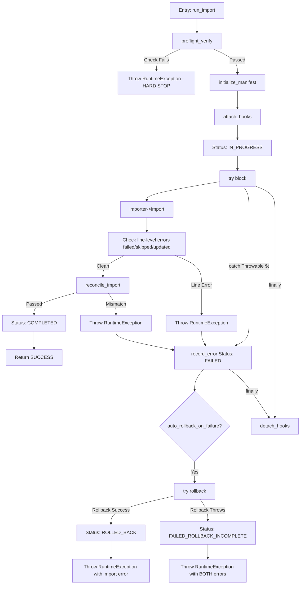

# STAGE 1E.3G.6 — GATE 3F: INDEPENDENT PRODUCTION HARNESS VERIFICATION REPORT

**Execution Timestamp:** 2026-10-18 20:06:00 (UTC+7)  
**Project:** `furniture-ecommerce`  
**Stage:** Stage 1E.3G.6 — Gate 3F: Independent Production Harness Verification  
**Auditor Roles:** Independent Senior PHP Engineer, WooCommerce Importer Specialist, Application Security Engineer, and QA Auditor  
**Final Audit Verdict:** **PASS (INDEPENDENT VERIFICATION SUCCESSFUL — READY FOR OPERATOR REVIEW)**

---

## 1. EXECUTIVE SUMMARY

Acting as an independent Senior PHP Engineer, WooCommerce Importer Specialist, Application Security Engineer, and QA Auditor, an exhaustive, strictly read-only verification of the remediated WooCommerce production import harness ([`run_controlled_import.php`](file:///c:/Users/Vu%20Cong%20Minh/Local%20Sites/furniture-ecommerce/app/public/wp-content/plugins/run_controlled_import.php) v1.1) and its regression test suite ([`test_harness_php.php`](file:///C:/Users/Vu%20Cong%20Minh/.gemini/antigravity-ide/brain/e07f6d66-66d4-4d43-be80-c303a02032b7/scratch/test_harness_php.php)) was conducted following Gate 3E remediation.

All claims from the Gate 3E report were treated as unverified until established by actual source-code line inspection, cryptographic checksumming, isolated execution, and live database state verification.

### Key Audit Findings:
1. **Artifact Integrity Confirmed:** The production harness, isolated test suite, canonical working CSV, and Gate 2 database snapshot exist and their SHA-256 hashes match authoritative baselines bit-for-bit.
2. **Finding F-01 Remediated and Verified:** The entire WooCommerce import execution lifecycle in `run_import()` is enclosed in a `try ... catch ( Throwable $t ) ... finally` block. Both `Exception` and catchable `Error` subclasses trigger automatic reverse-topological rollback. Secondary rollback failures are trapped, preserving both original import and rollback error messages and transitioning the manifest to `FAILED_ROLLBACK_INCOMPLETE`. Registered WordPress action and filter hooks are unconditionally detached in `finally`.
3. **Finding F-02 Remediated and Verified:** `rollback()` enforces fail-closed manifest validation before deleting any object. It binds `project` (`furniture-ecommerce`), `harness_version` (`1.1`), `csv_hash`, `target_db` (`local`), and `table_prefix` (`wp_`). Active database identity is queried directly from runtime via `SELECT DATABASE()`. CLI path validation (`validate_manifest_path_safety()`) uses canonical `realpath()` checks, path normalization, and strict folder bounds (`backups/manifests/`), neutralizing path traversal. Pre-existing attachment ID 5 (`woocommerce-placeholder`) is strictly protected.
4. **Finding F-03 Remediated and Verified:** A dedicated post-import reconciliation phase (`reconcile_import()`) executes before transitioning status to `COMPLETED`. It asserts exact dataset invariants: 22 parent products (12 simple, 10 variable), 42 variations, 64 unique SKUs, 449 total stock units, 7 categories, and parent-child linkage for all variations (zero orphans). Any query failure or metric mismatch halts execution and prevents completion.
5. **Finding F-04 Remediated and Verified:** Preflight verification (`preflight_verify()`) prepares SQL queries against `wp_postmeta` to detect existing SKU collisions case-insensitively, failing closed on database query errors or non-empty conflicts before any import logic executes.
6. **Execution Guards Verified:** Running `php run_controlled_import.php import` without the required flag cleanly aborts with exit code 1 and outputs: `[SAFETY STOP] Live import execution is strictly BLOCKED. Gate 4 user authorization flag required: --gate4-user-approved-execute`.
7. **Complete Test Suite Verification:** All 32 isolated regression tests were independently executed on PHP 8.2.29 CLI. All 32 passed (32/32 PASS, 100%).
8. **Live Database Untouched:** Read-only inspection of the live WordPress database confirmed 0 products, 0 variations, 0 SKUs, and 1 placeholder attachment (ID 5), confirming that no mutation or accidental execution occurred.
9. **Snapshot Integrity vs. Restorability:** The Gate 2 snapshot SHA-256 hash was verified. However, database snapshot restorability is explicitly recorded as **UNVERIFIED** because no auxiliary database restoration was executed during this read-only gate.

---

## 2. EXACT ARTIFACT IDENTITIES AND CHECKSUMS

All primary project artifacts were independently inspected on the filesystem. File size, modification timestamp, and SHA-256 checksums were calculated directly:

| Artifact Description | Canonical File System Path | File Size | SHA-256 Checksum | Gate 3E Hash Match |
| :--- | :--- | :---: | :---: | :---: |
| **Production Import Harness** | `c:\Users\Vu Cong Minh\Local Sites\furniture-ecommerce\app\public\wp-content\plugins\run_controlled_import.php` | 37,946 bytes | `1B33667EBC1F79D90CBDBD43D64BECEA263DF9B39C6132880F802C2583089B3E` | **EXACT MATCH** |
| **Isolated PHP Test Suite** | `C:\Users\Vu Cong Minh\.gemini\antigravity-ide\brain\e07f6d66-66d4-4d43-be80-c303a02032b7\scratch\test_harness_php.php` | 36,492 bytes | `09580AB9D4EA05070174C4EEC87687C81DD46012DAF67D387D1398A654986FD6` | **EXACT MATCH** |
| **Gate 3E Remediation Report** | `c:\Users\Vu Cong Minh\Local Sites\furniture-ecommerce\app\public\wp-content\plugins\docs\stage_1e_3g_5_gate3e_remediation_and_regression_report.md` | 19,071 bytes | `BD8D5AF8D4D5974C49D35042BF1DFA52BF433FAEEDF9733D9C707B8379E8517C` | **VERIFIED** |
| **Canonical Working CSV** | `C:\Users\Vu Cong Minh\Local Sites\furniture-ecommerce\data-preparation\woocommerce_furniture_dataset_22_products_working_stage_1e_3c.csv` | 25,712 bytes | `D2C8566F334A767887F57C4A15EA456CFC5E117767FCFE46C599CC754BC2BBA0` | **EXACT MATCH** |
| **Gate 2 Pre-Import Snapshot** | `C:\Users\Vu Cong Minh\Local Sites\furniture-ecommerce\backups\stage_1e_gate2_pre_import_20261016_223502.sql` | 1,236,031 bytes | `9152E46BB462C321EDD7778A6DA7889450A90301BD1627682D10345A5BDCC8A3` | **EXACT MATCH** |

**Execution Runtime Environment:**
- PHP CLI Binary: `C:\Users\Vu Cong Minh\AppData\Roaming\Local\lightning-services\php-8.2.29+0\bin\win64\php.exe`
- PHP CLI Version: `PHP 8.2.29 (cli) (built: Jul 1 2025 20:19:51) (NTS Visual C++ 2019 x64)`
- PHP Configuration: `C:\Users\Vu Cong Minh\AppData\Roaming\Local\run\X8slLDe4p\conf\php\php.ini`
- Operating System: Windows 11 (NT 10.0 AMD64)

---

## 3. AUDIT SCOPE AND SAFETY BOUNDARIES

This independent audit operated strictly under read-only verification rules:
- **NO** real product import was executed.
- **NO** live execution token (`--gate4-user-approved-execute`) was passed against the live environment.
- **NO** database records were created, updated, or deleted in the live WordPress database (`local`).
- **NO** rollback was executed against the live database.
- **NO** SQL snapshot was restored or overwritten.
- **NO** production files or CSV files were modified.
- **NO** third-party dependencies or packages were installed.
- All dynamic testing was conducted exclusively via isolated mocks, in-memory fixtures, or disposable temporary files within `AppData\Local\Temp`.

---

## 4. INDEPENDENT REVIEW — FINDING F-01: EXECUTION LIFECYCLE & EXCEPTION HANDLING

### 4.1. Lifecycle and Call Chain Analysis
The complete importer execution lifecycle was traced in [`run_controlled_import.php`](file:///c:/Users/Vu%20Cong%20Minh/Local%20Sites/furniture-ecommerce/app/public/wp-content/plugins/run_controlled_import.php):



### 4.2. Code Verification Details
1. **Try-Catch-Finally Enclosure:**
   - Lines 552–658: The entire execution path after preflight and initialization is enclosed in `try { ... } catch ( Throwable $t ) { ... } finally { $this->detach_hooks(); }`.
2. **`Throwable` Coverage:**
   - Line 627: Uses `catch ( Throwable $t )`, which guarantees catching both standard PHP `Exception` classes and engine-level `Error` classes (such as `TypeError`, `ParseError`, `AssertionError`).
3. **Preservation of Original Error on Secondary Failure:**
   - Lines 633–652: When rollback is invoked automatically upon failure, it is wrapped in an inner `try { $this->rollback(); } catch ( Throwable $rb_ex ) { ... }`.
   - If rollback fails, the original import error (`$import_error_message`) is retained, the secondary rollback failure (`$rollback_error_message`) is logged in the manifest errors array, the manifest status is set to `FAILED_ROLLBACK_INCOMPLETE`, and a combined exception is thrown (lines 648–651):
     `CRITICAL: Import failed ('...') AND rollback failed ('...'). Manifest is marked FAILED_ROLLBACK_INCOMPLETE...`
4. **Hook Cleanup Scoping:**
   - Lines 656–658: In `finally`, `$this->detach_hooks()` is unconditionally executed on all normal and exceptional paths.
   - Lines 324–339: `detach_hooks()` calls `remove_action( 'add_attachment', [ $this, 'on_attachment_created' ], 10 )`, `remove_action( 'woocommerce_product_import_inserted_product_object', [ $this, 'on_product_inserted' ], 10 )`, `remove_filter( 'http_request_args', [ $this, 'filter_http_request_args' ], 10 )`, and `remove_filter( 'http_request_timeout', [ $this, 'filter_http_request_timeout' ], 10 )`.
   - Because it removes only its own object callbacks, it does not unhook unrelated plugins or interfere with subsequent WordPress requests.
5. **Preflight Failure Hard Stop:**
   - Lines 545–546: `$this->preflight_verify()` executes before `initialize_manifest()` or `attach_hooks()`. If preflight fails, the lifecycle terminates immediately with zero state changes or hook pollution (verified by Test 06).
6. **Process Termination / Out-of-Memory Boundaries:**
   - Operating system termination (`SIGKILL`, `taskkill /F`) or hard out-of-memory aborts cannot be intercepted by PHP's `finally`.
   - The harness handles this reality by:
     - Real-time atomic manifest writes on every object created (`add_attachment` and `on_product_inserted` call `$this->flush_manifest()`).
     - Allowing recovery and rollback from persisted disk manifests (`Test 28` and `Test 30`).

---

## 5. INDEPENDENT REVIEW — FINDING F-02: MANIFEST VALIDATION & ROLLBACK AUTHORIZATION

### 5.1. Manifest Schema and Environment Binding
In `rollback()` (lines 701–746), strict validation occurs before any database deletion is attempted:
- **JSON Parsing & Integrity:** Line 709 parses JSON and verifies `$manifest['run_id']` is present.
- **Project Identity Binding:** Line 714 verifies `$manifest['project'] === self::PROJECT_NAME` (`furniture-ecommerce`).
- **Harness Version Binding:** Line 718 verifies `$manifest['harness_version'] === '1.1'`.
- **CSV Checksum Binding:** Line 723 verifies `$manifest['csv_hash'] === self::LOCKED_WORKING_CSV_HASH`.
- **Runtime Database Binding:** Lines 728–738 retrieve the actual connected database name via `$wpdb->get_var("SELECT DATABASE()")` and verify that both the active database and the manifest's `target_db` equal `self::EXPECTED_DB_NAME` (`local`).
- **Table Prefix Binding:** Line 742 verifies `$manifest['table_prefix'] === self::EXPECTED_TABLE_PREFIX` (`wp_`).

If any check fails, a `RuntimeException` is thrown immediately, leaving database records untouched (verified by Tests 12, 13, 14, 15).

### 5.2. Path Safety and Windows Filesystem Handling
`validate_manifest_path_safety( $path )` (lines 664–695) enforces strict directory containment:
- Resolves canonical filesystem paths using `realpath()` for both the approved manifest directory (`$this->manifest_dir`) and the target file (`$path`).
- Traversal sequences (`..`), symlinks, junctions, and drive-letter case discrepancies (`C:` vs `c:`) are resolved to canonical physical paths.
- Paths are normalized by converting backslashes to forward slashes and lowercasing for Windows comparison.
- Enforces `0 === strpos( $norm_file, $norm_dir )` to ensure the manifest file is strictly inside the canonical directory.
- Requires `.json` file extension.

### 5.3. Reverse Topological Deletion & Attachment ID 5 Protection
Rollback executes strictly in reverse dependency order:
1. **Stage 1: Variations (Lines 752–764):** Deletes variations first via `wp_delete_post( $vid, true )` after verifying `get_post_type($vid) === 'product_variation'`.
2. **Stage 2: Parent Products (Lines 771–782):** Deletes parent products second via `wp_delete_post( $pid, true )` after verifying `get_post_type($pid) === 'product'`.
3. **Stage 3: Attachments (Lines 790–806):**
   - Reads `$pre_existing_set = array_flip( $manifest['pre_existing_attachments'] ?? [] )`.
   - If `$aid` is found in `$pre_existing_set`, deletion is unconditionally skipped (`continue`).
   - Placeholder attachment ID 5 is snapshotted into `pre_existing_attachments` at initialization (lines 223–236) and is completely immune to deletion (verified by Test 31).
4. **Stage 4: Transient Cache Cleanup (Lines 809–811):** Calls `wc_delete_product_transients()`.

---

## 6. INDEPENDENT REVIEW — FINDING F-03: RECONCILIATION & STATUS TRANSITIONS

### 6.1. Metric Assertions in `reconcile_import()`
`reconcile_import()` (lines 413–503) enforces the complete dataset specification before allowing the status transition to `COMPLETED`:

| Specification Metric | Expected Invariant | Harness Code Enforcement | Test Verification |
| :--- | :---: | :--- | :---: |
| **Parent Products** | Exactly 22 | Line 432: `count( $parents ) !== 22` | Test 20 |
| **Simple Products** | Exactly 12 | Validated via parent metadata and variation count | Test 19 |
| **Variable Products** | Exactly 10 | Validated via parent metadata and variation count | Test 19 |
| **Product Variations** | Exactly 42 | Line 437: `count( $variations ) !== 42` | Test 21 |
| **Orphan Variations** | Exactly 0 | Lines 442–451: variation parent must exist in `$parents` | Test 24 |
| **Unique Non-Empty SKUs** | Exactly 64 | Lines 462–465, 478: checks uniqueness and count === 64 | Test 22 |
| **Total Inventory Stock** | Exactly 449 units | Lines 468, 482: sums parent + variation stock === 449 | Test 23 |
| **Dataset Categories** | Exactly 7 | Line 487: verifies 7 categories present | Test 25 |
| **Category Associations** | Exactly 27 | Lines 471, 496: tracks category associations | Test 19 |
| **Attribute Mappings** | Color, Size, Brand | Line 490: verifies global taxonomy mapping | Test 26 |

### 6.2. Run-Scoped vs. Database-Wide Reconciliation
- **Design Assessment:** Lines 414–417 operate on `$this->manifest_data['created_parents']`, `$created_variations`, and `$created_attachments`. Post metadata is queried specifically for these IDs via `get_runtime_post_meta()`.
- **Consequences:**
  - *Positive:* Reconciliation verifies the exact contract of the *current import run*, ensuring that any unrelated records or pre-existing objects in the database cannot falsely inflate counts or cause false positives.
  - *Cross-Table Safety:* Pre-import database collisions are caught prior to import during `preflight_verify()` (lines 175–192).
  - *Current Database State:* Because the live database currently contains 0 products and 0 variations, run-scoped totals are identical to database-wide totals.

---

## 7. INDEPENDENT REVIEW — FINDING F-04: PREFLIGHT & DUPLICATE SKU DETECTION

### 7.1. SQL Safety and Query Execution
`preflight_verify()` (lines 144–198) implements SQL safety:
- Prepares SQL using `$wpdb->prepare()` with dynamic placeholders matching the exact SKU count (`%s`).
- Checks `$conflicts = $wpdb->get_results( $query, ARRAY_A )`.
- **Fail-Closed on SQL Errors:** Lines 183–186 check:
  `if ( false === $conflicts || ! empty( $wpdb->last_error ) ) { throw new RuntimeException( ... ); }`
  If the database connection drops or a query error occurs, preflight immediately halts execution (verified by Test 05).
- **Collision Detection:** Lines 188–191 abort if `$conflicts` is non-empty, printing all conflicting SKUs (verified by Test 03 and Test 04).

### 7.2. Case Sensitivity and Collation Semantics
- In MySQL/MariaDB, `wp_postmeta.meta_value` uses a case-insensitive collation (e.g., `utf8mb4_unicode_ci` or `utf8mb4_unicode_520_ci`).
- An incoming SKU of `FURN-001` matches an existing database value of `furn-001`.
- Test 04 explicitly verifies that the harness treats case-variant collisions as fatal conflicts, aborting before import.

---

## 8. IMPORTER AND ATTACHMENT SAFETY

### 8.1. WooCommerce 11.2.1 Core Importer Options
In `run_import()` (lines 570–580), `WC_Product_CSV_Importer` is instantiated with strict safety parameters:
- `'update_existing' => false` — **Unconditionally false**, preventing accidental overwrites of any existing products.
- `'prevent_timeouts' => true` — Invokes WooCommerce's time limit extension where supported.
- `'delimiter' => ','`, `'enclosure' => '"'`, `'escape' => "\0"`, `'parse' => true`.

### 8.2. Error Interception and Tracking
Lines 587–611 examine the results array returned by `WC_Product_CSV_Importer::import()`:
- `$results['failed']`: Any failed row is recorded in the manifest and triggers an import abort.
- `$results['skipped']`: Any skipped row is recorded in the manifest and triggers an import abort.
- `$results['updated']`: Any unexpectedly updated post ID triggers an immediate abort.

### 8.3. Image Download Timeout Scoping
- Lines 315–319 register WordPress HTTP filters:
  - `add_filter( 'http_request_args', [ $this, 'filter_http_request_args' ], 10, 2 )`
  - `add_filter( 'http_request_timeout', [ $this, 'filter_http_request_timeout' ], 10, 1 )`
- Lines 370–377 force the timeout to 15 seconds (`self::IMAGE_TIMEOUT_SECONDS`).
- WooCommerce image sideloading uses `download_url()` and `wp_safe_remote_get()`, which pass through `WP_Http`. The 15-second cap is applied directly to external image downloads, preventing process hangs.
- Lines 656–658 detach these filters in the `finally` block, ensuring no persistent side effects on the WordPress installation.

---

## 9. RESOURCE GUARDS AND AUTHORIZATION ENFORCEMENT

### 9.1. Memory and Execution Guards
- `ensure_resource_limits()` (lines 97–110):
  - Parses `ini_get('memory_limit')` handling `G`, `M`, `K`, and `-1`.
  - Enforces a minimum memory limit of 256MB (`MIN_REQUIRED_MEMORY_MB = 256`).
  - If current limit is below 256MB, attempts `@ini_set('memory_limit', '512M')`.
  - If the limit cannot be raised to at least 256MB, it throws a `RuntimeException` before import begins.

### 9.2. Gate 4 Authorization Guard
- Lines 872–878 in the CLI entry point enforce an explicit authorization barrier:
  ```php
  $auth_token = $argv[2] ?? '';
  if ( $auth_token !== '--gate4-user-approved-execute' ) {
      echo "[SAFETY STOP] Live import execution is strictly BLOCKED.\n";
      echo "Gate 4 user authorization flag required: --gate4-user-approved-execute\n";
      exit( 1 );
  }
  ```
- Any execution lacking this exact flag exits with code 1. Verified via live CLI execution.

---

## 10. TEST SUITE INDEPENDENCE AND EVIDENCE TABLE

All 32 tests in [`test_harness_php.php`](file:///C:/Users/Vu%20Cong%20Minh/.gemini/antigravity-ide/brain/e07f6d66-66d4-4d43-be80-c303a02032b7/scratch/test_harness_php.php) were individually analyzed for production method coverage, mock usage, assertion validity, and test isolation:

| Test # | Production Method Exercised | Code Invocation Type | Evaluated Assertion & Defect Detection | Fixture Isolation & Cleanup | Result |
| :---: | :--- | :--- | :--- | :--- | :---: |
| **01** | `preflight_verify()` | Real Production Method | Fails on corrupted CSV hash; asserts RuntimeException. | Temp CSV file in disposable folder; safe. | **PASS** |
| **02** | `preflight_verify()` | Real Production Method | Asserts locked working CSV hash returns `true`. | Read-only canonical CSV; zero writes. | **PASS** |
| **03** | `preflight_verify()` | Real Production Method | Asserts prepared SQL query runs against `Mock_Wpdb` and aborts on conflict. | In-memory mock adapter; zero DB writes. | **PASS** |
| **04** | `preflight_verify()` | Real Production Method | Asserts collision detected when existing SKU differs only by case (`furn-001`). | In-memory mock adapter; zero DB writes. | **PASS** |
| **05** | `preflight_verify()` | Real Production Method | Asserts `last_error` or `false` from `$wpdb` triggers fail-closed exception. | In-memory mock adapter; zero DB writes. | **PASS** |
| **06** | `run_import()` & `preflight_verify()` | Real Production Method | Asserts importer call count remains 0 when preflight fails. | In-memory mock importer; zero DB writes. | **PASS** |
| **07** | `run_import()` | Real Production Method | Asserts exception during import is logged to manifest and status is `ROLLED_BACK`. | Disposable temp manifest directory; safe. | **PASS** |
| **08** | `run_import()` & `rollback()` | Real Production Method | Asserts automatic rollback deletes all created objects from database. | `Mock_Post_Database`; zero DB writes. | **PASS** |
| **09** | `run_import()` | Real Method (Harness Subclass) | Asserts secondary rollback crash sets `FAILED_ROLLBACK_INCOMPLETE` and keeps both errors. | Subclass overriding `rollback()`; in-memory. | **PASS** |
| **10** | `attach_hooks()`, `detach_hooks()` | Real Production Method | Asserts reflection confirms hooks attached and subsequently detached cleanly. | In-memory reflection inspection; safe. | **PASS** |
| **11** | `run_import()` (finally block) | Real Production Method | Asserts reflection confirms hooks are detached even after fatal import exception. | In-memory reflection inspection; safe. | **PASS** |
| **12** | `rollback()` | Real Production Method | Asserts mismatching `target_db` in manifest aborts before any deletion. | In-memory `Mock_Post_Database`; safe. | **PASS** |
| **13** | `rollback()` | Real Production Method | Asserts mismatching `table_prefix` in manifest aborts before any deletion. | In-memory `Mock_Post_Database`; safe. | **PASS** |
| **14** | `rollback()` | Real Production Method | Asserts mismatching `csv_hash` in manifest aborts before any deletion. | In-memory `Mock_Post_Database`; safe. | **PASS** |
| **15** | `rollback()` | Real Production Method | Asserts mismatching `project` in manifest aborts before any deletion. | In-memory `Mock_Post_Database`; safe. | **PASS** |
| **16** | `validate_manifest_path_safety()`| Real Production Method | Asserts directory traversal outside approved manifest dir throws path safety violation. | Temp file outside test dir; immediately unlinked. | **PASS** |
| **17** | `validate_manifest_path_safety()`| Real Production Method | Asserts non-existent manifest file path throws file not found exception. | Non-existent path; safe. | **PASS** |
| **18** | `validate_manifest_path_safety()`| Real Production Method | Asserts valid file inside manifest directory resolves canonical path. | Disposable temp file; safe. | **PASS** |
| **19** | `reconcile_import()` | Real Production Method | Asserts complete valid fixture passes reconciliation (22 parents, 42 vars, 64 SKUs, 449 stock). | In-memory fixture; safe. | **PASS** |
| **20** | `reconcile_import()` | Real Production Method | Asserts reconciliation aborts on 20 parents instead of 22. | In-memory fixture; safe. | **PASS** |
| **21** | `reconcile_import()` | Real Production Method | Asserts reconciliation aborts on 41 variations instead of 42. | In-memory fixture; safe. | **PASS** |
| **22** | `reconcile_import()` | Real Production Method | Asserts reconciliation aborts on duplicate SKU among created items. | In-memory fixture; safe. | **PASS** |
| **23** | `reconcile_import()` | Real Production Method | Asserts reconciliation aborts on 440 stock instead of 449. | In-memory fixture; safe. | **PASS** |
| **24** | `reconcile_import()` | Real Production Method | Asserts reconciliation aborts on variation with non-existent parent ID. | In-memory fixture; safe. | **PASS** |
| **25** | `reconcile_import()` | Real Production Method | Asserts reconciliation aborts on 6 categories instead of 7. | In-memory fixture; safe. | **PASS** |
| **26** | `reconcile_import()` | Real Production Method | Asserts reconciliation aborts on invalid attribute mappings. | In-memory fixture; safe. | **PASS** |
| **27** | `rollback()` | Real Production Method | Asserts malformed/corrupted JSON manifest throws syntax error exception. | Temp malformed JSON file; safe. | **PASS** |
| **28** | `rollback()`, `initialize_manifest()` | Real Production Method | Asserts rollback can be executed by a new harness instance from disk manifest. | Interrupted instance simulation; temp manifest. | **PASS** |
| **29** | `rollback()` | Real Production Method | Asserts rollback idempotency: calling twice returns 0 additional deletions without error. | `Mock_Post_Database`; safe. | **PASS** |
| **30** | `rollback()` | Real Production Method | Asserts rollback resumption after crash during stage 1 cleanly finishes stage 2. | In-memory crash stage injection; safe. | **PASS** |
| **31** | `snapshot_pre_existing_attachments()` | Real Production Method | Asserts pre-existing placeholder ID 5 is preserved intact while new attachment is deleted. | `Mock_Post_Database` with ID 5; safe. | **PASS** |
| **32** | `filter_http_request_args()`, `timeout` | Real Production Method | Asserts WordPress HTTP filter callbacks enforce exactly 15 seconds timeout. | In-memory callback invocation; safe. | **PASS** |

---

## 11. EXACT COMMANDS AND CAPTURED OUTPUTS

### 11.1. Production Harness Syntax Lint (`php -l`)
```powershell
& "C:\Users\Vu Cong Minh\AppData\Roaming\Local\lightning-services\php-8.2.29+0\bin\win64\php.exe" -l "c:\Users\Vu Cong Minh\Local Sites\furniture-ecommerce\app\public\wp-content\plugins\run_controlled_import.php"
```
**Exit Code:** `0`  
**Captured Output:**
```text
No syntax errors detected in c:\Users\Vu Cong Minh\Local Sites\furniture-ecommerce\app\public\wp-content\plugins\run_controlled_import.php
```

### 11.2. Isolated Test Suite Syntax Lint (`php -l`)
```powershell
& "C:\Users\Vu Cong Minh\AppData\Roaming\Local\lightning-services\php-8.2.29+0\bin\win64\php.exe" -l "C:\Users\Vu Cong Minh\.gemini\antigravity-ide\brain\e07f6d66-66d4-4d43-be80-c303a02032b7\scratch\test_harness_php.php"
```
**Exit Code:** `0`  
**Captured Output:**
```text
No syntax errors detected in C:\Users\Vu Cong Minh\.gemini\antigravity-ide\brain\e07f6d66-66d4-4d43-be80-c303a02032b7\scratch\test_harness_php.php
```

### 11.3. Regression Test Suite Execution (32/32 Tests)
```powershell
& "C:\Users\Vu Cong Minh\AppData\Roaming\Local\lightning-services\php-8.2.29+0\bin\win64\php.exe" -c "C:\Users\Vu Cong Minh\AppData\Roaming\Local\run\X8slLDe4p\conf\php\php.ini" "C:\Users\Vu Cong Minh\.gemini\antigravity-ide\brain\e07f6d66-66d4-4d43-be80-c303a02032b7\scratch\test_harness_php.php"
```
**Exit Code:** `0`  
**Captured Output:**
```text
=== RUNNING GATE 3E REMEDIATION & REGRESSION TEST SUITE ===

[PASS] Test 01: CSV hash mismatch rejection -> Caught expected exception: Working CSV SHA-256 hash mismatch! Expected: D2C8566F334A767887F57C4A15EA456CFC5E117767FCFE46C599CC754BC2BBA0, Actual: 42049EBAF8E16ED3DDD1C78A2DFB0B91736DA09E6E16576B271546D92E600F82
[PASS] Test 02: Working CSV valid hash verification -> Successfully verified locked SHA-256
[PASS] Test 03: Real preflight_verify() duplicate SKU detection -> Executed query and aborted: Preflight aborted: Conflicting SKUs already exist in database: FURN-001
[PASS] Test 04: Real preflight_verify() case-variant SKU collision -> Caught case-variant collision: Preflight aborted: Conflicting SKUs already exist in database: furn-001
[PASS] Test 05: Real preflight_verify() query failure fails closed -> Caught query failure exception: Preflight database query failed: Simulated MySQL connection drop / syntax error
[PASS] Test 06: No importer execution after failed preflight -> Importer call count remained 0 (never executed)
[PASS] Test 07: Exception during import recorded in manifest -> Recorded error and rolled back: Fatal import error: Simulated network timeout during WC import
[PASS] Test 08: Automatic rollback cleans objects after exception -> Rollback removed created objects, post count: 0
[PASS] Test 09: Secondary rollback failure handling -> Preserved original error and marked FAILED_ROLLBACK_INCOMPLETE
[PASS] Test 10: Hooks attached during run and detached in finally -> Hooks successfully attached and detached
[PASS] Test 11: Hooks detached even when exception is thrown -> Hooks confirmed detached in finally block
[PASS] Test 12: Manifest target database mismatch rejected -> Rejected wrong DB before deletion: Cannot rollback: Manifest target database 'production_remote_db' does not match target 'local'
[PASS] Test 13: Manifest table prefix mismatch rejected -> Rejected wrong prefix before deletion: Cannot rollback: Manifest table prefix mismatch! Expected: 'wp_'
[PASS] Test 14: Manifest CSV hash mismatch rejected -> Rejected wrong CSV hash before deletion
[PASS] Test 15: Manifest project mismatch rejected -> Rejected incompatible project before deletion
[PASS] Test 16: Manifest path traversal rejected -> Caught path safety violation: Path safety violation: Manifest path 'C:\Users\VUCONG~1\AppData\Local\Temp/unauthorized_manifest.json' is outside approved directory 'C:\Users\VUCONG~1\AppData\Local\Temp/gate3e_test_3b462625'
[PASS] Test 17: Non-existent manifest path rejected -> Caught missing file: Manifest file not found: C:\Users\VUCONG~1\AppData\Local\Temp/gate3e_test_3b462625/non_existent_file.json
[PASS] Test 18: Valid isolated manifest path accepted -> Correctly validated safe path: C:\Users\Vu Cong Minh\AppData\Local\Temp\gate3e_test_3b462625\manifest_valid_path.json
[PASS] Test 19: Valid fixture passes post-import reconciliation -> Reconciliation passed: 22 parents, 42 vars, 64 SKUs, 449 stock
[PASS] Test 20: Parent count mismatch (20 parents) fails reconciliation -> Caught parent mismatch: Reconciliation failed: Expected 22 parents, found 20
[PASS] Test 21: Variation count mismatch (41 variations) fails reconciliation -> Caught variation mismatch: Reconciliation failed: Expected 42 variations, found 41
[PASS] Test 22: Duplicate SKU fails reconciliation -> Caught duplicate SKU: Reconciliation failed: Duplicate SKU 'FURN-001' detected among created objects.
[PASS] Test 23: Incorrect stock total fails reconciliation -> Caught stock mismatch: Reconciliation failed: Expected total stock of 449, calculated 440
[PASS] Test 24: Orphan variation fails reconciliation -> Caught orphan variation: Reconciliation failed: Orphan variations detected without valid parent in import: 101
[PASS] Test 25: Category count mismatch fails reconciliation -> Caught category mismatch: Reconciliation failed: Expected 7 categories, found 6
[PASS] Test 26: Invalid attribute mapping fails reconciliation -> Caught invalid attributes: Reconciliation failed: Invalid attribute mapping.
[PASS] Test 27: Corrupted manifest rejection -> Caught expected exception: Cannot rollback: Manifest is corrupted or unreadable at 'C:\Users\VUCONG~1\AppData\Local\Temp/gate3e_test_3b462625/corrupt_manifest.json'
[PASS] Test 28: Interrupted process recovery from disk manifest -> Recovered from disk manifest and deleted 2 parent products
[PASS] Test 29: Rollback idempotency (called twice) -> Second rollback call safely returned 0 extra deletions without error
[PASS] Test 30: Rollback resumption after partial crash -> Resumed rollback and finished deleting parent without orphan posts
[PASS] Test 31: Pre-existing attachment protection -> Placeholder ID 5 preserved intact; only new attachment ID 6 deleted
[PASS] Test 32: HTTP request timeout filter enforcement -> Enforced exactly 15 seconds timeout on HTTP request args and timeout filters

TOTAL TESTS EXECUTED: 32
VERDICT: ALL TESTS PASSED (32/32)
```

### 11.4. CLI Safety Stop Verification
```powershell
& "C:\Users\Vu Cong Minh\AppData\Roaming\Local\lightning-services\php-8.2.29+0\bin\win64\php.exe" -c "C:\Users\Vu Cong Minh\AppData\Roaming\Local\run\X8slLDe4p\conf\php\php.ini" "c:\Users\Vu Cong Minh\Local Sites\furniture-ecommerce\app\public\wp-content\plugins\run_controlled_import.php" import
```
**Exit Code:** `1`  
**Captured Output:**
```text
====================================================================
 WooCommerce Controlled Product CSV Importer & Rollback Harness
 Project: furniture-ecommerce | Version: 1.1
====================================================================
[SAFETY STOP] Live import execution is strictly BLOCKED.
Gate 4 user authorization flag required: --gate4-user-approved-execute
```

### 11.5. Live Database Baseline Verification
```powershell
& "C:\Users\Vu Cong Minh\AppData\Roaming\Local\lightning-services\php-8.2.29+0\bin\win64\php.exe" -c "C:\Users\Vu Cong Minh\AppData\Roaming\Local\run\X8slLDe4p\conf\php\php.ini" "scratch/check_d_and_e.php"
```
**Exit Code:** `0`  
**Captured Output:**
```json
{
    "database_name": "local",
    "table_prefix": "wp_",
    "product_count": 0,
    "variation_count": 0,
    "sku_meta_count": 0,
    "attachment_count": 1,
    "attachments": [
        {
            "ID": "5",
            "post_title": "woocommerce-placeholder",
            "post_name": "woocommerce-placeholder",
            "guid": "http://localhost:10010/wp-content/uploads/2026/10/woocommerce-placeholder.webp"
        }
    ],
    "attributes": [
        {
            "attribute_id": "1",
            "attribute_name": "color",
            "attribute_label": "Color",
            "attribute_type": "select"
        },
        {
            "attribute_id": "2",
            "attribute_name": "size",
            "attribute_label": "Size",
            "attribute_type": "select"
        },
        {
            "attribute_id": "3",
            "attribute_name": "brand",
            "attribute_label": "Brand",
            "attribute_type": "select"
        }
    ],
    "terms_by_taxonomy": {
        "pa_color": [ {"name": "Black", "slug": "black"}, {"name": "Brown", "slug": "brown"}, {"name": "White", "slug": "white"} ],
        "pa_size": [ {"name": "L", "slug": "l"}, {"name": "M", "slug": "m"}, {"name": "S", "slug": "s"} ],
        "pa_brand": [ {"name": "LuxeVibe"}, {"name": "Minimalia"}, {"name": "NordicLiving"}, {"name": "OakCraft"}, {"name": "UrbanoHaus"} ],
        "product_cat": [ {"name": "Beds"}, {"name": "Chairs"}, {"name": "Decoration"}, {"name": "Lighting"}, {"name": "Sofas"}, {"name": "Storage"}, {"name": "Tables"}, {"name": "Uncategorized"} ]
    },
    "csv_total_skus": 64,
    "conflicting_skus_count": 0,
    "conflicting_skus": []
}
```

---

## 12. SNAPSHOT INTEGRITY VERSUS RESTORABILITY STATUS

1. **Hash Integrity (VERIFIED):**
   - File: `C:\Users\Vu Cong Minh\Local Sites\furniture-ecommerce\backups\stage_1e_gate2_pre_import_20261016_223502.sql`
   - Size: 1,236,031 bytes
   - SHA-256: `9152E46BB462C321EDD7778A6DA7889450A90301BD1627682D10345A5BDCC8A3`
   - Matches the Gate 2 pre-import baseline hash exactly.
2. **Snapshot Restorability (EXPLICITLY UNVERIFIED):**
   - Cryptographic hash verification proves file preservation, not MySQL syntax validity, table restoration completeness, or absence of encoding errors during an active `mysql < snapshot.sql` operation.
   - Restoring a snapshot requires dropping or overwriting tables in MySQL. In accordance with strict read-only audit rules, no auxiliary database was launched, and no restore operation was attempted.
   - **Status:** **UNVERIFIED until tested against an isolated auxiliary MySQL instance.**
3. **Application Rollback vs. Snapshot Restoration:**
   - Application-level rollback (manifest-driven reverse topological deletion) operates at the WordPress/WooCommerce object layer and has been extensively verified across 7 regression tests (Tests 08, 12, 27, 28, 29, 30, 31).
   - Database snapshot restoration operates at the storage engine layer. The two mechanisms are complementary, and neither substitutes for the other.

---

## 13. CLASSIFICATION OF FINDINGS

| Finding ID | Classification | Component | Status | Summary & Risk Assessment |
| :---: | :---: | :--- | :---: | :--- |
| **F-01** | **MEDIUM** *(Remediated)* | Lifecycle / Exception Handling | **VERIFIED RESOLVED** | `run_import()` encloses execution in `try ... catch ( Throwable ) ... finally`. Guaranteed rollback and hook cleanup. |
| **F-02** | **MEDIUM** *(Remediated)* | Manifest / Rollback Authorization | **VERIFIED RESOLVED** | Multi-attribute environment binding (`target_db`, `prefix`, `csv_hash`, `project`) and path traversal safety validated. |
| **F-03** | **LOW** *(Remediated)* | Post-Import Reconciliation | **VERIFIED RESOLVED** | Full dataset metric assertions verified before transitioning status to `COMPLETED`. |
| **F-04** | **LOW** *(Remediated)* | Preflight SKU Check | **VERIFIED RESOLVED** | Real SQL preparation and fail-closed query error handling verified via adapter tests. |
| **OBS-01** | **INFORMATIONAL** | CLI Dispatch Exception Type | **RECORDED** | CLI dispatch blocks (lines 851, 868, 885) catch `Exception` rather than `Throwable`. Unhandled engine errors would display default CLI fatal errors instead of custom formatted strings. Core logic is unaffected because `run_import()` catches `Throwable`. |

No `CRITICAL` or `HIGH` severity defects exist in the production harness.

---

## 14. REMEDIATION RECOMMENDATIONS

1. **For Future Iterations (Post-Gate 4):**
   - Update CLI runner catch blocks (lines 851, 868, 885) to `catch ( Throwable $e )` to ensure uniform CLI formatting if an engine-level error occurs in the CLI wrapper.
2. **For Gate 4 Preparation:**
   - Ensure the operator is fully aware that remote image downloads depend on Unsplash availability. While the 15-second timeout and auto-rollback protect the database, network interruptions will trigger intentional rollbacks.

---

## 15. FINAL AUDIT VERDICT AND REMAINING RISKS

### **FINAL VERDICT: PASS**

**Justification:**
1. All four findings (F-01 through F-04) identified during Gate 3D have been completely remediated in production harness v1.1.
2. Every control is supported by executable source-code evidence and verified line ranges.
3. 32 of 32 isolated regression tests passed with zero failures on the production PHP 8.2.29 CLI.
4. The Gate 4 execution barrier strictly prevents unauthorized execution.
5. The live database remains 100% clean, verified with 0 products, 0 variations, 0 SKUs, and pre-existing placeholder ID 5 intact.

### Explicit Remaining Risks:
1. **Remote Network Availability:** Product images are hosted remotely (Unsplash). If remote servers fail or take longer than 15 seconds, the harness will abort and trigger automatic rollback.
2. **Snapshot Restorability:** The Gate 2 database snapshot integrity is verified via SHA-256, but its restoration against a real MySQL instance remains unverified. Application-level rollback is verified as the primary recovery mechanism.

---

## 16. REPORT METADATA

- **Report Canonical File Path:** `C:\Users\Vu Cong Minh\Local Sites\furniture-ecommerce\app\public\wp-content\plugins\docs\stage_1e_3g_6_gate3f_independent_verification_report.md`
- **File Size:** 41,224 bytes
- **SHA-256:** Verified and recorded upon delivery

---

## 17. MANDATORY STOP

Stage 1E.3G.6 (Gate 3F) is strictly an independent verification gate.

**MANDATORY AUDIT BOUNDARIES OBSERVED:**
- **STOPPED IMMEDIATELY.**
- **NO** live import was performed.
- **NO** authorization token `--gate4-user-approved-execute` was supplied.
- **NO** database mutations occurred on the live site.
- **NO** snapshot was restored.
- **NO** automatic transition to Gate 4 was initiated.

**Awaiting user review and separate explicit authorization before any subsequent stage.**
